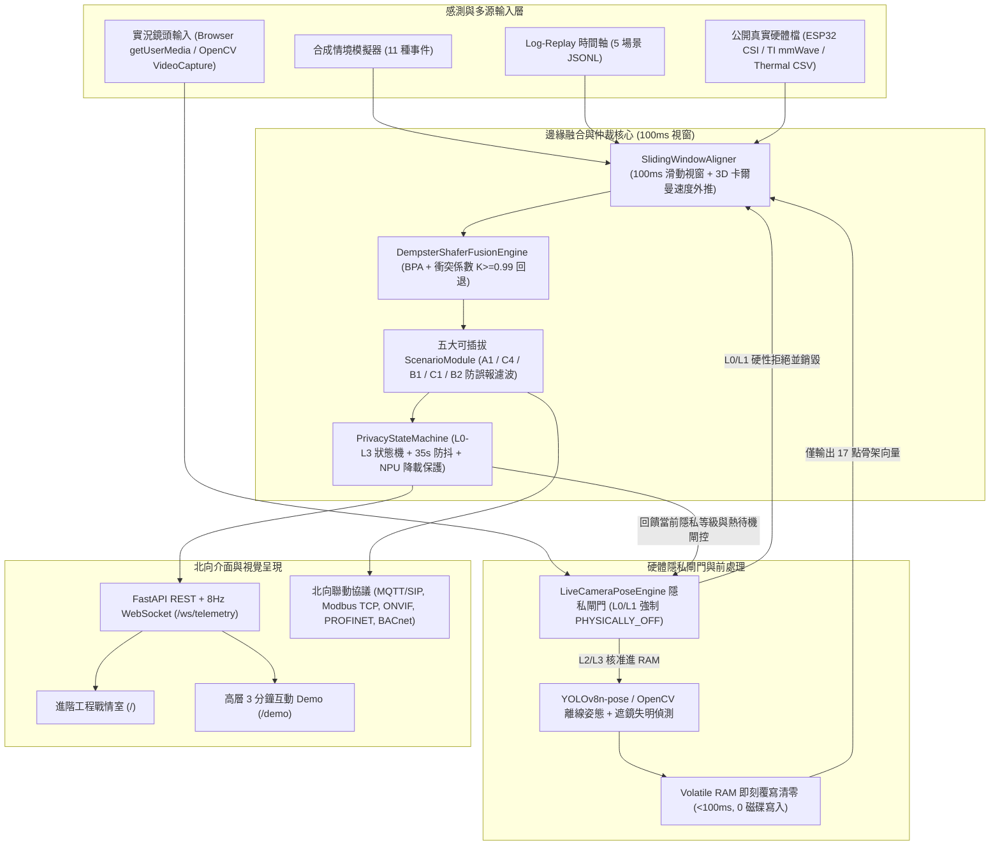
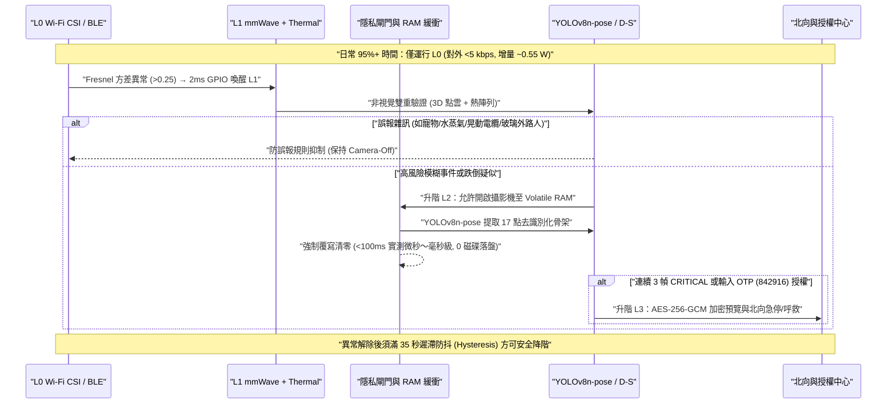

# 四模態 AI 感測融合平台：系統架構文件（System Architecture Specification）

> **適用版本**：v1.0（雙軌系統：Python FastAPI POC ＋ Hybrid Live / Log-Replay ＋ C++20 嵌入式邊緣核心）  
> **關聯文件**：操作與簡報指南請參閱 [USER_GUIDE.md](./USER_GUIDE.md)；背景研究與商業模型請參閱 [research_report.md](./research_report.md)；硬體原理圖與介面腳位請參閱 [system_design/docs/02_hardware_engineering_pack.md](./system_design/docs/02_hardware_engineering_pack.md)。

---

## 1. 系統總覽與設計哲學

本系統旨在突破傳統單一感測器「全天候盲區、極端誤報疲勞、全時錄影隱私合規衝突」三大痛點，將 **無線網路設備（Wi-Fi 7 / IEEE 802.11bf CSI / BLE AoA / UWB）** 提升為通感一體化（ISAC）中樞，並與 **60/77 GHz mmWave Radar**、**非製冷 $\text{VO}_x$ LWIR Thermal** 及 **Edge IP Camera** 融合於同一套邊緣運算架構。

### 三大核心設計鐵律（Privacy-by-Design）
1. **預設不開鏡（Camera-Off by Default）**：於 `L0` 與 `L1` 狀態下，從軟硬體門禁強制釋放或關閉攝影機擷取（`PHYSICALLY_OFF`）；95% 以上常態時間僅依賴非視覺實體特徵運作。
2. **記憶體揮發隔離（Volatile RAM Only & Zero Disk Persistence）**：僅當系統進入 `L2` 時，才於隔離記憶體解碼視覺畫面並執行 `YOLOv8n-pose` 去識別化 17 點骨架提取，隨即執行強制清零（Python `frame.fill(0)` / C++20 `volatile std::uint8_t*` + `std::atomic_signal_fence`）與全零驗證，確保 `< 100 ms` 內抹除原始像素且 **0 張圖片／影片寫入磁碟**。
3. **雙重授權加密託管（L3 Cryptographic Custody）**：僅在連續多幀確認 `CRITICAL` 危急事件或管理員輸入有效 RBAC + OTP 雙因子授權（測試權杖 `842916`）後，才開啟 `L3` AES-256-GCM 加密預覽與通報聯動。

---

## 2. 專案程式碼與模組地圖

本專案採雙軌對稱實作：**Python FastAPI 展示驗證原型**（便於 Web 戰情室展示、即時鏡頭互動與資料回放評估）與 **C++20 嵌入式核心**（驗證關鍵熱路徑 Zero Heap Allocation 與微秒級確定性延遲）。

```text
d:\AI_sensor_fusion\
├── README.md                          # 專案總覽導覽頁
├── SYSTEM_ARCHITECTURE.md             # 本系統架構文件
├── USER_GUIDE.md                      # 系統啟動、Demo 與操作教學手冊
├── research_report.md                 # 四模態技術與商業深度研究白皮書
├── prd_proposal_outline.md            # 產品需求規格與 14 頁簡報提案大綱
├── interactive_dashboard.html         # 單檔離線研究互動儀表板
└── system_design/
    ├── docs/
    │   ├── 01_system_architecture_spec.md   # 系統軟體協定與 D-S 數學規格
    │   ├── 02_hardware_engineering_pack.md  # 三大形態硬體設計與雙軌 BOM
    │   └── 03_scenario_modules_spec.md      # 五大可插拔場景模組工程規格
    ├── python_poc/                    # Python FastAPI 系統原型與實況 Demo
    │   ├── run_server.py              # 自動偵測可用連接埠之 Uvicorn 啟動腳本
    │   ├── yolov8n-pose.pt            # 官方預訓練 YOLOv8n-pose 權重（6.5 MB）
    │   ├── app/
    │   │   ├── main.py                # FastAPI 24 個 HTTP / WebSocket 端點定義
    │   │   ├── models.py              # Pydantic v2 強型別感測幀與系統快照模型
    │   │   ├── fusion_engine.py       # 100ms 卡爾曼對齊器 + Dempster-Shafer 融合核心
    │   │   ├── state_machine.py       # L0–L3 狀態機、防抖、降幀保護與 RAM 清零緩衝
    │   │   ├── live_camera.py         # 隱私閘門、YOLOv8n-pose/OpenCV 姿態、遮鏡失明偵測
    │   │   ├── replay_engine.py       # Log-Replay 回放、公開 CSV 轉檔與批次評估引擎
    │   │   ├── simulator.py           # SensorFusionSystem 多來源協調與情境模擬器
    │   │   └── modules/               # 五大可插拔場景插件（A1, C4, B1, C1, B2）
    │   ├── datasets/
    │   │   ├── *.jsonl                # 五大場景基準時間軸（各 120 幀，共 600 幀）
    │   │   └── real_public/           # 下載自 GitHub 之真實 ESP32 CSI CSV（917 幀）與出處
    │   ├── scripts/                   # 資料集產生與公開 CSV 轉 Unified JSONL 工具
    │   ├── static/
    │   │   ├── index.html             # 進階工程戰情室（零外部 CDN）
    │   │   └── demo.html              # 高層 3 分鐘互動實測 Demo 頁（零外部 CDN）
    │   └── tests/test_system.py       # 21 項自動化 Pytest 測試套件
    └── cpp_edge_core/                 # C++20 嵌入式邊緣高效能核心
        ├── CMakeLists.txt             # CMake 建置腳本（MinGW -static 零外部 DLL）
        ├── include/                   # POD 型別、安全環狀緩衝、滑動視窗、D-S、FSM、場景策略
        ├── src/                       # fusion_core.cpp 與 main.cpp 微基準演練
        └── tests/test_edge_core.cpp   # 7 項單元測試（含全域 operator new 零配置審計）
```

---

## 3. 端對端系統資料流架構圖

系統透過統一匯流介面支援四種輸入來源：**合成情境模擬器（Simulator）**、**時間軸基準回放（Log-Replay）**、**GitHub 真實 ESP32 硬體檔** 以及 **混合實況攝影機（Hybrid Live Webcam）**，所有感測資料均經同一條時空對齊、D-S 融合與隱私狀態機管線處理。



---

## 4. 核心子系統設計詳解

### 4.1 時空對齊與卡爾曼運動補償（`SlidingWindowAligner`）
異質設備具備截然不同的取樣頻率：**Wi-Fi CSI（100–1000 Hz）**、**mmWave Radar（10–20 Hz）**、**$\text{VO}_x$ Thermal（9–30 Hz）**、**IP Camera（30 fps）**。
* **對齊視窗**：預設 `window_ms = 100.0 ms`，嚴格目標誤差容限 `tolerance_ms = 15.0 ms`；超過視窗的過時影格自動捨棄。
* **高頻降維與運動外推**：
  * **CSI**：對視窗內（優先 `[target - 25ms, target + 25ms]`）多筆 CSI 進行動態振幅變異平均聚合以壓制瞬時雜訊。
  * **mmWave**：使用 6 狀態（位置 + 速度）3D 等速卡爾曼濾波器 `SimpleKalman3D`，針對感測器延遲 `dt_s` 執行一階位置與高度外推（如將滯後 20 ms 的 `Z = 0.300 m, vz = -1.5 m/s` 補償為 `Z = 0.270 m`）。
  * **Thermal**：若目標時刻前後均有熱幀則採雙幀線性插值；僅單側時利用 `temp_rise_rate_c_per_min` 執行斜率補償。

### 4.2 Dempster-Shafer (D-S) 證據融合與高衝突防護
辯識框架定義為 $\Theta = \{\text{Normal}, \text{Alert}\}$。各活躍感測模態輸出基本機率分配（BPA）：$(m(N), m(A), m(\Theta))$，並透過 Dempster 正交合併法則融合：

$$K = \sum_{X \cap Y = \emptyset} m_1(X) m_2(Y)$$

* **高衝突防除零與安全升階**：當兩感測器極端矛盾導致衝突係數 $K \ge 0.99$（例如 Thermal 正常但 mmWave 回報極端異常）時，Python 與 C++20 雙軌核心皆立即啟動 **Yager 安全回退**（將衝突質量歸入不確定度 $m(\Theta)$，完全消除 $1/(1-K)$ 除零與 `NaN` 風險），並設定 `high_conflict_flag = True` 觸發 `L2` 邊緣語意仲裁。

### 4.3 Privacy-by-Design 四階狀態機（`PrivacyStateMachine`）與清零機制



* **防抖與資源降載（Graceful Degradation）**：為避免目標在閾值邊界造成鏡頭頻繁開關震盪，降階必須連續滿足 `35 秒` 遲滯冷卻（支援 API `/api/fast-forward/{seconds}` 快進測試）；當 NPU 負載達到硬體設定門檻（例如 Tier 2 為 `85%`）時，自動將 L2 RGB 降載至 `10 fps`，優先鎖定 `20 Hz` 毫米波雷達與熱像追蹤不中斷。
* **雙軌 RAM 強制清零實作對照**：
  * **Python (`LiveCameraPoseEngine` / `VolatileRamBuffer`)**：直接對解碼後的 NumPy BGR 影像陣列執行 `frame.fill(0)` 並驗證 `int(frame.sum()) == 0`。
  * **C++20 (`SecureRingBuffer<T, N>`)**：透過 `volatile std::uint8_t*` 逐位元組覆寫並以 `std::atomic_signal_fence(std::memory_order_seq_cst)` 阻斷編譯器 Dead-Store Elimination（DSE）最佳化移除清零指令，`-O3` 模式下實測 262 KB 緩衝區清零僅耗時 **`180.20 us`（0.18 ms）**。

### 4.4 混合實況攝影機與遮鏡失明偵測（`LiveCameraPoseEngine`）
* **雙後端自動偵測**：啟動時檢查專案目錄下之本地權重 [yolov8n-pose.pt](./system_design/python_poc/yolov8n-pose.pt)（6.5 MB，避免現場無網環境觸發遠端下載阻塞），成功載入則使用 `yolov8n_pose_local`；並保留離線 OpenCV（HOG + Haar 上半身/人臉幾何 + 運動輪廓）作為零依賴備援。
* **17 點姿態精確計算**：自動過濾低信心度 `(0, 0)` 未見關節（防止筆電半身入鏡時骨架線段亂連到畫面左上角），依肩線／髖線斜率與外接框寬高比判斷 `standing`、`sitting` 與 `fallen`。
* **遮鏡／濃煙失明偵測 (`detect_visual_blindness`)**：即時量測畫面平均亮度 `brightness`（`< 28.0` 觸發全暗遮蔽告警）與拉普拉斯方差 `sharpness = cv2.Laplacian(gray, cv2.CV_64F).var()`（`< 18.0` 觸發遮擋／濃煙極端模糊告警）。

### 4.5 五大可插拔場景模組（`ScenarioModule`）

| 模組 ID | 場景名稱 | 核心權重（CSI / 雷達 / 熱像 / RGB） | 關鍵防誤報抑制規則（Anti-False-Alarm） | 北向聯動協議 |
| :---: | :--- | :---: | :--- | :--- |
| **A1** | 長照衛浴零穿戴跌倒與呼吸守護 | 0.20 / 0.40 / 0.25 / 0.15 | 排除 `<0.5m` 低質心寵物掃地機；排除彌散無急墜熱水蒸氣 | `MQTT / SIP` 護理站呼救 |
| **C4** | BESS 儲能熱失控 Stage 1 與濃煙搜救 | 0.10 / 0.30 / 0.45 / 0.15 | 排除汽車煞車餘熱與低斜率日照玻璃反光；濃煙下雷達穿透鎖定受困者 | `Modbus TCP / 乾接點` 切斷 BMS |
| **B1** | 關鍵園區全天候零誤報周界入侵 | 0.25 / 0.35 / 0.25 / 0.15 | 核銷 BLE/UWB 授權保全白名單；排除 `<0.7m` 野狗植栽與柏油熱浪 | `ONVIF / VMS gRPC` PTZ 連動 |
| **C1** | 智慧工廠 HRC 防撞與粉塵水霧過濾 | 0.25 / 0.40 / 0.20 / 0.15 | 結合 UWB 跨貨架預警與熱像活體窗，過濾冷水霧與高架電纜晃動 | `PROFINET / Safety PLC` 減速/急停 |
| **B2** | 智慧商辦 HVAC 零 False-Off 與節能 | 0.30 / 0.35 / 0.25 / 0.10 | 日間強制鎖定 L1 禁開鏡；排除玻璃外路人與無呼吸咖啡機熱源 | `BACnet/IP` VAV 風閥控制 |

---

## 5. 三大硬體藍本對照與實測效能基準

| 規格項目 | Phase 1 分散式利舊 MVP | Phase 2 V2 All-in-One 智慧 AP | Tier 3 工業級關鍵基礎設施 |
| :--- | :--- | :--- | :--- |
| **部署架構** | Edge Box ＋ 無鏡頭感測 Pod ＋ 既有 ONVIF | 吸頂／壁掛共面萬向雲台一體機 | 寬溫（-40°C~+85°C）IP67 一體／閘道 |
| **Wi-Fi / 無線中樞** | OpenWrt Wi-Fi 6E/7 CSI 測試 AP | Qualcomm IPQ5424 / MT7988 Wi-Fi 7 MLO | IPQ9574 + QCN9274 / Filogic 880 (10G) |
| **Edge NPU 算力** | Rockchip RK3588（6 TOPS, 34 GB/s） | Qualcomm QCS6490（12 TOPS, 51 GB/s） | NVIDIA Jetson Orin NX（70 TOPS, 102.4 GB/s） |
| **雷達 / 熱像** | TI IWRL6432 + MLX90640 / Lepton 3.5 | TI IWR6843AOP + Lepton 3.5 / Tiny1-C | TI AWR2944 (戶外交通/桶槽專用) / 雙 60GHz + Seek Mosaic 320 / Boson 640 |
| **PoE 供電預算** | PoE+ (802.3at 30W / 25.5W 上限) | PoE++ Type 3 (802.3bt 60W / 51W 上限) | PoE++ Type 4 (802.3bt 90W / 71.3W 上限) |
| **萬片級工程 BOM** | `$141–$174 USD`（單空間攤提） | `$189–$260` (非 NDAA) / `$257–$355` (NDAA) | `$649–$960` (準工業) / `$2,314–$3,695` (旗艦) |

### 本機實測驗證指標（已實跑確認）
* **Python FastAPI 套件測試（`pytest`）**：**21/21 全數通過（`4.87s`）**，涵蓋 D-S 數學精度、100ms 外推對齊、五大場景、REST/WebSocket、公開 CSV 轉換器與 `/demo` 實況鏡頭遮蔽測試。
* **600 幀跨 5 場景回放批次評估實測**：準確率 **`100.0%`**、單模態誤報 **`204` 次**降至四模態 **`0` 次**（誤報削減 **`100.0%`**）、B2 零 False-Off **`100.0%`**、平均端對端延遲 **`81.01 ms`**、平均 Volatile RAM 清零 **`0.9285 ms`**、L0–L2 常態頻寬節省 **`>99%`**。
* **C++20 嵌入式邊緣核心實測（MinGW64 `-O3` 靜態編譯）**：**7/7 單元測試通過**，關鍵融合熱路徑實證 **Zero Heap Allocation（0 次 `malloc/new`）**；10,000 次完整融合迴圈單步平均延遲 **`0.81 us`（P99 = `1.50 us`）**，`SecureRingBuffer<RawRgbFrame, 16>` 安全清零耗時 **`180.20 us`**。

---

## 6. REST API 與 WebSocket 端點參考表（共 24 個端點）

| 分類 | Method & 路徑 | 功能說明 |
| :--- | :--- | :--- |
| **前端頁面** | `GET /` | 提供進階工程戰情室單檔網頁（[static/index.html](./system_design/python_poc/static/index.html)） |
| **前端頁面** | `GET /demo` | 提供高層 3 分鐘互動簡報頁面（[static/demo.html](./system_design/python_poc/static/demo.html)） |
| **即時推播** | `WS /ws/telemetry` | 8 Hz 即時推送 `SystemStateSnapshot` JSON，支援 `"pause"` / `"resume"` 指令 |
| **系統狀態** | `GET /api/health` | 查詢服務健康、啟用場景、硬體藍本、隱私階級與零落盤確認 |
| **系統狀態** | `GET /api/state` | 取得當前完整 `SystemStateSnapshot` |
| **系統狀態** | `GET /api/scenarios` | 列出五大場景、三大硬體藍本、11 種注入事件與所有回放軌跡目錄 |
| **系統狀態** | `GET /api/audit` | 查詢最近 Volatile RAM `<100ms` 清零與北向聯動稽核日誌 |
| **即時控制** | `POST /api/scenario/{module_id}` | 熱切換場景模組（`A1` / `C4` / `B1` / `C1` / `B2`） |
| **即時控制** | `POST /api/hardware/{profile_id}` | 切換硬體部署藍本（`phase1_distributed_mvp` / `phase2_all_in_one_tier2` / `tier3_industrial`） |
| **即時控制** | `POST /api/inject/{event_name}` | 注入 11 種標準／真異常／誤報干擾測試情境（自動切換回 `simulator` 模式） |
| **即時控制** | `POST /api/fast-forward/{seconds}` | 快進模擬時間（0–3600 秒）以驗證 35 秒遲滯防抖降階 |
| **即時控制** | `POST /api/stress/{enabled}` | 啟閉 NPU 滿載壓力模擬，測試 Graceful Degradation 降幀保護 |
| **安全授權** | `POST /api/l3/authorize` | 模擬 L3 雙因子授權（OTP `842916`）`grant` 啟封存證或 `revoke` 復歸 |
| **模式與回放** | `POST /api/mode/{mode}` | 切換輸入來源模式（`simulator` / `log_replay` / `hybrid_live`） |
| **模式與回放** | `GET /api/replay/tracks` | 列出 5 條基準軌跡、GitHub 真實 ESP32 資料集與已匯入軌跡 |
| **模式與回放** | `POST /api/replay/load/{track_id}` | 載入指定回放軌跡並重置狀態機與對齊器 |
| **模式與回放** | `POST /api/replay/control` | 控制時間軸播放狀態（`playing`, `seek_index`, `speed`, `loop`, `step_once`） |
| **模式與回放** | `POST /api/replay/evaluate` | 執行單軌（`?track_id=...`）或跨場景全軌跡高層批次評估 |
| **模式與回放** | `POST /api/replay/upload` | Multipart 上傳 `.csv`/`.jsonl`（支援 `auto`/`esp_csi`/`ti_mmwave`/`thermal_csv`/`jsonl`） |
| **實況攝影機** | `GET /api/camera/status` | 查詢混合實況鏡頭隱私閘門、推論後端與清零狀態 |
| **實況攝影機** | `POST /api/camera/toggle` | 啟閉混合實況鏡頭並設定來源（`browser_getusermedia` / `local_opencv`） |
| **實況攝影機** | `POST /api/camera/frame` | 接收 JPEG 畫面；L0/L1 硬性拒絕，L2/L3 提取骨架並實測清零 |
| **高層簡報** | `POST /api/demo/pose` | `/demo` 專用：回傳 `YOLOv8n-pose` 17 點骨架、遮鏡失明指數與 RAM 清零毫秒 |
| **高層簡報** | `GET /api/demo/real-csi` | `/demo` 專用：回傳 GitHub 下載之真實 917 幀 ESP32 CSI 出處、原始 CSV 抽樣與波形 |
