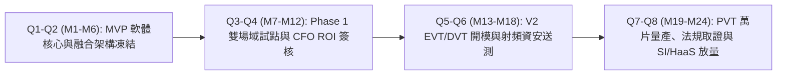

# 四模態 AI 感測融合平台：實戰版產品需求文件（PRD）與 14 頁商業提案大綱

> **關聯文件**：完整技術數據、文獻出處與 BOM 成本試算細節，請參閱 [research_report.md](./research_report.md)。  
> **文件目的**：供產品管理、硬體／韌體研發、法規認證團隊與高階主管對齊 **MVP（Phase 1）至 V2（Phase 2）** 產品規格、驗收紅線、24 個月交付里程碑與投資決策提案。

---

## 1. 高階主管摘要（Executive One-Pager）

### 核心問題：感測孤島與三大商業死結
現行智慧安防、長照醫療與工業監控受困於「單模態物理極限」與「系統孤島」，造成三項無法由單純升級攝影機或雲端 AI 解決的痛點：
1. **高誤報成本與警報疲勞**：醫療照護設備警報高達 **80%–99% 為誤報**；傳統周界 PIR 每日產生 **20–50 次誤報**；工廠安全光柵因水霧與電纜晃動頻繁誤急停，造成每小時 **\$50,000–\$260,000+ USD** 產線停機損失。
2. **全天候與非視距盲區**：光學 IP Camera 在濃煙、全暗、遮蔽與熱失控 Stage 1 前兆完全失效；純熱像儀受夏季背景溫差趨近零（$\Delta T \to 0$）與金屬反光干擾且無法穿牆。
3. **隱私法規紅線與重複佈線 TCO**：24/7 全時錄影直接撞上歐盟 **GDPR（Article 5/9/25）**、**EU AI Act（2024/1689）**、**HIPAA** 與衛浴／臥室／職場隱私抗拒；多套獨立系統更導致佈線與雲端頻寬成本高漲。

### 核心主張：ISAC 無線中樞 × Privacy-by-Design 四階喚醒
我們重新定義企業與商用無線網路設備為 **ISAC（通感一體化）三重角色中樞**（確定性骨幹＋Edge NPU 融合節點＋802.11bf/BLE/UWB 物理感測），結合 **mmWave Radar、非製冷 $\text{VO}_x$ Thermal 與 IP Camera**，打造 **L0→L3 分級喚醒漏斗架構**：
* **預設不開鏡（Camera-Off by Default）**：日常 95%+ 時間僅運行 **L0（Wi-Fi CSI/BLE，對外 <2–5 kbps，增量功耗 ~0.3–0.8 W）** 與 **L1（60GHz 雷達 2 ms 喚醒＋低階熱像雙重驗證）**，100% 免視覺隱私疑慮。
* **記憶體揮發隔離（Zero Disk Persistence）**：僅於不確定高風險時觸發 **L2** 將影像送入 **TEE Volatile RAM** 提取 17 點去識別化骨架並於 **<100 ms 內覆寫銷毀**，對外僅傳 **15–60 kbps JSON**。
* **確定性微延遲與大幅降本**：透過熱待機策略達成 **110–205 ms（預熱）／250–420 ms（標準）** 端對端關鍵告警延遲，同時節省 **>90%–95% 常態回傳頻寬與雲端儲存成本**。

### 目標市場與商業價值
* **首發切入（Phase 1 Brownfield 利舊）**：鎖定 Top 5 中回本最快之 **「長照無鏡頭衛浴／臥室跌倒守護（93.3 分）」** 與 **「BESS 儲能／高壓配電熱失控截斷與濃煙搜救（90.9 分）」**，以 **Edge Fusion Box** 納管既有 ONVIF/RTSP 攝影機並外接雷達／熱像 Pod，免除首年重資產開模風險。
* **財務與競爭護城河**：採非 NDAA／NDAA Section 889 雙軌 BOM（Tier 2 商用 **\$189–\$355 USD**；分散式單房攤提 **\$141–\$174 USD**），結合無變磚雙層 SaaS／HaaS（**\$55–\$110 PBM**）與工業 PdM（**\$300–\$900/點/年**），**第 3 年綜合混合毛利率達 64%–72%**，百床長照機構約 **7.5–12 個月** 回本，關鍵電力／廠務試點 **3–6 個月** 回本。

---

## 2. 14 頁對內／對外簡報提案大綱（Pitch & Executive Deck Outline）

本大綱專為「內部立項評審（Gate Review）」與「外部戰略投資人／B2B 標竿客戶提案」設計，共計 **14 頁**：

| 頁碼 | 簡報頁面標題 | 核心論點（Key Takeaway & Talking Points） | 建議圖表／視覺呈現 |
| :---: | :--- | :--- | :--- |
| **P1** | **封面與一句話定位：打破「感測孤島」的下一代隱私優先 AI 感知骨幹** | 揭示單一視覺監控時代終結；以現有無線網路設備為核心，實現「零誤報、穿煙暗、天生合規」的四模態空間感知系統。 | 四模態設備聚合概念圖＋三大核心數字卡片（`>90% 頻寬節省`、`75–98% 誤報消減`、`<200ms 關鍵延遲`） |
| **P2** | **市場痛點：為何既有系統陷入「誤報、盲區、隱私」三重死結？** | 量化揭露產業痛點：23% 長者不戴穿戴裝置、80%–99% 醫療警報疲勞、周界 PIR 日誤報 20–50 次、產線停機 \$50K–\$260K/小時、GDPR/EU AI Act 禁入私密與職場空間。 | 三角死結圖示（盲區 × 誤報 × 隱私紅線）與各產業痛點金額標註 |
| **P3** | **物理層正交突破：四模態九維互補矩陣與盲區閉環** | 論證為何 Wi-Fi+Camera、Camera+Thermal、mmWave+Thermal 任兩兩組合皆留有致命缺口；唯有四者協同達成穿牆、穿濃煙、測溫、生命徵象與語意取證 100% 閉環。 | 四模態九維能力雷達圖／熱力矩陣＋「雙模態盲區 vs. 四模態閉環」流向圖（圖 2-1） |
| **P4** | **無線設備三重角色：Network-as-a-Sensor-Hub (ISAC)** | 重新定義 Wi-Fi 7 AP：不僅傳資料，同時是 (a) MLO STR/PoE++ 骨幹、(b) Edge NPU 融合與 PTP 主鐘中樞、(c) 802.11bf-2025 CSI / BLE AoA / UWB 物理感測器，消滅重複佈線 CapEx。 | Wi-Fi AP 三重角色分層剖面圖＋802.11bf 五步感測時序與 2.4/5/6 GHz ISAC 通道隔離示意 |
| **P5** | **核心技術護城河：Privacy-by-Design 四階級聯喚醒狀態機（L0–L3）** | 詳述「Camera-Off by Default」、「Volatile RAM Zero Disk Persistence（<100ms 清零）」、「雙重授權 L3 Pre-roll 存證」；比較 L0–L3 功耗、對外頻寬與隱私等級。 | L0→L3 漏斗圖／序列圖（圖 5-1）＋L0–L3 對外頻寬（`<5 kbps → 60 kbps → 30 Mbps`）與增量功耗階梯柱狀圖 |
| **P6** | **全領域版圖與 Top 5 旗艦戰場篩選（15 項應用評分）** | 展示涵蓋長照、安防、工廠與交通能源之 15 項應用與五維加權評分結果，解釋為何優先聚焦 Top 5（#1 長照衛浴 93.3 分、#2 BESS 儲能 90.9 分、#3 周界 88.1 分、#4 HRC 87.7 分、#5 商辦 HVAC 87.3 分）。 | 15 項應用五維加權橫向排行長條圖（標註 Top 5 旗艦門檻） |
| **P7** | **旗艦應用深潛（一）：零穿戴長照衛浴守護 & 商辦零誤關 HVAC** | 剖析衛浴／臥室零鏡頭合規如何打通長照與銀髮宅；以及商辦複用天花板 AP 搭配 32×24 熱陣列消除 PIR False-Off，將無人空調延遲由 60 分鐘縮至 5–10 分鐘（再省 15%–25% 電費）。 | Top #1（L0–L3 衛浴跌倒判定流）與 Top #5（玻璃隔間阻隔熱像防誤觸示意）雙拼架構圖 |
| **P8** | **旗艦應用深潛（二）：BESS 儲能熱失控截斷 & 關鍵園區／工廠工安** | 剖析 Thermal 於 Stage 1 起火前數分鐘截斷充電、mmWave 濃煙零能見度下搜救維持 90%+ 定位，以及 HRC 與周界整合消除 70%–98% 誤急停與動物／雨霧誤報。 | 鋰電池熱失控 Stage 1–3 時間軸對比圖（傳統煙感滯後 vs. 四模態提前截斷與災時穿透） |
| **P9** | **底層工程硬實力：亞微秒時空同步、異質標定與熱待機延遲預算** | 說明如何以 IEEE 1588 PTP (<1 μs)、100ms 滑動視窗與卡爾曼補償對齊四種異質幀率；以加熱棋盤格＋角反射器＋mmWave 自監督校準 CSI；透過熱待機突破冷啟動達成 110–205 ms 預熱延遲。 | 四種感測器採樣時間軸對齊圖＋Stage 0–4 端對端延遲瀑布圖（Waterfall Chart） |
| **P10** | **部署形態決策：All-in-One 整合節點 vs. 分散式 Brownfield 協同** | 誠實面對物理挑戰：60GHz Radome 半波長公差與 EMI、AP 頂裝高熱致 $\text{VO}_x$ 飄移、PoE+ 25.5W 降頻陷阱、頂裝 vs 側壁俯仰幾何衝突；論證為何先推分散式利舊閘道再推 All-in-One。 | All-in-One 機構散熱／視角剖面衝突圖 vs. 分散式架構拓樸對照表 |
| **P11** | **競品格局與差異化定位：終結「訂閱懸崖」與「純影像法規牆」** | 拆解五大競品陣營（Origin AI [ADT 1.7 億美元收購]、Vayyar/Aqara FP2、FLIR/Axis、Cisco Spaces/UniFi、Verkada）之盲區與 TCO 缺口，突顯本方案無變磚本地底座與 30%–45% 施工降本優勢。 | 六大陣營能力與 TCO 比較矩陣（標註競爭空白象限） |
| **P12** | **三階雙軌硬體路線與萬片級 BOM 經濟性（標準 vs. NDAA 889）** | 揭露 Tier 1（\$61.8–\$110.5）、Tier 2（\$189–\$355；分散式單房攤提 \$141–\$174）、Tier 3（準工業 \$649–\$960；旗艦 \$2,314–\$3,695）代表晶片選型與分項成本拆解。 | 三階雙軌 BOM 堆疊條形圖＋All-in-One vs. 分散式單房攤提成本降幅對比 |
| **P13** | **商業模式、毛利複利結構與標竿客戶 Payback 實證模型** | 說明四大變現模式（買斷＋無變磚 SaaS、AP-as-a-Sensor OEM、長照 HaaS \$55–\$110 PBM + 保險減費、工業 PdM \$300–\$900/點/年），第 3 年混合毛利達 64%–72%，客戶回本 3–12 個月。 | 3 年期混合毛利爬坡曲線（46% → 64%–72%）＋百床長照（7.5 月回本）／20 點工業（3–6 月回本）ROI 計算表 |
| **P14** | **法規護城河、24 個月產品路線圖與 Phase 1 試點資源需求（Ask）** | 鎖定 77GHz 法規隔離、RED EN 18031 與 EU CRA（2026/09 通報、2027/12 強制）優勢；提出 Phase 1（M1–M12 Brownfield 雙試點）→ Phase 2（M12–M24 取證量產）預算與關鍵決策請求。 | GTM 42 個月推進圖（圖 11-1）＋Phase 1 試點資源配置與 Gate KPIs 總覽 |

---

## 3. 產品需求與工程規格表（MVP Phase 1 vs. V2 Phase 2）

### 3.1 MVP（V1.0 / Phase 1：M1–M12）— Brownfield 利舊融合閘道與無鏡頭試點套件

**產品定位**：零開模、快速驗證真實場域演算法與 ROI 之系統；透過邊緣閘道納管客戶既有攝影機與網通架構，並配接外掛式感測 Pod 進駐首發雙試點場域（**A1 私立長照衛浴／臥室** 與 **C4/C2 儲能與高壓配電盤**）。

| 規格分類 | 需求項目 / ID | MVP (V1.0) 詳細工程與功能規格 |
| :--- | :--- | :--- |
| **硬體系統組成** | **HW-MVP-01** 邊緣融合閘道（Edge Box） | • 採開發就緒商用算力平台：**Rockchip RK3588**（6 TOPS INT8, LPDDR4x/5, 非 NDAA 國內／亞太試點）或 **Qualcomm QCS6490**（12–13 TOPS, NDAA 預備線） • 介面：雙 2.5GbE（支援 PoE+ 802.3at 受電或 12V/24V DC 工業電源）、USB 3.0 / RS-485 / 乾接點繼電器（對接護理鈴與 BMS/PLC 跳脫） • 外接或內建支援 802.11ax/be CSI 擷取之測試 AP 介面（OpenWrt / Linux CSI Driver） |
| **外掛感測 Pod** | **HW-MVP-02** 雙試點感測莢 | • **長照試點 Pod（無鏡頭版）**：ESP32-C6 + **TI IWRL6432 / IWR6843AOP**（60GHz 預認證模組）+ **Melexis MLX90640 (32×24)** 或 **FLIR Lepton 3.5 (160×120)**，防潑水 IP54 壁掛盒 • **BESS／配電試點 Pod**：TI IWR6843AOP（或工業 60GHz 穿透模組）+ FLIR Lepton 3.5（高增益模式支援至 **+400°C**）+ 串接既有 ONVIF/RTSP 攝影機 |
| **核心軟體功能** | **FR-MVP-01** 既有攝影機納管與熱待機控制 | • 支援標準 ONVIF / RTSP 串流接入既有 IP Camera；具備軟體邏輯閥門，平時於閘道端主動捨棄或遮斷遠端拉流，僅於 L2/L3 觸發時喚醒記憶體緩衝讀入 |
| **時空對齊引擎** | **FR-MVP-02** 非同步時間對齊與快速標定 | • 支援 PTP/gPTP 軟體或硬體時間戳與 **$\Delta W = 100\text{ ms}$ 滑動視窗對齊**（容忍誤差 $\le 15\text{ ms}$），結合卡爾曼速度外推補償 9 Hz 熱像與 10–20 Hz 雷達幀率差 • 提供現場簡易引導式校準工具（加熱靶點＋角反射器工具包），2 小時內完成單室／單機櫃空間外參設定 |
| **融合與狀態機** | **FR-MVP-03** L0–L3 狀態機與 D-S 仲裁 | • 實作完整 L0→L1→L2→L3 狀態轉換與 **30–60 秒遲滯防抖（Hysteresis）** • L1 採 Dempster-Shafer 證據理論融合 Wi-Fi CSI + mmWave 跌倒/呼吸 + Thermal 熱斑/溫升斜率（$\Delta T/\Delta t$） • L2 於隔離 RAM 執行 INT8 `YOLOv8n-pose` / 火煙語意確認並於 **<100 ms** 內覆寫銷毀原始幀 |
| **安全與聯動介面** | **FR-MVP-04** 外部聯動與隱私安全 | • 支援 MQTT / REST Webhook / Modbus TCP 對接護理站呼叫中心、BMS 與消防乾接點 • TLS 1.3 + AES-256-GCM 傳輸加密，L0–L2 **Zero Disk Persistence（零影像寫入 Flash）**，具備基礎 OTA 簽章更新與初版 SBOM 清單 |

---

### 3.2 V2（V2.0 / Phase 2：M12–M24）— Tier 2／Tier 3 量產型 All-in-One 與標準分散式套件

**產品定位**：完成 RF／資安取證與雙軌量產開模之商業主力產品，提供「**All-in-One 智慧 AP 節點**（適用新建商辦、病房與飯店）」與「**企業 Wi-Fi 7 閘道＋標準無鏡頭 Pod 分散式套件**（適用多房長照與工業場域）」雙形態。

| 規格分類 | 需求項目 / ID | V2.0 (Phase 2) 量產進化規格（對齊 Tier 2 與 Tier 3 雙軌模型） |
| :--- | :--- | :--- |
| **雙軌運算與網通** | **HW-V2-01** 雙軌晶片與 PoE++ 供電 | • **Tier 2 商用**：**Qualcomm IPQ5424**（或 MT7986/88）Wi-Fi 7 2.5GbE 平台 + 非 NDAA（RK3588, 6 TOPS）/ NDAA（QCS6490 裸晶 12–13 TOPS 或 Ambarella CV72）+ TI IWR6843AOP / Infineon BGT60TR13C + Tiny1-C / FLIR Lepton 3.5 + Sony IMX415/IMX678 • **Tier 3 準工業**：**Filogic 880 / IPQ9574** + **TI AWR2944**（戶外/交通/桶槽）或雙 60GHz 協同（室內）+ **Seek Mosaic 320×240** / InfiRay 384×288 + Ambarella CV5 / **Jetson Orin NX 8GB** + IMX678 WDR • 供電：All-in-One 全載與 Tier 3 強制採用 **IEEE 802.3bt PoE++ Type 3 (60 W) / Type 4 (90 W)** 搭 6kV 防雷與寬溫（-40°C~+85°C）IP67 壓鑄外殼（Tier 3） |
| **機構與電磁熱設計** | **HW-V2-02** All-in-One 物理整合工藝 | • **60GHz Radome**：低損耗 PC/ABS/PP 透波罩遵循半波長厚度公式 $d = \frac{n \cdot c}{2f\sqrt{\epsilon_r}}$（公差 $\pm 0.05\text{ mm}$），PCB 佈設 EBG 與 Via Fence 隔離 • **$\text{VO}_x$ 熱隔離**：獨立隔熱腔與導熱背板隔離 18–45 W AP/NPU 熱源，內建高精度 NTC 支援 ATC 環境溫度補償與自動 FFC 排程 • **幾何機構**：吸頂版配備 **20°–35° 可調斜向萬向雲台** 化解 AP 水平置中與鏡頭／雷達俯仰衝突 |
| **進階融合演算法** | **FR-V2-01** Cross-Attention 與自監督校準 | • 全面啟用 L2 **BEV + Cross-Attention 跨模態特徵融合**（應對濃煙與部分遮蔽）及 **Memory Wall 保護**（記憶體頻寬餘裕 $\ge 1.8\times$、Zero-Copy `DMA-BUF`） • 上線 **CSI 跨模態自監督校準**：日常自動以 mmWave 3D 軌跡作為 Pseudo-Labels 線上修正 Wi-Fi 指紋，免人工重踩點 • 實作 **Graceful Degradation**：NPU 滿載時動態將 L2 RGB 降至 10 fps，維持 20 Hz 雷達＋熱像不間斷追蹤 |
| **企業資安與維運** | **FR-V2-02** Zero-Touch 與全法規內建 | • 出廠剛體外參預標定，支援單線 **Zero-Touch Commissioning** 與免寫程式規則引擎（串接 BMS / SCADA / 保險 API） • 支援 **TEE 硬體隔離、TPM 安全開機（Secure Boot）、雙向 TLS 1.3、自動化 SBOM 產出與 EU CRA 漏洞回報架構**，實踐無變磚雙層授權機制 |

---

## 4. 關鍵驗收指標（KPIs & Release Gate Criteria）

| 評估構面 | 驗收指標項目 | MVP (Phase 1) 試點驗收標準 | V2 (Phase 2) 量產上市標準 | 對應驗證基準與條件備註 |
| :--- | :--- | :--- | :--- | :--- |
| **偵測準確率** | 跌倒偵測靈敏度（A1） | 衛浴／臥室測試集 **$\ge 95\%$** | 量產真實場域 **$\ge 97\%$–$99\%$** | 單純 60GHz 雷達受控基準為 97%–99.5%；含緩慢滑倒與部分家具遮擋 |
| **惡劣環境穿透** | 濃煙／濃霧行人與人員定位率 | 霧／煙模擬環境 **$\ge 88\%$** | 濃煙（0 m 能見度）雷達 **$\ge 90\%$** | 對標 Cerema 霧室 MOR ~13 m 基準 $\ge 90\%$ 與 C4 災時搜救目標 |
| **熱預警提前期** | 儲能／電氣熱失控預警 Lead Time | 較標準光電煙感提前 **$\ge 3$ 分鐘** | Stage 1（60–70°C 異常斜率）提前 **數分至數十分鐘** | 工業接頭劣化 PdM 基準提前 3–18 個月偵測 |
| **誤報率削減** | 綜合場域誤報率下降（FAR） | 相較客戶既有單模態基線 **降低 $\ge 70\%$** | 長照降低 **75%–90%**；周界 **<1–2 次/百公尺/月**（降 $>98\%$） | 含寵物、垂落電纜、陽光熱反射與車體餘熱過濾 |
| **端對端延遲** | 關鍵告警觸發至安全指令發出 | 標準逐級喚醒 **$< 500\text{ ms}$**（感測到平台） | 預熱路徑 **110–205 ms**；標準 **250–420 ms**；工安 PLC **< 50–150 ms** | 採暖啟動（Warm-Standby）+ Fast-AE，嚴禁冷斷電重啟 |
| **頻寬與儲存** | 常態網路回傳與雲端儲存節省 | 較 24/7 H.265 4K 錄影 **節省 $\ge 90\%$** | **節省 $> 95\%$**（L0 `< 2–5 kbps`；L2 `< 15–60 kbps`） | L3 僅傳觸發前 5–10 秒 Pre-roll 加密片段（15–30 Mbps 突發） |
| **功耗控制** | L0 常駐與熱待機增量功耗 | 外掛 Pod 待機平均 **$< 1.5\text{ W}$** | L0 增量 **~0.3–0.8 W**（含 Wi-Fi 7 AP **12.5–19 W**） | 含 AP L3 滿載峰值控制於 PoE++ Type 3/4 預算內（30–48+ W） |
| **隱私與資安** | Privacy-by-Design 與法規測試 | 100% 無磁碟原始影像留存（L0–L2）；通過外部滲透基礎審查 | RAM 清零 **< 100 ms**；通過 **FCC 15.255 / EN 305 550 / EN 18031 / NCC LP0002** 及 DPIA 範本 | 強制隔離 77 GHz 勿售作一般室內安防；備齊 SBOM 與雙軌 NDAA BOM |
| **商業與成本** | BOM 目標與客戶實證回本 | 產出 **3–5 份 CFO 簽核報告（Payback < 12 個月）** | Tier 2 BOM 達 **\$189–\$355**（萬片級）；硬體毛利 **42%–50%** | 累計部署 5,000–10,000 台、軟體 NDR $\ge 105\%$ |

---

## 5. 18–24 個月開發與認證里程碑（Milestone Roadmap）

鑑於高頻射頻認證（FCC / ETSI / NCC）與熱像黑體校準測試常耗時 3–6 個月，以下將 M1–M24 劃分為四個嚴謹階段，於第 12 個月以前不盲目開模，以極小試錯成本跑通商業驗證後再進入 V2 EVT/DVT/PVT 量產爬坡：

*圖 PRD-1：24 個月產品開發、認證與量產里程碑流向圖*

| 時期 | 開發階段 | 核心研發與工程交付物 | 法規與商業 Gate 驗收點 |
| :--- | :--- | :--- | :--- |
| **M1–M3（Q1）** | **架構定義與演算法原型** | • 凍結 L0–L3 狀態機與 TEE Volatile RAM Ring Buffer 記憶體零落盤規範 • 建置 IEEE 1588 PTP 測試床與 100ms 滑動視窗時空對齊管線 • 採購預認證 60GHz AoP 模組（IWRL6432/IWR6843）與熱陣列組裝 MVP 閘道原型 | 完成技術架構審查（Architecture Review）與雙軌（NDAA vs 非 NDAA）核心晶片供貨鎖定 |
| **M4–M6（Q2）** | **MVP 系統整合與標定工具** | • 完成 ONVIF/RTSP 舊機納管模組、D-S 決策融合與 INT8 `YOLOv8n-pose` 推論最佳化 • 開發加熱 ChArUco＋角反射器一鍵外參標定工具，將單點安裝調校壓在 2 小時內 • 對接護理站 MQTT/Webhook 與 BESS BMS/PLC 跳脫模擬介面 | **Gate 1（M6）**：實驗室模擬端對端延遲 `< 450 ms`、L2 零落盤滲透測試通過、組裝 30 套 MVP 試點套件 |
| **M7–M9（Q3）** | **Phase 1 雙試點場域部署** | • 進駐 **5–10 家長照／護理之家**（A1 衛浴與臥室無鏡頭方案）及 **2–3 座 BESS／工廠配電室**（C4/C2） • 收集真實極端邊緣案例（緩慢滑倒、寵物、水蒸氣、陽光熱反光與開關櫃溫升）並微調模型 | 連續運行 60 天無當機；確認誤報率較客戶既有系統下降 **$\ge 70\%$** |
| **M10–M12（Q4）** | **ROI 簽核與 V2 EVT 啟動** | • 發表長照與廠務實證白皮書；凍結 **V2 Tier 2（All-in-One 與分散式 Pod）及 Tier 3 準工業** PCB/ID 機構設計 • 完成 60GHz Radome 半波長模流模擬與 $\text{VO}_x$ 隔熱腔熱流模擬 | **Gate 2（M12）**：取得 **3–5 份 CFO 簽核之 < 12 個月 Payback 報告**，核准 V2 開模與認證預算 |
| **M13–M15（Q5）** | **V2 EVT 工程驗證與預掃描** | • 完成 V2 EVT 樣機打樣（含 20°–35° 可調萬向雲台、PoE++ 802.3bt PD、Zero-Copy `DMA-BUF`） • 執行 RF Pre-scan（60GHz / Wi-Fi 7 6GHz LBT）、高溫 75°C 熱飄移 ATC/FFC 測試與 **Cross-Attention + CSI 自監督**軟體集成 | **Gate 3（M15）**：解決全部高頻諧波耦合與 Memory Wall（實測餘裕 $\ge 1.8\times$），預熱延遲達 **< 205 ms** |
| **M16–M18（Q6）** | **V2 DVT 設計驗證與正式送測** | • 進行熱衝擊、IP67 防水防塵（Tier 3）與 6kV 突波測試 • 正式向實驗室送測 **FCC Part 15.255（2023 修訂）**、**ETSI EN 305 550 / EN 303 687 / EN 18031（RED 資安）**、**NCC LP0002（含 6GHz 5.13 節）**，並備齊完整 SBOM 與 DPIA 文件包 | 完成全套認證測試樣機凍結與國際第三方實驗室排程卡位 |
| **M19–M21（Q7）** | **PVT 小批試產與 SI 賦能** | • 產線建置自動化「黑體＋角反射器」剛體外參出廠預標定夾具（FATP） • 上線無寫程式規則引擎與 BMS/SCADA/保險減費 API 對接包，培訓首批 10 家區域 SI 與保全合作夥伴 | **Gate 4（M21）**：取得 FCC / CE (EN 18031) / NCC 正式證書；PVT 良率 $\ge 97\%$ |
| **M22–M24（Q8）** | **商業化量產與規模複製** | • 啟動萬片級晶片階梯採購（目標壓低關鍵模組 BOM 25%–35%） • 正式商轉 Tier 2 HaaS 月租與 Tier 3 工業 PdM 訂閱，啟動 **IEEE 802.11bf AP-as-a-Sensor SDK** 與早期 ODM 客戶對接 | **Gate 5（M24）**：累計部署突破 **5,000–10,000 節點**、硬體毛利 **42%–50%**、NDR **$\ge 105\%$** |

---

## 6. 技術、法規與市場風險及緩解矩陣（Risk & Mitigation Matrix）

| 風險類別 | 風險項目與具體情境 | 影響程度 | 發生機率 | 預先緩解與工程／商業應變對策（Mitigation Plan） |
| :--- | :--- | :---: | :---: | :--- |
| **技術風險** | **T1. All-in-One 內部高溫致 $\text{VO}_x$ 熱像測溫飄移**（AP/NPU 18–45 W 發熱烘烤熱像晶片造成 FPN 與 $\Delta T$ 誤差） | **極高** | **高** | 1. 機構強制設置隔熱腔體與導熱鋁板隔離 Wi-Fi PA。 2. 韌體整合高精準熱敏電阻執行 **ATC 補償**與定時快門 **FFC**。 3. 凡對測溫精度要求 $\pm 2^\circ\text{C}$ 之 Tier 3 工業場景，優先推薦「**分散式無算力熱像前端（功耗 <2 W）**」。 |
| **技術風險** | **T2. 60GHz Radome 射頻衰減與高速匯流排 EMI 干擾**（DC-DC/MIPI 諧波灌入雷達 IF 或外殼材料介電損耗過高） | **高** | **高** | 1. 採用 **TI IWR6843AOP / Infineon BGT60** 等 AoP 預整合封裝降低主板佈線風險。 2. 嚴控 PC/ABS 外殼半波長厚度公差（$\pm 0.05\text{ mm}$），禁止金屬漆或碳纖填料，PCB 佈設 EBG 與 Via Fence。 |
| **技術風險** | **T3. 「PoE+ 25.5W 降頻陷阱」與「Memory Wall」延遲超標**（多路同時喚醒時電源跳脫或 LPDDR 頻寬壅塞致延遲 $>500\text{ ms}$） | **高** | **中** | 1. Tier 2 全載與 Tier 3 明確規範需 **PoE++ 802.3bt Type 3/4（60–90 W PSE）**；PoE+ 僅供分散式低負載模式。 2. 強制選用實測頻寬餘裕 $\ge 1.8\times$ 之 SoC，採用 Zero-Copy `DMA-BUF` 與 **Graceful Degradation**（突發時降 RGB 幀率保雷達熱像追蹤）。 |
| **技術風險** | **T4. 非同步感測器冷啟動延遲與幾何安裝衝突**（冷開機 >500 ms；AP 頂裝與鏡頭／雷達俯視角矛盾） | **中** | **高** | 1. 嚴禁徹底斷電，採 LPDS/Shutdown/Suspend-to-RAM **熱待機 + Fast-AE** 壓縮總延遲至 110–205 ms。 2. All-in-One 吸頂版配 **20°–35° 可調萬向雲台**；大跨距採分散式「AP 頂裝、感測牆角斜裝」。 |
| **供應鏈風險** | **S1. 熱像元件 EOL 與高階元件交期／成本過高**（FLIR Lepton 2.5 將於 **2027 年底停售**；Boson 640 致 BOM 超標） | **高** | **高** | 1. Tier 1 新設計全面禁用 Lepton 2.5，改用 **MLX90640** 或在產陣列。 2. Tier 3 目標價帶採 **Seek Mosaic 320×240 / InfiRay 384×288** 替代高價 Boson 640，僅對軍工旗艦客製選配。 |
| **法規風險** | **R1. 77 GHz 雷達違規銷售於一般室內安防／商辦**（違反 NCC LP0002 第 4.14/4.15 節、FCC Part 95M 與 ETSI EN 301 091） | **極高** | **中** | 產品料號與通路系統強制分流：**77 GHz（AWR2944/2243）僅限戶外交通路口、港口周界與封閉桶槽 TLPR 銷售**；所有室內商用／長照／商辦一律強制鎖定 **60 GHz 頻段**（合 FCC 15.255 / NCC 57–66 GHz）。 |
| **法規風險** | **R2. 歐美 GDPR Art. 9 / EU AI Act / NDAA 889 / EU CRA 合規地雷**（假名化仍算個資、2026/09 CRA 漏洞回溯通報） | **極高** | **中** | 1. 硬體級落實 L0–L2 **不可逆去識別化＋RAM 清零**（對齊 GDPR Art. 25），避免提取唯一辨識生物特徵。 2. 嚴格執行 **雙軌 BOM**（歐美政府基建採 Qualcomm/TI/FLIR/Seek；非受限市場採 Rockchip/InfiRay）。 3. 於 M12 前建立自動化 **SBOM 與 EN 18031/IEC 62443 OTA 安全框架**，提前因應 2026/09/11 通報與 2027/12/11 全面強制大限。 |
| **市場風險** | **M1. 企業客戶抗拒「訂閱懸崖」與 Brownfield 標定工時過高**（害怕停繳月費變磚；舊機跨接設定耗時） | **中** | **高** | 1. 承諾「**基礎本地功能永久可用**」，僅對進階 AI/PdM/合規稽核收費。 2. Phase 1 導入一鍵式校準包，Phase 2 上線 **mmWave 跨模態自監督 CSI 校準**，消除人工踩點（Site Survey）依賴。 |
