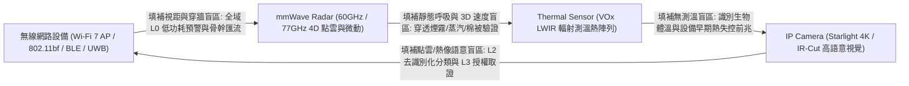
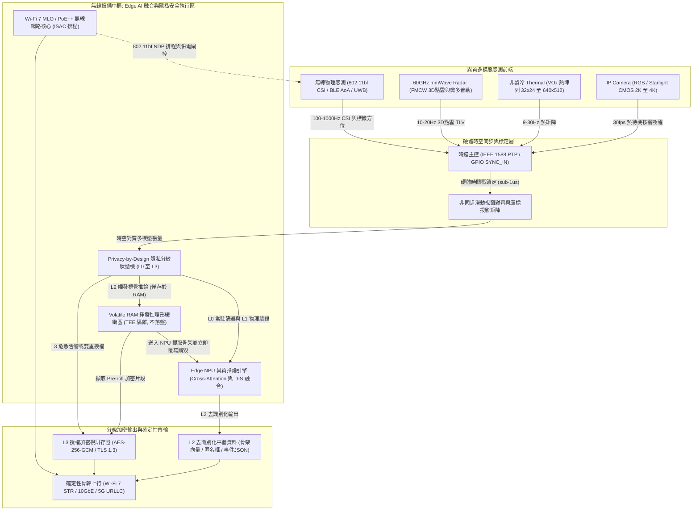
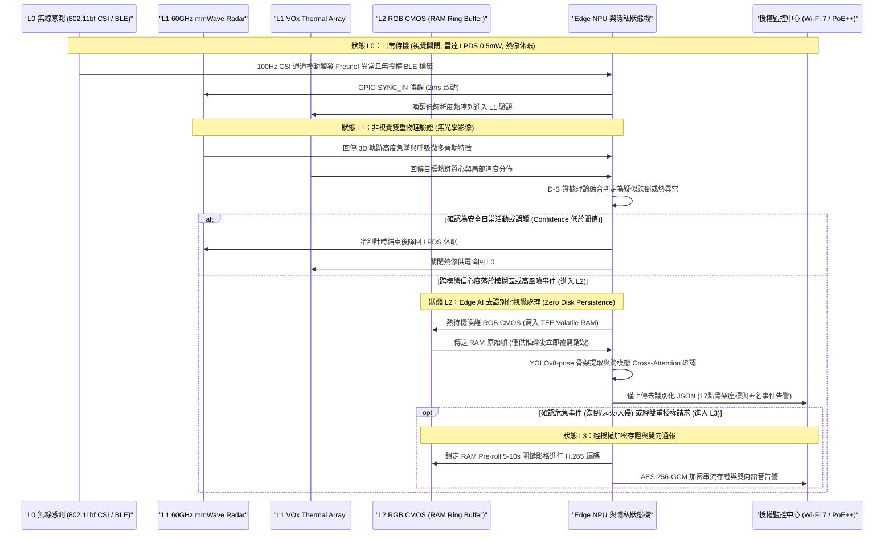
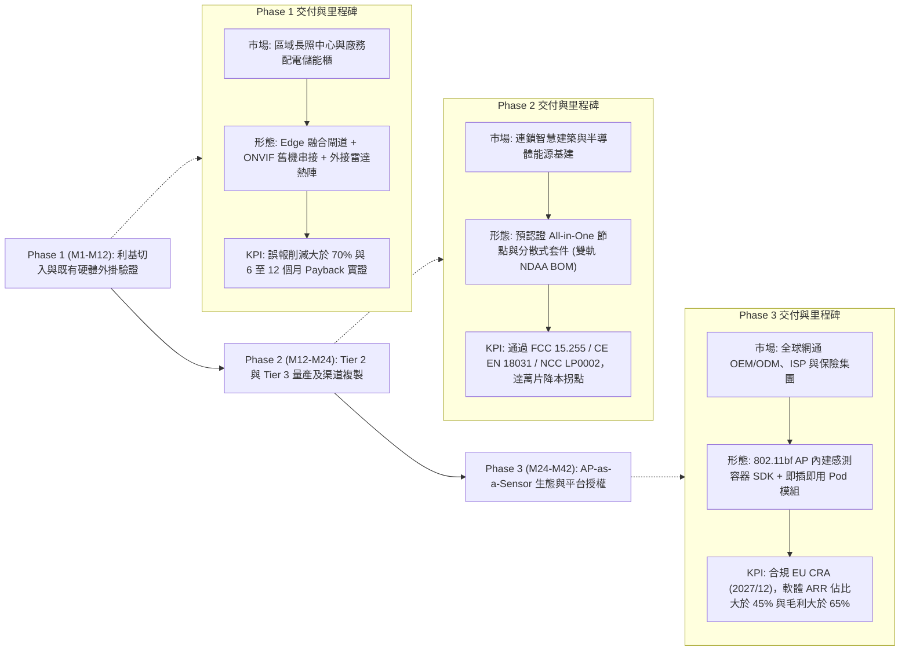

# 四模態 AI 感測融合架構深度研究報告：無線網路設備、IP Camera、Thermal Sensor 與 mmWave Radar 之技術融合、Privacy-by-Design 設計與商業化藍圖

> **文件性質**：技術與商業整合研究白皮書（定稿版）  
> **研究範疇**：無線網路設備（Wi-Fi 7 MLO / IEEE 802.11bf-2025 / BLE AoA / UWB）、光學視覺（RGB / Starlight / IR-Cut IP Camera）、遠紅外線熱像（LWIR 非製冷 $\text{VO}_x$ Thermal Sensor）及毫米波雷達（60GHz / 77GHz FMCW / 4D 成像 mmWave Radar）之物理互補、邊緣系統架構、雙軌 BOM 成本工程、法規護城河與 Go-to-Market 策略  
> **數據口徑聲明**：本報告嚴格區分「公開文獻／原廠規格書實證基準（標註出處）」與「跨模態整合後推論效能（明確標記為 `[合理工程推估]`）」。硬體預算同步區分「晶片／OEM 裸模組 vs. 含 Wi-Fi 7 AP 與保護機構之整機系統」及「非受限高性價比方案 vs. 美國 NDAA Section 889 合規方案」。

---

## 高階執行摘要（Executive Summary）

當前智慧感知、安防監控與工業自動化市場長期受困於**「感測孤島（Sensor Silos）」**與三大結構性矛盾：**全天候物理失效（濃煙、全暗、逆光、遮蔽與熱對比歸零）**、**極端誤報帶來的警報疲勞（醫療照護警報高達 80%–99% 為誤報、傳統周界 PIR 每日產生 20–50 次誤報）**，以及**全時光學錄影撞上 GDPR / HIPAA / EU AI Act 與居家隱私紅線**。

本研究透過物理層級的正交互補分析與端到端系統工程拆解，提出以**「無線網路設備作為通感一體化（ISAC）核心樞紐」**並搭配**「Privacy-by-Design 四階級聯喚醒狀態機（L0–L3）」**的四模態 AI 感測融合平台架構，得出以下核心結論：

1. **無線網路設備之三重角色重構（Network-as-a-Sensor-Hub）**：企業級 Wi-Fi 7 AP 與工業無線閘道不再僅是被動網路管線，而是同步承擔 **(a) 確定性傳輸骨幹**（Wi-Fi 7 MLO STR/EMLSR 與 IEEE 802.3bt PoE++ 60–90 W 供電與回傳）、**(b) Edge AI 融合與 PTP 主時鐘節點**（6–100+ TOPS NPU 本地推論與亞微秒時間對齊），以及 **(c) 主被動無線物理感測器**（IEEE 802.11bf-2025 標準化 CSI 跨牆存在感測、BLE AoA 亞米級與 UWB 釐米級白名單識別），藉由既有剛性網路建設大幅壓低感測邊際佈線成本。
2. **四模態正交物理互補與 Top 5 旗艦應用突破**：經由 15 項跨領域應用掃描與五維加權評分（滿分 100），篩選出最具商業爆發力與不可替代性的 Top 5 旗艦場景：**#1 銀髮居家與長照衛浴零穿戴跌倒守護（93.3 分）**、**#2 鋰電池儲能站（BESS）／EV 超充站熱失控 Stage 1 截斷與濃煙搜救（90.9 分）**、**#3 關鍵園區／倉儲全天候零誤報周界入侵偵測（88.1 分）**、**#4 人機協作（HRC）／智慧倉儲粉塵盲區動態安全（87.7 分）**，以及 **#5 智慧商辦微氣候 HVAC 零 False-Off 節能與夜間安防（87.3 分）**。
3. **Privacy-by-Design 四階級聯架構與量化效益**：落實「預設不開鏡（Camera-Off by Default）」、「記憶體揮發隔離（Volatile RAM Only, Zero Disk Persistence）」與「加密雙重授權託管（Cryptographic Custody）」三大鐵律。日常由 **L0（Wi-Fi CSI/BLE，增量功耗 ~0.3–0.8 W，對外 <2–5 kbps）** 與 **L1（mmWave 2 ms 熱喚醒＋低階 Thermal 非視覺交叉驗證）** 過濾無害事件；僅於模糊高風險事件觸發 **L2（RGB 喚醒至 TEE RAM 提取 17 點骨架向量並在 <100 ms 內覆寫銷毀原始像素，對外僅輸出 15–60 kbps JSON）**；唯危急或授權時啟動 **L3（Pre-roll 5–10 秒 AES-256-GCM 加密存證）**。透過熱待機（Warm-Standby）策略消除冷啟動陷阱，**端對端關鍵告警延遲於預熱路徑達 110–205 ms、標準逐級喚醒達 250–420 ms**，同時節省 **>90%–95%** 常態回傳頻寬與雲端儲存成本。
4. **雙軌三階 BOM 成本與商業閉環**：建立嚴格區分「非 NDAA 高性價比路線」與「NDAA Section 889 合規路線」之萬片級工程 BOM 模型——**Tier 1 消費／入門商用（\$61.80–\$110.50 USD，分散式單空間攤提 \$53–\$61）**、**Tier 2 中高階商用（\$189.00–\$355.00 USD，分散式單空間攤提 \$141–\$174）** 與 **Tier 3 工業／關鍵基建（準工業組 \$649.00–\$960.00 USD／旗艦級聯組 \$2,314.00–\$3,695.00 USD，分散式工業單點 \$600–\$720）**。結合「硬體買斷無變磚雙層 SaaS」、「AP-as-a-Sensor OEM 授權」、「長照 HaaS 月租（\$55–\$110 PBM）與保險減費 10%–20%」及「工業 PdM 按點位計費」，**第 3 年綜合混合毛利率可達 64%–72%**，百床長照機構約 **7.5–12 個月** 回本，高停機風險廠務／變電站僅需 **3–6 個月**（一般工廠 **12–18 個月**）即可完全回本。
5. **將法規深水區轉化為護城河與務實 GTM**：嚴格隔離 77 GHz 雷達室內法規紅線（NCC LP0002 / FCC 95M）、對齊歐盟 **RED EN 18031（2025/08 生效）** 與 **EU CRA（2026/09 漏洞通報、2027/12 全面強制）** 及 **GDPR Art. 25**，並以「**Phase 1（M1–M12）Brownfield 利舊外掛閘道試點 → Phase 2（M12–M24）Tier 2/3 取證量產 → Phase 3（M24–M42）802.11bf AP-as-a-Sensor SDK 生態擴張**」推進，避免初期盲目重資本開模風險。

---

## 完整目錄（Table of Contents）

- [高階執行摘要（Executive Summary）](#高階執行摘要executive-summary)
- [第 1 章：緒論、研究範疇與系統口徑規範](#第-1-章緒論研究範疇與系統口徑規範)
  - [1.1 研究背景與單一模態系統瓶頸](#11-研究背景與單一模態系統瓶頸)
  - [1.2 四類異質設備之物理本質與感知邊界](#12-四類異質設備之物理本質與感知邊界)
  - [1.3 報告工程口徑與跨章節對齊聲明](#13-報告工程口徑與跨章節對齊聲明)
- [第 2 章：四模態物理互補矩陣與盲區閉環分析](#第-2-章四模態物理互補矩陣與盲區閉環分析)
  - [2.1 九項物理與工程維度量化對照表](#21-九項物理與工程維度量化對照表)
  - [2.2 雙模態組合之殘餘盲區與四模態閉環機制](#22-雙模態組合之殘餘盲區與四模態閉環機制)
- [第 3 章：跨領域 15 大應用掃描與 Top 5 旗艦深度剖析](#第-3-章跨領域-15-大應用掃描與-top-5-旗艦深度剖析)
  - [3.1 四大垂直產業 15 項融合應用全景](#31-四大垂直產業-15-項融合應用全景)
  - [3.2 五維度加權評分矩陣與篩選總表](#32-五維度加權評分矩陣與篩選總表)
  - [3.3 Top 5 旗艦應用深度剖析](#33-top-5-旗艦應用深度剖析)
- [第 4 章：無線網路設備三重角色與四模態系統融合架構](#第-4-章無線網路設備三重角色與四模態系統融合架構)
  - [4.1 無線網路設備之 ISAC 三重角色定義](#41-無線網路設備之-isac-三重角色定義)
  - [4.2 四種多模態融合層級深度比較](#42-四種多模態融合層級深度比較)
  - [4.3 四模態感測融合與 Edge AI 系統架構圖](#43-四模態感測融合與-edge-ai-系統架構圖)
- [第 5 章：Privacy-by-Design 分級喚醒機制與端側安全架構](#第-5-章privacy-by-design-分級喚醒機制與端側安全架構)
  - [5.1 三大硬性工程鐵律](#51-三大硬性工程鐵律)
  - [5.2 四階隱私狀態機運作與防抖設計（L0 → L1 → L2 → L3）](#52-四階隱私狀態機運作與防抖設計l0--l1--l2--l3)
  - [5.3 跨情境感測器啟閉、頻寬、功耗與隱私合規估算](#53-跨情境感測器啟閉頻寬功耗與隱私合規估算)
- [第 6 章：時空同步、異質標定、部署權衡與 Edge AI 延遲預算](#第-6-章時空同步異質標定部署權衡與-edge-ai-延遲預算)
  - [6.1 多尺度時間同步與異質取樣率對齊](#61-多尺度時間同步與異質取樣率對齊)
  - [6.2 異質空間標定技術](#62-異質空間標定技術)
  - [6.3 部署形態對比：All-in-One 整合式智慧 AP vs. 分散式多節點協同](#63-部署形態對比all-in-one-整合式智慧-ap-vs-分散式多節點協同)
  - [6.4 Edge AI 算力、記憶體頻寬與端對端延遲預算分析](#64-edge-ai-算力記憶體頻寬與端對端延遲預算分析)
- [第 7 章：市場競品格局分析與四模態差異化切入點](#第-7-章市場競品格局分析與四模態差異化切入點)
  - [7.1 五大既有玩家陣營與結構性缺口](#71-五大既有玩家陣營與結構性缺口)
  - [7.2 競品全景比較與破局「不可能三角」](#72-競品全景比較與破局不可能三角)
- [第 8 章：三階雙軌硬體配置、晶片選型與分項 BOM 成本估算](#第-8-章三階雙軌硬體配置晶片選型與分項-bom-成本估算)
  - [8.1 BOM 建模原則與分散式邊際分攤邊界](#81-bom-建模原則與分散式邊際分攤邊界)
  - [8.2 Tier 1：消費級／入門商用（目標 BOM \$65–\$120 USD）](#82-tier-1消費級入門商用目標-bom-65120-usd)
  - [8.3 Tier 2：中高階商用（目標 BOM \$180–\$350 USD）](#83-tier-2中高階商用目標-bom-180350-usd)
  - [8.4 Tier 3：工業級／關鍵基礎設施（目標 BOM \$550–\$1,200+ USD）](#84-tier-3工業級關鍵基礎設施目標-bom-5501200-usd)
- [第 9 章：商業模式、獲利結構與 ROI 量化回本推估](#第-9-章商業模式獲利結構與-roi-量化回本推估)
  - [9.1 四大商業模式設計](#91-四大商業模式設計)
  - [9.2 獲利結構與毛利率模型](#92-獲利結構與毛利率模型)
  - [9.3 客戶投資回本週期（ROI & Payback Period）量化推估](#93-客戶投資回本週期roi--payback-period量化推估)
- [第 10 章：射頻、隱私與資安法規護城河](#第-10-章射頻隱私與資安法規護城河)
  - [10.1 無線電射頻與頻譜合規（FCC / ETSI CE / 台灣 NCC）](#101-無線電射頻與頻譜合規fcc--etsi-ce--台灣-ncc)
  - [10.2 隱私法規與 AI 監管（GDPR / HIPAA / EU AI Act）](#102-隱私法規與-ai-監管gdpr--hipaa--eu-ai-act)
  - [10.3 網路安全與供應鏈條款（EN 18031 / EU CRA / IEC 62443 / NDAA 889）](#103-網路安全與供應鏈條款en-18031--eu-cra--iec-62443--ndaa-889)
- [第 11 章：分階段 Go-to-Market (GTM) 商業路線圖與策略總結](#第-11-章分階段-go-to-market-gtm-商業路線圖與策略總結)
  - [11.1 三階段推進路線圖（M1–M42）](#111-三階段推進路線圖m1m42)
  - [11.2 綜合研究結語](#112-綜合研究結語)
- [附錄：參考文獻、標準文件與數據來源索引](#附錄參考文獻標準文件與數據來源索引)

---

## 第 1 章：緒論、研究範疇與系統口徑規範

### 1.1 研究背景與單一模態系統瓶頸

傳統物聯網感測與安全監控長期陷入「單一模態過載」與「系統孤島」雙重陷阱：光學 IP Camera 具備無可取代的物件與文字語意辨識力，卻在黑暗逆光、濃煙粉塵、隔間遮蔽與隱私法規前寸步難行；毫米波雷達與熱像儀能穿透視覺障礙並保護身分隱私，卻缺乏語意分類與廣域高速通訊能力；Wi-Fi 與藍牙基礎設施遍佈室內外角落，卻長期被動作為純網路封包管道使用。為突破單一感測器的物理極限並回應歐美與亞太日趨嚴苛的隱私與資安監管，本研究系統性論證將上述四類異質節點融合於同一邊緣架構的技術路徑與商業可行性。

### 1.2 四類異質設備之物理本質與感知邊界

本報告所探討的四模態感測融合架構，將四種設備的物理本質與系統分工重新校準如下：

1. **無線網路設備（Wireless Infrastructure as Triple-Role Backbone & Sensor）**：
   - **角色 A — 高速低延遲傳輸骨幹**：透過 Wi-Fi 7（IEEE 802.11be）Multi-Link Operation（MLO）、320 MHz 頻寬、4096-QAM 與 PoE++（IEEE 802.3bt Type 3/4，供電 60 W–90 W）或 5G/乙太網路回傳，承載異質感測匯流與確定性告警傳輸。
   - **角色 B — 邊緣運算與時空匯流節點**：作為室內與場域的邏輯中樞，執行異質時間對齊、跨模態觸發仲裁、端側 Edge AI 推論與加密封裝。
   - **角色 C — 主被動無線物理感測器**：
     - **Wi-Fi CSI / IEEE 802.11bf-2025（WLAN Sensing）**：於 **2025 年 9 月正式發布**，將通道狀態資訊（CSI）由過往封包副產物升級為標準化排程量測協定（Sensing Measurement Exchanges, SMEs），支援 **Sub-7 GHz（1–7.125 GHz）宏觀跨牆／多房間存在感測** 與 **>45 GHz（主要為 60 GHz DMG/EDMG）微觀手勢／呼吸微動感測**。
     - **BLE AoA（Bluetooth Direction Finding）**：透過多天線陣列量測到達角相位差，提供亞米級定位（代表晶片如 Nordic nRF52 / nRF54 系列），信標標籤可依靠鈕扣電池運行數月至數年。
     - **UWB（Ultra-Wideband, IEEE 802.15.4z）**：利用 $\ge 500\text{ MHz}$ 亞奈秒脈衝執行 ToF / TDoA / TWR 測距（代表晶片如 Qorvo DW3000 系列），具抗中繼 STS（Scrambled Timestamp Sequence）特性與釐米級精準定位能力。
2. **IP Camera（RGB / Starlight / IR-Cut 視覺感測）**：
   - 採用 1080p（2MP）至 4K（8MP, 3840×2160）CMOS 影像感測器，搭配 **Starlight / Sony STARVIS / STARVIS 2** 大像素背照式感光元件，可在微弱環境光維持全彩；結合機械式 **IR-Cut 雙濾光片切換器**，日間濾除近紅外線維持色彩還原，夜間搭配 850nm/940nm 主動紅外補光，透過 H.265 / Smart Codec 負責「**最終物件分類、細節取證、文字／車牌／工具辨識與人臉／行為語意判定**」。
3. **Thermal Sensor（遠紅外線 LWIR 8–14 µm 非製冷微測輻射熱計）**：
   - 以 **氧化釩（$\text{VO}_x$）非製冷微測輻射熱計（Microbolometer）** 接收物體自發射長波紅外線（LWIR, 8–14 µm），轉化為電阻變化與絕對輻射測溫（Radiometric）矩陣，具免製冷、快速啟動（**<0.5 秒**）與極高熱靈敏度（**NETD < 40–50 mK**，旗艦級 Boson+ 達 **$\le 20\text{ mK}$**）。涵蓋極低功耗陣列（如 Melexis MLX90640，32×24 像素，約 76 mW）、微型嵌入式測溫核（如 FLIR Lepton 3.5，160×120 像素，約 140–160 mW，高增益上限 **+400°C**），以及工業測溫型網路熱像儀（如 FLIR Boson+ 320×256 / 640×512 或 Axis Q19 系列 384×288 / 640×480）。
4. **mmWave Radar（60GHz / 77GHz FMCW / 4D 成像毫米波雷達）**：
   - 發射調頻連續波（FMCW）並分析回波時延、相位差與都卜勒頻移，直接輸出 **3D 空間座標 $(x, y, z)$ 與徑向速度（4D 成像含仰角 Elevation 維度）**。60 GHz 頻段（57–64 GHz，代表如 TI IWRL6432 超低功耗存在雷達、TI IWR6843AOP 與 Vayyar 4D 成像陣列，視場角可達 120°–140°）主導室內姿態點雲與 **亞毫米級胸腔起伏（呼吸、心跳）偵測**；77 GHz 頻段（76–81 GHz，如 TI AWR2944 / AWR2243 級聯）具備高頻寬與長距穿透力，主導交通、港口與戶外遠距目標追蹤。

### 1.3 報告工程口徑與跨章節對齊聲明

為避免多技術棧混算導致判讀偏差，全報告採用以下統一數據口徑：
* **定位精度環境區分**：BLE AoA 於理想視距（LOS）下最佳可達 **0.1–0.5 m**，一般室內多路徑環境典型精度為 **0.3–1.0 m**；UWB 標準視距測距精度為 **$\le 10\text{ cm}$**，複雜室內多路徑環境典型定位誤差為 **10–30 cm**。
* **功耗雙軌拆分**：明確區分「**感測器與 NPU 增量功耗（Sensor + Edge AI Incremental）**」與「**含全速三頻 Wi-Fi 7 企業級 AP 之整機系統總功耗**」（其中企業三頻 Wi-Fi 7 AP Idle 約 **12–18 W**、Normal 約 **18–28 W**、高負載融合峰值 **30–48+ W / 35–50+ W**）。裸模組功耗亦區分 IC 本體（如 Lepton 3.5 運行 140–150 mW / 含介面板最高 160 mW、快門 FFC 瞬時 650 mW、待機 5 mW）與含加熱/外殼之 PoE 終端（5–15 W+）。
* **頻寬內部與對外區分**：明確區分「**感測器至邊緣 RAM 內部匯流頻寬**」（如 4K RGB YUV 達 0.75–3.2 Gbps、160×120 熱陣列 @ 9Hz 約 2.76–2.8 Mbps / @ 30Hz 約 9.22 Mbps）與「**經端側過濾後進入 WAN/骨幹之上行有效負載（Payload）**」。
* **採購報價與雙軌 BOM 區分**：表列區分「**1–100 pcs 通路公開報價（Sample/Distributor Price）**」與「**千／萬片級 ODM 量產工程 BOM 估算**」；並依市場法規隔離區分「**高性價比非 NDAA 路線**」與「**美國 NDAA Section 889 合規路線**」。

---

## 第 2 章：四模態物理互補矩陣與盲區閉環分析

### 2.1 九項物理與工程維度量化對照表

下表綜合各感測器公開規格書（Datasheet）、IEEE 802.11bf-2025 標準文件及經銷市場公開報價區間，逐一量化比較四大模態於九項關鍵工程維度之表現：

| 評估維度 | 無線網路設備（Wi-Fi CSI / 802.11bf + BLE / UWB + AP） | IP Camera（RGB / Starlight / IR-Cut） | Thermal Sensor（$\text{VO}_x$ LWIR 8–14 µm 熱像） | mmWave Radar（60GHz / 77GHz FMCW 4D） |
| :--- | :--- | :--- | :--- | :--- |
| **代表規格／基準晶片參考** | Wi-Fi 7 AP（802.11be / 802.11bf）；BLE AoA（Nordic nRF52/54）；UWB（Qorvo DW3000） | 1080p–4K Starlight PoE IP Camera（Sony STARVIS CMOS + H.265） | MLX90640（32×24）；FLIR Lepton 3.5（160×120）；Axis Q19 / Boson+（384×288–640×512） | TI IWRL6432（60GHz ULP）；TI IWR6843AOP / Vayyar 4D；77GHz 4D 成像雷達 |
| **1. 空間與語意精度** | **空間粗～中／語意極低**：Wi-Fi CSI 為房間級／區域級存在感測（~1–3 m）；BLE AoA 視距 **0.1–0.5 m**（一般室內 **0.3–1.0 m**）；UWB 視距 **$\le 10\text{ cm}$**（多路徑 **10–30 cm**）；無法辨識外觀細節或物件類別。 | **空間極高（2D）／語意極高**：角解析度達毫弧度級，支援人臉、車牌、工裝、工具與細微動作分類；單目缺真實絕對深度，依賴 AI 推估。 | **空間中～高（2D）／語意中**：依解析度（32×24 至 640×512）區分人形／車輛輪廓與體溫分布，無法辨識表情、衣物顏色或文字標籤。 | **空間高（3D/4D）／語意低**：距離精度達公分級，具直接徑向速度向量（Doppler）；點雲較 LiDAR 稀疏，難以單獨區分外觀近似物體。 |
| **2. 穿牆／煙霧／全暗穿透力** | **穿牆強（Sub-7GHz）／全暗不受影響**：2.4/5/6 GHz 與 UWB 可穿透石膏板、木牆與非金屬隔間進行非視距（NLOS）存在偵測；完全無懼煙霧與全暗。 | **穿牆零／煙霧極弱／全暗依賴補光**：無法穿牆；濃煙、濃霧與粉塵嚴重散射可見光與 850nm IR；全暗下 Starlight 仍需微光或開啟 IR 補光。 | **穿牆零（含玻璃反射）／煙霧強／全暗極佳**：**無法穿透玻璃或實體牆壁**（長波紅外被普通玻璃阻隔）；可穿透輕中度煙霧、灰塵並在 **0 Lux 全暗** 下無須補光運作。 | **穿非金屬薄隔間／強煙霧／全暗極佳**：波長遠大於煙霧、粉塵、蒸汽與水霧微粒，**可穿透濃煙、蒸汽、塑膠與石膏板**（不可穿厚鋼筋混凝土或金屬），全暗下零衰減。 |
| **3. 全天候穩定度** | **室內極穩／室外抗雨霧佳**：電磁波不受光照與溫濕度影響，唯人體走動或金屬大型移動物會改變多路徑基線，需動態基線校準。 | **日夜與天候敏感**：易受逆光眩光（Headlight Bloom）、車燈反射、陰影晃動、暴雨與濃霧（MOR 下降）造成高誤報或失明。 | **中高（具溫差依賴性）**：不受光影干擾，於中度濃霧（Cerema PAVIN 測試 MOR ~13 m）仍可維持 **$\ge 90\%$** 行人偵測率；唯**極端大雨或高溫日曬路面**（背景溫度趨近目標 $\Delta T \to 0$）時對比度下降。 | **極高（全天候霸主）**：免疫強光、陰影、雨雪、濃霧與環境溫度劇變；僅在極端暴雨水膜附著天線罩或強風吹動鄰近金屬百葉時需演算法濾波。 |
| **4. 生理／生命徵象能力** | **中（靜態微動／呼吸）**：60 GHz 802.11bf 或近距離多天線 Sub-7 GHz CSI 可估算呼吸率與睡眠翻身，但在多人共處或非視距牆後易受干擾。 | **極低～低（僅限可視 rPPG）**：僅在近距離無遮擋且光線充足下可透過臉部膚色微變推算心率（rPPG），在實務安防／照護視角下極不可靠。 | **中（體表溫度與發燒篩檢）**：可精準量測體表／額頭溫度異常，無法直接測得心跳頻率，僅能透過鼻腔氣流微溫差於極近距估算呼吸。 | **極高（非接觸黃金標準）**：60 GHz 雷達可量測 **亞毫米級胸腔位移**，呼吸率誤差 **1–2 breaths/min**、心率可達 **$\pm 5\text{ bpm}$**（靜止／睡眠態），且具姿態與跌倒微都卜勒特徵。 |
| **5. 熱異常感測** | **無**：無法量測物體或環境溫度分布。 | **無（僅見明火/濃煙）**：僅能在已起火發光或產生大量可見煙霧後才被視覺模型識別（反應滯後）。 | **極高（核心不可替代能力）**：每像素直接輻射測溫（Lepton 3.5 NETD **<50 mK**，最高 **+400°C**），可於電氣起火或電池熱失控前數分鐘發現異常溫升梯度。 | **無**：僅能感測幾何距離與移動，無法直接測得溫度。 |
| **6. 隱私風險等級** | **極低（無線電物理特徵）**：Wi-Fi CSI 不含影像；BLE/UWB 僅涉及可隨機化或加密之裝置識別碼（惟需防範未授權 MAC 追蹤）。 | **極高（高風險個人資料）**：直接擷取可辨識人臉、衣著與私密行為影像，受 **GDPR / HIPAA / 個資法** 嚴格限制，禁入臥室、衛浴與更衣室。 | **低～中（依解析度而異）**：32×24 至 160×120 僅呈現模糊熱塊，**無可辨識五官**；高解析度 640×512 近距拍攝時具輪廓識別性，需端側遮罩或僅輸出告警座標。 | **極低（100% 無視覺隱私疑慮）**：僅輸出稀疏 3D/4D 點雲與距離／速度向量，無法辨別身分或裸露細節，天然符合 **Privacy-by-Design** 進入衛浴與臥室。 |
| **7. 常駐功耗** | **複合架構分層**：企業三頻 Wi-Fi 7 AP Idle **12–18 W**、Normal **18–28 W**、全載峰值 **35–50W+（需 PoE++）**，但因既有網路剛性常駐，**疊加 CSI 感測邊際硬體功耗極低**；終端 BLE/UWB 信標僅 **µW–數 mW** 級。 | **中高**：常駐 1080p–4K Starlight IP Camera 本體約 **3–5 W**（硬體待機 <1–5 mW）；夜間開啟 IR 補光燈或 PTZ 馬達與端側 AI 時攀升至 **8–12W+**（PoE 802.3af 級）。 | **極低～中**：OEM 裸模組極省電（MLX90640 約 **76 mW**；FLIR Lepton 3.5 運行 **140–160 mW**、快門 FFC 瞬時 650 mW、待機 **5 mW**）；整合 PoE 工業網路熱像儀（含編碼與加熱除霜）則需 **5–15W+**。 | **極低～中**：超低功耗存在雷達 TI IWRL6432 佔空比模式平均低至 **<1.15 mW–數十 mW**（LPDS **0.48–0.67 mW**）；高密度 3D 點雲追蹤 TI IWR6843 約 **1.0–1.8 W**（低功耗 **0.6–0.9 W**，峰值 2.0–2.5 W）。 |
| **8. 原始頻寬需求** | **極低～中**：單次原始 CSI 矩陣隨頻寬與天線數（$N_{tx}\times N_{rx}\times N_{st}$）增加；經 802.11bf 壓縮量化與差異化回報後僅佔 **數十 kbps 至數百 kbps**；BLE/UWB 元數據 **<10–50 kbps**。 | **極高**：未壓縮 4K@30fps RGB Raw 流高達 **>1.5–3 Gbps**；經 H.265 壓縮後 1080p 需 **1–3 Mbps**、4K 需 **4–8 Mbps**（24/7 上傳佔用巨量頻寬與儲存）。 | **低～中**：32×24@8Hz 原始矩陣約 **~100 kbps**；160×120@9Hz（16-bit 測溫）未壓縮約 **~2.8 Mbps**（@30Hz 約 **9.2 Mbps**）；經邊緣只傳溫度矩陣告警則降至 **<1 Mbps**。 | **極低（端側點雲）～極高（Raw ADC）**：Raw IQ ADC（透過 LVDS 接 DCA1000）高達 **10–100+ Mbps**；經片上 DSP/HWA 處理後僅透過 UART 輸出點雲 TLV，實務僅需 **數十 kbps 至 <1–3 Mbps**（預設 Baud 921,600 bps）。 |
| **9. 單節點有效覆蓋成本比（採購成本 vs. 覆蓋範圍）** | **極優（基礎設施零重複佈線）**：企業級 Wi-Fi 7 AP 單機硬體約 **\$300–\$800+ USD**（消費級 **\$100–\$250**），單機穿牆宏觀感測覆蓋 **80–150 m²**（多房間）；因 AP 本即為通訊剛性建設，**邊際感測覆蓋成本趨近極低**。 | **優（廣角單房視距）**：商用 4K Starlight PoE Camera 約 **\$80–\$250 USD**，視距覆蓋 **40–100 m²**（或室外 20–50 m 辨識距），單位視覺語意覆蓋性價比最高，但跨房需每房部署且無牆後覆蓋。 | **分化顯著（極兩極）**：消費/嵌入式模組 MLX90640 IC 約 **\$35–\$50**、Lepton 3.5 核心約 **\$150–\$250 USD**（覆蓋單機櫃或小房 15–40 m²）；工業測溫 IP 熱像儀（Axis Q19 等）達 **\$1,500–\$4,500+ USD**（雙光 PTZ 達 **\$10,000–\$35,000+**），覆蓋室外 50–300 m+。 | **高性價比（局部精準）**：60GHz 晶片量產 IC 級約 **\$6–\$10**（IWRL6432）至 **\$15–\$55**（IWR6843/AOP）；商業封裝成品（如 Vayyar Care）約 **\$240–\$250 USD**（覆蓋單房 **16–25 m²**，4m×4m～5m×5m 高精度區）；77GHz 量產入門 4D 模組隨規模化降至 **\$30–\$140 USD**（覆蓋車道/路口 50–150 m+）。 |

---

### 2.2 雙模態組合之殘餘盲區與四模態閉環機制

實務上許多廠商嘗試「雙模態融合」（例如僅用 `IP Camera + Thermal` 或 `Wi-Fi + mmWave`），卻仍無法消除關鍵誤報或法規死角。下表與閉環圖系統性揭示**兩兩組合的殘餘盲區**以及**四模態協同如何構成正交互補閉環**：

| 既有雙模態組合 | 仍存在的致命盲區（工程與合規缺口） | 第 3／第 4 模態如何填補盲區（閉環價值） |
| :--- | :--- | :--- |
| **Wi-Fi CSI + IP Camera** | 1. **熱異常全盲**：配電盤過熱、電池熱失控 Stage 1 完全無視覺與無線擾動徵兆。 2. **濃煙與衛浴隱私缺口**：濃煙中 Camera 失效；臥室/衛浴等隱私區若不裝 Camera，Wi-Fi CSI 單獨無法精準區分「跌倒靜臥」與「正常躺床／寵物跑動」。 | **Thermal** 提供提前數分鐘之早期輻射測溫警報；**60GHz mmWave** 提供衛浴/臥室 100% 匿名 3D 姿態與胸腔呼吸確認，徹底免除在私密區啟動 Camera。 |
| **IP Camera + Thermal Sensor**（傳統雙光攝影機） | 1. **視距遮蔽與穿牆全盲**：貨架後方、牆後、窗簾/棉被遮蓋下完全失明；普通玻璃會反射並阻斷 LWIR 熱像。 2. **缺乏瞬間速度向量與靜態微動分辨**：無法直接測出目標速度方向，亦常將太陽曬熱牆面、暖氣或高速移動物誤判，且常駐雙光連拍耗電與頻寬（4–8 Mbps/路）高。 | **Wi-Fi 802.11bf / UWB** 負責跨牆與大空間低功耗預警（L0 哨兵）；**mmWave Radar** 穿透棉被/蒸氣/粉塵提供真實距離與徑向速度，透過「移動速度＋熱源體溫」交叉驗證排除熱斑誤報。 |
| **mmWave Radar + Thermal Sensor** | 1. **語意辨識全盲**：知道「有 37°C 熱源以 1.2 m/s 移動」，卻無法分辨是「授權維運人員」、「攜帶危險品的入侵者」，還是「大型溫血動物/運作中馬達」。 2. **缺乏通訊骨幹與跨區預警**：兩者皆為區域感測器，無法如 Wi-Fi 7 AP 般提供廣域傳輸通道與跨房間追蹤。 | **無線網路設備** 提供傳輸骨幹、Edge 算力與跨房追蹤；僅當雷達與熱像確認「非預期區域異常熱動目標」時，**IP Camera** 才於端側喚醒執行語意分類（人/車/動物/工具）並產出去識別化骨架或加密存證。 |
| **Wi-Fi CSI + mmWave Radar** | 1. **無測溫能力**：無法感知工業過熱、電弧前兆或人員發燒異常。 2. **事故後取證與複雜語意空缺**：發生蓄意入侵、工安違規（未戴安全帽）或長者嚴重跌傷需遠端醫護目視評估時，點雲與 CSI 無法提供事件發生的語意上下文。 | **Thermal** 補齊全天候非接觸測溫維度；**IP Camera** 在緊急狀態（L2/L3）經授權條件喚醒，提供具法律與醫療價值的影像驗證，平時則保持零影像留存。 |

*圖 2-1：四模態物理互補閉環關係圖*

---

## 第 3 章：跨領域 15 大應用掃描與 Top 5 旗艦深度剖析

### 3.1 四大垂直產業 15 項融合應用全景

基於上述四模態正交互補原理，針對**「智慧照護／醫療／銀髮居家」**、**「智慧安防／商業空間／智慧建築」**、**「智慧工廠／工業安全」**及**「交通／無人零售／能源基礎設施」**四大領域，全面掃描並彙整出 **15 項具體融合應用**：

| 編號 | 所屬領域 | 融合應用名稱 | 核心觸發場景與痛點 | 四模態協同關鍵角色 | 核心價值主張 |
| :---: | :--- | :--- | :--- | :--- | :--- |
| **A1** | 智慧照護／醫療 | **銀髮居家與長照衛浴／臥室零穿戴跌倒與呼吸守護** | 長者拒戴穿戴裝置（未依規配戴率高達 23%）、衛浴/臥室禁用攝影機、慢速滑倒與離床失蹤。 | **AP/802.11bf**：跨房移動與離床偵測 **mmWave**：衛浴/床邊匿名 3D 跌倒與呼吸心跳 **Thermal**：失溫/體溫異常/地面人體熱輪廓確認 **Camera**：平時休眠，L3 危急確認與語音雙向關懷 | 兼顧 100% 衛浴隱私合規與低誤報率，消除護理站「警報疲勞」。 |
| **A2** | 智慧照護／醫療 | **失智症長者夜間徘徊走失預警與日夜節律（ADL）分析** | 失智長者半夜開啟大門、在危險區域（陽台/廚房）徘徊或長期臥床活動力退化。 | **BLE/UWB + Wi-Fi CSI**：門廳與跨房軌跡追蹤 **mmWave**：床邊離床與室內靜止/跌坐分辨 **Thermal**：廚房爐火遺忘乾燒＋人體位置確認 **Camera**：大門異常開啟時端側確認是否獨自外出 | 串聯「行為退化早期發現＋即時防走失與防乾燒」雙重安全網。 |
| **A3** | 智慧照護／醫療 | **醫院負壓隔離病房非接觸生理巡檢與突發發燒篩檢** | 降低醫護穿脫防護衣進入隔離病房頻率，防止高傳染病交叉感染並即時掌握呼吸窘迫。 | **Wi-Fi 7 AP**：病房醫療設備數據與感測回傳 **mmWave**：連續無接觸呼吸率（±1–2 rpm）與心率監測 **Thermal**：體表溫度連續趨勢與發燒突升預警 **Camera**：遠端醫療視訊會診與異常姿勢覆核（病患授權） | 減少醫護接觸風險與耗材成本，實現 24/7 無接觸連續生理看板。 |
| **A4** | 智慧照護／醫療 | **獨居長者用藥依從性與「突發生理失能」雙重關聯監護** | 長者獨居服藥時間未取藥，隨後出現昏迷、發燒或客廳跌倒，單一空間感測缺乏因果脈絡。 | **BLE/UWB**：藥盒/隨身信標觸發與位置確認 **Wi-Fi CSI**：全屋活動力基線驟降偵測 **mmWave + Thermal**：確認目標靜止無位移且體表溫度下降/異常 **Camera**：L2 端側骨架確認是否正常就寢或昏厥 | 將「行動軌跡、生理微動與熱徵象」結合，提前搶救黃金救援時間。 |
| **B1** | 智慧安防／建築 | **關鍵園區與倉儲全天候零誤報周界入侵偵測** | 夜間強光眩光、暴雨濃霧、流浪動物（狐/貓/鳥）及搖晃樹影造成傳統 PIR/CCTV 每日數十次誤報。 | **Wi-Fi / UWB**：巡檢員身分信標自動白名單解防 **mmWave**：穿透雨霧量測速度與距離（排除搖晃樹影） **Thermal**：夜間/霧中偵測溫血輪廓與人型尺寸過濾 **Camera**：異常觸發後高解析確認車牌/人臉/翻越動作 | 消除 90%+ 環境與野生動物誤報，顯著降低保全人力出勤與監控頻寬。 |
| **B2** | 智慧安防／建築 | **智慧商辦精準佔用感知與 HVAC/照明零「誤關」節能** | 傳統 PIR 無法偵測靜坐打字人員造成頻繁「False-Off」，迫使大樓拉長 30–60 分鐘延遲造成巨大空調浪費。 | **Wi-Fi CSI + AP**：樓層/辦公區人數密度宏觀調節外氣 **mmWave**：辦公位呼吸微動確認「真有人」消除誤關 **Thermal**：計算室內熱負荷與人員散熱分布調節風閥 **Camera**：非辦公時段入侵異常喚醒取證 | 兼顧極致空調/照明節能（縮短無人延遲至 5–10 分鐘內）與零客訴體驗。 |
| **B3** | 智慧安防／建築 | **智慧零售熱區動線、高隱私試衣間防昏倒與貨架防竊** | 顧客拒斥攝影機監看試衣間；店內需精準計算轉換率、排隊長度並偵測高單價櫃位異常聚集。 | **Wi-Fi / BLE**：巨觀商場回訪率與動線停留時長 **mmWave**：100% 匿名試衣間/洗手間人數與跌倒救援 **Thermal**：入口昏暗環境人流計數與熱區停留輔助 **Camera**：端側匿名統計結帳排隊與貨架異常取物取證 | 突破零售業 GDPR 隱私紅線，整合人流變現分析與突發安全守護。 |
| **B4** | 智慧安防／建築 | **博物館／金庫／資料中心「跨牆預警＋去識別化存證」** | 宵小由鄰室鑿牆或破壞管道間潛入，傳統室內攝影機在破牆前完全不知，且平時錄影涉及員工隱私。 | **Wi-Fi CSI**：牆體與鄰接空間異常無線通道擾動偵測 **mmWave**：穿透輕隔間偵測牆後異常人員靠近 **Thermal**：偵測人體熱源與電動切割工具高溫發熱 **Camera**：僅於高危驗證成立時喚醒高畫質加密錄影 | 實現「侵入發生前」的早期預警與合法合規的低儲存架構。 |
| **C1** | 智慧工廠／工安 | **人機協作（HRC）安全圍籬動態降速與防夾撞守護** | 工廠光影劇變、水霧或垂掛電纜晃動常引發傳統安全光柵/視覺誤停機，頻繁急停嚴重損失產能。 | **UWB**：作業員配戴安全帽標籤識別人員授權等級 **mmWave**：穿透油霧/粉塵精準量測人手與機械臂間距及速度 **Thermal**：確認目標具人體體溫特徵，排除機械零件或晃動電纜 **Camera**：視覺確認人員姿勢與安全裝備合規性 | 符合 ISO/TS 15066，大幅削減誤急停停機損失（False Stops）。 |
| **C2** | 智慧工廠／工安 | **高壓配電盤、馬達軸承與變壓器熱異常早期火災預警** | 傳統煙感於起火後才動作；純熱像常因陽光直射或熱風干擾誤報；高壓電弧區人員巡檢具高風險。 | **Wi-Fi 7 / 工業無線**：低延遲傳輸與異質資料邊緣匯流 **Thermal**：24/7 輻射測溫追蹤接點異常溫升梯度（$\Delta T / \Delta t$） **mmWave**：偵測周邊人員接近警告（電弧閃絡防禦）與機器異常震動 **Camera**：異常熱點觸發後對焦拍攝錶頭數值、指示燈或冒煙狀態 | 提前數週～數小時預測絕緣劣化與接觸不良，避免非計畫停機與火災。 |
| **C3** | 智慧工廠／工安 | **智慧倉儲堆高機／AGV 與人員粉塵冷鏈盲區防撞系統** | 冷凍庫結霧、料架轉角視線死角與揚塵環境使光學相機失能，堆高機盲區碰撞為工安主因。 | **UWB**：車載錨點與人員標籤 10–30 cm 跨貨架預警 **mmWave**：穿透冷氣水霧與粉塵量測障礙物即時距離與相對速度 **Thermal**：冷鏈低溫環境極高對比度鎖定作業員體溫輪廓 **Camera**：端側語意辨識人員/棧板/立柱，降低無謂急煞 | 雙重消除轉角遮蔽盲區與低溫結霧視覺退化，保護倉儲人員安全。 |
| **C4** | 智慧工廠／工安 | **鋰電池儲能站（BESS）與 EV 快充場「熱失控截斷＋濃煙搜救」** | 鋰電池熱失控 Stage 1–2（內熱與電解液洩漏）早於明火；開放場域氣流稀釋煙霧使煙感延遲；起火後濃煙蔽日。 | **Wi-Fi / 5G 閘道**：毫秒級連動 BMS 與充電樁斷電跳脫 **Thermal**：預警電池櫃/充電槍異常升溫（如 $>70^\circ\text{C}$ 異常熱點），比煙感早數分鐘 **mmWave**：濃煙全盲下穿透煙霧定位受困人員位置與生命徵象 **Camera**：日常辨識車牌/插槍異常，事故時確認火勢與外溢範圍 | 在起火前自動切斷充電/負載阻斷連鎖反應，災時引導消防搜救。 |
| **D1** | 交通基礎設施 | **智慧路口弱勢用路人（VRU）濃霧暴雨防撞與 V2X 預警** | 濃霧、夜間對向車燈眩光與暴雨導致路口攝影機與 LiDAR 漏檢行人、單車騎士（VRU）。 | **Wi-Fi / C-V2X 路側單元**：即時廣播碰撞風險給周邊車輛 **77GHz 4D 雷達**：抗雨霧長距鎖定 VRU 4D 軌跡與時間碰撞（TTC） **Thermal**：補齊靜止行人熱像特徵（提升霧雨 mAP 15–20%） **Camera**：晴朗/微光下辨識號誌狀態、車種與違規行為 | 降低惡劣天候下路口死亡事故，加速計算預警時間窗。 |
| **D2** | 交通／地下空間 | **長距離公路隧道／地下停車場火警偵測與濃煙受困定位** | 隧道通風高速氣流吹散煙霧導致傳統煙感嚴重延遲；火災發生後濃黑煙使所有可見光 CCTV 瞬間失明。 | **Wi-Fi / 專網骨幹**：隧道段間高速傳輸與緊急廣播匯流 **Thermal**：穿透初期煙霧偵測車輛底盤過熱或起火點溫度場 **mmWave**：穿過極濃黑煙持續追蹤滯留車輛與人員呼吸／移動座標 **Camera**：火災前辨識交通事故/逆向，起火初期協助判讀車型 | 解決隧道救災最大盲點——「濃煙中到底有幾人困在哪一車道」。 |
| **D3** | 能源基礎設施 | **無人變電站（Substation）／太陽能案場設備健康與防盜防護** | 變電站偏遠分散、高壓設備具致命電弧風險、夜晚竊盜或野生動物闖入造成非計畫跳電。 | **Wi-Fi / 5G 邊緣閘道**：傳送設備壽命指標並大幅節省偏遠回傳頻寬 **Thermal**：連續監測變壓器套管與太陽能匯流箱熱點，降低非計畫停機高達 73% **mmWave**：過濾風吹雜草與動物，精準追蹤翻牆人員動態 **Camera**：僅於確認異常闖入或溫升警報時回傳高清照片存證 | 以單一整合架構同時滿足高價值能源資產「預測性維護＋防盜安防」。 |

---

### 3.2 五維度加權評分矩陣與篩選總表

為確保資源聚焦於具備「最高技術門檻保護、最強剛性需求、最清晰商業回本路徑」的應用場景，建立五維度加權評分矩陣（滿分 100 分，各項指標採 0–10 分制加權換算）：

1. **市場剛需與痛點迫切度（25%）**：單／雙感測器失敗的後果嚴重性（人命安全、巨額財損或法規強制合規）及市場規模。
2. **四模態技術互補不可替代性（25%）**：是否真正需要四類異質訊號共同解決，而非少數感測器即可勝任。
3. **Privacy-by-Design 隱私與法規優勢（20%）**：透過 L0–L3 低隱私分級喚醒機制，能否解決既有產業因 GDPR、HIPAA 或勞資／顧客隱私抗拒而無法落地的痛點。
4. **商業 ROI 與經濟效益（15%）**：投資回本週期（Payback Period）清晰度與單點節省成本（人力、誤停機、保費、災損或電費）潛力。
5. **既有設備利舊與規模化落地可行性（15%）**：能否複用現有 Wi-Fi AP / PoE / IP Camera 基礎設施漸進部署，標準化複製難度低。

| 排名 | 編號 | 應用名稱（簡稱） | 市場剛需 (25%) | 技術不可替代性 (25%) | 隱私法規優勢 (20%) | 商業 ROI (15%) | 落地可行性 (15%) | 加權總分 (100) | 是否入選 Top 5 |
| :---: | :---: | :--- | :---: | :---: | :---: | :---: | :---: | :---: | :---: |
| **1** | **A1** | **銀髮居家／長照衛浴零穿戴跌倒與生命徵象守護** | 9.6 | 9.2 | **9.8** | 8.8 | 9.0 | **93.3** | **★ Flagship #1** |
| **2** | **C4** | **儲能站（BESS）／EV 超充站熱失控截斷與濃煙搜救** | **9.8** | **9.6** | 7.6 | **9.5** | 8.6 | **90.9** | **★ Flagship #2** |
| **3** | **B1** | **關鍵園區／倉儲全天候零誤報周界入侵偵測** | 8.8 | 8.8 | 8.4 | 9.0 | **9.2** | **88.1** | **★ Flagship #3** |
| **4** | **C1** | **人機協作（HRC）／智慧倉儲盲區與粉塵安全防護** | 9.2 | 9.4 | 8.0 | 8.6 | 8.2 | **87.7** | **★ Flagship #4** |
| **5** | **B2** | **智慧商辦微氣候 HVAC 零誤關節能與分級安防** | 8.4 | 8.4 | 9.0 | 8.8 | **9.4** | **87.3** | **★ Flagship #5** |
| 6 | D3 | 變電站／太陽能案場預測性維護與防盜 | 9.0 | 8.6 | 7.2 | 9.2 | 8.0 | 84.2 | 候補 |
| 7 | C2 | 工廠高壓配電盤熱異常預警與電弧人員防護 | 9.0 | 8.8 | 7.0 | 8.8 | 8.2 | 84.0 | 候補 |
| 8 | A2 | 失智長者夜間徘徊防走失與廚房防乾燒 | 8.6 | 8.2 | 9.0 | 7.6 | 8.2 | 83.7 | 候補 |
| 9 | B3 | 智慧零售動線與高隱私試衣間安全守護 | 7.8 | 8.2 | 9.2 | 8.2 | 8.6 | 83.6 | 候補 |
| 10 | C3 | 倉儲堆高機／AGV 冷鏈結霧與視線死角防撞 | 8.8 | 8.6 | 7.5 | 8.5 | 8.0 | 83.3 | 候補 |
| 11 | D2 | 公路隧道／地下空間火警與濃煙受困定位 | 9.0 | 9.2 | 7.4 | 7.8 | 7.4 | 83.1 | 候補 |
| 12 | B4 | 博物館／金庫跨牆預警與去識別化存證 | 8.0 | 8.8 | 8.2 | 7.8 | 7.8 | 81.8 | 候補 |
| 13 | D1 | 智慧路口 VRU 濃霧暴雨防撞與 V2X 預警 | 8.8 | 8.4 | 7.6 | 7.4 | 7.2 | 80.1 | 候補 |
| 14 | A3 | 負壓隔離病房非接觸生理巡檢與發燒篩檢 | 8.2 | 8.0 | 8.2 | 7.6 | 7.4 | 79.4 | 候補 |
| 15 | A4 | 獨居長者用藥依從性與失能關聯監護 | 7.8 | 7.6 | 8.6 | 7.2 | 7.6 | 77.9 | 候補 |

> **架構共構洞察**：得分居冠的 Top 5 應用皆面對「無法由單一感測器化解的物理或法規矛盾」。實務部署中，Flagship #2（C4）可與 C2 配電盤防護及 D3 變電站架構高度共構；Flagship #4（C1）亦無縫涵蓋 C3 倉儲冷鏈搬運防護。

---

### 3.3 Top 5 旗艦應用深度剖析

#### 【Flagship #1】銀髮居家與長照衛浴／臥室「零穿戴、Privacy-by-Design」跌倒與生命徵象守護系統（93.3 分）

1. **系統性痛點：為何單一與雙模態皆告失效？**
   - **穿戴式裝置的高棄用率**：緊急求救鈕與智慧手錶雖普及，但長照科技採用基線調查（Origin Wireless 引用數據）顯示，**高達 23% 的長者並未依醫護要求配戴足夠時數**，洗澡、如廁、夜間睡覺或失智忘記充電恰為跌倒最高風險時刻，形成致命空窗。
   - **純視覺攝影機的隱私紅線**：在臥室、更衣與衛浴部署 24 小時錄影機不僅違反 **GDPR 資料最小化原則（Article 5）**，更引發「Granny Cam」倫理爭議與家屬／住民拒裝。
   - **護理站「警報疲勞（Alarm Fatigue）」**：臨床統計顯示醫療監測警報高達 **80% 至 99% 為誤報或無需處置事件**。單用 Wi-Fi CSI 易受寵物、掃地機器人或鄰房走動干擾；單用 60GHz 雷達於長者「快速坐下、撿物、緩慢沿牆滑倒」或被家具遮擋（Occlusion）時仍存在誤報與漏報。
2. **四模態感知鏈具體分工**
   - **無線網路設備（Wi-Fi 7/6E AP + 802.11bf CSI / BLE）**：扮演骨幹、邊緣匯流中樞與宏觀哨兵，利用 Sub-7 GHz 跨房穿透追蹤全域活動節律（ADL），偵測夜間離床逾時未回或走廊突發急停並喚醒局部節點。
   - **60GHz mmWave Radar（TI IWR6843AOP / IWRL6432 / Vayyar 4D）**：部署於衛浴與床頭，穿透水蒸氣與棉被取得 3D 空間高度剖面，並在倒地靜止後立即量測亞毫米級胸腔呼吸起伏（區分清醒躺地休憩或昏迷無反應）。
   - **Thermal Sensor（32×24 至 160×120 $\text{VO}_x$）**：以非視覺方式交叉驗證倒地目標是否具備 **34°C–37°C 人體體表熱輪廓**（瞬間剔除掉落棉被、抱枕或機械寵物誤報），並監測夜間發燒或失溫異常。
   - **IP Camera（Starlight 4K，預設物理／邏輯休眠）**：平時完全休眠；僅在極端危急確認（倒地無呼吸、逾 60 秒無移動且護理端需遠端評估傷勢）時啟動，優先於邊緣輸出「去識別化火柴人骨架＋匿名邊界框」；唯經預授權的緊急救護時刻方才開啟加密視訊與雙向通話。
3. **Privacy-by-Design 結合方式（L0→L3 分級觸發）**
   - **L0**：僅由 Wi-Fi AP（802.11bf CSI）常駐感知宏觀擾動，全屋 **零影像擷取**。
   - **L1**：Wi-Fi 發現區域驟停或衛浴滯留異常 $\to$ 喚醒 60GHz 雷達追蹤高度與呼吸，同時低解析 Thermal 確認人體熱源。
   - **L2**：客廳／走廊必要時觸發 IP Camera 端側推論，抽出 17 點骨架確認跌倒姿態，原始畫面於記憶體內即時銷毀。
   - **L3**：唯有「雷達＋熱像」雙重確診重度跌倒或生命徵象異常，始開啟加密連線通報家屬／119。
4. **融合後量化效益指標**
   - **誤報率下降**：60GHz 雷達受控跌倒偵測率約 **97%–99.5%**、CSI（DeFall 研究）誤報率約 **<1.5%–2%**。`[合理工程推估]` 結合「Wi-Fi 宏觀活動＋60GHz 跌倒速度與呼吸驗證＋Thermal 體溫過濾」三重聯鎖邏輯後，較傳統單一警報機制可將**實務環境誤報率再降低 75%–90%**，實質緩解照護警報疲勞。
   - **頻寬與儲存節省**：相較 4K H.265 全時錄影每路 **4–8 Mbps**（每日約 43–86 GB/路），四模態 L0–L1 常駐狀態僅上傳數十 kbps 狀態事件，`[合理工程推估]` **全屋常態回傳頻寬與雲端儲存成本節省 >95%**（對齊文獻事件觸發架構節省 90%–95% 基準）。
   - **反應時間**：免除昏迷無法按鈕之無限延遲，`[合理工程推估]` 結合邊緣 NPU 推論，從跌倒觸地到三重非視覺確認發出警報可控制於 **1.5–3.0 秒內**（含確認是否自行爬起之短暫觀察窗）。

---

#### 【Flagship #2】鋰電池儲能站（BESS）／EV 超充站與高壓配電設施「熱失控前兆截斷＋濃煙穿透搜救」防護系統（90.9 分）

1. **系統性痛點：為何單一與雙模態皆告失效？**
   - **傳統煙霧偵測的致命滯後**：鋰離子電池熱失控為多階段連鎖反應（Stage 1 內部微短路異常升溫 $\to$ Stage 2 130°C–200°C+ 排氣洩漏有毒可燃氣體 $\to$ Stage 3 $>1000^\circ\text{C}$ 射流火焰）。傳統煙感僅於 Stage 2 末或 Stage 3 作動；在開放式 EV 超充場與強通風 BESS 貨櫃中，氣流稀釋更使煙霧延遲數分鐘才達天花板偵測器，錯失斷電黃金期。
   - **單用熱像儀的「高溫環境誤報」與「災後致盲」**：夏季陽光直射電動車深色車頂、剛行駛完的高溫煞車碟盤與排氣管易使純熱像誤觸發；起火後濃黑毒煙又使光學鏡頭瞬間致盲，無法判斷現場是否仍有充電車主或維運員受困。
   - **既有變電與工業數據佐證**：依 EPRI 與 DNV 分析，BESS 事故多源自空調凝露、液冷滲漏或電氣接頭過熱；大型變壓器／配電設施導入連續熱像與監測後，文獻指出可將**非計畫停機時間降低高達 73%**，並避免單顆 **\$10萬至 \$200萬美元以上** 之變壓器毀損。
2. **四模態感知鏈具體分工**
   - **Thermal Sensor（測溫型 $\text{VO}_x$，如 Lepton 3.5 / Boson+ / Seek Mosaic）**：24/7 掃描機櫃接頭、充電槍／電纜與車輛底盤電池包，偵測異常熱點（如 $>70^\circ\text{C}$ 警告或異常溫升斜率 $\Delta T/\Delta t$），於**起火冒煙前數分鐘（Stage 1）**早期預警。
   - **IP Camera（4K 工業寬動態 STARVIS 2）**：辨識車牌與插槍狀態，並將高溫熱點與物件語意綁定——**自動區分「引擎蓋／煞車碟盤散熱（正常高溫）」與「底盤電池包／充電座接點過熱（真風險）」**，徹底消除陽光與車輛餘熱誤報。
   - **mmWave Radar（60GHz/77GHz 4D 成像雷達）**：於熱異常時確認周邊人員撤離狀況再執行高壓跳脫或惰性氣體滅火；進入 Stage 3 濃煙火災時，**穿透極濃黑煙與火焰煙霧**持續定位受困人員位置與生命徵象，引導消防搜救。
   - **無線網路設備（工業寬溫 Wi-Fi 7 + 5G/乙太 PoE++ 閘道）**：在無外網盲區（地下室／偏遠儲能站）構建低延遲邊緣運算與通訊中樞，接收 BMS/EMS 訊號並毫秒級下達斷電跳脫指令，推送熱圖摘要與搜救點雲至消防指揮端。
3. **Privacy-by-Design 結合方式**
   - 商業停車場與公共充電站涉及車主臉孔與車牌隱私。日常由 **Thermal＋mmWave** 作為 L0–L1 主力監控，**無須全時錄製車主影像**；僅當發生異常溫升或非營業入侵時，喚醒 IP Camera 於端側執行部位標定與車牌加密記錄，無關路人自動去識別化遮罩。
4. **融合後量化效益指標**
   - **早期預警提前時間窗**：相較傳統煙感（Stage 2 末–Stage 3 動作），輻射測溫熱像於 Stage 1 異常溫升期搶先截斷電源，**預警較傳統煙感提前數分鐘至數十分鐘**（變壓器／配電接頭漸進劣化可提前 **3–18 個月** 偵測，出自 Oxmaint 工業 PdM 基準）。
   - **非計畫停機與誤報改善**：結合「Camera 部位語意遮罩＋Thermal 絕對測溫矩陣」，`[合理工程推估]` 可消除 **85%–95%** 陽光熱反射與車體餘熱誤報；並承襲變電所自動化基準，協助關鍵電力設施減少高達 **73%** 非計畫停機風險。
   - **災時搜救可視率**：在可見光 Camera 視距歸零（0 m）的濃煙環境下，mmWave Radar 仍維持 **90% 以上空間位置與微動穿透追蹤能力**。

---

#### 【Flagship #3】關鍵園區／倉儲全天候「零誤報」周界入侵偵測與分級喚醒安防系統（88.1 分）

1. **系統性痛點：為何單一與雙模態皆告失效？**
   - **傳統 PIR 與純光學監視器的誤報災難**：產業統計顯示傳統 PIR 受風吹草動、昆蟲與陽光驟變影響，每日可產生 **20 至 50 次以上誤報**；純 RGB 攝影機夜間飽受蚊蟲、樹影、車燈眩光與暴雨霧氣困擾，導致 SOC 對告警麻木且佔滿上行頻寬。
   - **純熱像儀在氣候與生物上的限制**：雖然熱像搭配 Edge AI 可過濾約 **85%–95%** 野生動物與背景雜訊，但面對中大型溫血動物（鹿、大型野狗）、夏季高溫路面熱氣閃爍（Thermal Shimmer）或暴雨導致 $\Delta T$ 縮小時仍具誤報／漏報風險，且高階工業雙光 PTZ 單價高達 **\$10,000–\$35,000+ USD**，難以高密度鋪設。
2. **四模態感知鏈具體分工**
   - **無線網路設備（戶外 Mesh AP / UWB / BLE 白名單）**：提供全域骨幹回傳，並利用巡邏保全配戴之加密 BLE/UWB 識別信標執行「動態白名單自動核銷」。
   - **mmWave Radar（77GHz / 60GHz 廣域追蹤）**：全天候無懼暴雨濃霧，量測進入警戒線目標的真實距離、速度向量與人體步態微都卜勒特徵，直接剔除往復搖晃樹枝與低矮小型動物。
   - **Thermal Sensor（策略佈點 VOx 熱像陣列）**：無須全線採購天價長距熱像，配合雷達於暗區驗證目標是否具人類恆溫體熱特徵與垂直輪廓，確保霧夜中（Cerema 測試 MOR ~13 m 仍達 $\ge 90\%$ 偵測率）不漏抓深色隱身入侵者。
   - **IP Camera（Starlight 4K 定點／變焦攝影機）**：僅於「非白名單＋雷達確認人類步態逼近＋熱像確認溫血人類輪廓」後喚醒拍攝高清人臉、車牌或破壞工具作為取證。
3. **Privacy-by-Design 結合方式**
   - 緊鄰公眾道路或民宅之園牆外側平時設為零影像錄製，由 **Wi-Fi 信標核銷＋雷達／低階熱像於圍牆內側執行物理預警（L0–L1）**，唯有真正翻越電子圍籬進入管制區時才觸發定向攝影機拍攝，徹底杜絕無辜路人影像留存。
4. **融合後量化效益指標**
   - **誤報率下降**：Thermal Edge-AI 基準已可較傳統 PIR 消減 **85%–95%** 誤報；再疊加雷達步態速度篩檢與 UWB 白名單，`[合理工程推估]` **綜合周界誤報率可壓低至每百公尺每月 <1–2 次（較傳統 PIR/動態偵測降低 >98%）**。
   - **回傳頻寬與硬體 TCO 最佳化**：`[合理工程推估]` 採用「中低價雷達＋策略熱陣列＋現有 Starlight 相機」分層配置，相較全面換裝高階雙光熱像 PTZ 可**降低約 40%–60% 初期硬體部署成本**；事件喚醒策略亦節省 **>90% 夜間冗餘錄影儲存與頻寬**。

---

#### 【Flagship #4】智慧工廠人機協作（HRC）與倉儲堆高機／AGV 粉塵盲區動態安全守護系統（87.7 分）

1. **系統性痛點：為何單一與雙模態皆告失效？**
   - **誤停機（False Stops）的巨額產線代價**：協作區感測過於敏感會因電纜垂落晃動、金屬反光、焊煙粉塵或飛蛾頻繁觸發急停（E-Stop），每次非計畫重啟耗時數十分鐘並造成半成品報廢；過於遲鈍則引發夾撞工安事故。
   - **倉儲冷鏈與高架貨架死角**：冷凍庫出入口結霧、多層貨架轉角視線遮蔽（Line-of-Sight Occlusion），單靠車載攝影機或 2D LiDAR 無法提前預警貨架後方正衝出的人員。
2. **四模態感知鏈具體分工**
   - **無線網路設備（UWB + 工廠 Wi-Fi 7/專網邊緣節點）**：作業員安全帽配戴輕量 UWB 標籤（**10–30 cm** 精度），實現**跨貨架、跨牆面的視線盲區提前預警**，並依人員授權等級動態縮放安全半徑。
   - **mmWave Radar（60GHz/77GHz 工業級）**：安裝於機械臂基座或堆高機四周，穿透焊煙、油霧、水氣與粉塵即時量測手部／軀幹距離與逼近速度向量，計算動態安全減速邊界（符合 **ISO/TS 15066** 功率與力量限制安全規範）。
   - **Thermal Sensor（中低階 VOx 熱像）**：在鋼鐵、機械或冷鏈低溫背景中迅速剝離「活體人員熱特徵」與「無生命晃動電纜、塑膠布簾或掉落紙箱」，消除安全圍籬誤觸發。
   - **IP Camera（邊緣視覺 AI）**：協助判讀人員安全帽／反光背心合規性與手部意圖姿態，並留下安全稽核紀錄。
3. **Privacy-by-Design 結合方式**
   - 日常協作期間僅依靠 **UWB 匿名 ID＋mmWave 點雲座標＋Thermal 輪廓（L0–L1）** 執行即時防撞與裝備判定，**IP Camera 原始人臉畫面於端側即時模糊去識別化且不存檔**，化解工會對「全程攝影監視工作績效」之勞資抗拒；僅於違規闖禁區或碰撞急停時調閱加密片段（L3）。
4. **融合後量化效益指標**
   - **誤停機下降**：`[合理工程推估]` 藉由「Thermal 體溫過濾非生物晃動＋mmWave 逼近速度矢量＋UWB 分級安全半徑」三重驗證，相較單一 2D 安全光柵或純視覺圍籬可**減少 70%–85% 不必要的誤急停次數**，顯著提升產線稼動率（OEE）。
   - **端對端反應延遲**：本地 Edge 節點直接匯流 mmWave 與 UWB 測距下達 PLC 安全降速訊號（跳過雲端），端對端控制觸發延遲可壓縮於 **< 50–150 ms** 內。

---

#### 【Flagship #5】智慧商辦／醫療院所「微氣候 HVAC 精準節能與非侵入安全巡檢」一體化系統（87.3 分）

1. **系統性痛點：為何單一與雙模態皆告失效？**
   - **PIR「False-Off」造成的節能死結**：傳統 PIR 無法偵測靜坐打字或開會人員，頻繁誤關空調與照明引起客訴，迫使大樓工程師設定長達 **30–60 分鐘「無人延遲關機」**，造成會議散場後空房持續吹冷氣之巨額耗電。
   - **單用 Wi-Fi 或單用 mmWave 的限制**：僅靠 AP 連線數會因一人多機高估或訪客漏估；單用高靈敏 mmWave 容易穿透玻璃隔間誤偵測走廊行人或空調扇葉微飄，導致冷氣徹夜不關；全時架設攝影機點算人頭則觸犯職場隱私法規。
2. **四模態感知鏈具體分工**
   - **無線網路設備（企業吸頂 Wi-Fi 7/6E AP 作為現成樞紐）**：直接複用辦公大樓既有天花板 AP，利用 **802.11bf Wi-Fi CSI** 掌握全樓層巨觀人流進出趨勢，動態調控全層新風換氣量（Demand-Controlled Ventilation）。
   - **mmWave Radar（集成於 AP 內或低功耗子節點）**：負責單一會議室／辦公區**靜態呼吸微動存在確認**，消除靜坐 False-Off，並在人員離開後確認零呼吸狀態。
   - **Thermal Sensor（極低成本 32×24 如 MLX90640 級熱陣列）**：(1) 偵測室內真實發熱人數與輻射表面溫度，即時微調 VAV 空調熱負荷（如西曬窗邊補償）；(2) 利用「玻璃阻隔 LWIR」之物理特性區分「隔間內真實人員體熱」與「玻璃外走廊穿牆雷達誤觸／百葉窗晃動」，徹底根治徹夜誤開。
   - **IP Camera（預設完全關閉）**：日間辦公時段 **100% 關閉或遮罩**，零職場監視風險；僅於下班保全模式後，當前三者偵測異常滯留或入侵時始於端側啟動匿名告警與取證。
3. **Privacy-by-Design 結合方式**
   - 實踐「**AP-as-a-Sensor**」典範：白天僅以 **Wi-Fi CSI＋mmWave＋32×24 Thermal** 三重無影像組合執行空調控制與盤點，完全繞開職場監視地雷；攝影機僅於下班後保全聯防狀態（L2–L3）依排程啟用。
4. **融合後量化效益指標**
   - **False-Off 歸零與空房延遲縮短**：無人確認關機延遲安全縮短至 **5–10 分鐘**（相較 PIR 30–60 分鐘），實現「人在不斷電、人走即節能」。
   - **綜合 HVAC 節能與快速回本**：`[合理工程推估]` 搭配 Thermal 室內熱負荷微調，可較傳統定時／PIR 大樓額外釋放 **15%–25% 空調與照明節能空間**；大幅複用既有企業 Wi-Fi AP 與 PoE 佈線，單點改造成本極低，於高電價商辦可預期於 **1.5–2.5 年內回收成本（Payback）**。

---

## 第 4 章：無線網路設備三重角色與四模態系統融合架構

### 4.1 無線網路設備之 ISAC 三重角色定義

在傳統弱電與物聯網部署中，無線路由器／AP 僅是被動的封包轉發管道，與影像監控、熱成像、毫米波雷達分屬互不相通的垂直系統。本架構將無線設備重新定義為 **ISAC（Integrated Sensing and Communication，通感一體化）** 樞紐，同時承擔三大職責：

#### (a) 高速低延遲確定性傳輸骨幹（Deterministic Backhaul & Fronthaul）
* **Wi-Fi 7（IEEE 802.11be）MLO 多重鏈路運作**：
  * **STR（Simultaneous Transmit and Receive，同步收發）**：在具備隔離射頻鏈路的 AP 與高性能子節點間，實現 5 GHz 與 6 GHz 雙頻段同時獨立收發，避免半雙工等待，提供 **Sub-1 ms 至數 ms 級** 確定性空口延遲。
  * **EMLSR（Enhanced Multi-Link Single Radio）**：針對功耗與體積受限的無線感測子節點，允許同時監聽多條鏈路並動態切換至干擾最小頻段收發，省電之餘大幅抑制無線封包抖動（Jitter）。
  * **Multi-RU 與 Preamble Puncturing（頻譜穿孔）**：當 320 MHz / 160 MHz 寬頻中部分子載波受鄰近干擾時，系統可繞過受阻頻譜持續傳送關鍵告警封包，打破傳統 Wi-Fi「盡力而為（Best-Effort）」的不確定性。
* **PoE++（IEEE 802.3bt）與多網回傳**：單條 Cat6A 網路線同步承載 Type 3（60 W PSE / 51 W PD）或 Type 4（90 W PSE / 71.3 W PD）直流供電與 2.5G/10GbE 乙太回傳，並支援 **5G URLLC / RedCap** 作為無有線佈線場域之廣域網路備援。

#### (b) 邊緣融合與 Edge AI 推論節點（Edge Fusion & Inference Hub）
* 將 **Edge NPU（6–100+ TOPS INT8）**、安全隔離記憶體區（TEE / Volatile RAM）與異質介面整合於 AP 或邊緣閘道端，本地承接 4K 視訊流、熱像矩陣、雷達點雲與高頻 CSI 特徵張量。
* **架構價值**：消除將高頻寬原始影像與 CSI 串流（單節點內部匯流可達數百 Mbps 至數 Gbps）送上雲端所引發的 WAN 壅塞、推論延遲與隱私外洩，並兼任本地多節點 **IEEE 1588 PTP Grandmaster 時鐘主站**。

#### (c) 無線物理感測器（Device-Free & Tag-Based RF Sensing）
* **Wi-Fi CSI 與 IEEE Std 802.11bf-2025（WLAN Sensing）**：
  * 2025 年 5 月獲 IEEE 標準委員會核准、同年 9 月正式發布的 **IEEE 802.11bf-2025** 將 WLAN 感知納入 MAC 與 PHY 標準層級。架構定義 **Sensing Initiator（發起端，常為 AP）** 與 **Sensing Responder（響應端，AP 或 STA）**，透過標準化五步時序執行低開銷量測：
    1. **SMS（Sensing Measurement Setup）**：協商頻寬、週期與量測會話參數；
    2. **NDPA（Null Data Packet Announcement）**：預告即將進行通道探測；
    3. **NDP（Null Data Packet）**：發送不含資料負載、僅帶已知訓練序列（Sub-7 GHz 為 HE-LTF、60 GHz 為 DMG/EDMG 訓練欄位）的探測封包；
    4. **CSI 矩陣估測**：接收端解算跨子載波、空間流與天線對的細粒度振幅衰減與相位偏移；
    5. **Sensing Measurement Report / TB SME（Trigger-Based Sensing Measurement Exchange）**：透過觸發式多用戶交換或 **SBP（Sensing by Proxy，代理感知）** 回報結果，在空口佔用率低於 **1%–3%** 下維持 100–1000 Hz 感知採樣。
* **BLE AoA 與 UWB（IEEE 802.15.4z）協同**：BLE AoA 透過多天線基站量測低功耗標籤相位差（視距 0.1–0.5 m / 複雜室內 0.3–1.0 m），適合「授權人員識別與白名單核銷」；UWB 結合 $\ge 500\text{ MHz}$ 脈衝與 **STS** 防中繼攻擊（視距 $\le 10\text{ cm}$ / 多路徑 10–30 cm），主導工安電子圍籬與資產高精度追蹤。

> **通感資源排程隔離（ISAC Co-Scheduling）**：在 Wi-Fi 7 三頻架構下，系統將 2.4 GHz 或單一 5 GHz 20/80 MHz 通道指派予 802.11bf NDP 週期性感知與 BLE/IoT 控制面，保留 6 GHz 160/320 MHz 寬頻專責高優先級告警與受控視訊串流，確保感知與傳輸互不饑餓（Starvation-Free）。

---

### 4.2 四種多模態融合層級深度比較

四模態系統資料維度橫跨一維射頻複數矩陣（CSI）、三維稀疏速度點雲（mmWave）、二維低解析溫度陣列（Thermal）與高解析光學紋理（RGB），無法單一化套用同一融合層級，須採取動靜分層混合範式：

| 比較維度 | Early Fusion（早期/前融合） | Mid Fusion（特徵/BEV/Cross-Attention） | Late Fusion（決策層/貝氏/D-S 證據理論） | Event-Triggered Cascade Fusion（事件觸發級聯） |
| :--- | :--- | :--- | :--- | :--- |
| **融合切入點** | 原始感測資料／像素張量級拼接（如 5–6 通道 RGB-T-D） | 隱空間特徵圖 / **BEV（Bird's-Eye-View）** 統一網格層與 **Cross-Attention** | 獨立偵測結果 / 軌跡 / 事件置信度（**Dempster-Shafer 證據理論**區分支持/反對/Epistemic Uncertainty） | **動態分級**：日常 L0/L1 採輕量觸發，異常時切入 Mid + Late 融合 |
| **跨模態互補增益** | 理論極高（依賴完美對齊） | **極高**（Attention 動態補償單模態盲區） | 中等（無法修正上游特徵誤判，但可納入無幾何投影之 CSI） | **高**（關鍵時刻啟用 Mid-Fusion，兼顧物理篩選） |
| **單感測器失效容錯率** | **極低**（任一輸入缺失即導致張量錯亂） | 中高（Masked Attention 可降級運行） | **極高**（獨立通道失效不影響其餘感測器） | **極高**（支援故障降級與非視覺獨立兜底） |
| **時空同步與標定依賴** | **極嚴苛**（sub-ms 時間與亞像素空間對齊） | 高（需精確特徵投影與 BEV 轉換外參） | 低至中等（僅需軌跡級 IOU 或時間窗關聯） | **分層依賴**：L0/L1 低依賴；喚醒至 L2 後啟用高精度對齊 |
| **算力（TOPS）與記憶體需求** | **極高**（全時 4 路高解析張量運算） | 高（多路 Backbone + Transformer 計算） | 中低（各管線可非同步或分散式獨立執行） | **平均極低、峰值彈性**（95%+ 時間僅 < 0.1 TOPS） |
| **端側功耗與隱私友好度** | 功耗極高、隱私風險高（全時開鏡） | 功耗高、全時開鏡不符隱私最小化 | 視感測器啟閉策略而定 | **最佳**（Camera-Off by Default 徹底實踐 Privacy-by-Design） |
| **最佳適用場域** | 高速自駕車全時貼身避障 | L2 級複雜場域精準辨識（煙霧火災、遮蔽跌倒） | 跨空間分散式 AP 利舊節點與安全仲裁 | **智慧照護、企業安防、工業安全與智慧建築全時部署** |

---

### 4.3 四模態感測融合與 Edge AI 系統架構圖

*圖 4-1：四模態感測融合與 Edge AI 系統架構圖*

---

## 第 5 章：Privacy-by-Design 分級喚醒機制與端側安全架構

### 5.1 三大硬性工程鐵律

為徹底消弭傳統影像監控面臨的 GDPR、HIPAA 與居家隱私抗拒，並杜絕全時 4K 視訊對頻寬與算力的浪費，本架構在硬體與作業系統層級強制落實三大設計鐵律：

1. **預設不開鏡（Camera-Off by Default）**：所有日常環境存在感測與異常前兆篩檢，均由零影像、無生物識別特徵之 RF、毫米波雷達與低解析度熱矩陣完成。
2. **記憶體揮發隔離（Volatile RAM Only, Zero Disk Persistence）**：L2 階段之光學推論影格僅可駐留於受 **TEE（Trusted Execution Environment）** 隔離之揮發性記憶體環形緩衝區（Ring Buffer），嚴禁寫入 Flash/SSD/SD 卡或對外開啟 RTSP 原始串流，推論完成後於 `< 100 ms` 時間窗內立即覆寫清零。
3. **加密雙重授權託管（Cryptographic Custody）**：唯有經跨模態連續幀確證之高危危急事件，或經 RBAC 與雙因子動態審計權杖（Dual-Custody Token）授權，方能觸發 L3 原始視訊加密封存。

### 5.2 四階隱私狀態機運作與防抖設計（L0 → L1 → L2 → L3）

* **L0：常駐極低功耗無線環境感知（Always-On Ambient RF Sensing）**
  * **感測器狀態**：僅維持 AP 端 **Wi-Fi 802.11bf CSI（100 Hz 基礎掃描）** 與 **BLE AoA/Beacon** 監聽；**60GHz mmWave Radar** 處於 **LPDS（Low-Power Deep Sleep，如 TI IWRL6432 僅約 0.48–0.67 mW，保留記憶體上下文，喚醒僅需約 2 ms）**；**Thermal** 處於關斷或 Shutdown 態（如 FLIR Lepton 3.5 約 5 mW；無睡眠模式之 MLX90640 透過外部 MOSFET Load Switch 切斷 $V_{DD}$）；**RGB CMOS** 處於硬體 Standby（感測器本體 < 1–5 mW，ISP 時脈閘控）。
  * **L0 → L1 喚醒條件**：當 Wi-Fi CSI 跨子載波振幅方差或相位差（CSI Ratio）突破靜態基線（人員進入 Fresnel 區或突發波動），且 BLE AoA/UWB 未偵測到現場授權白名單標籤（或雖有授權標籤但動靜訊號出現長時靜止異常），立即透過硬體 GPIO `SYNC_IN` 喚醒 L1 感測器。
* **L1：非視覺雙重物理驗證（Non-Visual Dual-Physics Verification）**
  * **感測器狀態**：2 ms 內喚醒 mmWave Radar（切換至 10–20 Hz 3D 點雲與微多普勒模式）與低解析度 Thermal（於 0.5 s 內或由低頻熱待機切換至 9–30 Hz）。
  * **物理判別邏輯**：以雷達量測目標三維高度變化率（$dZ/dt$ 急降後貼地靜止）、水平速度與胸腔呼吸微多普勒（0.15–0.5 Hz），結合熱像確認人體熱斑輪廓長寬比與異常絕對／相對溫升（設備過熱或早發火源）。
  * **L1 → L2 喚醒條件**：透過 D-S 證據理論計算事件信心度。若為無害微擾（窗簾擺動、無人熱機），待冷卻計時器結束（**30–60 秒遲滯防抖保護 Hysteresis**，防止邊界振盪）降回 L0；若判定為「疑似跌倒、高溫異常或非授權入侵」且需語意確認（如區分大型紙箱倒落與人體跌倒、區分電暖器與明火），進入 L2。
* **L2：邊緣去識別化語意解析（Edge AI De-identified Vision, Volatile RAM Only）**
  * **感測器狀態**：將 RGB CMOS 從硬體待機熱喚醒寫入 TEE Volatile RAM 環形緩衝區，執行 `YOLOv8-pose` 骨架關鍵點提取與跨模態 Cross-Attention 融合確認。
  * **隱私強制保證**：作業系統層禁用儲存寫入與原始串流外洩；原始影像在提取 **17 點人體骨架座標、匿名邊界框（Anonymous BBox）與火煙語意類別** 後於 `< 100 ms` 內覆寫銷毀，對外僅傳送 **15–60 kbps** JSON 中繼資料。
* **L3：經授權／危急告警之加密存證與雙向通報（Authorized / Critical Encrypted Forensics）**
  * **觸發條件**：L2 連續幀確證高危事件（例如連續 3 幀確認人員跌倒且無自主起身、明火伴隨高溫熱斑擴散、禁區確認入侵），或值班人員／家屬經雙重授權要求介入。
  * **執行動作**：凍結並提取 Volatile RAM 中留存之 **觸發前 5–10 秒 Pre-roll 緩衝影格**，經硬體 H.265 編碼與 **AES-256-GCM + TLS 1.3** 端到端加密傳送至授權端，對無關第三方自動套用動態模糊遮罩（Privacy Masking），同步啟動雙向語音通話或 PLC/BMS 安全聯動。

*圖 5-1：Privacy-by-Design 分級喚醒狀態機與事件流序列圖*

---

### 5.3 跨情境感測器啟閉、頻寬、功耗與隱私合規估算

> **計量口徑說明**：功耗同步拆分為「**感測與推論增量功耗（Sensor + Edge NPU Incremental）**」與「**含全速三頻 Wi-Fi 7 企業級 AP 之整機總功耗（含 Wi-Fi 7 Idle 12–18 W / Normal 18–28 W 骨幹負載）**」。熱像頻寬對應 32×24@8Hz（~100 kbps）、160×120@9Hz 16-bit（~2.76–2.8 Mbps）與 160×120@30Hz 未壓縮（~9.22 Mbps）。

| 應用情境 | 所處隱私階級 | 感測器啟閉與運作模式（CSI/BLE、mmWave、Thermal、RGB） | 節點內部匯流排頻寬（Sensor-to-RAM） | 對外上行回傳頻寬（Uplink / Backhaul） | 感測與 AI 增量功耗 / 含 Wi-Fi 7 AP 總功耗 | 隱私合規等級與法規對齊 |
| :--- | :--- | :--- | :--- | :--- | :--- | :--- |
| **1. 日常無人**（Vacant / Idle） | **L0** | **CSI/BLE**：100 Hz 常駐感知 **mmWave**：LPDS 休眠 (~0.5 mW) **Thermal**：關斷 / Shutdown (~0–5 mW) **RGB**：硬體關閉 (< 5 mW) | CSI 內部擷取：~0.35–1.5 Mbps （AP 內部直算，不佔對外網路） | **< 2–5 kbps** （僅心跳與無人狀態摘要） | **增量功耗**：~0.3–0.8 W **含 AP 總功耗**：~12.5–19 W | **Tier-0 最高隱私（零影像 / 零個資）**：完全無光學與溫度成像，符合 GDPR 非個資範疇與臥室/衛浴最嚴苛部署規範 |
| **2. 日常安全活動**（已授權人員移動/日常作息） | **L0 → L1**（短時） | **CSI/BLE**：100–200 Hz + BLE AoA 白名單確認 **mmWave**：10 Hz 低功耗追蹤與呼吸監測 **Thermal**：按需 1–9 Hz 粗粒度掃描（無異常則待命） **RGB**：**保持關閉** | CSI + 雷達 TLV（~50–150 kbps）+ 低解析熱陣列（~100 kbps–2.8 Mbps） | **5–20 kbps** （匿名存在計數、熱區安全狀態、心率呼吸摘要） | **增量功耗**：~1.2–2.5 W **含 AP 總功耗**：~19–30 W | **Tier-1 非視覺合規**：僅存在匿名座標點雲與粗略熱斑，無容貌辨識可能，符合 HIPAA/GDPR 匿名生理與安全追蹤要求 |
| **3. 疑似跌倒 / 異常發熱**（不確定高風險觸發） | **L2** | **CSI/BLE**：500 Hz 微動輔助 **mmWave**：20 Hz 高密度點雲與微多普勒 **Thermal**：160×120 @ 9–30 Hz 溫度測繪 **RGB**：**熱喚醒至 TEE RAM** 進行骨架/火煙推論（**不落盤**） | RGB Raw YUV 進 RAM：~0.75–3.0 Gbps + 雷達 (~250 kbps) + 熱像 (~9.2 Mbps) | **15–60 kbps** （僅輸出 17 點骨架向量、匿名 BBox 與熱點座標 JSON） | **增量功耗**：~5.5–9.5 W（含 NPU + CMOS/ISP） **含 AP 總功耗**：~24–38 W | **Tier-2 邊緣去識別化合規**：實踐 Data Minimization 與 Purpose Limitation；原始影像存活於揮發記憶體 < 100 ms 即銷毀，不構成可追溯視訊檔案 |
| **4. 確認入侵或危急告警**（確認跌倒/火災/入侵或授權覆核） | **L3** | **全模態全速運作**：CSI 500–1000 Hz + mmWave 20–30 Hz + Thermal 30 Hz + RGB 4K @ 30fps H.265 加密存證與雙向語音 | 內部全開：~1.5–3.2 Gbps（含 Pre-roll RAM 環形緩衝讀取） | **15–30 Mbps**（4K H.265 平衡品質；開啟 DOL-HDR 最高 40–60 Mbps）+ 雙向音訊 64 kbps | **增量功耗**：~8–14 W（含編碼與 AES 加密） **含 AP 總功耗**：~30–48+ W（高負載需 PoE++ 供電） | **Tier-3 受控合規存證**：具明確合法正當性（Vital Interests / 授權稽核），採 AES-256-GCM 加密、RBAC 權限控管與自動第三者遮罩 |

---

## 第 6 章：時空同步、異質標定、部署權衡與 Edge AI 延遲預算

### 6.1 多尺度時間同步與異質取樣率對齊

四模態取樣節奏橫跨三個數量級：**RGB Camera（30–60 fps，週期 16.7–33.3 ms）**、**Thermal（出口管制商規版 9 Hz 週期 111 ms / 工業版 30 Hz 週期 33.3 ms）**、**mmWave Radar（10–20 Hz，週期 50–100 ms）** 與 **Wi-Fi CSI（100–1000 Hz，週期 1–10 ms）**。

1. **分散式網路層同步：IEEE 1588 PTP / gPTP (802.1AS) vs. NTP**：
   * **NTP 的系統性失敗**：NTP 運作於作業系統軟體棧，受中斷與 Wi-Fi 競爭延遲影響，同步誤差達 **1 ms 至 20+ ms**。對移動速度 1.5–3 m/s 之人員或 AGV（每 20 ms 位移 3–6 cm），NTP 抖動將導致雷達點雲與影像框錯位關聯失敗。
   * **IEEE 1588 PTP / gPTP（802.1AS）**：透過網卡 **PHY/MAC 硬體時間戳** 直接在封包跨越實體層時打標並扣除線纜交換延遲，實現 **Sub-microsecond（< 1 μs，典型 < 100 ns）** 全域時間基準。
2. **節點內硬體脈衝同步（Hardware Triggering）**：透過主控 SoC 專用 **GPIO `SYNC_IN` / FSIN 觸發腳位** 與 1PPS 時脈分配，強迫 RGB 曝光中點、mmWave Chirp 起始時間與 Thermal FPA 讀出對齊同一基準邊緣，消除 UART/SPI/USB 驅動延遲。
3. **非同步異質取樣率演算法對齊（Sliding Window & Motion Compensation）**：於 Edge RAM 建立長度 $\Delta W = 100\text{ ms}$ 之**滑動時間對齊視窗**，規定關聯容忍誤差 $\epsilon_t \le 15\text{ ms}$：
   * **高頻降維對齊（100–1000 Hz CSI）**：對每個主幀時間戳 $t_k$ 前後 $[t_k - 25\text{ ms}, t_k + 25\text{ ms}]$ 區間內 5–50 筆 CSI 封包執行帶通濾波、相位解捲繞與短時能量／多普勒包絡特徵壓縮，生成對齊之 20 Hz 射頻狀態向量。
   * **低頻運動補償插值（10–20 Hz mmWave / 9 Hz Thermal）**：不直接採最近鄰幀，而於卡爾曼濾波器中利用估測速度向量 $\hat{\mathbf{v}}$ 線性外推或雙向插值至精確 RGB 曝光時刻 $t_{\text{RGB}}$：$\hat{\mathbf{p}}(t_{\text{RGB}}) = \mathbf{p}(t_{\text{radar}}) + \hat{\mathbf{v}} \cdot (t_{\text{RGB}} - t_{\text{radar}})$。

### 6.2 異質空間標定技術

1. **RGB – Thermal 共視角單應性與深度外參標定**：單應性矩陣 $H \in \mathbb{R}^{3\times 3}$（$p_{\text{rgb}} \sim H \cdot p_{\text{thermal}}$）僅於遠距離或固定深度平面成立；於 1.5–6 m 室內存在基線視差（Parallax）時必然失效。工程解法為採用 **主動加熱式 ChArUco / 棋盤格標定板**（電阻加熱或高低發射率雙材質貼片）求解雙相機內參 $K_{\text{rgb}}, K_{\text{thm}}$ 與畸變係數，經 Levenberg-Marquardt 求解剛體外參 $[R_{t\to c} | t_{t\to c}]$，並於運行期**借用 mmWave 雷達真實深度 $Z$** 進行動態 3D 反投影補償視差。
2. **mmWave 3D 點雲與影像投影矩陣標定**：將雷達球座標 $(r, \theta_{\text{az}}, \phi_{\text{el}})$ 轉為笛卡兒座標 $P_r = [X_r, Y_r, Z_r]^T$ 後投影至光學平面：
   $$s \begin{bmatrix} u \\ v \\ 1 \end{bmatrix} = K \begin{bmatrix} R_{r\to c} & t_{r\to c} \end{bmatrix} \begin{bmatrix} X_r \\ Y_r \\ Z_r \\ 1 \end{bmatrix}$$
   由於毫米波穿透紙質棋盤格，須採用 **「視覺-熱感複合棋盤格＋高 RCS 三面角反射器（Trihedral Corner Reflector）」剛性聯合標定工裝**，透過角反射器點雲高訊噪比峰值質心與 PnP 最小化 2D 重投影誤差求解外參 $[R_{r\to c} | t_{r\to c}]$。
3. **Wi-Fi CSI 空間對齊與自監督校準**：依據 AP 與節點實體座標建立三維 **Fresnel Zone 橢球模型**並結合 MUSIC/ESPRIT 估測 AoA 與 ToF 鎖定扇區；更關鍵的是在 L1 日常運行期間，**直接利用幾何精準的 mmWave 3D 軌跡座標作為自動標註（Pseudo-Labels）**，線上自監督更新 CSI 空間指紋映射表，徹底消除傢俱搬移後須人工重踩點（Site Survey）之業界痛點。

### 6.3 部署形態對比：All-in-One 整合式智慧 AP vs. 分散式多節點協同

在實際工程量產與場域導入時，系統可採 **All-in-One 整合節點**（單一外殼囊括 Wi-Fi 7、NPU 與三感測器）或 **分散式多節點架構**（Wi-Fi 7 邊緣中樞＋分離式感測終端，含既有攝影機利舊），兩者在電磁、熱力學、供電與幾何物理上存在根本取捨：

1. **RF / EMI 干擾與天線隔離**：All-in-One 緊湊 PCB 面臨 2.4 GHz Wi-Fi/BLE 裝置內共存干擾（IDC）、60 GHz WiGig 與 60 GHz 雷達撞頻阻塞風險，以及 DC-DC/PCIe/MIPI CSI-2/USB 3.0 諧波耦合進雷達類比中頻（IF）。此外，60 GHz 波長僅 ~5 mm，外殼（Radome）必須選用低介電常數 $\epsilon_r$ 與低損耗 $\tan\delta$ 材料（如 PC、ABS、PP、PMMA，嚴禁碳纖或金屬電鍍漆），壁厚 $d$ 嚴格遵循半波長準則 $d = \frac{n \cdot c}{2 f \sqrt{\epsilon_r}}$（公差 $\pm 0.05\text{ mm}$ 內），保持精確氣隙並部署 **EBG 電磁帶隙與 Via Fence 隔離**。分散式則靠空間距離天然隔離。
2. **熱管理與非製冷 $\text{VO}_x$ 熱飄移**：All-in-One 內部 Wi-Fi 7 AP（18–28 W 常態／35–48+ W 峰值）與 Edge NPU 會使密封機殼內溫飆升至 **55–75°C**，導致高電阻溫度係數（TCR）的非製冷 $\text{VO}_x$ 焦平面基準溫度 $T_{\text{FPA}}$ 劇烈飄移並產生固定圖案雜訊（FPN），必須設計隔熱腔體、分區導熱板、**ATC（環境溫度補償）** 及頻繁 **機械快門 FFC**（每次瞬時功耗衝至 ~650 mW 並造成短暫畫面凍結）。分散式熱像子機總功耗僅 0.5–2 W，測溫極為穩定。
3. **供電架構與「PoE+ 降頻陷阱」**：依據 IEEE 802.3 扣除線纜壓降後 PD 保證輸入功率——**802.3af (PoE)** 僅 12.95 W（不足）；**802.3at (PoE+)** 僅 **25.5 W PD**（PSE 30 W），許多三頻 Wi-Fi 7 AP 在 25.5 W 下會被迫關閉空間流或降頻（「PoE+ 降頻陷阱」，Tier 2 僅能藉分級喚醒與精簡射頻規避）；All-in-One 完整全速運行建議採 **802.3bt PoE++ Type 3**（PSE 60 W / PD 51.0 W）或 **Type 4**（PSE 90 W / PD 71.3 W），墊高交換機升級成本。分散式則可分攤供電至既有 802.3af 埠。
4. **幾何視角衝突（Mounting Geometry Conflict）**：Wi-Fi AP/CSI 追求**天花板正中央水平安裝**，而 IP Camera 與 Thermal 垂直正下視僅能拍到頭頂，最佳位置為**牆角側壁高處 2.4–3.2 m 向下俯仰 15°–45°**。All-in-One 頂裝必須為視覺與雷達設計 **20°–35° 可調斜向萬向雲台** 或限定壁掛場景；分散式則可「射頻頂裝、視覺雷達側裝」雙最佳化。
5. **Greenfield vs. Brownfield 利舊**：All-in-One 可於工廠執行剛體外參預標定並單線即插即用（Zero-Touch），適合新建案；分散式雖須現場跨節點同步與標定（可透過 mmWave 自監督降低工時），卻能無痛納管客戶既有的數十支 ONVIF/RTSP IP Camera（Brownfield 利舊）。

| 工程評估維度 | 形態 A：All-in-One 整合式智慧 AP | 形態 B：分散式多節點協同（含混合式架構） |
| :--- | :--- | :--- |
| **RF / EMI 與外殼設計難度** | **高**（須處理 DC-DC/高速匯流排諧波、EBG 隔離及 60GHz 半波長 Radome 公差） | **低**（空間物理隔離，免特殊複合透波外殼） |
| **Thermal 熱飄移風險** | **高**（受 18–45 W AP/NPU 熱烘烤，需隔熱腔體 + 頻繁 FFC/ATC 補償） | **低**（熱像子機自身功耗 < 2 W，測溫精準且長期穩定） |
| **供電門檻（IEEE 802.3）** | 全載強制 **PoE++ 802.3bt Type 3/4**（60–90 W PSE）；Tier 2 精簡組可藉分級喚醒壓入 PoE+ | 彈性（既有 802.3af/at 埠可分攤供電，關鍵閘道用 PoE+/PoE++） |
| **幾何視角最佳化** | **受限且衝突**（需犧牲 AP 置中改壁掛，或設計 20°–35° 斜向萬向雲台） | **完全解耦最佳化**（AP 頂裝、光學與雷達壁掛俯視各就各位） |
| **現場標定與安裝工時** | **極低**（工廠預標定剛體外參、單線即插即用） | **中高**（需現場進行 PTP 同步與跨視角剛體標定 / 自監督映射） |
| **既有設備利舊（Brownfield）** | **無**（需整機替換） | **極佳**（無痛納管既有 ONVIF/RTSP IP Camera 與傳統 PoE 網段） |
| **適用場景定位** | 新建標準化空間（醫院單人病房、飯店客房、精裝銀髮宅） | 大面積複雜場域（工廠車間、商場大廳、既有建築智慧化改造） |

---

### 6.4 Edge AI 算力、記憶體頻寬與端對端延遲預算分析

要在 L0→L1→L2→L3 級聯架構下達成 **端對端關鍵告警延遲 < 200 ms – 500 ms**，最大隱形殺手並非推論時間，而是**感測器冷啟動延遲（Cold Power-Off Stabilization Latency）**——傳統斷電重啟嵌入式 Linux、ISP 3A 收斂與 $\text{VO}_x$ 熱平衡常達 500 ms 至數秒。因此本系統採**分級熱待機（Warm-Standby / Retention Sleep）**：
* **mmWave Radar（TI IWRL6432）**：LPDS 模式（~0.5 mW）保留 Retention SRAM 上下文，外部 `SYNC_IN` 觸發後 **~2 ms** 射出首幀脈衝。
* **Thermal（FLIR Lepton 3.5）**：內部 Shutdown 模式（~5 mW）Time-to-Image **< 0.5 s**；高敏時段維持極低幀率預熱運行（~75–140 mW）即可消除啟動等待。
* **RGB CMOS（Sony IMX678 / IMX415）**：硬體待機 < 1–5 mW，搭配主控 SoC **Suspend-to-RAM 熱待機與預設曝光表（Fast-AE）**，總計 **25–45 ms** 即將第一幀可用 YUV 送入 NPU。

#### 代表性 Edge AI 平台實測基準

| 平台代表（定位） | NPU / AI 算力（INT8） | 記憶體匯流排與頻寬 | `YOLOv8n / YOLOv8n-pose`（640×640）推論延遲 | 工程適配備註 |
| :--- | :--- | :--- | :--- | :--- |
| **Rockchip RK3588**（商用主流高 CP 值） | **6 TOPS** | LPDDR4x/5 (~34 – 51 GB/s) | `YOLOv8n`：10–15 ms `YOLOv8n-pose`：15–25 ms（RKNN INT8） | 單路多模態甜蜜點；高解析（960p+）或重型 Transformer 易觸及記憶體頻寬瓶頸 |
| **Qualcomm QCS6490**（低功耗 AIoT/AP 匯流） | **12–13 TOPS**（Hexagon DSP + HTA） | LPDDR5-3200 (~51 GB/s) | 經 QNN / AI Hub 最佳化：`YOLOv8n` **~4–12 ms** | 須確保全部算子（含 NMS/Keypoint 解碼）卸載至 HTA/DSP，回退 CPU 延遲暴增 > 300 ms |
| **NVIDIA Jetson Orin NX**（8GB / 16GB 工業級） | **70 / 100 Sparse TOPS**（標準 35 / 50 Dense；Super 模式達 117 / 157 Sparse） | 128-bit LPDDR5 (**102.4 GB/s**) | TensorRT INT8 `YOLOv8n/s-pose`：**10–15 ms** | 具備充裕記憶體頻寬，可承載 4–8 路分散式攝影機 + BEV Cross-Attention 重型融合 |

#### 端對端關鍵告警延遲、算力與記憶體頻寬逐階預算拆解

| 處理階段 | 核心運算任務與硬體執行單元 | 所需算力估算（TOPS） | 記憶體頻寬佔用估算 | 延遲預算（預熱平行路徑 / 標準逐級喚醒） |
| :--- | :--- | :--- | :--- | :--- |
| **Stage 0：L0 RF 觸發** | 802.11bf CSI 擷取、小波去噪與 Fresnel 方差判別（Wi-Fi SoC / DSP） | < 0.05 TOPS（純 DSP 矩陣） | < 0.2 GB/s | **20 – 40 ms**（含 2–4 筆 100 Hz CSI 滑動窗累積） |
| **Stage 1：L0→L1 喚醒與物理計算** | GPIO 喚醒 mmWave LPDS（2 ms）+ 2D-FFT / CFAR 點雲生成（Radar HWA）+ Thermal 採樣與質心提取 | ~0.2 TOPS（硬體 FFT/HWA 加速） | ~0.5 – 1.2 GB/s | **20 – 40 ms**（平行預熱熱像）； 若 Thermal 由 Shutdown 喚醒最高 **110 – 180 ms** |
| **Stage 2：L1→L2 視覺熱喚醒與對齊** | CMOS 硬體喚醒（2–10 ms）+ 1 幀曝光（33 ms）+ PTP/滑動視窗時空插值對齊 | < 0.1 TOPS（CPU / ISP DMA） | ~2.5 – 4.5 GB/s（4K/2K YUV DMA 寫入 RAM） | **35 – 50 ms**（Fast-AE 與預置曝光表）； 無預熱冷啟動將飆升 > 400 ms |
| **Stage 3：L2 Edge AI 多模態推論** | `YOLOv8n-pose` INT8 骨架提取 + 輕量 PointNet 點雲特徵 + Cross-Attention 融合與 D-S 仲裁（NPU） | **3.5 – 8.0 TOPS**（單路即時運算）；多路匯流需 20–70+ TOPS | **8 – 18 GB/s**（權重、特徵圖與 Attention KV 讀寫） | **20 – 45 ms**（於 6–13 TOPS NPU 執行 INT8 推論，可與連續幀管線重疊） |
| **Stage 4：L3 加密封裝與確定性發出** | 擷取 RAM Pre-roll 影格執行硬體 H.265 編碼 + AES-256-GCM 加密 + Wi-Fi 7 MLO / GbE 傳送 | 硬體編解碼器（VPU）+ 密碼引擎 | ~2.0 – 4.0 GB/s | **15 – 30 ms**（加密與打包 10–25 ms + Wi-Fi 7 STR/有線傳輸 1–5 ms） |
| **端對端總預算彙整** | **完整四模態感測-融合-加密告警關鍵路徑** | **單節點建議 $\ge 6\text{–}12\text{ TOPS}$** （分散多路匯流 $\ge 35\text{–}70\text{ TOPS}$） | **峰值 ~13–28 GB/s** （建議配置 $\ge 34\text{–}51\text{ GB/s}$ LPDDR5 防記憶體牆） | **預熱最佳路徑：110 – 205 ms**（滿足 `< 200 ms` 高標） **標準逐級喚醒（含多幀確認）：250 – 420 ms**（穩定落於 `< 200–500 ms` 目標） |

> **記憶體牆（Memory Wall）與降級設計準則**：端側多模態融合瓶頸常在 4K DMA 與 Attention 記憶體頻寬爭搶，工程選型應維持 **實測記憶體頻寬餘裕 $\ge 1.8\times$** 總峰值佔用，並強制採用 Zero-Copy `DMA-BUF` 共享 Volatile RAM。當突發多區事件引發算力滿載時，應動態降載（如將 L2 RGB 幀率由 30 fps 暫降至 10 fps，改以 20 Hz mmWave 3D 點雲與 Thermal 連續追蹤），實施確定性降級保護（Graceful Degradation）。

---

## 第 7 章：市場競品格局分析與四模態差異化切入點

### 7.1 五大既有玩家陣營與結構性缺口

當前環境感知與智能安防市場呈現高度碎片化的**「感測孤島」**格局，五大陣營各自掌握部分物理層或網通層，卻均未能跨出系統邊界：

1. **Wi-Fi Sensing 專精軟體陣營（Origin AI / Cognitive Systems / Aerial Technologies）**：
   * *動態*：先驅 **Origin Wireless（Origin AI）** 已於 **2026 年 2 月** 由北美安防龍頭 **ADT Inc.** 以 **1.7 億美元現金**收購，並與歐洲 **Verisure** 簽署多年期授權協議；Cognitive 與 Aerial 則透過 Broadcom 與路由器 OEM/ISP 推動 B2B2C 預載授權。
   * *缺口*：純 CSI 屬「粗粒度群體活動感知」，無法提供公分級 3D 點雲、無法監測靜止物體熱失控或火災前兆、缺乏影像取證力，且於金屬工廠或多寵物環境誤報濾除困難。
2. **mmWave 照護與空間感測陣營（Vayyar Care / TI mmWave 生態 / Aqara）**：
   * *動態*：消費級 **Aqara Presence Sensor FP2**（約 **\$80–\$83 USD**，採 Infineon XENSIV BGT60TR13C 60GHz）主打無月費區域存在感測；專業照護 **Vayyar Care**（單機硬體約 **\$250 USD**＋每月 **\$20+ USD** 訂閱）採 VYYR7201 60–64GHz 4D 成像覆蓋 4×5 公尺。
   * *缺口*：受牆體衰減限制，每房須獨立佈建供電連網；Aqara FP2 啟用跌倒模式即強制吸頂且失去多區追蹤；純雷達對非移動型熱危害（配電盤過載、起火前兆）完全盲目，跨房追蹤亦依賴外部通訊網路。
3. **熱像安防與工業監測陣營（Teledyne FLIR / Axis Communications / Hikvision / Seek Thermal）**：
   * *動態*：FLIR（Saros、FH-Series、Boson）、Axis（Q19/Q21 搭 Object Analytics）、Hikvision（雙光譜 Bi-spectrum）與 Seek（Mosaic 核心）構築成熟產品線。
   * *缺口*：企業／工業級造價高昂（**\$1,500–\$10,000+ USD**）；具兩大物理盲區——夏季高溫背景與體溫接近時熱對比度下降、低放射率（$\varepsilon < 0.2$）光滑金屬面易反射假熱源；無法穿牆與玻璃，無徑向速度／呼吸測距，且與企業 Wi-Fi 網路割裂。
4. **企業智慧 AP 與網路基礎設施陣營（Cisco Spaces / HPE Aruba / Ubiquiti / Cambium）**：
   * *動態*：Cisco Spaces + Meraki MV 最接近跨網通視覺融合；HPE Aruba Central/ALE 主攻 BLE/Wi-Fi 定位須接第三方 VMS；Ubiquiti（UniFi + Protect）採 **\$0 年費授權** 搶攻低 TCO；Cambium 聚焦高性價比戶外工業無線。
   * *缺口*：Cisco 面臨嚴重**硬體鎖定**與**訂閱懸崖（Subscription Cliff）**（授權到期核心服務受阻）；Ubiquiti 缺乏 Wi-Fi CSI 與非視覺雷達／熱像融合與企業級 SLA；**所有網通大廠至今均未將 mmWave＋Thermal＋去識別化 Edge AI 原生融進網路骨幹**。
5. **雲端原生與純 AI IP Camera 陣營（Verkada / Rhombus / Hanwha Vision）**：
   * *動態*：Verkada 採硬體綁定多年期 SaaS（入門機型含授權起價約 **\$800–\$1,000+ USD**），強調雲端檢索便利性。
   * *缺口*：24/7 上傳造成長期頻寬與續約 OpEx 壓力；純光學在全暗逆光、濃煙粉塵下失明；面對歐盟 GDPR、美國 HIPAA 與長照衛浴臥室面臨難以跨越的法規與心理阻礙。

### 7.2 競品全景比較與破局「不可能三角」

| 比較維度 | Wi-Fi Sensing 軟體商 （Origin AI / Cognitive） | mmWave 照護廠商 （Vayyar / Aqara FP2） | 熱像/雙光譜安防商 （FLIR / Axis / Hikvision） | 企業智慧 AP 廠商 （Cisco Spaces / Aruba / UniFi） | 雲端 AI IP Camera （Verkada 等） | **本架構：四模態感測融合平台** （AP/Edge + mmWave + Thermal + Camera） |
| :--- | :--- | :--- | :--- | :--- | :--- | :--- |
| **感測物理覆蓋** | 廣域穿牆動靜、粗略呼吸 | 單房 3D 點雲、跌倒、微動呼吸/心率 | 遠紅外熱分布、表面測溫、穿透煙霧 | 裝置連線/BLE RSSI 位置、部分整合視覺 | 視覺語意辨識（RGB/IR） | **全域穿牆觸發 + 毫米級點雲 + 放射測溫 + 語意視覺** |
| **跨系統連動延遲** | 雲端/本地推論 0.5–3s（無視覺連動） | 單機告警 0.5–2s（跨系統 API 延遲 3–8s） | 邊緣告警 <1s（與網通/雷達割裂） | AP 與 VMS 跨平台 API 連動約 2–10s | 雲端同步 1–5s，依賴上行頻寬 | **端側共址（Co-located）硬體中斷喚醒 <150ms** |
| **誤報主要來源** | 寵物、穿牆鄰居干擾、電風扇 | 金屬反光多路徑、靜止熱源無感 | 環境熱漂移、低放射率金屬反光、蟲鳥 | 僅追蹤訊號而非實體，未帶手機即隱形 | 陰影、雨雪霧、夜間雜訊、光影閃爍 | **異質物理交叉驗證（無線×雷達×熱像×AI），誤報率大幅衰減** |
| **隱私敏感場域合規度** | 極高（無影像） | 極高（無影像） | 中高（熱輪廓去臉部，無精細生物特徵） | 高（僅網路連線/匿名位置） | **低**（受 GDPR Art.9 / EU AI Act 嚴格限制） | **最高（Privacy-by-Design 四階喚醒，日常 0 影像）** |
| **5 年總擁有成本 (TCO)** | 最低（現有 AP 軟體授權，功能受限） | 中高（每房獨立硬體＋監測訂閱） | 高（多套獨立硬體＋佈線＋VMS 授權） | 極高（Cisco 訂閱懸崖）/ 低（UniFi 無深層感測） | 極高（單機高價＋強制雲端續約＋高頻寬） | **集約降本：共用 PoE/Wi-Fi 骨幹與佈線，減省 30%–45% 施工與重複維護** |

**差異化切入點（打破三大不可能三角）**：(1) **以網通為母體（Network-as-a-Sensor-Hub）** 消除重複佈線 CapEx；(2) **異質物理交叉驗證** 消滅警衛無效出勤與工廠誤停機損失；(3) **Privacy-by-Design 四階喚醒** 打通純攝影機無法進駐的歐美長照、醫療房舍與工會廠房。

---

## 第 8 章：三階雙軌硬體配置、晶片選型與分項 BOM 成本估算

### 8.1 BOM 建模原則與分散式邊際分攤邊界

為同時滿足預算彈性與地緣政治供應鏈合規（區分 **美國 NDAA Section 889 合規路線** 與 **非受限市場極致性價比路線**），以下建立三個明確價位帶模型。各表同步揭露 **市場公開報價區間（1–100 pcs Distributor/Sample Price）** 與 **千／萬片級量產工程 BOM 估算**。

> **分散式套件成本槓桿與 PoE 電源對齊說明**：
> * 在多房舍或大跨距場域，採「**1 台 Edge AI Wi-Fi 融合閘道 ＋ $N$ 台輕量化無鏡頭／無高算力終端**」之分散式部署，可將主控 SoC 與高階算力分攤至多區，使**單空間平均 BOM 再下降 25%–40%**。
> * Tier 2 商用節點可透過 L0–L2 分級喚醒節能與單路/精簡射頻設計壓入既有 802.3at PoE+（25.5 W PD）預算實現利舊，惟若採三頻企業級 Wi-Fi 7 全速並行 L3 滿載或 Tier 3 工業寬溫方案，必須導入 802.3bt PoE++（60–90 W PSE）避免第 6.3 節所述之「PoE+ 降頻陷阱」。

---

### 8.2 Tier 1：消費級／入門商用（目標 BOM \$65–\$120 USD）

* **適用場域**：獨居長輩居家照護、小型診所、零售店面防盜、智慧套房節能與跌倒預警。
* **關鍵晶片選型**：
  * **無線與 CSI 主控**：**MediaTek Filogic 820 (MT7981B)**（雙核 A53 1.3GHz、Wi-Fi 6、2.5GbE，整機路由器市場價 \$30–\$120）或 **Espressif ESP32-C6**（RISC-V 160MHz、Wi-Fi 6 + BLE 5 + Thread，模組單價 **\$2.0–\$3.0 USD**）。
  * **60GHz 低功耗雷達**：**TI IWRL6432**（57–63.9GHz, 2Tx/3Rx, Arm M4F + HWA 1.2；DigiKey/Mouser 公開報價 **\$6.0–\$9.0 USD**）。
  * **低解析熱陣列**：**Melexis MLX90640**（32×24 FIR，3.3V <23 mA/~76 mW；IC 公開報價 **\$35–\$50 USD**，模組板 \$40–\$65 USD）。*生命週期預警：Teledyne FLIR 已排定於 **2027 年底**停售 Lepton 2.5（80×60），新案應採用 MLX90640 或其他在產低階熱陣列避免 EOL 風險。*
  * **Edge AI NPU + 視覺 CMOS**：非 NDAA 採 **Rockchip RV1106G3**（1.0 TOPS）/ **RV1126**（2.0 TOPS，開發板 \$10–\$25）；NDAA 合規採 **Kneron KL630 / KL720**（0.5–1.4 TOPS，開發套件 \$50–\$150+）；CMOS 搭 **Sony IMX307**（1080p Starvis，模組 **\$5–\$15 USD**）。

| 子系統 | 代表晶片 / 元件選型 | 市場公開報價區間（1–100 pcs 參考） | 萬片級工程 BOM 估算 （高性價比非 NDAA 組） | 萬片級工程 BOM 估算 （NDAA 合規組） |
| :--- | :--- | :--- | :--- | :--- |
| **無線通訊與 CSI 主控** | ESP32-C6 / MediaTek MT7981B + 射頻前端/天線 | \$2.0–\$3.0（ESP32-C6 模組）/ \$30+（整機） | \$4.50 – \$7.00 | \$6.50 – \$9.50 |
| **60GHz 存在/生命徵象雷達** | TI IWRL6432 (2T3R, 60GHz) + PCB 貼片天線 | \$6.0–\$9.0（IC 單顆） | \$4.80 – \$6.50 | \$4.80 – \$6.50 |
| **低解析熱陣列** | Melexis MLX90640 (32×24) / 替代低階熱電堆 | \$35.0–\$50.0（IC）/ \$40–\$65（板卡） | \$20.00 – \$26.00 | \$22.00 – \$28.00 |
| **Edge AI NPU + 視覺 SoC** | Rockchip RV1106G3 / RV1126（非 NDAA）或 Kneron KL630/KL720（合規） | \$10–\$25（RV1106 板）/ \$50–\$150（KL720 套件） | \$6.50 – \$11.00 | \$18.00 – \$24.00 |
| **CMOS 感光與鏡頭** | Sony IMX307 (1080p Starvis) / 2K CMOS + M12 定焦鏡頭 + IR-Cut | \$5.0–\$15.0（相機模組） | \$6.00 – \$9.50 | \$7.00 – \$11.00 |
| **記憶體與儲存** | 512MB–1GB LPDDR4 + 256MB–4GB Flash/eMMC | — | \$4.50 – \$6.50 | \$5.50 – \$7.50 |
| **電源與被動元件** | USB-C PD / 12V DC-DC、PMIC、晶振、保護元件 | — | \$3.50 – \$5.00 | \$4.00 – \$5.50 |
| **PCB、機構與組測 (FATP)** | 6 層板、阻燃 ABS 吸頂/壁掛外殼、散熱片、燒錄測試 | — | \$12.00 – \$16.50 | \$14.00 – \$18.50 |
| **合計 All-in-One 節點 BOM** | **總估算成本（USD）** | — | **\$61.80 – \$88.00** | **\$81.80 – \$110.50** |

> **Tier 1 分散式套件換算（1 戶 3 房情境）**：採「1 台 Edge NPU 閘道主機（\$38）＋ 3 個獨立無鏡頭臥室/衛浴節點（ESP32-C6 + TI IWRL6432 + MLX90640，單節點 BOM \$40–\$48）」模式，3 房總 BOM 約 \$158–\$182 USD，**平均單空間分攤 BOM 降至 \$53–\$61 USD**，同時實現衛浴零鏡頭極致隱私。

---

### 8.3 Tier 2：中高階商用（目標 BOM \$180–\$350 USD）

* **適用場域**：智慧商辦建築、銀髮長照與養護機構、智慧連鎖零售。
* **關鍵晶片選型**：
  * **Wi-Fi 7 / 2.5GbE 網通平台**：**Qualcomm IPQ5424**（主流企業 Wi-Fi 7 SoC，萬片估 \$15–\$25）或 **MediaTek Filogic 830 (MT7986)** / **Filogic 880 (MT7988)** 精簡射頻組。
  * **60GHz 3D 點雲雷達**：**TI IWR6843AOP**（3Tx/4Rx AoP 封裝整合天線、C674x DSP，單顆公開 **\$20–\$30+ USD**）或 **Infineon XENSIV BGT60TR13C**（1Tx/3Rx AiP 陣列，公開 **\$10–\$20 USD**）。
  * **微型 $\text{VO}_x$ 熱像模組**：NDAA 合規採 **Teledyne FLIR Lepton 3.5**（160×120 測溫級，NETD <50 mK，公開樣品 **\$200–\$250 USD** / 裸核參考 \$150–\$200）；非受限商業性價比選項採 **InfiRay Tiny1-C**（256×192，NETD <50 mK，公開樣品 **\$200–\$300 USD**）。
  * **4K Starlight CMOS + 中階 Edge NPU（4–12 TOPS）**：非 NDAA 採 **Rockchip RK3588**（6 TOPS，晶片 **\$45–\$60 USD**）；NDAA 合規採 **Qualcomm QCS6490**（12–13 TOPS，SoM 公開 \$250–\$400+，採直接焊載裸晶大幅降本）或 **Ambarella CV72 / CV25**（晶片級 \$20–\$50）搭配 **Sony IMX415**（\$15–\$35）/ **IMX678 STARVIS 2**（\$30–\$70+）。

| 子系統 | 代表晶片 / 元件選型 | 市場公開報價區間（1–100 pcs 參考） | 萬片級工程 BOM 估算 （高性價比商用組：非 NDAA） | 萬片級工程 BOM 估算 （NDAA 合規企業組） |
| :--- | :--- | :--- | :--- | :--- |
| **Wi-Fi 7 + 2.5GbE 網通子系統** | Qualcomm IPQ5424 平台 / MediaTek Filogic 830/880 精簡射頻組 + 2.5G PHY | \$15–\$25（IPQ5424 萬片級晶片估） | \$22.00 – \$30.00 | \$26.00 – \$35.00 |
| **60GHz 3D 點雲雷達** | Infineon BGT60TR13C（非 DSP）/ TI IWR6843AOP（含 C674x DSP） | \$10–\$20（BGT60）/ \$20–\$30+（IWR6843AOP） | \$8.00 – \$14.00 | \$15.00 – \$22.00 |
| **微型 VOx 熱像模組** | InfiRay Tiny1-C 256×192（非 NDAA）/ FLIR Lepton 3.5 160×120（合規） | \$200–\$300（Tiny1-C）/ \$200–\$250（Lepton 3.5） | \$78.00 – \$105.00 | \$110.00 – \$145.00 |
| **Edge AI NPU 主控平台** | Rockchip RK3588 (6 TOPS) / Ambarella CV72 或 Qualcomm QCS6490 裸晶方案 | \$45–\$60（RK3588）/ \$25–\$50（CV72）/ \$250+（QCS6490 SoM） | \$30.00 – \$40.00 | \$42.00 – \$65.00 |
| **4K Starlight 視覺與光學** | Sony IMX415 / IMX678 + 低畸變廣角玻璃鏡頭 + IR-Cut + IR LED | \$15–\$35（IMX415）/ \$30–\$70（IMX678） | \$14.00 – \$20.00 | \$20.00 – \$28.00 |
| **記憶體與儲存** | 4GB–8GB LPDDR4X/LPDDR5 + 32GB–64GB eMMC (工業級) | — | \$11.00 – \$16.00 | \$13.00 – \$19.00 |
| **PoE+ (802.3at) 電源管理** | 30W PD 控制器、高頻隔離變壓器、多路 DC-DC、TVS 防突波 | — | \$8.00 – \$11.00 | \$9.00 – \$12.00 |
| **PCB、散熱與機構組測** | 8–10 層 HDI PCB、鋁合金散熱背板、防火 PC/ABS、射頻遮蔽罩與校準 | — | \$18.00 – \$24.00 | \$22.00 – \$29.00 |
| **合計 All-in-One 節點 BOM** | **總估算成本（USD）** | — | **\$189.00 – \$260.00** | **\$257.00 – \$355.00** |

> **Tier 2 分散式套件換算（長照機構 1 走廊＋4 間長輩臥室情境）**：於走廊安裝 **1 台「企業級 Wi-Fi 7 Edge AI AP 閘道」**（含 IPQ5424 + RK3588/QCS6490 + 4K 走廊視覺攝影機 + 雷達，BOM 約 **\$165–\$210 USD**），並於 4 間獨立臥室/浴廁部署 **4 個「無鏡頭隱私照護終端 Pod」**（TI IWR6843AOP + Lepton 3.5，單顆 BOM 約 **\$135–\$165 USD**）。5 節點總 BOM 約 \$705–\$870 USD，**平均單房整合感測分攤成本僅 \$141–\$174 USD**，不僅低於 \$180 下限，更提供全樓層高速 Wi-Fi 7 網路覆蓋。

---

### 8.4 Tier 3：工業級／關鍵基礎設施（目標 BOM \$550–\$1,200+ USD）

* **適用場域**：半導體無塵室、高壓變電站與儲能電站（BESS/ESS）、石化鋼鐵預測性維護、港口／軌道交通周界監控。
* **關鍵晶片選型**：
  * **工業寬溫 Wi-Fi 7 + 10G PoE++ 閘道**：**Qualcomm IPQ9574 + QCN9274**（\$35–\$60+）或 **MediaTek Filogic 880 (MT7988)**（\$25–\$45），搭 **IEEE 802.3bt PoE++ (60–90 W)** 浪湧保護（電源增加約 \$6–\$12 增量 BOM）。
  * **60/77GHz 4D 成像雷達**：單晶片 **TI AWR2944**（76–81GHz, 4Tx/4Rx, HSM 安全模組，公開 **\$30–\$55+ USD**）；旗艦 **4× TI AWR2243 級聯**（12Tx/16Rx, 86 虛擬通道, >350 m，評估套件 \$4,000–\$8,000+，萬片模組仍達 **\$250–\$380 USD**）。*（註：受 77 GHz 頻譜法規限制，室內工業大場域改採雙顆 60 GHz IWR6843 協同）。*
  * **高解析測溫 $\text{VO}_x$ 熱像核心（含黑體廠校、NUC 與 $\varepsilon/T_{refl}$ 補償）**：準工業合規採 **Seek Thermal Mosaic Core 320×240**（公開 **\$450–\$600 USD**）；非受限工業採 **InfiRay 384×288 / 640×512**（公開 \$800–\$3,000+）；西方旗艦標竿採 **Teledyne FLIR Boson 320 / 640 / Boson+**（ITAR-free/NDAA 合規，Boson+ 靈敏度 $\le 20\text{ mK}$，640 測溫版公開 **\$3,500–\$6,000+ USD**）。
  * **高算力 Edge AI 與 4K WDR 視覺**：**NVIDIA Jetson Orin NX 8GB/16GB**（公開單價 **\$399–\$599+ USD**）或 **Ambarella CV5**（晶片級 \$60–\$120+），搭配 **Sony IMX678 STARVIS 2** 全玻璃電動變焦鏡頭。

| 子系統 | 代表晶片 / 元件選型 | 市場公開報價區間（1–100 pcs 參考） | 千/萬片級工程 BOM 估算 （準工業組：目標帶內） | 千/萬片級工程 BOM 估算 （關鍵基建旗艦組） |
| :--- | :--- | :--- | :--- | :--- |
| **工業寬溫 Wi-Fi 7 / 10G 網通** | MediaTek Filogic 880 / Qualcomm IPQ9574 + 10G PHY (不含 5G 數據機) | \$25–\$60+（主晶片組規模估） | \$38.00 – \$52.00 | \$55.00 – \$75.00 |
| **60/77GHz 4D 成像雷達** | TI AWR2944（單晶片）/ 4× TI AWR2243 Cascade + DSP（旗艦 4D） | \$30–\$55（AWR2944）/ \$4,000+（Cascade EVM） | \$28.00 – \$42.00 | \$240.00 – \$350.00 |
| **高解析測溫級 VOx 熱像核心** | Seek Mosaic 320×240 / InfiRay 384×288（準工業）/ FLIR Boson 640 測溫版（旗艦） | \$450–\$600（Seek）/ \$800–\$1,500（384）/ \$3,500–\$6,000+（Boson 640） | \$290.00 – \$420.00 | \$1,450.00 – \$2,400.00 |
| **高算力邊緣 AI 運算模組** | Ambarella CV5 + Carrier（準工業）或 NVIDIA Jetson Orin NX 8GB/16GB（旗艦） | \$60–\$120（CV5 晶片）/ \$399–\$599+（Orin NX 模組） | \$145.00 – \$220.00 | \$340.00 – \$510.00 |
| **工業 4K WDR 視覺模組** | Sony IMX678 (STARVIS 2) + 電動變焦全玻璃鏡頭 + 除霧加熱片 | \$30–\$70+（感測板模組） | \$35.00 – \$55.00 | \$55.00 – \$85.00 |
| **PoE++ (802.3bt) 與防雷保護** | 60W–90W PoE++ PD、工業級寬溫電容、6kV 突波防護、隔離介面 | — | \$18.00 – \$26.00 | \$24.00 – \$35.00 |
| **IP67 壓鑄鋁殼與熱像視窗** | 壓鑄鋁防水外殼、鍺（Ge）/ ZnSe 紅外穿透視窗玻璃（佔工業熱像高成本）、黑體/廠校 | — | \$95.00 – \$145.00 | \$150.00 – \$240.00 |
| **合計 All-in-One 節點 BOM** | **總估算成本（USD）** | — | **\$649.00 – \$960.00** | **\$2,314.00 – \$3,695.00** |

> **工程實務拐點與分散式工業分攤**：當要求「西方合規 640×512 Boson＋4 晶級聯雷達」時單機芯即逾 \$1,700 USD；欲將 Tier 3 穩定控於 **\$550–\$1,200 USD** 目標帶內，量產應採 **Seek Mosaic 320×240（或非受限區 InfiRay 384×288）＋單晶 AWR2944／雙 IWR6843 ＋ Orin NX 8GB／CV5**。在變電站或無塵室採 **1 台防爆級 Edge AI 融合閘道（Orin NX 16GB + Wi-Fi 7 + 10G PoE++ Switch，BOM ~\$680 USD）** 透過 PoE++ 串接 **4 組無算力純感測前端（IP67 攝影機 + AWR2944 + 測溫鏡頭，單組 BOM ~\$430–\$550 USD）**，總 BOM ~\$2,400–\$2,880 USD，**平均單點位 BOM 降至 \$600–\$720 USD**，同步解決散熱隔離與百 TOPS 算力共享。

---

## 第 9 章：商業模式、獲利結構與 ROI 量化回本推估

### 9.1 四大商業模式設計

1. **模式 A：硬體買斷（CapEx）＋ 無變磚分層軟體訂閱（OpEx）**：
   - 吸取企業抗拒 Verkada/Meraki 授權過期即變磚之教訓，保障「本地網路傳輸、基本錄影與基礎觸發永久可用」，僅針對「進階多目標 AI 演算法／PdM 預測」、「跨空間軌跡接力、GDPR/HIPAA 自動化報表及 EU CRA 資安 SBOM/OTA 修補服務」收取年約硬體售價 **15%–25%** 之 SaaS 年費。
2. **模式 B：AP-as-a-Sensor（網通設備 OEM 授權 ＋ 外掛 Sensor Pod）**：
   - 將「Wi-Fi CSI 常駐感知引擎＋Edge 融合容器（Docker / OpenWrt SDK）」授權予 Wi-Fi 7 AP 製造商或 ISP，收取 **NRE 整合費 ＋ 每台啟用裝置年費（\$12–\$36 USD/AP/年）**。既有客戶欲升級精度，無需更換 AP，僅需加購透過 PoE/USB-C 連接之輕量「**mmWave + Thermal Sensor Pod**」即完成四模態升級。
3. **模式 C：B2B2C 銀髮照護 HaaS（硬體即服務）與保險減費（Insurance-Linked）**：
   - 長照機構採「**硬體買斷（\$350–\$550/房）＋ SaaS 月費（\$25–\$45 PBM）**」或零頭期款「**HaaS 全包訂閱（\$65–\$110 PBM）**」；並聯手產壽險／健康險業者推出「智慧防跌／防電氣火災保單」，給予投保家庭或廠房 **10%–20% 保費折扣**或裝機補貼。
4. **模式 D：智慧工廠工安與預測性維護（PdM）按點位價值定價**：
   - 針對半導體廠務、BESS 與變電站，採「**關鍵監測點位年費（\$300–\$900 USD/點位/年）**」，整合 $\Delta T$ 熱斜率監控、電弧初兆四模態確認與直接下發 PLC 停機聯鎖，與每小時數萬美元之停機風險綁定定價。

### 9.2 獲利結構與毛利率模型

因 95% 以上 AI 推論留置於端側 NPU，雲端運算與頻寬 COGS 遠低於雲端攝影機廠商：

| 產品 / 服務層級 | 建議終端定價（MSRP / 專案價估算） | 估算製造成本 / 維運成本（COGS） | 目標毛利率（Gross Margin） | 策略角色 |
| :--- | :--- | :--- | :--- | :--- |
| **Tier 1 入門商用節點** | \$149 – \$229 USD（含首年基礎雲服務） | BOM \$75–\$105 + 包裝通路物流約 \$15 | **30% – 38%** | 流量入口與 B2B2C 規模化滲透 |
| **Tier 2 中高階商用節點** | \$490 – \$750 USD | BOM \$220–\$340 + 製造認證攤提約 \$35 | **42% – 50%** | 商業/長照核心獲利硬體載體 |
| **Tier 3 工業關鍵基建節點** | \$1,650 – \$3,200+ USD | BOM \$700–\$1,250 + 校準測試與防爆認證攤提約 \$120 | **48% – 56%** | 高單價標竿專案，拉升硬體毛利 |
| **進階 AI / PdM SaaS 訂閱** | \$25–\$65/月（長照）或 \$300–\$900/年（工業） | 輕量雲端儲存/推播/資安更新維護（佔比 14%–22%） | **78% – 86%** | 核心高估值 ARR 引擎 |
| **綜合混合毛利率（3 年生命週期）** | 硬體一次性銷售 ＋ 3 年 SaaS 續約 | — | **第 1 年 46% → 第 3 年累計 64%–72%** | 兼具硬體擴張與 SaaS 複利結構 |

### 9.3 客戶投資回本週期（ROI & Payback Period）量化推估

* **情境 A：100 床規模銀髮養護機構（採用 Tier 2 分散式方案）**
  * **投入成本**：全包式 HaaS 月費 **\$55 USD/床/月**（含走廊 Wi-Fi 7 Edge AP＋房間無鏡頭雷達熱陣 Pod），**年度總投入 = $\$55 \times 100 \times 12 = \$66,000\text{ USD/年}$**（買斷制為初期 CapEx ~\$42,000 + 年費 \$24,000 = 首年 \$66,000）。
  * **量化效益**：單次嚴重跌倒（骨折急診與訴訟）直接與隱性成本達 **\$30,000–\$35,000 USD/起**；環境監測研究顯示可減少 **30%–50%** 無人目擊跌倒與延遲傷害。百床機構每年僅需**預防或緩解 2 起重大跌倒**即省 **\$60,000–\$70,000 USD**；加上被動監測替代部分夜間手電筒巡房，每月釋放 150–200 小時工時（年省 **\$36,000–\$48,000 USD**）。
  * **回本週期**：$\frac{\$66,000}{\$65,000\text{ (跌倒避險)} + \$40,000\text{ (人力優化)}} \approx \mathbf{7.5\text{ 個月}}$（僅計醫療與訴訟避險亦可在 **11–12 個月** 回本）。
* **情境 B：精密製造／半導體廠務與變電室關鍵監測（20 個 Tier 3 監測點位）**
  * **投入成本**：20 個工業級點位（單點含安裝整合 ~\$2,200 USD）＋首年 PdM 授權（\$500/點/年），**首年總成本 = $\$44,000 + \$10,000 = \$54,000\text{ USD}$**。
  * **量化效益**：關鍵產線非計畫停機損失達 **\$50,000–\$260,000+ USD/小時**；依 Fluke 工業紅外 PdM 基準可減少 **35%–45% 非計畫停機**、削減 **70%–75% 突發重大故障**並降 **30%–40% 維護成本**。年內僅須提前預警 **1 次開關櫃電弧或軸承過熱鎖死**（避開 2 小時停機與損毀，保守損失 **\$120,000–\$180,000 USD**）即遠超系統建置費。
  * **回本週期**：關鍵廠務與能源設施 **3–6 個月完全回本**；傳統一般工廠標準情境為 **12–18 個月**。

---

## 第 10 章：射頻、隱私與資安法規護城河

### 10.1 無線電射頻與頻譜合規（FCC / ETSI CE / 台灣 NCC）

| 無線電模態 | 美國 FCC 規範重點 | 歐盟 ETSI / CE 規範重點 | 台灣 NCC LP0002 規範重點 | 商業設計與認證對策 |
| :--- | :--- | :--- | :--- | :--- |
| **60 GHz 雷達** （57–71 GHz） | **FCC Part 15.255（2023 年 5 月 FCC 23-35 修訂版）**：正式放寬場強擾動感測器（FDS）移動/車內/手勢/室內外規範，依頻寬與佔空比區分室內與室外 EIRP 限制。 | **ETSI EN 305 550**：規範 40–246 GHz 短距離設備（SRD），對頻譜罩、混附發射與最大平均/峰值 EIRP 設嚴格門檻。 | **NCC LP0002（57–66 GHz）**：涵蓋場強擾動感測器，須符合 EIRP 極限與禁止航空器/衛星操作；須由具高頻能量認可實驗室測報。 | **室內/商用主戰場鎖定 60GHz**：法規對室內健康/存在感知最友善，建議採 **Antenna-on-Package (AoP) 預認證模組**縮短 3–6 個月認證時程。 |
| **77 GHz 雷達** （76–81 GHz） | **FCC Part 95 Subpart M (§ 95.3331)** 限車載與特定運輸設施（平均 EIRP $\le 50\text{ dBm}$、峰值 $\le 55\text{ dBm}$）；**Part 15.256** 限封閉式桶槽位面探測（LPR，向下發射）。 | **ETSI EN 301 091（Parts 1–3）** 與 **EN 302 264**：嚴格區分車載、鐵道與「固定運輸基礎設施（Part 2）」；**EN 302 729** 限封閉桶槽 LPR。 | **NCC LP0002 第 4.14 與 4.15 節**：76–77 GHz **僅限車輛雷達**；77–81 GHz **僅限車輛短距雷達（SRR）與桶槽位面探測雷達（TLPR）**，須掃描高頻混附（如達 231 GHz）。 | **法規紅線隔離**：77 GHz 嚴禁直接作為一般室內商用安防或辦公樓層雷達銷售！Tier 3 AWR2944/2243 僅限交通/港口或工業桶槽，室內工業大場域改採多顆 60GHz 協同。 |
| **Wi-Fi 6E / Wi-Fi 7** （6 GHz 頻段） | 開放完整 5.925–7.125 GHz；高功率標準功率（Standard Power）與室內外延伸強制整合 **AFC（自動頻率協調）** 資料庫。 | **ETSI EN 303 687**：開放 5.945–6.425 GHz（LPI 室內低功率 / VLP 超低功率），強制具備 LBT（先聽後傳）抗干擾機制。 | **NCC LP0002（2024 修訂新增第 5.13 節）**：開放 **5.945–6.425 GHz**（LPI 最大 23 dBm / VLP 14 dBm，強制 LBT），須由認可 RCB 依新版測報取證。 | **模組化預認證設計**：整機合規認證（FCC+CE+NCC）單型號成本約 **\$45,000–\$90,000+ USD**，強烈建議 Wi-Fi 7 射頻採用標準 M.2 預認證子卡降低重複測試費。 |

### 10.2 隱私法規與 AI 監管（GDPR / HIPAA / EU AI Act）

1. **GDPR 與 EDPB Guidelines 3/2019**：一般監視影像屬個人資料（須通過 Article 6 合法利益測試與 DPIA 影響評估，建議留存壓縮於 **24–72 小時**）；若以 AI 提取臉部或步態作「唯一身分識別」，即跨越 **GDPR Article 9（特殊類別生物特徵資料）** 紅線。
2. **EU AI Act (`Regulation (EU) 2024/1689`)**：公共空間「即時遠端生物辨識（Real-time RBI）」與職場／學校情緒辨識屬 **Article 5 原則禁止**範疇；事後回溯「Post-RBI」亦列為 **Annex III 高風險 AI 系統**，須經 Notified Body 審核、人類監督與基本人權影響評估（FRIA）。
3. **HIPAA Safe Harbor vs. GDPR 不可逆匿名之差異**：美國醫療可藉移除 18 項識別碼達成 **HIPAA Safe Harbor**；但在歐盟 GDPR 下，「可逆馬賽克或可逆加密（假名化 Pseudonymization）」仍屬受監管個資，唯有物理與數學上**不可逆匿名化（Irreversible Anonymization）**始能完全脫離管制。

> **Privacy-by-Design 護城河本質**：本系統 L0–L2 嚴格遵守「Volatile RAM 即時提取骨架向量後 `< 100 ms` 銷毀原始影格、Zero Disk Persistence」，在硬體源頭實踐 **GDPR Article 25（Data Protection by Design and by Default）**，直接將純 24/7 錄影競品阻絕於歐洲與高端醫療／長照市場門外。

### 10.3 網路安全與供應鏈條款（EN 18031 / EU CRA / IEC 62443 / NDAA 889）

* **EU RED EN 18031 系列**：無線電設備指令網路安全協調標準 **EN 18031-1/2/3** 已自 **2025 年 8 月 1 日**起強制生效。
* **EU Cyber Resilience Act（CRA, `Regulation (EU) 2024/2847`）**：於 2024 年 12 月 10 日生效，設定兩大強制死線——**(1) 2026 年 9 月 11 日**：製造商須向 ENISA/CSIRT 主動通報遭利用之漏洞與重大事件（**具回溯效力，涵蓋既有存量產品**）；**(2) 2027 年 12 月 11 日**：全面強制生效，所有數位連網產品須具 **SBOM（軟體物料清單）**、Secure Boot、加密 OTA 修補保證與 CE 資安標誌。
* **IEC 62443-4-1 / 4-2**：Tier 3 工業節點須遵循安全開發生命週期與元件要求（TPM/TEE、雙向 TLS 1.3、OT/IT 隔離），無縫對接 EU CRA 審查。
* **美國 NDAA Section 889**：禁止聯邦政府與受補助基建及公立醫療網採購含指定實體晶片模組之視訊通訊設備，確立本報告第 8 章**雙軌料號策略（Double-Track BOM）**之絕對必要性。

---

## 第 11 章：分階段 Go-to-Market (GTM) 商業路線圖與策略總結

### 11.1 三階段推進路線圖（M1–M42）

切忌於首年盲目投入高昂 All-in-One 客製開模與全套射頻認證，應採取「外掛閘道 Brownfield 驗證 ROI → 中高階商業硬體放量 → 標準化平台授權擴張」的務實三階段路徑：

*圖 11-1：三階段 Go-to-Market (GTM) 商業推進路線圖*

* **Phase 1（第 1–12 個月）：利基切入與 Brownfield 外掛閘道驗證**：推出 **Edge Fusion Box** 透過 RTSP/ONVIF 接管既有攝影機並外掛「60GHz 雷達＋低階熱陣」及 OpenWrt CSI 路由器；鎖定 **5–10 家私立長照機構**與**工廠高壓配電／BESS 機房**，實證誤報率下降 $\ge 70\%$ 與經 CFO 簽核之 `< 12 個月` 回本案例。
* **Phase 2（第 12–24 個月）：商業化 Tier 2 / Tier 3 量產與渠道複製**：完成 **FCC 15.255、ETSI EN 305 550 + EN 18031、NCC LP0002** 完整取證並啟動雙軌 BOM（萬片採購壓低關鍵模組成本 25%–35%）；透過系統整合商（SI）與機電保全商對接 BMS／護理站／SCADA，推出 **HaaS 月租** 與首批**保險減費聯名試點**，達成累計部署 **5,000–10,000 台**、硬體毛利 **42%–50%**、軟體 NDR $\ge 105\%$。
* **Phase 3（第 24–42 個月）：802.11bf 生態標準化與 AP-as-a-Sensor 平台擴張**：順應 **IEEE 802.11bf** 商用化與 **EU CRA（2027/12）** 淘汰缺乏資安工程能力小廠之結構紅利，將 L0–L3 融合引擎與合規安全框架封裝為 **Edge Sensing OS / Container SDK**，直接授權台灣與全球一線網通 ODM 大廠及電信 ISP，建立第三方即插即用 Sensor Pod 生態，推動 **軟體 ARR 佔比 > 45%**、**綜合毛利率突破 65%**。

### 11.2 綜合研究結語

「無線網路設備 + IP Camera + Thermal Sensor + mmWave Radar」四模態融合並非單純將四顆感測器裝進同一機殼，而是一場以**「物理層互補、網路算力共址、隱私級聯喚醒」**為骨幹的架構範式轉移。透過讓 Wi-Fi 7 / 802.11bf 與 60GHz 雷達／$\text{VO}_x$ 熱陣列在日常扛起 95% 以上的零影像感知負載，並將 Edge AI 視覺推論嚴格鎖進揮發性記憶體中執行跨模態驗證，此架構同時破解了「高誤報成本」、「全時頻寬算力爆炸」與「全球最嚴苛隱私資安法規」三大痛點，為長照醫療、儲能安全、關鍵園區與智慧製造創造出技術與商業雙重護城河。

---

## 附錄：參考文獻、標準文件與數據來源索引

1. **無線網路與標準規範**：IEEE Std 802.11bf-2025（2025 年 9 月發布，Sub-7 GHz 與 >45 GHz WLAN Sensing）；IEEE 802.11be (Wi-Fi 7 MLO STR/EMLSR)；IEEE 802.3bt (PoE++ Type 3/4)；IEEE 1588 PTP / 802.1AS gPTP；IEEE 802.15.4z (UWB STS)；FCC Part 15.255（2023/05 FCC 23-35 修訂）、Part 95 Subpart M；ETSI EN 305 550、EN 301 091、EN 303 687；台灣 NCC LP0002（含第 4.14/4.15 節 77GHz 限制與 2024 修訂第 5.13 節 6GHz LPI/VLP）。
2. **隱私與網路資安法規**：EU GDPR（Article 5, 6, 9, 25）與 EDPB Guidelines 3/2019；EU AI Act（`Regulation (EU) 2024/1689`）；美國 HIPAA Safe Harbor 與 NDAA Section 889；EU RED EN 18031-1/2/3（2025/08/01 生效）；EU Cyber Resilience Act（`Regulation (EU) 2024/2847`）；IEC 62443-4-1/4-2。
3. **Wi-Fi Sensing 與照護誤報基準**：Origin Wireless 公開基準（長者穿戴未依規率 **23%**、ADT 於 2026/02 以 **1.7 億美元現金**收購 Origin AI）；*DeFall* CSI 跌倒研究（準確率 >95%、誤報率 <1.5%–2%）；APSF / Clinical Alarms 臨床警報疲勞統計（**80%–99%** 誤報率）。
4. **毫米波雷達與熱像技術規格**：Texas Instruments（IWRL6432 LPDS 0.48–0.67 mW / 佔空比平均 <1.15 mW、IWR6843AOP 1.0–1.8 W / 跌倒 ML 準確度 **97%–99.5%** / 心率 **±5 bpm**、AWR2944 / AWR2243 Cascade）；Infineon XENSIV BGT60TR13C；Vayyar Care（\$240–\$250 USD）；Aqara FP2（\$80–\$83 USD）；Teledyne FLIR（Lepton 3.5 140–160 mW / FFC 650 mW / 待機 5 mW / +400°C、Lepton 2.5 2027 年底 EOL、Boson+ $\le 20\text{ mK}$）；Melexis MLX90640（~76 mW）；InfiRay Tiny1-C；Seek Thermal Mosaic 320；Cerema PAVIN 霧室試驗（MOR ~13 m 行人偵測率 **$\ge 90\%$**）；周界 PIR（日誤報 20–50 次）vs. Thermal Edge-AI（消減 **85%–95%**）。
5. **工業儲能、交通融合與邊緣晶片基準**：EPRI / DNV BESS 失效分析；Oxmaint / Fluke 工業 PdM 與變電站基準（熱異常提前 3–18 個月預警、非計畫停機降低 **35%–45% / 高達 73%**、重大故障降 **70%–75%**、維護降 **30%–40%**、避損 \$10萬–\$200萬+ USD）；VoD / TJ4DRadSet 雨霧 4D 雷達融合基準（mAP 提升 **15%–20%**）；Rockchip RK3588（6 TOPS）/ RV1106、Qualcomm QCS6490（12–13 TOPS）/ IPQ5424 / IPQ9574、MediaTek Filogic 820/830/880、NVIDIA Jetson Orin NX（70–157 Sparse TOPS, 102.4 GB/s）、Ambarella CV5/CV72、Kneron KL630/KL720、Sony IMX307/IMX415/IMX678。
