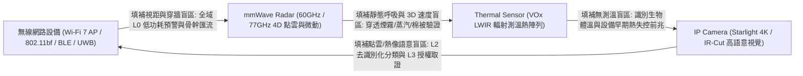

# 第一章：四模態感測融合之物理特性互補矩陣、跨領域應用掃描與 Top 5 旗艦應用深度剖析

> **章節範疇與核心命題**  
> 本章從物理感測機理與系統工程邊界出發，評估「**無線網路設備（Wi-Fi AP / 802.11bf / BLE / UWB）**、**IP Camera（RGB / Starlight / IR-Cut）**、**Thermal Sensor（LWIR 非製冷 VOx 熱像）**、**mmWave Radar（60GHz / 77GHz FMCW / 4D 成像雷達）**」四類異質節點的物理極限與盲區互補關係，進而於四大垂直產業掃描 15 項具體融合應用，並透過多維度加權評分矩陣篩選出最具商業爆發力與技術不可替代性的 **Top 5 旗艦應用** 進行深度剖析。

---

## 1.1 四模態物理特性定義與雙重／三重角色邊界

傳統物聯網感測往往落入「單一模態過載」或「系統孤島」的陷阱：光學攝影機具備極高語意辨識力，卻在黑暗、濃煙與隱私法規前寸步難行；毫米波雷達與熱像儀能穿透視覺遮蔽，卻缺乏身分／語意與全域通訊能力。本研究所探討的四模態異質融合架構，將四種設備的物理本質與系統分工重新校準如下：

1. **無線網路設備（Wireless Infrastructure as Triple-Role Backbone & Sensor）**：
   在融合架構中，無線網路設備（如企業級 Wi-Fi 7 AP 或工業無線閘道）不再僅是被動網路管線，而是同時承擔三重角色：
   - **角色 A — 高速低延遲傳輸骨幹**：透過 Wi-Fi 7（IEEE 802.11be）Multi-Link Operation（MLO）、320 MHz 頻寬、4096-QAM 與 PoE++（IEEE 802.3bt Type 3/4，供電 60W–90W），或 5G/乙太網路回傳，承載異質感測器匯流與低延遲告警傳輸。
   - **角色 B — 邊緣運算與時空匯流節點**：作為室內／場域的運算與邏輯中樞，執行異質時間對齊、跨模態觸發仲裁、端側 AI 推論與加密摘要封裝。
   - **角色 C — 主被動無線物理感測器**：
     - **Wi-Fi CSI / IEEE 802.11bf-2025（WLAN Sensing）**：IEEE 802.11bf 已於 **2025 年 9 月正式發布**，將通道狀態資訊（CSI）從過去的「封包副產物」升級為標準化排程量測協定（Sensing Measurement Exchanges, SMEs），支援 **Sub-7 GHz（1–7.125 GHz）宏觀跨牆／多房間存在感測** 與 **>45 GHz（主要為 60 GHz DMG/EDMG）微觀手勢／呼吸微動感測**。
     - **BLE AoA（Bluetooth Direction Finding）**：透過多天線陣列量測到達角相位差，提供 **0.3–1.0 m** 亞米級定位（代表晶片如 Nordic nRF52 / nRF54 系列），信標標籤可依靠鈕扣電池運行數年。
     - **UWB（Ultra-Wideband）**：利用亞奈秒脈衝進行 ToF / TDoA / TWR 測距（代表晶片如 Qorvo DW3000 系列），在複雜室內多路徑環境下達成 **10–30 cm** 釐米級精準定位與電子圍籬連動。
2. **IP Camera（RGB / Starlight / IR-Cut 視覺感測）**：
   - 採用 1080p（2MP）至 4K（8MP, 3840×2160）CMOS 影像感測器，搭配 **Starlight / Sony STARVIS** 大像素背照式感光元件，可在微弱環境光（如走廊夜燈）下維持全彩影像；結合機械式 **IR-Cut 雙濾光片切換器**，日間濾除近紅外線維持色彩還原，夜間或零照度時切換並搭配 850nm/940nm 主動紅外補光。透過 H.265 / Smart Codec 硬體編碼輸出高語意視覺畫面，負責「**最終物件分類、細節取證、文字／車牌／工具辨識與人臉／行為語意判定**」。
3. **Thermal Sensor（遠紅外線 LWIR 8–14 µm 非製冷微測輻射熱計）**：
   - 以 **氧化釩（VOx）非製冷微測輻射熱計（Microbolometer）** 接收物體自發射的長波紅外線（LWIR, 8–14 µm），將溫度輻射轉化為電阻變化與絕對輻射測溫（Radiometric）矩陣。具備免製冷、快速啟動（**<0.5 秒**）與極高熱靈敏度（**NETD < 40–50 mK**）等特性。依場域需求涵蓋三類規格：極低功耗陣列（如 Melexis MLX90640，32×24 像素，約 76 mW）、微型嵌入式測溫核（如 FLIR Lepton 3.5，160×120 像素，約 140–150 mW，高增益測溫範圍可達 **+400°C**），以及工業測溫型網路熱像儀（如 FLIR Boson+ 320×256 / 640×512 或 Axis Q19 系列 384×288 / 640×480）。
4. **mmWave Radar（60GHz / 77GHz FMCW / 4D 成像毫米波雷達）**：
   - 發射調頻連續波（FMCW）並分析回波時延、相位差與都卜勒頻移，直接輸出目標的 **3D 空間座標 $(x, y, z)$ 與徑向速度（4D 成像含仰角 Elevation 維度）**。60 GHz 頻段（57–64 GHz，代表如 TI IWRL6432 超低功耗存在雷達、TI IWR6843AOP 與 Vayyar 4D 成像陣列，視場角可達 120°–140°）擅長室內人體姿態點雲與 **亞毫米級胸腔起伏（呼吸、心跳）偵測**；77 GHz 頻段（76–81 GHz）具備更高頻寬與長距穿透力，主導交通路口、大型倉庫與戶外全天候目標追蹤。

---

## 1.2 四模態物理特性對照矩陣（九項工程維度與基準參考）

下表綜合各感測器公開規格書（Datasheet）、IEEE 802.11bf-2025 標準文件及經銷市場公開報價區間，逐一量化比較四大模態於九項關鍵物理／工程維度之表現（第十項維度「盲區互補關係」則於 1.3 節獨立展開閉環矩陣）：

| 評估維度 | 無線網路設備（Wi-Fi CSI / 802.11bf + BLE / UWB + AP） | IP Camera（RGB / Starlight / IR-Cut） | Thermal Sensor（VOx LWIR 8–14 µm 熱像） | mmWave Radar（60GHz / 77GHz FMCW 4D） |
| :--- | :--- | :--- | :--- | :--- |
| **代表規格／基準晶片參考** | Wi-Fi 7 AP（802.11be / 802.11bf）；BLE AoA（Nordic nRF52/54）；UWB（Qorvo DW3000） | 1080p–4K Starlight PoE IP Camera（Sony STARVIS CMOS + H.265） | MLX90640（32×24）；FLIR Lepton 3.5（160×120）；Axis Q19 / Boson+（384×288–640×512） | TI IWRL6432（60GHz ULP）；TI IWR6843AOP / Vayyar 4D；77GHz 4D 成像雷達 |
| **1. 空間與語意精度** | **空間粗～中／語意極低**：Wi-Fi CSI 為房間級／區域級存在感測（~1–3 m）；BLE AoA 約 **0.3–1.0 m**；UWB 達 **10–30 cm**；無法辨識外觀細節或物件類別。 | **空間極高（2D）／語意極高**：角解析度達毫弧度級，支援人臉、車牌、工裝、工具與細微動作分類；單目缺真實絕對深度，依賴 AI 推估。 | **空間中～高（2D）／語意中**：依解析度（32×24 至 640×512）區分人形／車輛輪廓與體溫分布，無法辨識表情、衣物顏色或文字標籤。 | **空間高（3D/4D）／語意低**：距離精度達公分級，具直接徑向速度向量（Doppler）；點雲較 LiDAR 稀疏，難以單獨區分外觀近似物體。 |
| **2. 穿牆／煙霧／全暗穿透力** | **穿牆強（Sub-7GHz）／全暗不受影響**：2.4/5/6 GHz 與 UWB 可穿透石膏板、木牆與非金屬隔間進行非視距（NLOS）存在偵測；完全無懼煙霧與全暗。 | **穿牆零／煙霧極弱／全暗依賴補光**：無法穿牆；濃煙、濃霧與粉塵嚴重散射可見光與 850nm IR；全暗下 Starlight 仍需微光或開啟 IR 補光。 | **穿牆零（含玻璃反射）／煙霧強／全暗極佳**：**無法穿透玻璃或實體牆壁**（長波紅外被普通玻璃阻隔）；可穿透輕中度煙霧、灰塵並在 **0 Lux 全暗** 下無須補光運作。 | **穿非金屬薄隔間／強煙霧／全暗極佳**：波長遠大於煙霧、粉塵、蒸汽與水霧微粒，**可穿透濃煙、蒸汽、塑膠與石膏板**（不可穿厚鋼筋混凝土或金屬），全暗下零衰減。 |
| **3. 全天候穩定度** | **室內極穩／室外抗雨霧佳**：電磁波不受光照與溫濕度影響，唯人體走動或金屬大型移動物會改變多路徑基線，需動態基線校準。 | **日夜與天候敏感**：易受逆光眩光（Headlight Bloom）、車燈反射、陰影晃動、暴雨與濃霧（MOR 下降）造成高誤報或失明。 | **中高（具溫差依賴性）**：不受光影干擾，於中度濃霧（Cerema PAVIN 測試 MOR ~13 m）仍可維持 **≥90%** 行人偵測率；唯**極端大雨或高溫日曬路面**（背景溫度趨近目標 $\Delta T \to 0$）時對比度下降。 | **極高（全天候霸主）**：免疫強光、陰影、雨雪、濃霧與環境溫度劇變；僅在極端暴雨水膜附著天線罩或強風吹動鄰近金屬百葉時需演算法濾波。 |
| **4. 生理／生命徵象能力** | **中（靜態微動／呼吸）**：60 GHz 802.11bf 或近距離多天線 Sub-7 GHz CSI 可估算呼吸率與睡眠翻身，但在多人共處或非視距牆後易受干擾。 | **極低～低（僅限可視 rPPG）**：僅在近距離無遮擋且光線充足下可透過臉部膚色微變推算心率（rPPG），在實務安防／照護視角下極不可靠。 | **中（體表溫度與發燒篩檢）**：可精準量測體表／額頭溫度異常，無法直接測得心跳頻率，僅能透過鼻腔氣流微溫差於極近距估算呼吸。 | **極高（非接觸黃金標準）**：60 GHz 雷達可量測 **亞毫米級胸腔位移**，呼吸率誤差 **1–2 breaths/min**、心率可達 **±5 bpm**（靜止／睡眠態），且具姿態與跌倒微都卜勒特徵。 |
| **5. 熱異常感測** | **無**：無法量測物體或環境溫度分布。 | **無（僅見明火/濃煙）**：僅能在已起火發光或產生大量可見煙霧後才被視覺模型識別（反應滯後）。 | **極高（核心不可替代能力）**：每像素直接輻射測溫（Lepton 3.5 NETD **<50 mK**，最高 **+400°C**），可於電氣起火或電池熱失控前數分鐘發現異常溫升梯度。 | **無**：僅能感測幾何距離與移動，無法直接測得溫度。 |
| **6. 隱私風險等級** | **極低（無線電物理特徵）**：Wi-Fi CSI 不含影像；BLE/UWB 僅涉及可隨機化或加密之裝置識別碼（惟需防範未授權 MAC 追蹤）。 | **極高（高風險個人資料）**：直接擷取可辨識人臉、衣著與私密行為影像，受 **GDPR / HIPAA / 個資法** 嚴格限制，禁入臥室、衛浴與更衣室。 | **低～中（依解析度而異）**：32×24 至 160×120 僅呈現模糊熱塊，**無可辨識五官**；高解析度 640×512 近距拍攝時具輪廓識別性，需端側遮罩或僅輸出告警座標。 | **極低（100% 無視覺隱私疑慮）**：僅輸出稀疏 3D/4D 點雲與距離／速度向量，無法辨別身分或裸露細節，天然符合 **Privacy-by-Design** 進入衛浴與臥室。 |
| **7. 常駐功耗** | **複合架構分層**：企業三頻 Wi-Fi 7 AP 全載通訊功耗約 **35–50W+（需 PoE++）**，但因為既有網路剛性常駐設備，**疊加 Wi-Fi CSI 感測的邊際硬體功耗極低**；終端 BLE/UWB 信標平均僅 **µW–數 mW** 級。 | **中高**：常駐 1080p–4K Starlight IP Camera 本體約 **3–5W**；夜間開啟 IR 補光燈或 PTZ 馬達與端側 AI 時攀升至 **8–12W+**（PoE 802.3af 級）。 | **極低～中**：OEM 裸模組極省電（MLX90640 約 **76 mW**；FLIR Lepton 3.5 運行 **140–150 mW**、快門 FFC 瞬時 650 mW、待機 **5 mW**）；整合 PoE 工業網路熱像儀（含編碼與加熱除霜）則需 **5–15W+**。 | **極低～中**：視佔空比與晶片定位而異——超低功耗存在雷達 TI IWRL6432 佔空比模式平均可低至 **<1.15 mW–數十 mW**；高密度 3D 點雲追蹤 TI IWR6843 約 **1.0–1.8W**（低功耗模式 **0.6–0.9W**，峰值 2.0–2.5W）。 |
| **8. 原始頻寬需求** | **極低～中**：單次原始 CSI 矩陣隨頻寬與天線數（$N_{tx}\times N_{rx}\times N_{st}$）增加；經 802.11bf 壓縮量化與差異化回報後，通常僅佔 **數十 kbps 至數百 kbps**；BLE/UWB 定位元數據 **<10–50 kbps**。 | **極高**：未壓縮 4K@30fps RGB Raw 流可高達 **>1.5–3 Gbps**；經 H.265 壓縮後 1080p 需 **1–3 Mbps**、4K 需 **4–8 Mbps**（全天候 24/7 上傳佔用巨量頻寬與儲存）。 | **低～中**：32×24@8Hz 原始矩陣僅約 **~100 kbps**；160×120@9Hz（16-bit 輻射測溫）約 **~2.8 Mbps** 未壓縮；高階 640×512@30Hz 經 H.265 編碼或邊緣只傳温度矩陣告警則降至 **<1 Mbps**。 | **極低（端側點雲）～極高（Raw ADC）**：若直接拉取 Raw IQ ADC（如透過 LVDS 接 DCA1000）高達 **10–100+ Mbps**；經片上 DSP/HWA 處理後僅透過 UART 輸出點雲與追蹤清單，實務僅需 **數十 kbps 至 <1–3 Mbps**（預設 Baud 921,600 bps）。 |
| **9. 單節點有效覆蓋成本比（採購成本 vs. 覆蓋範圍）** | **極優（基礎設施零重複佈線）**：企業級 Wi-Fi 7 AP 單機硬體約 **$300–$800+ USD**（消費級 **$100–$250**），單機穿牆宏觀感測覆蓋 **80–150 m²**（多房間）；因 AP 本即為通訊剛性建設，**邊際感測覆蓋成本趨近於極低**。 | **優（廣角單房視距）**：商用 4K Starlight PoE Camera 約 **$80–$250 USD**，視距覆蓋 **40–100 m²**（或室外 20–50 m 辨識距），單位視覺語意覆蓋性價比最高，但跨房需每房部署且無牆後覆蓋。 | **分化顯著（極兩極）**：消費/嵌入式模組 MLX90640 IC 約 **$35–$40**、Lepton 3.5 核心約 **$150–$200 USD**（覆蓋單一機櫃或小房間 15–40 m²）；工業防塵防水測溫 IP 熱像儀（Axis Q19 等）達 **$1,500–$4,500+ USD**（雙光 PTZ 更達 **$10,000–$35,000+**），覆蓋室外 50–300 m+。 | **高性價比（局部精準）**：60GHz 晶片量產 IC 級約 **$6–$10**（IWRL6432）至 **$45–$55**（IWR6843AOP）；商業封裝成品（如 Vayyar Care）約 **$240–$250 USD**（覆蓋單房 **16–25 m²**，4m×4m～5m×5m 跌倒高精度區）；77GHz 量產入門 4D 模組隨規模化已降至 **$30–$140 USD**（覆蓋車道/路口 50–150 m+）。 |

> **表 1-1 數據口徑說明**：上述指標均區分「晶片/OEM 核心模組」與「IP66/67 完整終端設備」之功耗與成本邊界；頻寬區分「感測器內部未壓縮原始資料流（Raw ADC / Raw Frame）」與「經端側 DSP/Codec 處理後進入網路骨幹之有效負載（Payload）」，以真實反映後續架構設計中 Edge 節點的匯流壓力。

---

## 1.3 物理「盲區互補關係」與四模態不可替代性閉環

實務上許多廠商嘗試「雙模態融合」（例如僅用 `IP Camera + Thermal` 或 `Wi-Fi + mmWave`），卻仍無法消除關鍵誤報或法規死角。下表與流程圖系統性地揭示 **兩兩組合的殘餘盲區** 以及 **四模態協同如何構成物理互補閉環**：

### 表 1-2：雙模態組合之殘餘盲區與四模態互補解決機制

| 既有雙模態組合 | 仍存在的致命盲區（工程與合規缺口） | 第 3／第 4 模態如何填補盲區（閉環價值） |
| :--- | :--- | :--- |
| **Wi-Fi CSI + IP Camera** | 1. **熱異常全盲**：配電盤過熱、電池熱失控 Stage 1 完全無視覺與無線擾動徵兆。 2. **濃煙與衛浴隱私缺口**：濃煙中 Camera 失效；臥室/衛浴等隱私區若不裝 Camera，Wi-Fi CSI 單獨無法精準區分「跌倒靜臥」與「正常躺床／寵物跑動」。 | **Thermal** 提供提前數分鐘之早期輻射測溫警報；**60GHz mmWave** 提供衛浴/臥室 100% 匿名 3D 姿態與胸腔呼吸確認，徹底免除在私密區啟動 Camera。 |
| **IP Camera + Thermal Sensor**（傳統雙光攝影機） | 1. **視距遮蔽與穿牆全盲**：貨架後方、牆後、窗簾/棉被遮蓋下完全失明；普通玻璃會反射並阻斷 LWIR 熱像。 2. **缺乏瞬間速度向量與靜態微動分辨**：無法直接測出目標速度方向，亦常將太陽曬熱的牆面、大型暖氣或高速移動物誤判，且常駐雙光連拍耗電與頻寬（4–8 Mbps/路）高。 | **Wi-Fi 802.11bf / UWB** 負責跨牆與大空間低功耗預警（L0 哨兵）；**mmWave Radar** 穿透棉被/蒸氣/粉塵提供真實距離與徑向速度，透過「移動速度＋熱源體溫」交叉驗證排除熱斑誤報。 |
| **mmWave Radar + Thermal Sensor** | 1. **語意辨識全盲**：知道「有 37°C 熱源以 1.2 m/s 移動」，卻無法分辨是「授權維運人員」、「攜帶危險品的入侵者」，還是「大型溫血動物/運作中馬達」。 2. **缺乏通訊骨幹與跨區預警**：兩者皆為區域感測器，無法如 Wi-Fi 7 AP 般提供廣域傳輸通道與跨房間追蹤。 | **無線網路設備** 提供傳輸骨幹、Edge 算力與跨房追蹤；僅當雷達與熱像確認「非預期區域異常熱動目標」時，**IP Camera** 才於端側喚醒執行語意分類（人/車/動物/工具）並產出去識別化骨架或加密存證。 |
| **Wi-Fi CSI + mmWave Radar** | 1. **無測溫能力**：無法感知工業過熱、電弧前兆或人員發燒異常。 2. **事故後取證與複雜語意空缺**：當發生蓄意入侵、工安違規（未戴安全帽）或長者嚴重跌傷需遠端醫護目視評估時，點雲與 CSI 無法提供事件發生的語意上下文。 | **Thermal** 補齊全天候非接觸測溫維度；**IP Camera** 在緊急狀態（L2/L3）經授權條件喚醒，提供具法律與醫療價值的影像驗證，平時則保持零影像留存。 |

---

## 1.4 跨領域融合應用廣泛掃描（15 項代表性場域）

基於上述四模態互補原理，我們針對 **「智慧照護／醫療／銀髮居家」**、**「智慧安防／商業空間／智慧建築」**、**「智慧工廠／工業安全」** 及 **「交通／無人零售／能源基礎設施」** 四大領域，全面掃描並彙整出 **15 項具體融合應用**：

### 表 1-3：四大領域 15 項四模態融合應用全景掃描

| 編號 | 所屬領域 | 融合應用名稱 | 核心觸發場景與痛點 | 四模態協同關鍵角色 | 核心價值主張 |
| :---: | :--- | :--- | :--- | :--- | :--- |
| **A1** | 智慧照護／醫療 | **銀髮居家與長照衛浴／臥室零穿戴跌倒與呼吸守護** | 長者拒戴穿戴裝置（未依規配戴率高達 23%）、衛浴/臥室禁用攝影機、慢速滑倒與離床失蹤。 | **AP/802.11bf**：跨房移動與離床偵測 **mmWave**：衛浴/床邊匿名 3D 跌倒與呼吸心跳 **Thermal**：失溫/體溫異常/地面人體熱輪廓確認 **Camera**：平時休眠，L3 危急確認與語音雙向關懷 | 兼顧 100% 衛浴隱私合規與低誤報率，消除護理站「警報疲勞」。 |
| **A2** | 智慧照護／醫療 | **失智症長者夜間徘徊走失預警與日夜節律（ADL）分析** | 失智長者半夜開啟大門、在危險區域（陽台/廚房）徘徊或長期臥床活動力退化。 | **BLE/UWB + Wi-Fi CSI**：門廳與跨房軌跡追蹤 **mmWave**：床邊離床與室內靜止/跌坐分辨 **Thermal**：廚房爐火遺忘乾燒＋人體位置確認 **Camera**：大門異常開啟時端側確認是否獨自外出 | 串聯「行為退化早期發現＋即時防走失與防乾燒」雙重安全網。 |
| **A3** | 智慧照護／醫療 | **醫院負壓隔離病房非接觸生理巡檢與突發發燒篩檢** | 降低醫護穿脫防護衣進入隔離病房頻率，防止高傳染病交叉感染並即時掌握呼吸窘迫。 | **Wi-Fi 7 AP**：病房醫療設備數據與感測回傳 **mmWave**：連續無接觸呼吸率（±1–2 rpm）與心率監測 **Thermal**：體表溫度連續趨勢與發燒突升預警 **Camera**：遠端醫療視訊會診與異常姿勢覆核（病患授權） | 減少醫護接觸風險與耗材成本，實現 24/7 無接觸連續生理看板。 |
| **A4** | 智慧照護／醫療 | **獨居長者用藥依從性與「突發生理失能」雙重關聯監護** | 長者獨居服藥時間未取藥，隨後出現昏迷、發燒或客廳跌倒，單一空間感測缺乏因果脈絡。 | **BLE/UWB**：藥盒/隨身信標觸發與位置確認 **Wi-Fi CSI**：全屋活動力基線驟降偵測 **mmWave + Thermal**：確認目標靜止無位移且體表溫度下降/異常 **Camera**：L2 端側骨架確認是否正常就寢或昏厥 | 將「行動軌跡、生理微動與熱徵象」結合，提前搶救黃金救援時間。 |
| **B1** | 智慧安防／建築 | **關鍵園區與倉儲全天候零誤報周界入侵偵測** | 夜間強光眩光、暴雨濃霧、流浪動物（狐/貓/鳥）及搖晃樹影造成傳統 PIR/CCTV 每日數十次誤報。 | **Wi-Fi / UWB**：巡檢員身分信標自動白名單解防 **mmWave**：穿透雨霧量測速度與距離（排除搖晃樹影） **Thermal**：夜間/霧中偵測溫血輪廓與人型尺寸過濾 **Camera**：異常觸發後高解析確認車牌/人臉/翻越動作 | 消除 90%+ 環境與野生動物誤報，顯著降低保全人力出勤與監控頻寬。 |
| **B2** | 智慧安防／建築 | **智慧商辦精準佔用感知與 HVAC/照明零「誤關」節能** | 傳統 PIR 無法偵測靜坐打字人員造成頻繁「False-Off」，迫使大樓拉長 30–60 分鐘延遲造成巨大空調浪費。 | **Wi-Fi CSI + AP**：樓層/辦公區人數密度宏觀調節外氣 **mmWave**：辦公位呼吸微動確認「真有人」消除誤關 **Thermal**：計算室內熱負荷與人員散熱分布調節風閥 **Camera**：非辦公時段入侵異常喚醒取證 | 兼顧極致空調/照明節能（縮短無人延遲至 5 分鐘內）與零客訴體驗。 |
| **B3** | 智慧安防／建築 | **智慧零售熱區動線、高隱私試衣間防昏倒與貨架防竊** | 顧客拒斥攝影機監看試衣間；店內需精準計算轉換率、排隊長度並偵測高單價櫃位異常聚集。 | **Wi-Fi / BLE**：巨觀商場回訪率與動線停留時長 **mmWave**：100% 匿名試衣間/洗手間人數與跌倒救援 **Thermal**：入口昏暗環境人流計數與熱區停留輔助 **Camera**：端側匿名統計結帳排隊與貨架異常取物取證 | 突破零售業 GDPR 隱私紅線，整合人流變現分析與突發安全守護。 |
| **B4** | 智慧安防／建築 | **博物館／金庫／資料中心「跨牆預警＋去識別化存證」** | 宵小由鄰室鑿牆或破壞管道間潛入，傳統室內攝影機在破牆前完全不知，且平時錄影涉及員工隱私。 | **Wi-Fi CSI**：牆體與鄰接空間異常無線通道擾動偵測 **mmWave**：穿透輕隔間偵測牆後異常人員靠近 **Thermal**：偵測人體熱源與電動切割工具高溫發熱 **Camera**：僅於高危驗證成立時喚醒高畫質加密錄影 | 實現「侵入發生前」的早期預警與合法合規的低儲存架構。 |
| **C1** | 智慧工廠／工安 | **人機協作（HRC）安全圍籬動態降速與防夾撞守護** | 工廠光影劇變、水霧或垂掛電纜晃動常引發傳統安全光柵/視覺誤停機，頻繁急停嚴重損失產能。 | **UWB**：作業員配戴安全帽標籤識別人員授權等級 **mmWave**：穿透油霧/粉塵精準量測人手與機械臂間距及速度 **Thermal**：確認目標具人體體溫特徵，排除機械零件或晃動電纜 **Camera**：視覺確認人員姿勢與安全裝備合規性 | 符合 ISO/TS 15066，大幅削減誤急停停機損失（False Stops）。 |
| **C2** | 智慧工廠／工安 | **高壓配電盤、馬達軸承與變壓器熱異常早期火災預警** | 傳統煙感於起火後才動作；純熱像常因陽光直射或熱風干擾誤報；高壓電弧區人員巡檢具高風險。 | **Wi-Fi 7 / 工業無線**：低延遲傳輸與異質資料邊緣匯流 **Thermal**：24/7 輻射測溫追蹤接點異常溫升梯度（$\Delta T / \Delta t$） **mmWave**：偵測周邊人員接近警告（電弧閃絡防禦）與機器異常震動 **Camera**：異常熱點觸發後對焦拍攝錶頭數值、指示燈或冒煙狀態 | 提前數週～數小時預測絕緣劣化與接觸不良，避免非計畫停機與火災。 |
| **C3** | 智慧工廠／工安 | **智慧倉儲堆高機／AGV 與人員粉塵冷鏈盲區防撞系統** | 冷凍庫結霧、料架轉角視線死角與揚塵環境使光學相機失能，堆高機盲區碰撞為工安主因。 | **UWB**：車載錨點與人員標籤 10–30 cm 跨貨架預警 **mmWave**：穿透冷氣水霧與粉塵量測障礙物即時距離與相對速度 **Thermal**：冷鏈低溫環境極高對比度鎖定作業員體溫輪廓 **Camera**：端側語意辨識人員/棧板/立柱，降低無謂急煞 | 雙重消除轉角遮蔽盲區與低溫結霧視覺退化，保護倉儲人員安全。 |
| **C4** | 智慧工廠／工安 | **鋰電池儲能站（BESS）與 EV 快充場「熱失控截斷＋濃煙搜救」** | 鋰電池熱失控 Stage 1–2（內熱與電解液洩漏）早於明火；開放場域氣流稀釋煙霧使煙感延遲；起火後濃煙蔽日。 | **Wi-Fi / 5G 閘道**：毫秒級連動 BMS 與充電樁斷電跳脫 **Thermal**：預警電池櫃/充電槍異常升溫（如 $>70^\circ\text{C}$ 異常熱點），比煙感早數分鐘 **mmWave**：濃煙全盲下穿透煙霧定位受困人員位置與生命徵象 **Camera**：日常辨識車牌/插槍異常，事故時確認火勢與外溢範圍 | 在起火前自動切斷充電/負載阻斷連鎖反應，災時引導消防搜救。 |
| **D1** | 交通基礎設施 | **智慧路口弱勢用路人（VRU）濃霧暴雨防撞與 V2X 預警** | 濃霧、夜間對向車燈眩光與暴雨導致路口攝影機與 LiDAR 漏檢行人、單車騎士（VRU）。 | **Wi-Fi / C-V2X 路側單元**：即時廣播碰撞風險給周邊車輛 **77GHz 4D 雷達**：抗雨霧長距鎖定 VRU 4D 軌跡與時間碰撞（TTC） **Thermal**：補齊靜止行人熱像特徵（提升霧雨 mAP 15–20%） **Camera**：晴朗/微光下辨識號誌狀態、車種與違規行為 | 降低惡劣天候下路口死亡事故，加速計算預警時間窗。 |
| **D2** | 交通／地下空間 | **長距離公路隧道／地下停車場火警偵測與濃煙受困定位** | 隧道通風高速氣流吹散煙霧導致傳統煙感嚴重延遲；火災發生後濃黑煙使所有可見光 CCTV 瞬間失明。 | **Wi-Fi / 專網骨幹**：隧道段間高速傳輸與緊急廣播匯流 **Thermal**：穿透初期煙霧偵測車輛底盤過熱或起火點溫度場 **mmWave**：穿過極濃黑煙持續追蹤滯留車輛與人員呼吸／移動座標 **Camera**：火災前辨識交通事故/逆向，起火初期協助判讀車型 | 解決隧道救災最大盲點——「濃煙中到底有幾人困在哪一車道」。 |
| **D3** | 能源基礎設施 | **無人變電站（Substation）／太陽能案場設備健康與防盜防護** | 變電站偏遠分散、高壓設備具致命電弧風險、夜晚竊盜或野生動物闖入造成非計畫跳電。 | **Wi-Fi / 5G 邊緣閘道**：傳送設備壽命指標並大幅節省偏遠回傳頻寬 **Thermal**：連續監測變壓器套管與太陽能匯流箱熱點，降低非計畫停機高達 73% **mmWave**：過濾風吹雜草與動物，精準追蹤翻牆人員動態 **Camera**：僅於確認異常闖入或溫升警報時回傳高清照片存證 | 以單一整合架構同時滿足高價值能源資產「預測性維護＋防盜安防」。 |

---

## 1.5 Top 5 旗艦應用篩選評分矩陣與深度剖析

為確保資源聚焦於具備「最高技術門檻保護、最強剛性需求、最清晰商業回本路徑」的應用場景，本研究建立五維度加權評分矩陣（滿分 100 分），對上述 15 項應用進行系統性評比：

### 1.5.1 評分維度與給分標準（總權重 100%）

1. **市場剛需與痛點迫切度（25%）**：單／雙感測器失敗的後果嚴重性（人命安全、巨額財損或法規強制合規）及市場規模。
2. **四模態技術互補不可替代性（25%）**：是否真正需要四類異質訊號（含無線骨幹／感測、雷達、熱像、視覺）共同解決，而非少數感測器即可勝任。
3. **Privacy-by-Design 隱私與法規優勢（20%）**：透過 L0–L3 低隱私分級喚醒機制，能否解決既有產業因 GDPR、HIPAA 或勞資／顧客隱私抗拒而無法落地的痛點。
4. **商業 ROI 與經濟效益（15%）**：客戶投資回本週期（Payback Period）清晰度與單點節省成本（人力、誤停機、保費、災損或電費）潛力。
5. **既有設備利舊與規模化落地可行性（15%）**：能否複用現有 Wi-Fi AP / PoE / IP Camera 基礎設施漸進部署，標準化複製難度低。

### 1.5.2 15 項跨領域應用量化評分總表

| 排名 | 編號 | 應用名稱（簡稱） | 市場剛需 (25%) | 技術不可替代性 (25%) | 隱私法規優勢 (20%) | 商業 ROI (15%) | 落地可行性 (15%) | 加權總分 (100) | 是否入選 Top 5 |
| :---: | :---: | :--- | :---: | :---: | :---: | :---: | :---: | :---: | :---: |
| **1** | **A1** | **銀髮居家／長照衛浴零穿戴跌倒與生命徵象守護** | 9.6 | 9.2 | **9.8** | 8.8 | 9.0 | **93.3** | **★ Flagship #1** |
| **2** | **C4** | **儲能站（BESS）／EV 超充站熱失控截斷與濃煙搜救** | **9.8** | **9.6** | 7.6 | **9.5** | 8.6 | **90.9** | **★ Flagship #2** |
| **3** | **B1** | **關鍵園區／倉儲全天候零誤報周界入侵偵測** | 8.8 | 8.8 | 8.4 | 9.0 | **9.2** | **88.1** | **★ Flagship #3** |
| **4** | **C1** | **人機協作（HRC）／智慧倉儲盲區與粉塵安全防護** | 9.2 | 9.4 | 8.0 | 8.6 | 8.2 | **87.7** | **★ Flagship #4** |
| **5** | **B2** | **智慧商辦微氣候 HVAC 零誤關節能與分級安防** | 8.4 | 8.4 | 9.0 | 8.8 | **9.4** | **87.3** | **★ Flagship #5** |
| 6 | D3 | 變電站／太陽能案場預測性維護與防盜 | 9.0 | 8.6 | 7.2 | 9.2 | 8.0 | 84.2 | 候補 |
| 7 | C2 | 工廠高壓配電盤熱異常預警與電弧人員防護 | 9.0 | 8.8 | 7.0 | 8.8 | 8.2 | 84.0 | 候補 |
| 8 | A2 | 失智長者夜間徘徊防走失與廚房防乾燒 | 8.6 | 8.2 | 9.0 | 7.6 | 8.2 | 83.7 | 候補 |
| 9 | B3 | 智慧零售動線與高隱私試衣間安全守護 | 7.8 | 8.2 | 9.2 | 8.2 | 8.6 | 83.6 | 候補 |
| 10 | C3 | 倉儲堆高機／AGV 冷鏈結霧與視線死角防撞 | 8.8 | 8.6 | 7.5 | 8.5 | 8.0 | 83.3 | 候補 |
| 11 | D2 | 公路隧道／地下空間火警與濃煙受困定位 | 9.0 | 9.2 | 7.4 | 7.8 | 7.4 | 83.1 | 候補 |
| 12 | B4 | 博物館／金庫跨牆預警與去識別化存證 | 8.0 | 8.8 | 8.2 | 7.8 | 7.8 | 81.8 | 候補 |
| 13 | D1 | 智慧路口 VRU 濃霧暴雨防撞與 V2X 預警 | 8.8 | 8.4 | 7.6 | 7.4 | 7.2 | 80.1 | 候補 |
| 14 | A3 | 負壓隔離病房非接觸生理巡檢與發燒篩檢 | 8.2 | 8.0 | 8.2 | 7.6 | 7.4 | 79.4 | 候補 |
| 15 | A4 | 獨居長者用藥依從性與失能關聯監護 | 7.8 | 7.6 | 8.6 | 7.2 | 7.6 | 77.9 | 候補 |

> **篩選洞察**：觀察 Top 5 結果可發現，得分最高者皆具備「**無法由單一感測器解決的複合物理矛盾**」（如：必須在極私密空間偵測跌倒、必須在起火前偵測內熱又要在濃煙後搜救、必須抗雨霧動物同時又要保留影像取證、必須跨樓層利舊現有 Wi-Fi AP 達到 HVAC 節能）。*(註：針對工業設施與電力場域，Flagship #2 實務上常與 C2 配電盤防護及 D3 變電站架構高度共構；Flagship #4 亦涵蓋 C3 廠內物流搬運安全。)*

---

### 1.5.3 Top 5 旗艦應用深度剖析

#### 【Flagship #1】銀髮居家與長照衛浴／臥室「零穿戴、Privacy-by-Design」跌倒與生命徵象守護系統
*加權評分：93.3 分（市場剛需 9.6 / 不可替代性 9.2 / 隱私優勢 9.8 / ROI 8.8 / 落地可行性 9.0）*

1. **系統性痛點：為何單一與雙模態皆告失效？**
   - **穿戴式裝置的高棄用率**：緊急求救鈕與智慧手錶雖普及，但根據長照科技採用基線調查（Origin Wireless 引用數據），**高達 23% 的長者並未依醫護要求配戴足夠時數**，洗澡、如廁、夜間睡覺或失智忘記充電時恰為跌倒最高風險時刻，形成致命監測空窗。
   - **純視覺攝影機的隱私紅線**：在臥室、更衣與衛浴部署 24 小時錄影機不僅直接違反 **GDPR 資料最小化原則（Article 5）**，更引發嚴重的「Granny Cam」倫理爭議與家屬／住民強烈拒裝。
   - **護理站「警報疲勞（Alarm Fatigue）」**：臨床與安防研究指出，醫療及照護監測設備的警報中高達 **80% 至 99% 為誤報或無需處置事件**。若單用 Wi-Fi CSI，寵物跳動、掃地機器人或隔壁房間走動皆易觸發誤報；若單用 60GHz 雷達，長者「快速坐下、撿拾地板物品、緩慢沿牆滑倒」或被大型家具遮擋（Occlusion）時，仍存在漏報與誤報風險。
2. **四模態感知鏈具體分工**
   - **無線網路設備（Wi-Fi 7/6E AP + 802.11bf CSI / BLE）**：扮演骨幹、邊緣匯流中樞與宏觀哨兵。利用 Sub-7 GHz 跨房穿透特性持續追蹤全域活動節律（ADL），偵測夜間「離床超過設定時間未回」或客廳/走廊突發急停動作，並以低功耗喚醒局部節點。
   - **60GHz mmWave Radar（如 TI IWR6843AOP / IWRL6432 / Vayyar 4D）**：部署於衛浴與床頭，穿透水蒸氣與棉被取得 3D 空間高度剖面與姿態軌跡，更在人員倒地靜止後立即量測亞毫米級胸腔呼吸起伏（區分「意識清醒躺地休憩」或「昏迷無呼吸反應」）。
   - **Thermal Sensor（低解析度陣列如 32×24 至 160×120 VOx）**：非視覺方式交叉驗證倒地目標是否具備 **34°C–37°C 人體體表熱輪廓**（瞬間剔除掉落的棉被、大型抱枕或機械寵物誤報），並偵測長者夜間發燒或失溫異常。
   - **IP Camera（Starlight 4K，預設物理/邏輯休眠）**：平時完全不擷取也不傳輸串流。僅在極端危急確認（如倒地無呼吸、超過 60 秒無移動且護理端需遠端評估傷勢）時啟動，優先於邊緣輸出「去識別化火柴人骨架＋匿名邊界框」；唯經家屬／機構預先授權的緊急救護時刻方才開啟加密視訊確認意識與雙向通話。
3. **Privacy-by-Design 結合方式（L0→L3 分級觸發）**
   - **L0 常駐感知**：僅由 Wi-Fi AP（802.11bf CSI）與休眠待命的低功耗雷達感測宏觀擾動，全屋 **零影像擷取**。
   - **L1 非視覺交叉驗證**：Wi-Fi 發現某區域驟停或衛浴滯留異常 $\to$ 喚醒 60GHz 雷達追蹤空間高度與微動呼吸，同時由低解析 Thermal 確認人體熱源及體溫異常（非動物或掉落物）。
   - **L2 邊緣去識別化骨架（視授權區域）**：客廳／走廊可觸發 IP Camera 端側推論，僅抽取出關節點座標確認跌倒姿態，原始畫面於記憶體內即時銷毀。
   - **L3 緊急授權存證與通話**：唯有「雷達＋熱像」雙重確診重度跌倒或生命徵象消失，始開啟高優先加密連線通報家屬／119。
4. **融合後量化效益指標**
   - **誤報率下降**：單純 60GHz 雷達在受控環境跌倒偵測率約 **97%–99.5%**、CSI（如 DeFall 研究）誤報率約 **<1.5%–2%**；實務上護理場域面臨大量家具與寵物干擾。`[合理工程推估]` 結合「Wi-Fi 宏觀活動狀態＋60GHz 跌倒速度/呼吸驗證＋Thermal 人體體溫過濾」三重聯鎖邏輯後，較傳統單一警報機制可將**實務環境誤報率再降低 75%–90%**，實質緩解照護人力警報疲勞。
   - **頻寬與儲存節省**：相較 4K Camera 全時 H.265 錄影每路需 **4–8 Mbps**（每日約 43–86 GB/路），四模態 L0–L1 常駐狀態下僅上傳數十 kbps 狀態事件，`[合理工程推估]` **全屋常態回傳頻寬與雲端儲存成本節省 >95%**（基準文獻指出事件觸發式架構普遍可節省 90%–95% 回傳流量）。
   - **反應時間**：無穿戴觸發免除長者昏迷無法按鈕的無限延遲；`[合理工程推估]` 結合局部邊緣 NPU 推論，從跌倒觸地到三重非視覺確認發出警報可控制於 **1.5–3.0 秒內**（包含確認倒地後是否爬起之短暫靜止觀察窗）。

---

#### 【Flagship #2】鋰電池儲能站（BESS）／EV 超充站與高壓配電設施「熱失控前兆截斷＋濃煙穿透搜救」防護系統
*加權評分：90.9 分（市場剛需 9.8 / 不可替代性 9.6 / 隱私優勢 7.6 / ROI 9.5 / 落地可行性 8.6）*

1. **系統性痛點：為何單一與雙模態皆告失效？**
   - **傳統煙霧偵測的致命滯後**：鋰離子電池熱失控屬多階段連鎖反應（Stage 1 內部微短路異常升溫 $\to$ Stage 2 130°C–200°C+ 排氣洩漏有毒可燃氣體 $\to$ Stage 3 $>1000^\circ\text{C}$ 射流火焰）。傳統光電／離子煙感僅能於 Stage 2 末期或 Stage 3 起火後作動；且在**開放式／半戶外 EV 超充停車場與強通風 BESS 貨櫃**中，氣流稀釋會使煙霧延遲數分鐘才抵達天花板偵測器，錯失斷電黄金期。
   - **單用熱像儀的「高溫環境誤報」與「災後致盲」**：夏季陽光直射電動車深色車頂、剛結束高速行駛的高溫煞車碟盤與排氣管，極易使純熱像閾值法誤觸發；此外，若櫃體遮蔽或一旦電池起火伴隨超高溫射流火焰，標準測溫範圍（如 +400°C）會飽和，且濃黑毒煙使救災時無法判斷現場是否仍有充電車主／維運員受困。
   - **既有變電與工業數據佐證**：依 EPRI 與 DNV 分析，BESS 事故多源自空調失靈凝露、液冷滲漏或電氣接頭過熱；而在大型變壓器／配電設施導入連續熱像與監測後，文獻指出可將**非計畫停機時間降低高達 73%**，並避免單顆 **$10萬至 $200萬美元以上** 的變壓器毀損與電網罰款。
2. **四模態感知鏈具體分工**
   - **Thermal Sensor（測溫型 VOx，如 Lepton 3.5 / Boson+ / 工業熱像 IP 系統）**：24/7 掃描電池機櫃接頭、充電槍／電纜與車輛底盤電池包表面，偵測異常局部熱點（如 $>70^\circ\text{C}$ 警告或異常溫升斜率 $\Delta T/\Delta t$），於**開火冒煙前數分鐘（Stage 1）**發出早期預警。
   - **IP Camera（4K 工業寬動態）**：辨識車牌與充電槍插入狀態，並將高溫熱點與空間物件語意綁定——例如**自動區分「引擎蓋／煞車碟盤散熱（正常高溫）」與「底盤電池包／充電座接點過熱（真風險）」**，徹底消除陽光與車輛餘熱誤報。
   - **mmWave Radar（60GHz/77GHz 4D 成像雷達）**：於熱點異常時即時確認周邊人員存在與動態軌跡，於執行高壓急停跳脫或惰性氣體滅火前確認人員撤離狀況；若不幸進入 Stage 3 濃煙火災，**mmWave 穿透極濃黑煙與火焰煙霧**持續定位受困人員位置與生命徵象，提供消防隊精準座標。
   - **無線網路設備（工業寬溫 Wi-Fi 7 + 5G/乙太 PoE++ 閘道）**：負責在無外網盲區（地下停車場／偏遠儲能站）構建低延遲邊緣運算與通訊中樞，接收 BMS/EMS 訊號並毫秒級下達充電樁切斷指令，同時透過去中心化 Mesh/5G 將熱圖摘要與搜救點雲即時推送給消防指揮車。
3. **Privacy-by-Design 結合方式**
   - 商業停車場與公共充電站涉及大量車主臉孔與車牌隱私。日常由 **Thermal（熱異常監測）+ mmWave（車位佔用與人員動態）** 作為 L0–L1 主力監控，**無須全時錄製車主影像**。
   - 僅當發生「異常溫升熱點」或「深夜非營業時段入侵」時，始喚醒 IP Camera 於端側執行車種／部位語意標定與車牌加密記錄（供截斷電源與保險事故鑑定），並對無關路人自動去識別化遮罩。
4. **融合後量化效益指標**
   - **早期預警提前時間窗（Lead Time）**：相較傳統煙霧偵測器（Stage 2 末–Stage 3 動作），輻射測溫熱像可在 Stage 1 異常溫升期（如電池表面達到 60–70°C 異常梯度時）搶先截斷充電電源，**預警時間較傳統煙感提前數分鐘至數十分鐘**（變壓器／配電接頭漸進劣化甚至可提前 **3–18 個月** 偵測，出自 Oxmaint/工業 PdM 基準）。
   - **非計畫停機與誤報改善**：結合「Camera 部位語意遮罩（排除煞車盤／太陽反光）＋ Thermal 絕對測溫矩陣」，`[合理工程推估]` 可消除 **85%–95%** 的陽光熱反射與車體餘熱誤報；並承襲變電所自動化監測基準，協助關鍵電力設施減少高達 **73%** 的非計畫停機風險，單次成功阻斷 EV/BESS 熱失控即可避免數十萬至數百萬美元財損與品牌商譽損失。
   - **災時搜救可視率**：在可見光 Camera 視距歸零（0 m）的濃煙環境下，mmWave Radar 仍維持 **90% 以上空間位置與微動穿透追蹤能力**。

---

#### 【Flagship #3】關鍵園區／倉儲全天候「零誤報」周界入侵偵測與分級喚醒安防系統
*加權評分：88.1 分（市場剛需 8.8 / 技術不可替代性 8.8 / 隱私優勢 8.4 / ROI 9.0 / 落地可行性 9.2）*

1. **系統性痛點：為何單一與雙模態皆告失效？**
   - **傳統 PIR 與純光學監視器的誤報災難**：產業統計顯示，傳統被動紅外線（PIR）受風吹草動、昆蟲與陽光驟變影響，每日可產生 **20 至 50 次以上誤報**；純 RGB 攝影機在夜間則飽受蚊蟲撲燈、樹影搖晃、車燈眩光與暴雨霧氣困擾，導致保全監控中心（SOC）對告警麻木，且大量無人夜間畫面持續以 4–8 Mbps 傳輸佔滿上行頻寬。
   - **純熱像儀（Thermal-Only）在氣候與生物上的限制**：雖然熱像搭配 Edge AI 分類可過濾約 **85%–95%** 的野生動物與背景雜訊，但面對「中大型溫血動物（大型野狗、鹿、狐狸）接近鏡頭造成像素面積近似人類」、「夏季高溫柏油路面熱氣閃爍（Thermal Shimmer）」，或「暴雨導致環境與體表溫差 $\Delta T$ 縮小」時，仍會產生誤報或邊界漏報；此外，工業級高解析熱像儀單價高昂（$1,500–$10,000+ USD），全面高密度鋪設不符成本效益。
2. **四模態感知鏈具體分工**
   - **無線網路設備（戶外 Mesh AP / UWB / BLE 白名單）**：提供全域骨幹回傳，並利用夜間巡邏保全配戴的加密 BLE / UWB 識別信標進行「動態白名單自動核銷」，巡邏人員經過感測區時不觸發誤報。
   - **mmWave Radar（77GHz / 60GHz 廣域追蹤）**：全天候無懼暴雨、濃霧與熱浪，精準量測進入警戒線目標的「真實距離、移動速度向量與人體步態微都卜勒（Micro-Doppler）特徵」——搖晃樹枝呈往復零淨位移直接剔除，低矮快速移動的小型動物亦因質心高度與反射截面（RCS）被過濾。
   - **Thermal Sensor（中低階 VOx 陣列或策略佈點熱像）**：無須全面採購天價長距熱像，僅於關鍵盲區與暗區配合雷達觸發驗證目標是否具備「人類恆溫體熱特徵」與垂直站立輪廓，確認於霧夜中（Cerema 測試 MOR ~13m 仍達 $\ge 90\%$ 偵測）不漏抓穿深色隱身衣之入侵者。
   - **IP Camera（Starlight 4K 變焦/定點攝影機）**：僅在「非白名單人員＋雷達確認人類步態逼近＋熱像確認溫血人類輪廓」後喚醒變焦拍攝高清人臉、車牌或破壞工具，作為報警派遣與司法呈堂證據。
3. **Privacy-by-Design 結合方式**
   - 園區外圍緊鄰公共道路或鄰近民宅時，傳統 24/7 全時廣角攝影極易觸犯鄰近隱私拍攝規範。本架構平時將跨越園牆以外視角設為零影像錄製，由 **Wi-Fi 信標核銷＋雷達/低階熱像在圍牆內側作物理預警（L0–L1）**，唯有真正翻越電子圍籬進入管制區內的事件才觸發定向攝影機拍攝，徹底杜絕無辜路人影像留存。
4. **融合後量化效益指標**
   - **誤報率下降**：整合 Thermal Edge-AI 與物理運動軌跡驗證，相較傳統 PIR 每日 20–50 次誤報可消減 **90%–95%+**（基準業界數據）；再疊加 77GHz 雷達的都卜勒步態與速度篩檢及 UWB 保全白名單，`[合理工程推估]` **綜合周界誤報率可壓低至每百公尺每月 <1–2 次（較傳統 PIR/動態偵測降低 >98%）**，直接節省夜班保全無效派遣與 SOC 監看人力成本。
   - **回傳頻寬與硬體 TCO 最佳化**：`[合理工程推估]` 採用「低價雷達＋中階熱陣列＋現有 Starlight 相機」分層配置，相較全面換裝高階雙光熱像 PTZ（單機 $10,000+ USD）可**降低約 40%–60% 初期硬體部署成本**；事件喚醒傳輸策略亦節省 **>90% 夜間冗餘錄影儲存與無線骨幹頻寬**。

---

#### 【Flagship #4】智慧工廠人機協作（HRC）與倉儲堆高機／AGV 粉塵盲區動態安全守護系統
*加權評分：87.7 分（市場剛需 9.2 / 技術不可替代性 9.4 / 隱私優勢 8.0 / ROI 8.6 / 落地可行性 8.2）*

1. **系統性痛點：為何單一與雙模態皆告失效？**
   - **誤停機（False Stops）的巨額產線代價**：在機械手臂協作區或自動化產線，安全感測面臨「兩難困境」——過於敏感會因為**電纜垂落晃動、金屬反光、焊煙粉塵、甚至飛蛾**頻繁觸發緊急停止（E-Stop），每次產線非計畫重啟皆耗時數分鐘至數十分鐘並造成半成品報廢；過於遲鈍則導致嚴重夾撞或工安致命事故。
   - **倉儲冷鏈與高架貨架死角**：冷凍倉儲出入口嚴重結霧、多層貨架轉角形成視線遮蔽（Line-of-Sight Occlusion），單靠車載攝影機或 2D 光達（LiDAR）無法提前知道貨架背後正有人員衝出，在濃霧或強逆光下亦會失靈。
2. **四模態感知鏈具體分工**
   - **無線網路設備（UWB + 工廠 Wi-Fi 7/專網邊緣節點）**：作業員安全帽或工裝配戴輕量 UWB 標籤（精度 **10–30 cm**），實現**跨貨架、跨牆面的視線盲區提前預警**（堆高機尚未轉彎前即知後方 5 公尺有人員），同時區分「一般訪客」與「授權維運工程師」，依權限動態縮放安全半徑。
   - **mmWave Radar（60GHz/77GHz 工業級）**：直接安裝於機械手臂基座或堆高機四周，穿透廠房焊煙、油霧、水氣與粉塵，實時輸出作業員手部／軀幹精確距離與逼近速度向量，計算動態安全減速邊界（符合 **ISO/TS 15066 功率與力量限制安全規範**）。
   - **Thermal Sensor（中低階 VOx 熱像）**：在鋼鐵、機械或冷鏈背景中迅速剝離「活體人員熱特徵」與「無生命晃動電纜、塑膠布簾或掉落紙箱」，大幅消除安全圍籬的誤觸發急停。
   - **IP Camera（邊緣視覺 AI）**：協助判讀作業員是否正確配戴安全帽／反光背心，以及手部意圖姿態（區分「正常協作遞料」與「身體失衡跌入危險軌跡」），並於事故發生前留下合規安全稽核片段。
3. **Privacy-by-Design 結合方式**
   - 工廠員工對於工作場域「全程攝影監視工作績效（Micromanagement）」普遍極度反感且涉及工會與勞動法規爭議。本架構在日常協作期間僅依靠 **UWB 匿名 ID＋mmWave 點雲座標＋Thermal 輪廓（L0–L1）** 執行即時防撞減速與安全帽合規邊緣判定，**IP Camera 原始人臉畫面於端側即時模糊去識別化且不存檔**；僅當發生違規闖入禁區或真實碰撞急停事件時，始調閱加密片段進行工安檢討（L3）。
4. **融合後量化效益指標**
   - **誤停機（False Positives / E-Stops）下降**：`[合理工程推估]` 藉由「Thermal 人體體溫過濾非生物晃動＋mmWave 真實逼近速度矢量＋UWB 授權人員分級半徑」三重驗證，相較單一 2D 安全光柵或純視覺圍籬，預期可**減少 70%–85% 不必要的誤急停次數**，顯著提升產線稼動率（OEE）。
   - **端對端緊急反應延遲**：依靠本地 Edge 節點直接匯流 mmWave 與 UWB 測距並下達 PLC 安全降速訊號（跳過雲端），端對端控制觸發延遲可壓縮於 **< 50–150 ms** 內，滿足工業即時功能安全需求。
   - **零人員識別追蹤風險**：透過將工作人員定位抽象為匿名 UWB/點雲座標與邊緣去識別骨架，順利化解勞資隱私摩擦，加快跨廠區導入時程。

---

#### 【Flagship #5】智慧商辦／醫療院所「微氣候 HVAC 精準節能與非侵入安全巡檢」一體化系統
*加權評分：87.3 分（市場剛需 8.4 / 技術不可替代性 8.4 / 隱私優勢 9.0 / ROI 8.8 / 落地可行性 9.4）*

1. **系統性痛點：為何單一與雙模態皆告失效？**
   - **PIR「False-Off」造成的節能死結**：商業大樓 HVAC 空調耗能佔建築總用電最大宗。傳統 PIR 感測器仰賴人員大幅度移動切換紅外熱區；當員工專注靜坐打字、閱讀或開會時，PIR 會誤判房間無人而觸發「**False-Off（誤關冷氣／熄燈）**」引發強烈客訴。工程師為此被迫設定長達 **30–60 分鐘的「無人延遲關機」**，導致員工下班或會議散場後空房持續吹送冷氣長達一小時，節能效益大打折扣。
   - **單用 Wi-Fi 或單用 mmWave 的限制**：若僅靠 AP 連接裝置數或 Wi-Fi CSI 估算，一人攜帶筆電＋手機＋平板會造成人數高估（或訪客未連網漏估），且粗粒度無法精準控制獨立會議室 VAV 風閥；而若僅用高靈敏 mmWave 雷達，又容易「穿透玻璃隔間偵測走廊行人」或將「空調扇葉／窗簾微飄」誤判為有人在座，反而讓冷氣徹夜無法關閉。
   - **辦公區全時錄影的法規與員工反彈**：在開放辦公區或休息室加裝攝影機點算人頭，於歐盟 GDPR 及各國職場隱私規範下阻力極大。
2. **四模態感知鏈具體分工**
   - **無線網路設備（企業天花板吸頂 Wi-Fi 7/6E AP 作為現成樞紐）**：直接複用辦公大樓「每百平方米必裝」的天花板 AP，無須額外拉設專線與供電；利用 **802.11bf Wi-Fi CSI** 掌握整層樓與開放區的巨觀人流進出趨勢，並整合各分區訊號控制全樓層新風換氣量（Demand-Controlled Ventilation）。
   - **mmWave Radar（集成於 AP 內或低功耗子節點）**：負責單一會議室／辦公區的**靜態呼吸微動存在確認**，即使員工靜坐兩小時不動也不發生 False-Off；並在人員確實離開後迅速確認「0 呼吸微動」狀態。
   - **Thermal Sensor（極低成本 32×24 如 MLX90640 級熱陣列）**：(1) 偵測室內「真實發熱人體數量與輻射表面溫度」，直接反饋給空調控制系統動態調校冷房負載（避免窗邊西曬區過熱或無人區過冷）；(2) 在物理邊界上區分「玻璃內真實人員體熱」與「玻璃外走廊穿牆雷達穿透干擾 / 空調百葉窗冷風吹拂晃動」，徹底根治 mmWave 徹夜誤開冷氣的痛點！
   - **IP Camera（預設完全關閉，僅供非營業夜間異常觸發）**：日間辦公時段 **100% 關閉或遮罩**，零職場監視風險；僅於下班設定保全模式後，當 Wi-Fi＋mmWave＋Thermal 偵測異常人員滯留或非法闖入時才啟動端側匿名告警與保全取證。
3. **Privacy-by-Design 結合方式**
   - 展現「**AP-as-a-Sensor**」的極致落地模式：白天透過 **Wi-Fi CSI（全域）+ mmWave（微動）+ 低解析 32×24 Thermal（玻璃隔絕與熱負荷）** 三重無影像組合完成空調控制與人數盤點，完全免除職場攝影機的合規地雷。攝影機僅於下班後保全聯防狀態（L2–L3）依時間排程啟用。
4. **融合後量化效益指標**
   - **False-Off 歸零與空房延遲大幅縮短**：相較傳統 PIR 需設定 30–60 分鐘延遲，融合 mmWave 靜態存在驗證與 Thermal 邊界濾波後，可將無人確認延遲安全縮短至 **5–10 分鐘**（業界 mmWave/混合存在基準），實現「人在不斷電、人走即節能」。
   - **綜合 HVAC 節能效益與快速回本**：`[合理工程推估]` 縮短空房空調浪費並搭配 Thermal 室內熱負荷動態微調，可較傳統定時／PIR 大樓再額外釋放 **15%–25% 空調與照明節能空間**；且因大幅複用既有企業 Wi-Fi AP 供電與 PoE 佈線，單點改造成本極低，於電費高昂商辦可預期於 **1.5–2.5 年內回收成本（Payback）**。

---

## 1.6 本章關鍵結論與跨章節介面交接

1. **物理互補無可取代**：四大模態在「穿牆／穿煙／全暗」、「微動呼吸／速度向量」、「輻射絕對測溫」與「高語意分類取證」四個軸向上呈現高度正交；任一雙模態組合皆會留下致命工程或法規缺口。
2. **Privacy-by-Design 是商業落地的解鎖鑰匙**：以「無線網路（Wi-Fi 802.11bf / BLE / UWB）＋ 非視覺感測（mmWave + 低階 Thermal）」作為低功耗常駐前哨，僅於高確信度或授權危急事件下漸進喚醒 IP Camera，能同時解決 **90%+ 頻寬冗餘、80%–99% 警報疲勞誤報，以及 GDPR/HIPAA 隱私拒裝阻礙**。
3. **後續架構與商業推導介面**：
   - 本章篩選出的 Top 5 旗艦應用及其 **L0–L3 事件級聯喚醒需求**，將交由第二章（`02_technical_architecture.md`）進行四階狀態機、時空同步標定、PoE++/EMI 整合部署與 Edge NPU 延遲預算之工程細化。
   - 本章所盤點的三階感測器規格光譜（如超低功耗 IWRL6432 / MLX90640 至工業級 IWR6843 / Boson+ / 4K Starlight 與 Wi-Fi 7 AP），將交由第三章（`03_market_bom_gtm.md`）進行三價位帶詳細 BOM 成本拆解、競品缺口定位與商業 GTM 路線規劃。

---

## 參考資料與數據來源索引

1. **IEEE 802.11bf-2025 Standard**：*IEEE Standard for Information Technology—Enhancements for Wireless LAN Sensing*, IEEE-SA Standards Board（2025 年 9 月正式發布；涵蓋 Sub-7 GHz 宏觀與 >45 GHz/60 GHz 微觀感測協定與 CSI 壓縮回饋機制）。
2. **Wi-Fi CSI / 智慧照護與長者穿戴不依從率**：Origin Wireless 公開技術基準數據（長者未能依規配戴穿戴裝置比例達 **23%**；*DeFall* 等基於 CSI 之跌倒偵測研究於受控 LOS/NLOS 下準確率 **>95%**、誤報率 **<1.5%–2%**）與 Cognitive Systems WiFi Motion 架構白皮書。
3. **60GHz mmWave 照護準確度與生理量測基準**：Texas Instruments（TI IWR6843AOP / IWRL6432 技術資料與參考設計：跌倒偵測 ML 管線報告準確度 **97%–99.5%**、心率估測 **±5 bpm**、IWRL6432 佔空比存在模式平均功耗 **<1.15 mW**、IWR6843 典型平均功耗 **1.0–1.8W** 與 UART 點雲預設 921,600 bps / 上限 3.125 Mbps）；Vayyar Care 商業規格（4D 成像 140° FoV，單機零售約 $240–$250 USD）。
4. **護理警報疲勞（Alarm Fatigue）臨床統計**：APSF / Clinical Alarms 文獻指出醫療監測機構警報中 **80%–99%** 為誤報或非可處置事件。
5. **熱像儀（VOx）規格與氣候效能**：Teledyne FLIR Lepton 3.5 規格書（160×120、NETD <50 mK、功耗 ~140–150 mW / 待機 5 mW、高增益上限 +400°C、模組價約 $150–$200 USD）；Melexis MLX90640（32×24、~76 mW、IC 約 $35–$40 USD）；Cerema PAVIN 霧室試驗（中等至濃霧 MOR ~13m 下優化熱像行人偵測率 **≥90%**）；周界 PIR（每日 20–50 次誤報）vs. Thermal Edge-AI 消減 **85%–95%** 誤報之產業部署統計。
6. **IP Camera 與無線網路供電／定位基準**：Starlight / 4K H.265 典型碼率（1080p **1–3 Mbps**、4K **4–8 Mbps**）與 PoE 功耗（常態 3–5W、IR/PTZ 8–12W+）；企業級 Wi-Fi 7 AP 滿載功耗（**35–50W+**，需 IEEE 802.3bt PoE++ 60W–90W）；Nordic BLE AoA（0.3–1.0 m）與 Qorvo UWB（10–30 cm）定位基準。
7. **工業／儲能／交通融合基準**：EPRI（2018–2025 全球 BESS 單位 GWh 失效下降約 98%，事故主因集中於 BOS 溫濕與滲漏管理）；Oxmaint / 工業變電站 PdM 基準（熱異常可提前 3–18 個月預警，非計畫停機降低高達 **73%**，避免 $100K–$2M+ 變壓器損壞）；4D 成像雷達與熱像/視覺融合於雨霧交通場景（VoD/TJ4DRadSet 等研究顯示惡劣天候 3D 偵測 mAP 提升 **15%–20%**）。
