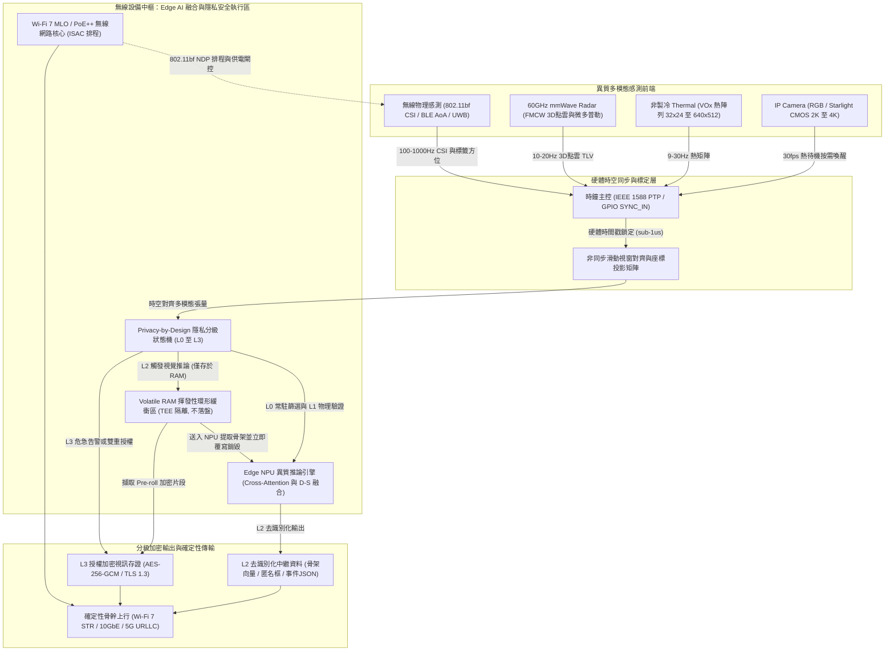
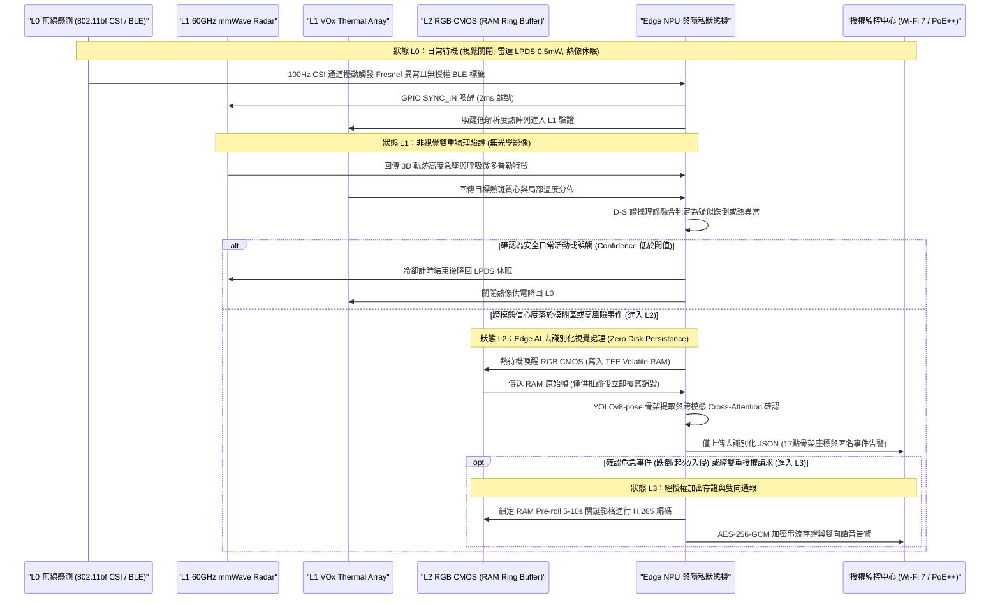

# 第二章：四模態感測融合系統架構與邊緣運算設計

本章聚焦於「無線網路設備 + IP Camera + Thermal Sensor + mmWave Radar」四模態異質感知系統的底層工程架構，闡述無線設備如何作為 **ISAC（Integrated Sensing and Communication，通感一體化）** 的核心樞紐，並詳解多模態融合層級、**Privacy-by-Design 隱私分級喚醒狀態機**、毫秒至微秒級時空同步與空間標定演算法、All-in-One 與分散式部署形態之物理限制對比，以及 Edge AI 算力與端對端延遲預算。

---

## 2.1 無線網路設備的三重角色定位

在傳統弱電與物聯網部署中，無線路由器/存取點（AP）僅被視為被動的封包轉發管道，與影像監控、熱成像測溫、毫米波雷達分屬互不相通的垂直系統。本架構將無線網路設備重新定義為整合 **通信骨幹、邊緣算力與物理感測** 的三重角色中樞：

### (a) 高速低延遲確定性傳輸骨幹（Deterministic Backhaul & Fronthaul）
* **Wi-Fi 7（IEEE 802.11be）MLO 多重鏈路運作**：
  * **STR（Simultaneous Transmit and Receive，同步收發）**：在具備隔離雙/三射頻鏈路的 AP 與高性能子節點間，實現 5 GHz 與 6 GHz 雙頻段同時獨立收發，避免單通道半雙工等待，為多路感測節點提供高總吞吐量與低確定性空口延遲（Sub-1ms 至數 ms 級）。
  * **EMLSR（Enhanced Multi-Link Single Radio，增強型多鏈路單無線電）**：針對功耗與體積受限的無線感測終端（如無線電池供電攝影機或微型子節點），允許終端同時監聽多條鏈路並動態切換至瞬時干擾最小的頻段收發，在省電前提下大幅抑制無線封包抖動（Jitter）。
  * **Multi-RU 與 Preamble Puncturing（頻譜穿孔）**：當 320 MHz 或 160 MHz 寬頻中部分子載波受鄰近干擾時，系統可繞過受阻頻譜持續傳送關鍵告警封包，打破傳統 Wi-Fi「盡力而為（Best-Effort）」的不確定性。
* **有線供電回傳骨幹 PoE++（IEEE 802.3bt）與 2.5G/10GbE**：透過單條 Cat6A 網路線同時承載 Type 3（60 W PSE / 51 W PD）或 Type 4（90 W PSE / 71.3 W PD）直流供電與 10Gbps 確定性低延遲乙太網路回傳，並支援以 **5G URLLC / RedCap** 作為無有線佈線場域的廣域網路（WAN）備援骨幹。

### (b) 邊緣融合與 Edge AI 推論節點（Edge Fusion & Inference Hub）
* 將 **Edge NPU（6–100 TOPS INT8）**、安全隔離記憶體區（TEE / Volatile RAM）與異質協定轉換介面直接整合於 AP 或匯流閘道端，承接本地 4K 視訊流、熱像矩陣、雷達點雲與高頻 CSI 特徵張量。
* **架構優勢**：消除高頻寬原始影像與 CSI 串流（單節點內部匯流可達數百 Mbps 至數 Gbps）上雲所造成的 WAN 頻寬壅塞、雲端推論延遲與隱私外洩風險，並作為本地多節點 **IEEE 1588 PTP Grandmaster 時鐘主站**。

### (c) 無線物理感測器（Device-Free & Tag-Based RF Sensing）
* **Wi-Fi CSI 與 IEEE Std 802.11bf-2025（WLAN Sensing）**：
  * 2025 年 5 月獲 IEEE 標準委員會核准、同年 9 月正式發布的 **IEEE 802.11bf-2025** 將 WLAN 感知納入 MAC 與 PHY 標準層級。架構包含 **Sensing Initiator（發起端，常為 AP）** 與 **Sensing Responder（響應端，AP 或 STA）**，透過標準化五步時序執行低開銷通道量測：
    1. **SMS（Sensing Measurement Setup）**：協商頻寬、週期與量測會話參數；
    2. **NDPA（Null Data Packet Announcement）**：預告即將進行通道探測；
    3. **NDP（Null Data Packet）**：發送不含資料負載、僅帶已知訓練序列（Sub-7 GHz 為 HE-LTF、60 GHz 頻段為 DMG/EDMG 訓練欄位）的探測封包；
    4. **CSI 矩陣估測**：接收端解算跨子載波、空間流與天線對的細粒度振幅衰減與相位偏移；
    5. **Sensing Measurement Report / TB SME（Trigger-Based Sensing Measurement Exchange）**：透過觸發式多用戶交換或 **SBP（Sensing by Proxy，代理感知）** 回報量測結果，在不影響資料吞吐率（空口佔用率低於 1%–3%）下維持 100–1000 Hz 感知採樣。
* **BLE AoA（Bluetooth 5.1+ 到達角）與 UWB（IEEE 802.15.4z）協同**：
  * **BLE AoA**：透過多天線定位基站量測低功耗標籤（Tag）的相位差，提供 0.1–0.5 m（視距下）方向向量定位，標籤端可運行數月至數年，適合「授權人員識別與白名單過濾」。
  * **UWB**：利用 $\ge 500\text{ MHz}$ 超寬頻脈衝執行 ToF/TDOA 測距，具備 $\le 10\text{ cm}$ 絕對定位精度、強抗多徑能力與 IEEE 802.15.4z **STS（Scrambled Timestamp Sequence）** 防中繼攻擊特性，適用於高精度工安電子圍籬與醫療人員/設備追蹤。

> **通感資源排程隔離（ISAC Co-Scheduling）**：在 Wi-Fi 7 三頻架構下，系統可將 2.4 GHz 或單一 5 GHz 20/80 MHz 通道指派予 802.11bf NDP 週期性感知與 BLE/IoT 控制面，同時保留 6 GHz 160/320 MHz 寬頻專責高優先級告警與受控視訊串流回傳，確保感知發包與高速傳輸互不饑餓（Starvation-Free）。

### 圖 1：四模態感測融合與 Edge AI 系統架構圖

---

## 2.2 多模態融合層級深度比較

四模態系統涵蓋一維射頻複數通道矩陣（Wi-Fi CSI）、三維稀疏速度點雲（mmWave Radar）、二維低解析輻射溫度陣列（Thermal）與高解析光學紋理（RGB Camera），資料維度與語意密度差異極大，無法一概套用單一融合層級。以下深度比較四種融合範式：

1. **Early Fusion（資料/像素前融合）**：在特徵提取前將原始感測資料對齊並拼接（例如將雷達 3D 點雲與熱像溫度值直接投影至 RGB 影像像素平面形成 5–6 通道 RGB-T-D 原始張量）。保留最多跨模態原始交互細節，但對空間標定誤差、時間同步抖動極度敏感；只要單一感測器斷線、遮蔽或失準，整條輸入張量即告崩潰，且須全時以最高取樣率運行所有感測器，端側算力與功耗最高。
2. **Mid Fusion（跨模態特徵 / BEV / Cross-Attention 融合）**：各模態透過獨立 Backbone 提取高維特徵（如影像經 CNN/ViT、點雲經 PointNet/PointPillars），再透過座標變換投影至統一空間（如 **BEV Bird's-Eye-View 俯視網格**），利用 **Cross-Attention（跨模態注意力機制）** 讓影像語意特徵動態查詢雷達幾何深度與熱像特徵。能於黑暗、煙霧或部分遮蔽下互補權重，平衡特徵豐富度與模組化，為**複雜場景精準感知（L2 級確認階段）**之主流技術。
3. **Late Fusion（決策層 / 貝氏 / D-S 證據理論融合）**：四個模態各自獨立運行感知與追蹤管線，僅在最後將 Bounding Box、軌跡向量或事件分類機率送入決策融合器。採用貝氏濾波或 **Dempster-Shafer (D-S) 證據理論**（透過基本機率分配函數 Mass Function 與 Dempster 合成法則，顯式區分「正向支持」、「反對證據」與「未知/模糊區間 Epistemic Uncertainty」）。具備極高容錯率與異質相容性（甚至可納入不具備幾何投影能力的 Wi-Fi CSI 異常指標），但損失了底層跨模態幾何關聯增益。
4. **Event-Triggered Cascade Fusion（事件觸發級聯融合 — 本架構核心典範）**：將感知流程重構為「**L0 極低功耗無線篩選 → L1 非視覺物理交叉驗證 → L2 記憶體去識別化特徵融合 → L3 加密取證**」的漏斗式計算管線。平時僅消耗毫瓦級感測算力，僅在低階物理異常發生時按需逐層喚醒高階感測器並套用 **Mid-Fusion（Cross-Attention）+ Late-Fusion（D-S 仲裁）**。兼顧極致隱私合規、低功耗/低頻寬與高準確率。

| 比較維度 | Early Fusion（早期/前融合） | Mid Fusion（特徵/BEV/Cross-Attention） | Late Fusion（決策層/貝氏/D-S 證據理論） | Event-Triggered Cascade Fusion（事件觸發級聯） |
| :--- | :--- | :--- | :--- | :--- |
| **融合切入點** | 原始感測資料/像素張量級 | 隱空間特徵圖 / BEV 統一網格層 | 獨立偵測結果 / 軌跡 / 事件置信度 | **動態分級**：日常 L0/L1 採輕量觸發，異常時切入 Mid + Late 融合 |
| **跨模態互補增益** | 理論極高（依賴完美對齊） | **極高**（Attention 動態補償單模態盲區） | 中等（無法修正上游特徵誤判） | **高**（關鍵時刻啟用 Mid-Fusion，兼顧物理篩選） |
| **單感測器失效容錯率** | **極低**（任一輸入缺失即導致張量錯亂） | 中高（Masked Attention 可降級運行） | **極高**（獨立通道失效不影響其餘感測器） | **極高**（支援故障降級與非視覺獨立兜底） |
| **時空同步與標定依賴** | **極嚴苛**（sub-ms 時間與亞像素空間對齊） | 高（需精確特徵投影與 BEV 轉換外參） | 低至中等（僅需軌跡級 IOU 或時間窗關聯） | **分層依賴**：L0/L1 低依賴；喚醒至 L2 後啟用高精度對齊 |
| **算力（TOPS）與記憶體需求** | **極高**（全時 4 路高解析張量運算） | 高（多路 Backbone + Transformer 計算） | 中低（各管線可非同步或分散式獨立執行） | **平均極低、峰值彈性**（95%+ 時間僅 < 0.1 TOPS） |
| **端側功耗與隱私友好度** | 功耗極高、隱私風險高（全時開鏡） | 功耗高、全時開鏡不符隱私最小化 | 視感測器啟閉策略而定 | **最佳**（Camera-Off by Default 徹底實踐 Privacy-by-Design） |
| **最佳適用場域** | 高速自駕車全時貼身避障 | L2 級複雜場域精準辨識（煙霧火災、遮蔽跌倒） | 跨空間分散式 AP 利舊節點與安全仲裁 | **智慧照護、企業安防、工業安全與智慧建築全時部署** |

---

## 2.3 核心亮點：Privacy-by-Design 隱私分級喚醒與低功耗/低頻寬事件觸發架構

為徹底解決傳統影像監控引發的 GDPR、HIPAA 與居家隱私反感，同時消除全時 4K 視訊回傳與 AI 運算造成的算力與頻寬浪費，本架構建立嚴格的 **四階隱私狀態機（L0–L3）**，落實三大硬性工程鐵律：
1. **預設不開鏡（Camera-Off by Default）**：所有一般環境監測由零影像、無生物特徵之 RF 與物理感測器完成。
2. **記憶體揮發隔離（Volatile RAM Only, Zero Disk Persistence）**：L2 視覺推論嚴禁寫入 Flash/SSD/SD 卡或對外串流原始影像，推論後立即覆寫銷毀。
3. **加密雙重授權託管（Cryptographic Custody）**：唯有確定的高危事件或經 RBAC 與雙重認證（Dual-Custody Token）授權，方能觸發 L3 原始視訊加密封存。

### 四階狀態機運作與防抖設計（L0 → L1 → L2 → L3）

* **L0：常駐極低功耗無線環境感知（Always-On Ambient RF Sensing）**
  * **感測器狀態**：僅維持 AP 端 **Wi-Fi 802.11bf CSI（100 Hz 基礎掃描）** 與 **BLE AoA/Beacon** 監聽；**60GHz mmWave Radar** 處於 **LPDS（Low-Power Deep Sleep，如 TI IWRL6432 僅約 0.48–0.67 mW，保留記憶體上下文，喚醒僅需約 2 ms）**；**Thermal** 處於關斷或 Shutdown 低功耗態（如 FLIR Lepton 3.5 約 5 mW；無內建睡眠模式之 MLX90640 須以外部 MOSFET Load Switch 切斷 $V_{DD}$）；**RGB CMOS** 處於硬體 Standby（感測器本體 < 1–5 mW，ISP 時脈閘控）。
  * **L0 → L1 喚醒條件**：當 Wi-Fi CSI 跨子載波振幅方差或相位差（CSI Ratio）突破靜態環境基線（人員進入 Fresnel 區或突發巨幅波動），且 BLE AoA/UWB 未偵測到現場人員佩戴有效授權白名單標籤（或雖為授權人員但動靜訊號出現長時靜止異常），即透過硬體 GPIO `SYNC_IN` 喚醒 L1 感測器。
* **L1：非視覺雙重物理驗證（Non-Visual Dual-Physics Verification）**
  * **感測器狀態**：2 ms 內喚醒 mmWave Radar（切換至 10–20 Hz 3D 點雲與微多普勒模式）與低解析度 Thermal（於 0.5 s 內或從低頻熱待機切換至 9–30 Hz）。
  * **物理判別邏輯**：利用雷達直接量測目標三維高度變化率（$dZ/dt$ 急降後貼地靜止）、水平速度與胸腔呼吸微多普勒特徵（0.15–0.5 Hz），結合熱像儀量測人體熱斑輪廓長寬比與異常絕對/相對溫升（例如設備表面過熱或早期火源）。
  * **L1 → L2 喚醒條件**：利用 D-S 證據理論計算事件信心度。若確認為無害微擾（如窗簾擺動、無人熱機）則待冷卻計時器結束（30–60 秒遲滯保護，避免反覆切換振盪）降回 L0；若判定為「疑似跌倒、高溫異常或非授權入侵」且需語意確認（例如區分大型紙箱倒落與人類跌倒、區分電熱器與明火），即進入 L2。
* **L2：邊緣去識別化語意解析（Edge AI De-identified Vision, Volatile RAM Only）**
  * **感測器狀態**：將 RGB CMOS 從硬體待機熱喚醒，於受保護的 **TEE（Trusted Execution Environment）Volatile RAM 環形緩衝區** 中接收 YUV 影格，執行 `YOLOv8-pose` 骨架關鍵點提取與跨模態 Cross-Attention 融合確認。
  * **隱私強制保證**：作業系統層級禁止開啟儲存寫入與 RTSP 原始視訊對外埠口；原始影像幀在提取 **17 點人體骨架座標、匿名邊界框（Anonymous BBox）與火煙語意類別** 後於固定時間窗（< 100 ms）內即時覆寫清零，對外僅發送 < 50 kbps 的 JSON 中繼資料。
* **L3：經授權/危急告警之加密存證與雙向通報（Authorized / Critical Encrypted Forensics）**
  * **L2 → L3 觸發條件**：僅當 L2 語意融合連續確認（例如連續 3 幀確認人員跌倒且無自主起身、明火伴隨高溫熱斑擴散、非授權區域確認入侵），**或**值班人員/家屬透過雙因子與動態審計權杖授權緊急介入時觸發。
  * **執行動作**：凍結並提取 Volatile RAM 中留存的 **觸發前 5–10 秒 Pre-roll 緩衝影格** 進行 H.265 硬體編碼，經 **AES-256-GCM + TLS 1.3** 端到端加密後串流至授權端或封存於加密區，並對非涉事第三方人員自動套用動態模糊遮罩（Privacy Masking），同時開啟雙向語音通報。

### 圖 2：Privacy-by-Design 分級喚醒狀態機與事件流序列圖

### 跨情境感測器啟閉、頻寬、功耗與隱私合規估算表

> **功耗計量口徑說明**：為使工程評估透明且可與硬體配置精確對應，下表將功耗拆分為 **「感測器與推論增量功耗（Sensor + Edge NPU Incremental）」** 與 **「含全速三頻 Wi-Fi 7 企業級 AP 基礎運作之整機總功耗（Total AP + Fusion System，含 Wi-Fi 7 Idle 12–18 W / Normal 18–28 W 骨幹負載）」**。

| 應用情境 | 所處隱私階級 | 感測器啟閉與運作模式（CSI/BLE、mmWave、Thermal、RGB） | 節點內部匯流排頻寬（Sensor-to-RAM） | 對外上行回傳頻寬（Uplink / Backhaul） | 感測與 AI 增量功耗 / 含 Wi-Fi 7 AP 總功耗 | 隱私合規等級與法規對齊 |
| :--- | :--- | :--- | :--- | :--- | :--- | :--- |
| **1. 日常無人**（Vacant / Idle） | **L0** | **CSI/BLE**：100 Hz 常駐感知 **mmWave**：LPDS 休眠 (~0.5 mW) **Thermal**：關斷 / Shutdown (~0–5 mW) **RGB**：硬體關閉 (< 5 mW) | CSI 內部擷取：~0.35–1.5 Mbps （AP 內部直算，不佔對外網路） | **< 2–5 kbps** （僅心跳與無人狀態摘要） | **增量功耗**：~0.3–0.8 W **含 AP 總功耗**：~12.5–19 W | **Tier-0 最高隱私（零影像 / 零個資）**：完全無光學與溫度成像，符合 GDPR 非個資範疇與臥室/衛浴最嚴苛部署規範 |
| **2. 日常安全活動**（已授權人員移動/日常作息） | **L0 → L1**（短時） | **CSI/BLE**：100–200 Hz + BLE AoA 白名單確認 **mmWave**：10 Hz 低功耗追蹤與呼吸監測 **Thermal**：按需 1–9 Hz 粗粒度掃描（無異常則待命） **RGB**：**保持關閉** | CSI + 雷達 TLV（~50–150 kbps）+ 低解析熱陣列（~100 kbps–2.7 Mbps） | **5–20 kbps** （匿名存在計數、熱區安全狀態、心率呼吸摘要） | **增量功耗**：~1.2–2.5 W **含 AP 總功耗**：~19–30 W | **Tier-1 非視覺合規**：僅存在匿名座標點雲與粗略熱斑，無容貌辨識可能，符合 HIPAA/GDPR 匿名生理與安全追蹤要求 |
| **3. 疑似跌倒 / 異常發熱**（不確定高風險觸發） | **L2** | **CSI/BLE**：500 Hz 微動輔助 **mmWave**：20 Hz 高密度點雲與微多普勒 **Thermal**：160×120 @ 9–30 Hz 溫度測繪 **RGB**：**熱喚醒至 TEE RAM** 進行骨架/火煙推論（**不落盤**） | RGB Raw YUV 進 RAM：~0.75–3.0 Gbps + 雷達 (~250 kbps) + 熱像 (~9.2 Mbps) | **15–60 kbps** （僅輸出 17 點骨架向量、匿名 BBox 與熱點座標 JSON） | **增量功耗**：~5.5–9.5 W（含 NPU + CMOS/ISP） **含 AP 總功耗**：~24–38 W | **Tier-2 邊緣去識別化合規**：實踐 Data Minimization 與 Purpose Limitation；原始影像存活於揮發記憶體 < 100 ms 即銷毀，不構成可追溯視訊檔案 |
| **4. 確認入侵或危急告警**（確認跌倒/火災/入侵或授權覆核） | **L3** | **全模態全速運作**：CSI 500–1000 Hz + mmWave 20–30 Hz + Thermal 30 Hz + RGB 4K @ 30fps H.265 加密存證與雙向語音 | 內部全開：~1.5–3.2 Gbps（含 Pre-roll RAM 環形緩衝讀取） | **15–30 Mbps**（4K H.265 平衡品質；開啟 DOL-HDR 高動態最高 40–60 Mbps）+ 雙向音訊 64 kbps | **增量功耗**：~8–14 W（含編碼與 AES 加密） **含 AP 總功耗**：~30–48+ W（高負載需 PoE++ 供電） | **Tier-3 受控合規存證**：具明確合法正當性（Vital Interests / 授權稽核），採 AES-256-GCM 加密、RBAC 權限控管與自動第三者遮罩 |

---

## 2.4 時空同步與異質標定技術

四模態感測器的採樣頻率跨越三個數量級，且物理觀測空間從「透視光學投影」橫跨到「全向多徑射頻散射」，必須建置嚴格的時空統一層（Spatio-Temporal Unification Layer），否則特徵層融合將因錯位而產生嚴重「鬼影與誤關聯」。

### 2.4.1 多尺度時間同步與異質取樣率對齊

感測鏈包含四種截然不同的原生取樣節奏：**RGB Camera（30–60 fps，週期 16.7–33.3 ms）**、**Thermal（出口管制商規版 9 Hz 週期 111 ms / 工業版 30 Hz 週期 33.3 ms）**、**mmWave Radar（10–20 Hz，週期 50–100 ms）** 與 **Wi-Fi CSI（100–1000 Hz，週期 1–10 ms）**。

1. **分散式網路層同步：IEEE 1588 PTP / gPTP (802.1AS) vs. NTP**
   * **NTP 的系統性失敗**：傳統 NTP 運作於作業系統軟體協定棧，受系統中斷、佇列排程與 Wi-Fi 競爭延遲影響，同步誤差通常為 **1 ms 至 20+ ms**。對於移動速度 1.5–3 m/s 的跑動人員或工廠 AGV（每 20 ms 位移可達 3–6 cm，高速目標甚至數十 cm），NTP 抖動將造成雷達點雲與影像框之間明顯的空間分離與關聯失敗。
   * **IEEE 1588 PTP / gPTP（IEEE 802.1AS）**：透過網卡 **PHY/MAC 硬體時間戳（Hardware Timestamping）** 直接在封包跨越實體層時打標，並透過 `Sync`、`Follow_Up` 與 `Pdelay_Req/Resp` 機制量測與扣除交換機線纜傳播延遲，可實現 **Sub-microsecond（< 1 μs，典型 < 100 ns）** 之全域時間基準，徹底滿足分散式跨節點攝影機與雷達的幀級對齊需求。
2. **節點內硬體脈衝同步（Hardware Triggering）**：
   * 在 All-in-One 或近距離有線子板內，主控 SoC 透過專用 **GPIO `SYNC_IN` / FSIN 觸發腳位** 與 1PPS 時脈分配，強迫 RGB 感測器曝光中點（Mid-Exposure）、mmWave Radar Chirp 起始時間與 Thermal FPA 讀出中斷對齊於同一基準時脈邊緣，消除 UART/SPI/USB 驅動堆疊帶來的不確定傳輸延遲。
3. **非同步異質取樣率演算法對齊（Sliding Window & Motion Compensation）**：
   * 即使擁有精確硬體時間戳，9 Hz Thermal（111 ms）與 30 fps RGB（33.3 ms）依然存在幀率倍數差異。系統於 Edge RAM 建立長度為 $\Delta W = 100\text{ ms}$ 的 **滑動時間對齊視窗（Sliding Alignment Window）**，並規定有效關聯時間容忍誤差 $\epsilon_t \le 15\text{ ms}$：
     * **高頻降維對齊（100–1000 Hz CSI）**：對每個攝影機/雷達主幀時間戳 $t_k$ 前後 $[t_k - 25\text{ ms}, t_k + 25\text{ ms}]$ 區間內的 5–50 筆 CSI 封包執行帶通濾波、相位解捲繞與短時能量/多普勒包絡特徵壓縮，生成與主幀對齊之 20 Hz 射頻狀態向量。
     * **低頻運動補償插值（10–20 Hz mmWave / 9 Hz Thermal）**：針對移動中人體目標，不可直接取「最近鄰幀（Nearest Neighbor）」，而應在雷達卡爾曼濾波器（Kalman Filter）或熱斑質心追蹤器中，利用估測速度向量 $\hat{\mathbf{v}}$ 將歷史座標線性外推或雙向插值至精確 RGB 曝光時刻 $t_{\text{RGB}}$：$\hat{\mathbf{p}}(t_{\text{RGB}}) = \mathbf{p}(t_{\text{radar}}) + \hat{\mathbf{v}} \cdot (t_{\text{RGB}} - t_{\text{radar}})$。

### 2.4.2 異質空間標定（Spatial Calibration）

1. **RGB – Thermal 共視角單應性與深度外參標定**：
   * **單應性矩陣（Homography $H \in \mathbb{R}^{3\times 3}$）的幾何極限**：利用 $p_{\text{rgb}} \sim H \cdot p_{\text{thermal}}$ 雖可快速對齊畫面，但數學上**僅對遠距離場景或固定深度平面（例如只監看牆面電氣櫃）成立**。在 1.5–6 m 的室內照護與走廊環境中，只要兩顆鏡頭存在數公分的物理基線（Baseline），前景人員與背景牆面將產生明顯視差（Parallax），單一 $H$ 矩陣必然失效。
   * **工程解法**：先以 **主動加熱式 ChArUco / 棋盤格標定板**（如背面佈設電阻發熱線圈或高低紅外線發射率雙材質貼片，使冷熱方格於 LWIR 波段產生強烈對比）進行雙方相機內參 $K_{\text{rgb}}, K_{\text{thm}}$ 與畸變係數求解，再以 Levenberg-Marquardt 非線性最小平方法求解雙目剛體外參 $[R_{t\to c} | t_{t\to c}]$；執行時期再**借用 mmWave 雷達測得之目標真實深度 $Z$** 進行動態 3D 反投影補償視差，達到全室範圍內像素級重合。
2. **mmWave 3D 點雲與影像投影矩陣標定**：
   * 先將雷達內部陣列通道相位/距離偏置校准後，由球座標 $(r, \theta_{\text{az}}, \phi_{\text{el}})$ 轉為雷達笛卡兒座標 $P_r = [X_r, Y_r, Z_r]^T$，再經外參剛體變換與相機內參矩陣投影至 RGB/Thermal 平面像素座標 $(u, v)$：
     $$s \begin{bmatrix} u \\ v \\ 1 \end{bmatrix} = K \begin{bmatrix} R_{r\to c} & t_{r\to c} \end{bmatrix} \begin{bmatrix} X_r \\ Y_r \\ Z_r \\ 1 \end{bmatrix}$$
   * **聯合標定靶材設計**：由於毫米波會穿透一般紙質棋盤格，業界採用 **「視覺-熱感複合棋盤格 + 高 RCS 三面角反射器（Trihedral Corner Reflector）」剛性聯合標定工裝**。角反射器安裝於棋盤格背面或已知精密機械偏移座標處，雷達於點雲中萃取出高訊噪比反射峰值質心作為 3D 錨點，透過 PnP 與最小化 2D 重投影誤差（Reprojection Error）聯合收斂求解 $[R_{r\to c} | t_{r\to c}]$。
3. **Wi-Fi CSI 空間對齊與場域指紋映射**：
   * Wi-Fi 波長（Sub-7 GHz 約 5–12.5 cm）遠大於光學波段且為多徑全向傳播，不存在單一針孔投影矩陣，必須透過兩階段將 CSI 映射至空間區域（ROI）：
     * **Fresnel Zone 幾何橢球與多天線 AoA 映射**：根據 AP（TX）與遠端節點/反射天線（RX）之實體座標 $(X, Y, Z)$，建立覆蓋場域的三維菲涅爾區（Fresnel Zone）同心橢球模型，結合多天線陣列 MUSIC/ESPRIT 演算法估測主要動態路徑的到達角（AoA）與時延（ToF），鎖定動靜發生之扇區（Sector/Zone）。
     * **跨模態自監督指紋校準（Cross-Modal Auto-Calibration）**：解決 Wi-Fi 指紋易受傢俱搬移失效的業界痛點——在日常 L1 運行期間，系統直接利用空間幾何精準的 **mmWave 3D 軌跡座標作為自動標註（Pseudo-Labels）**，持續線上校準並更新各空間網格與 CSI 通道響應特徵之間的映射表，無需人工手持設備重新踩點（Site Survey）。

---

## 2.5 部署形態深度對比：All-in-One 整合式節點 vs. 分散式多節點網路協同

在實際工程量產與場域導入時，系統可採取 **All-in-One 整合式智慧 AP（單一外殼囊括 Wi-Fi 7、NPU 與三感測器）** 或 **分散式多節點架構（Wi-Fi 7 邊緣中樞 + 分離式感測器節點，含既有攝影機利舊）**。兩者在物理電磁、熱力學、供電與幾何安裝上存在根本性工程取捨。

### 六大核心工程維度深度剖析

1. **RF / EMI 干擾與天線隔離**：
   * **All-in-One 嚴苛挑戰**：雖然 2.4/5/6 GHz Wi-Fi 與 60/77 GHz mmWave 頻帶不重疊，但緊湊 PCB 內仍面臨三大風險：(a) 2.4 GHz Wi-Fi 與 BLE 存在裝置內共存干擾（IDC）；(b) 若採用 60 GHz WiGig（802.11ad/ay）回傳將與 60 GHz 雷達直接撞頻造成接收機阻塞；(c) 交換式電源（DC-DC Buck）、高速 PCIe / MIPI CSI-2 / USB 3.0 的高次諧波會耦合進入雷達敏感的中頻（IF）類比前端。此外，60 GHz 波長僅約 5 mm，塑膠外殼（Radome）必須選用低介電常數 $\epsilon_r$ 與低損耗角正切 $\tan\delta$ 材料（如 PC、ABS、PP、PMMA，嚴禁含碳纖填料或金屬電鍍漆），壁厚 $d$ 須嚴格依半波長透波準則設計：$d = \frac{n \cdot c}{2 f \sqrt{\epsilon_r}}$（公差需控管在 $\pm 0.05\text{ mm}$ 內），並於 AiP（封裝天線）與外殼間保持精確氣隙避免 Fabry-Pérot 腔體自激反射，同時在 PCB 上部署 **EBG（電磁帶隙結構）與密集接地過孔柵欄（Via Fence）**。
   * **分散式天然優勢**：射頻 AP 與攝影機、雷達在空間上相隔數公尺，徹底消除 PCB 級近場耦合與高速數位諧波干擾，機殼設計門檻大幅降低。
2. **熱管理與非製冷 Thermal 飄移（Thermal Drift）**：
   * **All-in-One 熱災難風險**：Tri-Band Wi-Fi 7 AP 正常運行功耗即達 **18–28 W**（高負載峰值 **35–48 W+**），加上 Edge NPU 全速推論，密封吸頂機殼內部環境溫度極易飆升至 **55–75°C**。由於系統採用非製冷 **$\text{VO}_x$ 微測輻射熱計（Microbolometer）**，不具備主動致冷器（TEC），且 $\text{VO}_x$ 具備極高的電阻溫度係數（TCR）。機殼內部熱流與 ROIC 自發熱會引發焦平面陣列（FPA）基準溫度 $T_{\text{FPA}}$ 劇烈飄移，造成的固定圖案雜訊（FPN）與測溫偏差遠大於目標真實熱輻射差異。必須額外設計隔熱腔體、分區導熱鋁板隔離 Wi-Fi PA 與熱像模組，並依賴晶片旁高精準熱敏電阻進行 **ATC（環境溫度補償）** 及頻繁觸發 **機械快門 FFC（Flat Field Correction）**（注意：每次 FFC 動作峰值功耗衝至 ~650 mW 並造成短暫畫面凍結）。
   * **分散式優勢**：獨立微型熱像子節點總功耗僅 0.5–2 W，自發熱極低，在溫度劇變抑制與絕對測溫準確度上遠優於整合式方案。
3. **供電架構與 PoE 瓦數瓶頸（IEEE 802.3af/at/bt）**：
   * 依據 IEEE 802.3 標準扣除 Cat5e/Cat6 線纜電阻壓降後之 PD 端保證輸入功率：
     * **802.3af (PoE)**：PSE 15.4 W / PD 12.95 W（完全不足）。
     * **802.3at (PoE+)**：PSE 30.0 W / PD 25.5 W —— **「PoE+ 降頻陷阱」**：許多標稱相容 PoE+ 的 Wi-Fi 7 AP 在 25.5 W 上限下會被迫關閉部分空間流或限制 6 GHz 發射功率，無法同時驅動 NPU 與三感測器。
     * **802.3bt Type 3 (PoE++)**：Class 5（PSE 45 W / PD 40.0 W）與 Class 6（PSE 60 W / PD 51.0 W）為 All-in-One 完整運行之最低建議門檻；若含高算力 NPU 與加熱型防霧戶外罩，則需 **Type 4（Class 7/8，PSE 75–90 W / PD 62.0–71.3 W）**。這要求既有大樓交換機全面升級為 PoE++ 供電交換器，資本支出顯著墊高。
   * **分散式彈性**：主匯流 AP 單獨使用 PoE+ / PoE++，其餘感測子節點可由既有多個 802.3af（15.4 W）交換機埠分攤供電，或以低功耗無線電池供電（如 BLE/低功耗雷達子節點）。
4. **幾何視角衝突（Mounting Geometry Conflict）**：
   * **空間幾何矛盾**：Wi-Fi AP 與 CSI 感知追求 **天花板正中央高處水平安裝**，以取得最均勻的射頻覆蓋與多路徑 Fresnel 區；然而，**IP Camera 與 Thermal** 若垂直正下視（Top-Down），僅能拍到人頭頂，徹底喪失人臉輪廓、跌倒側向姿態特徵與設備櫃正面測溫視角，其最佳安裝位置為 **牆角或側壁高處 2.4–3.2 m 向下俯仰 15°–45°**；**60GHz mmWave Radar** 側壁斜裝時可精準量測身高跌落與胸腔垂直距離變化，頂裝時則對水平微動與近天花板風管金屬反射較敏感。
   * **工程解方**：All-in-One 若強制裝於天花板中央，必須針對視光學與雷達模組設計 **獨立 20°–35° 可調式斜向萬向節雲台外殼**，或專用於壁掛式走廊/病房節點；分散式架構則讓 AP 自由裝於天花板最佳射頻點，感測端各司其職裝於牆角最佳視角，達成「射頻覆蓋與物理視角雙最佳化」。
5. **標定維護與既有設備利舊（Greenfield vs. Brownfield）**：
   * All-in-One 可於工廠產線執行 **剛體外參預標定**，現場只需拉一條網路線即可完成安裝（Zero-Touch Commissioning），大幅降低部署人工成本，適合新建案（Greenfield）；但一旦單一零件（如熱像快門或鏡頭）老化損壞，常需整台拆換。
   * 分散式方案最強大的商業優勢在於 **Brownfield 既有設備利舊**——客戶既有的數十支 ONVIF/RTSP IP Camera 可直接透過 Wi-Fi 7/PoE++ 邊緣盒升級為 L2/L3 智慧感測網，無需重複採購光學硬體，但必須付出**現場跨節點時空標定**的維運複雜度代價（可藉由前述 mmWave 自動標註校準機制降低工時）。

### All-in-One 整合節點 vs. 分散式多節點架構總評表

| 工程評估維度 | 形態 A：All-in-One 整合式智慧 AP | 形態 B：分散式多節點協同（含混合式架構） |
| :--- | :--- | :--- |
| **RF / EMI 與外殼設計難度** | **高**（須處理 DC-DC/高速匯流排諧波、EBG 隔離及 60GHz 半波長 Radome 公差） | **低**（空間物理隔離，免特殊複合透波外殼） |
| **Thermal 熱飄移風險** | **高**（受 18–45 W AP/NPU 熱烘烤，需隔熱腔體 + 頻繁 FFC/ATC 補償） | **低**（熱像子機自身功耗 < 2 W，測溫精準且長期穩定） |
| **供電門檻（IEEE 802.3）** | 強制 **PoE++ 802.3bt Type 3/4**（60–90 W PSE），需升級交換機 | 彈性（既有 802.3af/at 埠可分攤供電，關鍵閘道用 PoE+） |
| **幾何視角最佳化** | **受限且衝突**（需犧牲 AP 置中位置改採壁掛，或設計複雜斜向旋轉雲台） | **完全解耦最佳化**（AP 頂裝、光學與雷達壁掛俯視各就各位） |
| **現場標定與安裝工時** | **極低**（工廠預標定剛體外參、單線即插即用） | **中高**（需現場進行 PTP 同步與跨視角剛體標定 / 自監督映射） |
| **既有設備利舊（Brownfield）** | **無**（需整機替換） | **極佳**（無痛納管既有 IP Camera 與傳統 PoE 網段） |
| **適用場景定位** | 新建標準化空間（醫院單人病房、飯店客房、精裝銀髮宅） | 大面積複雜場域（工廠車間、商場大廳、既有建築智慧化改造） |

---

## 2.6 Edge AI 算力需求、記憶體頻寬與端對端延遲預算分析

要在 L0→L1→L2→L3 級聯架構下達成 **關鍵告警端對端延遲（End-to-End Critical Alert Latency）< 200 ms – 500 ms**，最大的工程隱形殺手並非模型推論本身，而是**感測器喚醒與冷啟動延遲（Wakeup & Stabilization Latency）**。

### 關鍵工程破題：消除「冷啟動延遲陷阱」
若為了省電而將 IP Camera ISP/SoC 或 Thermal 模組完全斷電（Cold Power-Off），重新上電啟動嵌入式 Linux、ISP 3A（自動曝光/白平衡/對焦）收斂以及 $\text{VO}_x$ 熱平衡往往需 **500 ms 至數秒**，完全無法滿足 < 500 ms 的即時安全目標。因此，本系統採用 **分級熱待機（Warm-Standby / Retention Sleep）策略**：
* **mmWave Radar（如 TI IWRL6432）**：採用 **LPDS 模式（~0.5 mW）**，在內建 Retention SRAM 保存應用程式與 Chirp 配置檔，無需重新啟動晶片，外部 `SYNC_IN` 脈衝觸發後 **~2 ms** 即可射出首幀調頻脈衝。
* **Thermal Array（如 FLIR Lepton 3.5）**：採內部低功耗 Shutdown 模式（~5 mW）時 Time-to-Image **< 0.5 s**；若對反應時間要求嚴苛（目標總延遲 < 200 ms），可於潛在活動時段令 Thermal 維持極低幀率預熱運行（約 75–140 mW），直接消除上電瞬變飄移與等待時間。
* **RGB CMOS（如 Sony IMX678 / IMX415）**：CMOS 感測器維持硬體待機僅耗 **< 1–5 mW**，釋放待機腳位與時脈後感測器類比級穩定僅需 **2–10 ms**；搭配主控邊緣 SoC 的 **Suspend-to-RAM 熱待機與預設快門曝光參數（Fast-AE）**，可將第一幀可用 YUV 進入 NPU 的總時間壓縮至 **25–45 ms**。

### 代表性 Edge AI 平台實測算力與頻寬基準

| 平台代表（定位） | NPU / AI 算力（INT8） | 記憶體匯流排與頻寬 | `YOLOv8n / YOLOv8n-pose`（640×640）推論延遲 | 工程適配備註 |
| :--- | :--- | :--- | :--- | :--- |
| **Rockchip RK3588**（商用主流高CP值） | **6 TOPS** | LPDDR4x/5 (~34 – 51 GB/s) | `YOLOv8n`：10–15 ms `YOLOv8n-pose`：15–25 ms（RKNN INT8） | 單路多模態甜蜜點；高解析（如 960p+）或重型 Transformer 易觸及記憶體頻寬瓶頸 |
| **Qualcomm QCS6490**（低功耗 AIoT/AP 匯流） | **12–13 TOPS**（Hexagon DSP + HTA） | LPDDR5-3200 (~51 GB/s) | 經 QNN / AI Hub 最佳化：`YOLOv8n` **~4–12 ms** | 須確保全部算子（含 NMS/Keypoint 解碼）完整卸載至 HTA/DSP，若回退 CPU 運算延遲會暴增至 > 300 ms |
| **NVIDIA Jetson Orin NX**（8GB / 16GB 工業級） | **70 / 100 Sparse TOPS**（35 / 50 Dense TOPS） | 128-bit LPDDR5 (**102.4 GB/s**) | TensorRT INT8 `YOLOv8n/s-pose`：**10–15 ms** | 具備充裕記憶體頻寬，可同時承載 4–8 路分散式攝影機 + BEV Cross-Attention 重型融合 |

### 端對端關鍵告警延遲、算力與記憶體頻寬逐階預算拆解表

下表以「單節點遭遇突發跌倒或高危入侵事件（L0 觸發 → L1 物理驗證 → L2 去識別化語意確認 → L3 關鍵加密告警發出）」為基準情境，拆解各管線階段預算：

| 處理階段 | 核心運算任務與硬體執行單元 | 所需算力估算（TOPS） | 記憶體頻寬佔用估算 | 延遲預算（標準逐級喚醒 / 預熱平行路徑） |
| :--- | :--- | :--- | :--- | :--- |
| **Stage 0：L0 RF 觸發** | 802.11bf CSI 擷取、小波去噪與 Fresnel 方差判別（Wi-Fi SoC / DSP） | < 0.05 TOPS（純 DSP 矩陣） | < 0.2 GB/s | **20 – 40 ms**（含 2–4 筆 100 Hz CSI 滑動窗累積） |
| **Stage 1：L0→L1 喚醒與物理計算** | GPIO 喚醒 mmWave LPDS（2 ms）+ 2D-FFT / CFAR 點雲生成（Radar HWA）+ Thermal 採樣與質心提取 | ~0.2 TOPS（硬體 FFT/HWA 加速） | ~0.5 – 1.2 GB/s | **20 – 40 ms**（平行預熱熱像）； 若 Thermal 由 Shutdown 喚醒最高 **110 – 180 ms** |
| **Stage 2：L1→L2 視覺熱喚醒與對齊** | CMOS 硬體喚醒（2–10 ms）+ 1 幀曝光（33 ms）+ PTP/滑動視窗時空插值對齊 | < 0.1 TOPS（CPU / ISP DMA） | ~2.5 – 4.5 GB/s（4K/2K YUV DMA 寫入 RAM） | **35 – 50 ms**（Fast-AE 與預置曝光表）； 無預熱冷啟動將飆升 > 400 ms |
| **Stage 3：L2 Edge AI 多模態推論** | `YOLOv8n-pose` INT8 骨架提取 + 輕量 PointNet 點雲特徵 + Cross-Attention 融合與 D-S 仲裁（NPU） | **3.5 – 8.0 TOPS**（單路即時運算）；多路匯流需 20–70+ TOPS | **8 – 18 GB/s**（權重、特徵圖與 Attention KV 讀寫） | **20 – 45 ms**（於 6–13 TOPS NPU 執行 INT8 推論，可與連續幀管線重疊） |
| **Stage 4：L3 加密封裝與確定性發出** | 擷取 RAM Pre-roll 影格執行硬體 H.265 編碼 + AES-256-GCM 加密 + Wi-Fi 7 MLO / GbE 傳送 | 硬體編解碼器（VPU）+ 密碼引擎 | ~2.0 – 4.0 GB/s | **15 – 30 ms**（加密與打包 10–25 ms + Wi-Fi 7 STR/有線傳輸 1–5 ms） |
| **端對端總預算彙整** | **完整四模態感測-融合-加密告警關鍵路徑** | **單節點建議 $\ge 6\text{–}12\text{ TOPS}$** （分散多路匯流 $\ge 35\text{–}70\text{ TOPS}$） | **峰值 ~13–28 GB/s** （建議配置 $\ge 34\text{–}51\text{ GB/s}$ LPDDR5 防記憶體牆） | **預熱最佳路徑：110 – 205 ms**（滿足 `< 200 ms` 高標） **標準逐級喚醒（含多幀確認）：250 – 420 ms**（穩定落於 `< 200–500 ms` 目標） |

### 工程總結與算力配置建議
1. **避免計算與頻寬錯配（Memory Wall）**：實務中邊緣平台執行多模態融合時，效能瓶頸常不在標稱 TOPS，而在於 4K 影像 DMA、多分支張量重塑（Reshape）與 Cross-Attention 帶來的 LPDDR 記憶體頻寬爭搶。工程選型應維持 **實測有效記憶體頻寬餘裕 $\ge 1.8\times$** 總峰值佔用，且務必選用支援硬體零拷貝（Zero-Copy DMA-BUF）於 ISP、NPU 與 VPU 間共享 Volatile RAM 的 SoC 架構。
2. **確定性降級保護（Graceful Degradation）**：當 Edge NPU 同時面臨多區域事件爆發（Burst）而算力接近滿載時，狀態機應動態降載次要分支（例如暫停 L2 高解析 RGB 幀率由 30 fps 降至 10 fps，改以 20 Hz mmWave 3D 點雲與 Thermal 維持主軌跡連續追蹤），確保端對端關鍵告警始終鎖定在 500 ms 紅線之內。
