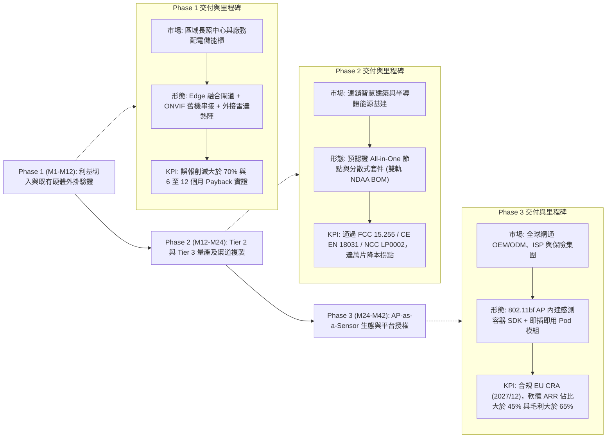

# 第三章：市場格局、三階硬體 BOM 估算、商業模式與法規 GTM 策略

> **章節定位**：本章從產業商業化與法規合規的實務視角出發，剖析既有智慧感測與網路基礎設施市場的結構性斷裂（感測孤島），提出具備量產可行性的「消費/入門商用、中高階商用、工業關鍵基礎設施」三階硬體與分項 BOM 成本模型（同步涵蓋 All-in-One 節點與分散式套件），並設計兼顧毛利與客戶回本週期（Payback Period）的商業模式、全球法規護城河（Privacy-by-Design）以及三階段 Go-to-Market（GTM）執行路線圖。

---

## 3.1 市場痛點與現有競品格局分析：打破「感測孤島」

儘管環境感知（Ambient Intelligence）與邊緣人工智慧近年快速演進，但現有商業市場仍高度碎片化，呈現**「各自為政的感測孤島（Sensor Silos）」**格局。五大類既有玩家各自掌握單一或雙重技術棧，卻因通訊協定封閉、物理感測盲區與商業利益邊界，無法解決跨情境的真實痛點。

### 3.1.1 五大既有玩家陣營與結構性缺口

1. **Wi-Fi Sensing 專精軟體陣營（Origin AI / Cognitive Systems / Aerial Technologies）**
   - **現況與動態**：此陣營專注於擷取與分析 Wi-Fi 通道狀態資訊（CSI）並積極參與 **IEEE 802.11bf（WLAN Sensing）** 標準制定。產業整合已進入加速期——例如先驅廠商 **Origin Wireless（Origin AI）** 已於 **2026 年 2 月** 由北美安防龍頭 **ADT Inc.** 以 **1.7 億美元現金**收購，同時與歐洲安防巨擘 **Verisure** 簽署多年期商業授權協議；**Cognitive Systems** 與 **Aerial Technologies** 則主要透過 Broadcom 等晶片廠與路由器 OEM/ISP 進行 B2B2C 軟體預載授權。
   - **技術與商業缺口**：純 Wi-Fi CSI 屬於**「粗粒度（Coarse-grained）群體活動感知」**，能穿牆偵測是否有人移動、簡易跌倒或靜止呼吸，但無法提供公分級 3D 點雲精準定位、無法辨識靜止物體溫度異常（如電器過熱或鋰電池熱失控），亦缺乏視覺層級的事件舉證能力；在多徑干擾劇烈的金屬工廠或寵物共存家庭中，誤報濾除仍具高度挑戰。

2. **mmWave 照護與空間感測陣營（Vayyar Care / TI mmWave 生態系 / Aqara）**
   - **現況與動態**：消費級市場如 **Aqara Presence Sensor FP2**（終端售價約 **\$80–\$83 USD**，採用 Infineon XENSIV BGT60TR13C 60GHz 雷達），以無月費策略切入智慧家庭區域存在感測；專業照護領域則以 **Vayyar Care** 為代表（單機硬體約 **\$250 USD**，搭配每月 **\$20+ USD** 專業照護整合訂閱），採用自研 VYYR7201 60–64GHz MIMO 4D 成像雷達，具備 IP54 防水並可覆蓋 4×5 公尺空間。
   - **技術與商業缺口**：高頻毫米波具備隱私優勢與穿衣/穿透水蒸氣能力，但受限於室內牆體衰減與視距範圍，**每一間獨立臥室與衛浴皆須獨立佈建、供電與連網**；例如 Aqara FP2 啟用跌倒偵測時必須強制吸頂安裝，且無法同時啟用多區域人員追蹤；Vayyar 雖具備優良跌倒與呼吸分析，但無法預警非移動型熱危害（配電盤過載、明火初期），且跨出單房走廊後的空間連貫追蹤須依賴外部系統。

3. **熱像安防與工業監測陣營（Teledyne FLIR / Axis Communications / Hikvision / Seek Thermal）**
   - **現況與動態**：針對全黑、煙霧與戶外周界或工業設備過熱檢測，**Teledyne FLIR**（Saros、FH-Series 及 Boson OEM 核心）、**Axis Communications**（Q19/Q21 熱像儀搭 AXIS Object Analytics）、**Hikvision**（雙光譜 Bi-spectrum 系列）與 **Seek Thermal**（Mosaic 核心）已建立成熟方案。部分雙光譜攝影機整合了 RGB 與 LWIR 熱成像以降低陰影與樹影誤報。
   - **技術與商業缺口**：純熱像系統或雙光譜攝影機造價高昂（工業/企業級單點常達 **\$1,500–\$10,000+ USD**），且有兩大物理盲區：第一，在夏季高溫環境中，當環境背景溫度接近人體體表溫度（~32–36°C）時，人體熱對比度大幅下降；第二，光滑金屬表面（低放射率 $\varepsilon < 0.2$）極易反射周邊熱源造成「假高溫誤報」。此外，熱像儀無法穿透玻璃與隔間牆，也無法像毫米波雷達般取得目標的徑向速度（Doppler）與微動呼吸頻率，系統更通常獨立於企業無線網路之外。

4. **企業智慧 AP 與網路基礎設施陣營（Cisco Spaces / HPE Aruba / Ubiquiti / Cambium）**
   - **現況與動態**：
     - **Cisco Spaces + Meraki MV**：目前最接近跨網通與視覺融合的企業平台，能利用 Catalyst/Meraki AP 的 BLE/IoT 射頻並結合 Meraki MV 攝影機做空間人數與熱區分析。
     - **HPE Aruba（Aruba Central / Meridian / ALE）**：提供企業級藍牙/Wi-Fi 定位引擎與混合雲授權，但視覺感測須透過 API 對接第三方 VMS。
     - **Ubiquiti（UniFi + UniFi Protect）**：以 **\$0 年費授權**整合 AP 與監控攝影機於單一介面，在中小企業擁有極低 TCO。
     - **Cambium Networks（cnMaestro）**：以高性價比工業/戶外無線硬體見長，但缺乏高階 AI 空間感知與視覺交叉驗證生態。
   - **技術與商業缺口**：Cisco 生態面臨嚴重的**硬體鎖定（Vendor Lock-in）**與**訂閱懸崖（Subscription Cliff）**——多品牌混合網路環境無法納入 Cisco Spaces 原生遙測，且授權一旦到期，裝置管理與核心網路服務即會受阻；Ubiquiti 雖無年費卻缺乏 Wi-Fi CSI 細粒度感知、非視覺雷達/熱像融合能力與企業級 SLA。所有主流網通大廠至今均未將 **mmWave 雷達 + 熱像陣列 + Edge AI 視覺去識別化** 原生整合進網路架構中。

5. **雲端原生與純 AI IP Camera 陣營（Verkada / Rhombus / Hanwha Vision 等）**
   - **現況與動態**：以 **Verkada** 為代表的雲端攝影機採「硬體綁定多年期 SaaS 授權」銷售（入門機型含授權起價約 **\$800–\$1,000+ USD**），主打即插即用與 Command 雲端檢索。
   - **技術與商業缺口**：第一，持續錄影與雲端 AI 帶來高昂的上行頻寬壓力與多年期 OpEx 累積；第二，純光學鏡頭在全暗逆光、煙霧粉塵或障礙物遮蔽下完全失效；第三，最致命的是**隱私與法規牆**——在歐盟 GDPR、美國醫療 HIPAA 及銀髮照護臥室/衛浴等場景，24 小時開啟光學攝影機面臨難以跨越的法遵與心理排斥阻力。

### 3.1.2 既有玩家的四大核心痛點與四模態融合切入點

| 比較維度 | Wi-Fi Sensing 軟體商 （Origin AI / Cognitive） | mmWave 照護廠商 （Vayyar / Aqara FP2） | 熱像/雙光譜安防商 （FLIR / Axis / Hikvision） | 企業智慧 AP 廠商 （Cisco Spaces / Aruba / UniFi） | 雲端 AI IP Camera （Verkada 等） | **本架構：四模態感測融合平台** （AP/Edge + mmWave + Thermal + Camera） |
| :--- | :--- | :--- | :--- | :--- | :--- | :--- |
| **感測物理覆蓋** | 廣域穿牆動靜、粗略呼吸 | 單房 3D 點雲、跌倒、微動呼吸/心率 | 遠紅外熱分布、表面測溫、穿透煙霧 | 裝置連線/BLE RSSI 位置、部分整合視覺 | 視覺語意辨識（RGB/IR） | **全域穿牆觸發 + 毫米級點雲 + 放射測溫 + 語意視覺** |
| **跨系統連動延遲** | 雲端/本地推論 0.5–3s（無視覺連動） | 單機告警 0.5–2s（跨系統 API 延遲 3–8s） | 邊緣告警 <1s（與網通/雷達割裂） | AP 與 VMS 跨平台 API 連動約 2–10s | 雲端同步 1–5s，依賴上行頻寬 | **端側共址（Co-located）硬體中斷喚醒 <150ms** |
| **誤報主要來源** | 寵物、穿牆鄰居干擾、電風扇 | 金屬反光多路徑、靜止熱源無感 | 環境熱漂移、低放射率金屬反光、蟲鳥 | 僅追蹤訊號而非實體，未帶手機即隱形 | 陰影、雨雪霧、夜間雜訊、光影閃爍 | **異質物理交叉驗證（無線×雷達×熱像×AI），誤報率大幅衰減** |
| **隱私敏感場域合規度** | 極高（無影像） | 極高（無影像） | 中高（熱輪廓去臉部，無精細生物特徵） | 高（僅網路連線/匿名位置） | **低**（受 GDPR Art.9 / EU AI Act 嚴格限制） | **最高（Privacy-by-Design 四階喚醒，日常 0 影像）** |
| **5 年總擁有成本 (TCO)** | 最低（現有 AP 軟體授權，功能受限） | 中高（每房獨立硬體＋監測訂閱） | 高（多套獨立硬體＋佈線＋VMS 授權） | 極高（Cisco 訂閱懸崖）/ 低（UniFi 無深層感測） | 極高（單機高價＋強制雲端續約＋高頻寬） | **集約降本：共用 PoE/Wi-Fi 骨幹與佈線，減省 30%–45% 施工與重複維護** |

**四模態整合的差異化切入點**在於解決上述三個「不可能三角」：
1. **以網通節點作為感測母體（Network-as-a-Sensor-Hub）**：將企業與商用場域本來就必須部署的 Wi-Fi 6/7 AP 或邊緣閘道升級為「傳輸＋算力＋CSI 感知」三重節點，消滅獨立拉線與多套主機的 CapEx 浪費。
2. **異質交叉確認消滅誤報成本**：傳統單模態誤報會導致高達數百美元/次的警衛出勤費或數萬美元/小時的工廠誤停機損失；四模態融合要求「熱點異常同時伴隨雷達異常微動或熱升溫斜率異常」才升級告警，把誤報成本壓至趨近於零。
3. **非視覺常駐＋事件級聯喚醒（Privacy-by-Design）**：平時僅由 Wi-Fi CSI 與 60GHz 雷達/低解析熱陣執行 0 影像監測，僅在高度疑似危急事件時於端側 NPU 進行去識別化骨架驗證或加密存證，一舉打通純影像方案無法進駐的歐美醫療、長照房舍與高隱私製造廠房。

---

## 3.2 三階硬體配置、代表晶片選型與分項 BOM 成本估算

為滿足不同商業場景的預算彈性與供應鏈合規要求（特別區分 **NDAA Section 889 合規路線** 與 **非受限市場成本極致路線**），本節建立三個明確價位帶的硬體參考架構。所有估算皆同步區分：
- **市場公開報價區間（Market Sample / Distributor Price）**：經查證 DigiKey、Mouser、LCSC、SparkFun、GroupGets 等公開單顆/開發套件或小批量（1–100 pcs）通路報價。
- **量產千/萬片級工程 BOM 估算（1k–10k pcs Engineering BOM Estimate）**：依據 ODM 大宗採購階梯折讓、PCBA 外圍被動元件、電源轉換、散熱結構與系統組測（FATP）的實務工程估算。

> [!NOTE]
> **分散式套件（Distributed Kit）與 All-in-One 節點的成本邊界**：
> 在真實商業部署中，All-in-One 節點適合單室/高風險關鍵點位；若須覆蓋多房舍或大跨距走道，採用「**1 台具 Edge AI 與 Wi-Fi 感測能力的整合閘道/AP ＋ $N$ 台輕量化無線感測終端**」之分散式套件，可將主控 SoC、PoE 供電與高階算力的成本分攤至多個房間，使單房邊際 BOM 成本再下降 **25%–40%**。

---

### 3.2.1 Tier 1：消費級 / 入門商用（目標 BOM 約 \$65–\$120 USD）

- **適用場域**：獨居長輩居家照護、小型診所、零售店面防盜、智慧套房節能與異常跌倒預警。
- **核心設計哲學**：以低功耗常駐為優先，熱像採用低解析度熱陣列（無需高價 VOx 測溫機芯）作為輪廓與熱源存在確認，AI 運算壓縮在 1–2 TOPS 輕量 NPU 執行端側去識別化人形/姿態判斷。
- **關鍵晶片選型與市場查證**：
  - **無線傳輸與 CSI 感知**：**MediaTek Filogic 820 (MT7981B)**（雙核 Cortex-A53 1.3GHz，支援 Wi-Fi 6 2×2 2.4GHz + 3×3/2×2 5GHz 與 2.5GbE，整機路由器消費市場價僅 \$30–\$120），或於分體節點採用 **Espressif ESP32-C6**（RISC-V 160MHz，Wi-Fi 6 + BLE 5 + 802.15.4/Thread；模組公開單價 **\$2.0–\$3.0 USD**）。
  - **60GHz 低功耗雷達**：**TI IWRL6432**（57–63.9GHz，7GHz 頻寬，2Tx/3Rx，內建 Arm Cortex-M4F 160MHz + HWA 1.2 硬體加速器，支援超低功耗睡眠模式；DigiKey/Mouser 單顆公開報價 **\$6.0–\$9.0 USD**）。
  - **低解析度熱陣列**：**Melexis MLX90640**（32×24 FIR 像素，FOV 55°×35° 或 110°×75°，NETD 0.1K @ 1Hz，3.3V <23mA，I²C 介面；IC 公開報價 **\$35–\$50 USD**，含 Breakout 模組板 \$40–\$65 USD）。*註：原本 80×60 級距常用的 FLIR Lepton 2.5（歷史模組價約 \$114 USD）已進入產品生命週期終止（EOL）過渡期，Teledyne FLIR 排定於 **2027 年底**停售，故入門商用新專案應優先採用 MLX90640 或轉往非製冷高性價比陣列，避免生命週期風險。*
  - **Edge AI NPU + 視覺 CMOS**：
    - *高性價比非 NDAA 路線*：**Rockchip RV1106G3**（單核 A7 + RISC-V MCU，1.0 TOPS INT4/INT8，內建 5MP ISP）或 **RV1126**（四核 A7，2.0 TOPS；晶片公開量產參考 \$8–\$15 USD，RV1106 開發板僅 \$10–\$25 USD），搭配 **Sony IMX307**（2.1MP 1080p Starvis，2.9µm 大畫素低照度佳；模組公開價 **\$5–\$15 USD**）。
    - *NDAA 合規路線*：**Kneron KL630 / KL720**（KL630 支援 0.5 eTOPS INT8 / 1.0 eTOPS INT4 及 Transformer 網路；KL720 達 1.4 TOPS、0.9 TOPS/W，開發模組 \$50–\$150+ USD，配合獨立低階 CMOS ISP）。

#### 表 3.1：Tier 1（消費級 / 入門商用）All-in-One 節點分項 BOM 成本試算

| 子系統 | 代表晶片 / 元件選型 | 市場公開報價區間（1–100 pcs 參考） | 萬片級工程 BOM 估算 （高性價比非 NDAA 組） | 萬片級工程 BOM 估算 （NDAA 合規組） |
| :--- | :--- | :--- | :--- | :--- |
| **無線通訊與 CSI 主控** | ESP32-C6 / MediaTek MT7981B + 射頻前端/天線 | \$2.0–\$3.0（ESP32-C6 模組）/ \$30+（整機） | \$4.50 – \$7.00 | \$6.50 – \$9.50 |
| **60GHz 存在/生命徵象雷達** | TI IWRL6432 (2T3R, 60GHz) + PCB 貼片天線 | \$6.0–\$9.0（IC 單顆） | \$4.80 – \$6.50 | \$4.80 – \$6.50 |
| **低解析熱陣列** | Melexis MLX90640 (32×24) / 替代低階熱電堆 | \$35.0–\$50.0（IC）/ \$40–\$65（板卡） | \$20.00 – \$26.00 | \$22.00 – \$28.00 |
| **Edge AI NPU + 視覺 SoC** | Rockchip RV1106G3 / RV1126（非 NDAA）或 Kneron KL630/KL720（合規） | \$10–\$25（RV1106 板）/ \$50–\$150（KL720 套件） | \$6.50 – \$11.00 | \$18.00 – \$24.00 |
| **CMOS 感光與鏡頭** | Sony IMX307 (1080p Starvis) / 2K CMOS + M12 定焦鏡頭 + IR-Cut | \$5.0–\$15.0（相機模組） | \$6.00 – \$9.50 | \$7.00 – \$11.00 |
| **記憶體與儲存** | 512MB–1GB LPDDR4 + 256MB–4GB Flash/eMMC | — | \$4.50 – \$6.50 | \$5.50 – \$7.50 |
| **電源與被動元件** | USB-C PD / 12V DC-DC、PMIC、晶振、保護元件 | — | \$3.50 – \$5.00 | \$4.00 – \$5.50 |
| **PCB、機構與組測 (FATP)** | 6 層板、阻燃 ABS 吸頂/壁掛外殼、散熱片、燒錄測試 | — | \$12.00 – \$16.50 | \$14.00 – \$18.50 |
| **合計 All-in-One 節點 BOM** | **總估算成本（USD）** | — | **\$61.80 – \$88.00** | **\$81.80 – \$110.50** |

> **Tier 1 分散式套件換算（1 戶 3 房情境）**：若家庭既有支援 Wi-Fi Sensing 的主路由器（新增軟體成本趨近於 0），或採「1 台具備 Edge NPU 閘道主機（\$38）＋ 3 個獨立簡配臥室/衛浴節點（僅含 ESP32-C6 + TI IWRL6432 + MLX90640，不含高畫素 Camera 與大算力 NPU，單節點 BOM 約 \$40–\$48）」模式，則 3 房總硬體 BOM 約 \$158–\$182 USD，**平均單空間分攤 BOM 降至 \$53–\$61 USD**，且完全符合衛浴零鏡頭的極致隱私要求。

---

### 3.2.2 Tier 2：中高階商用（目標 BOM 約 \$180–\$350 USD）

- **適用場域**：智慧建築、銀髮長照與養護機構（Assisted Living）、智慧連鎖零售、商業辦公空間安全與節能。
- **核心設計哲學**：無線節點直接承擔 **2.5GbE PoE+ (IEEE 802.3at, 最高 30W) 企業級 Wi-Fi 7 AP** 職責；mmWave 升級為具備 3D 點雲與仰角偵測的 60GHz 單晶片 DSP 雷達（支援多人追蹤與複雜姿勢分類）；熱像升級至 **160×120 或 256×192 VOx 微測輻射熱計**（可區分人體肢體倒地姿態與電器熱點）；NPU 需達 **4–12 TOPS** 以並行處理點雲融合、去識別化骨架推論與雙頻網路封包轉發。
- **關鍵晶片選型與市場查證**：
  - **Wi-Fi 7 / 2.5GbE PoE+ 網通平台**：**Qualcomm IPQ5424**（主流企業級 Wi-Fi 7 SoC，萬片規模晶片組估 \$15–\$25 USD）或 **MediaTek Filogic 830 (MT7986)**（四核 A53 2.0GHz, 12nm, 雙 2.5GbE, 雙頻 4×4 Wi-Fi 6/6E）/ **Filogic 880 (MT7988)** 精簡射頻組態。
  - **高解析 60GHz 3D/點雲雷達**：
    - **TI IWR6843AOP**（60–64GHz，3Tx/4Rx Antenna-on-Package 封裝整合天線，內建 Arm Cortex-R4F + TI C674x DSP，免除高頻天線板材設計難題；單顆公開報價 **\$20–\$30+ USD**，無 AOP 標準封裝 IWR6843 約 \$15–\$25 USD）。
    - **Infineon XENSIV BGT60TR13C**（60GHz FMCW 1Tx/3Rx L 型 AiP 陣列，視野 ~90°、偵測距離達 15 公尺；IC 公開價 **\$10–\$20 USD**，適合需外接主控處理點雲之精簡節點）。
  - **微型 VOx 熱像模組**：
    - *NDAA 合規主力*：**Teledyne FLIR Lepton 3.5**（160×120 輻射測溫級 LWIR VOx，NETD <50mK，含機械快門定時 NUC 校準，功耗僅 140–160 mW，出口合規幀率 <9Hz；公開單顆模組價 **\$200–\$250 USD**）。
    - *非歐美政府商業性價比選項*：**InfiRay Tiny1-C**（256×192 12µm 晶圓級封裝 VOx，NETD <50mK，最高 25Hz，體積僅 13×13×8mm，功耗 240–600 mW；公開樣品價 **\$200–\$300 USD**，量產採購優勢顯著但受限於 NDAA）。
  - **4K Starlight CMOS + 中階 Edge NPU (4–12 TOPS)**：
    - *非 NDAA 性價比組*：**Rockchip RK3588**（8nm，四核 A76 + 四核 A55，6 TOPS 三核 NPU，支援 8K 編解碼；晶片公開報價 **\$45–\$60 USD**，SBC 約 \$90–\$180 USD）。
    - *NDAA 合規商用組*：**Qualcomm QCS6490**（6nm，八核 A78/A55，最高 **12 TOPS** AI 引擎，Spectra ISP 可同時處理 5 路攝影機；SoM 模組公開報價 **\$250–\$400+ USD**，直接採晶片封裝於主板可大幅降本），或 **Ambarella CV72 / CV25**（低功耗 CVflow 架構，CV25 晶片級約 \$20–\$45，CV72 晶片級約 \$25–\$50）搭配 **Qualcomm QCS610**（~3.15 TOPS，供貨承諾至 2030 年）。
    - **4K CMOS**：**Sony IMX415**（4K UHD 1/2.8" Starvis；模組公開價 **\$15–\$35 USD**）或進階 **Sony IMX678**（4K UHD 1/1.8" STARVIS 2，卓越 HDR 抗強光；模組公開價 **\$30–\$70+ USD**）。

#### 表 3.2：Tier 2（中高階商用）All-in-One 節點分項 BOM 成本試算

| 子系統 | 代表晶片 / 元件選型 | 市場公開報價區間（1–100 pcs 參考） | 萬片級工程 BOM 估算 （高性價比商用組：非 NDAA） | 萬片級工程 BOM 估算 （NDAA 合規企業組） |
| :--- | :--- | :--- | :--- | :--- |
| **Wi-Fi 7 + 2.5GbE 網通子系統** | Qualcomm IPQ5424 平台 / MediaTek Filogic 830/880 精簡射頻組 + 2.5G PHY | \$15–\$25（IPQ5424 萬片級晶片估） | \$22.00 – \$30.00 | \$26.00 – \$35.00 |
| **60GHz 3D 點雲雷達** | Infineon BGT60TR13C（非 DSP）/ TI IWR6843AOP（含 C674x DSP） | \$10–\$20（BGT60）/ \$20–\$30+（IWR6843AOP） | \$8.00 – \$14.00 | \$15.00 – \$22.00 |
| **微型 VOx 熱像模組** | InfiRay Tiny1-C 256×192（非 NDAA）/ FLIR Lepton 3.5 160×120（合規） | \$200–\$300（Tiny1-C）/ \$200–\$250（Lepton 3.5） | \$78.00 – \$105.00 | \$110.00 – \$145.00 |
| **Edge AI NPU 主控平台** | Rockchip RK3588 (6 TOPS) / Ambarella CV72 或 Qualcomm QCS6490 裸晶方案 | \$45–\$60（RK3588）/ \$25–\$50（CV72）/ \$250+（QCS6490 SoM） | \$30.00 – \$40.00 | \$42.00 – \$65.00 |
| **4K Starlight 視覺與光學** | Sony IMX415 / IMX678 + 低畸變廣角玻璃鏡頭 + IR-Cut + IR LED | \$15–\$35（IMX415）/ \$30–\$70（IMX678） | \$14.00 – \$20.00 | \$20.00 – \$28.00 |
| **記憶體與儲存** | 4GB–8GB LPDDR4X/LPDDR5 + 32GB–64GB eMMC (工業級) | — | \$11.00 – \$16.00 | \$13.00 – \$19.00 |
| **PoE+ (802.3at) 電源管理** | 30W PD 控制器、高頻隔離變壓器、多路 DC-DC、TVS 防突波 | — | \$8.00 – \$11.00 | \$9.00 – \$12.00 |
| **PCB、散熱與機構組測** | 8–10 層 HDI PCB、鋁合金散熱背板、防火 PC/ABS、射頻遮蔽罩與校準 | — | \$18.00 – \$24.00 | \$22.00 – \$29.00 |
| **合計 All-in-One 節點 BOM** | **總估算成本（USD）** | — | **\$189.00 – \$260.00** | **\$257.00 – \$355.00** |

> **Tier 2 分散式套件換算（長照機構 1 走廊＋4 間長輩臥室情境）**：
> 在智慧養老院中，最優部署為在走廊安裝 **1 台「企業級 Wi-Fi 7 Edge AI AP 閘道」**（含 IPQ5424 + RK3588/QCS6490 + 4K 走廊視覺攝影機 + 雷達，BOM 約 **\$165–\$210 USD**），並於 4 間獨立臥室/浴廁部署 **4 個「無鏡頭隱私照護終端 Pod」**（含低功耗 PoE/Wi-Fi + TI IWR6843AOP + Lepton 3.5 或高階熱陣列，單顆 BOM 約 **\$135–\$165 USD**）。5 節點總 BOM 約 \$705–\$870 USD，**平均單房/單區整合感測分攤成本僅 \$141–\$174 USD**，不僅突破 \$180 USD 下限，更使走廊 AP 同時為整層樓提供高速 Wi-Fi 7 上網服務。

---

### 3.2.3 Tier 3：工業級 / 高階關鍵基礎設施（目標 BOM 約 \$550–\$1,200+ USD）

- **適用場域**：半導體無塵室與化學槽區、高壓變電站與儲能電站（ESS）、石化與鋼鐵重工業高溫預測性維護、港口/邊境/軌道平交道防侵入周界監控。
- **核心設計哲學**：須滿足工業寬溫（-40°C ~ +85°C）、IP67 防水防塵與抗電磁干擾（EMI）、防爆外殼選配、放射測溫精度校準（$\pm 2^\circ\text{C}$ 或 $\pm 2\%$）及高算力多路異質 AI 融合（20–100+ TOPS）。特別在熱像與級聯雷達上，受限於西方向量晶片供應鏈與軍工級核心單價，本階須清楚區分**「準工業性價比組（約 \$850–\$1,180 USD）」**與**「關鍵基礎設施旗艦版（可達 \$2,200–\$3,500+ USD）」**。
- **關鍵晶片選型與市場查證**：
  - **工業寬溫 Wi-Fi 7 + 10G/5G PoE++ 閘道**：**Qualcomm IPQ9574 + QCN9274**（Networking Pro 1220/1620 旗艦級 Wi-Fi 7 三頻平台，支援 MLO 與高達 2,000 併發終端；萬片級晶片組估 \$35–\$60+ USD）或 **MediaTek Filogic 880 (MT7988)**（四核 A73，雙 10G USXGMII，硬體封包 NPU，規模量產晶片組估 \$25–\$45 USD）+ 工業級 5G 備援模組。**IEEE 802.3bt PoE++ (Type 3/4, 60W–90W)** 供電介面因須配置高功率隔離變壓器與浪湧保護，電源子系統單獨增加約 **\$6–\$12 USD** 增量 BOM。
  - **60/77GHz 4D 成像雷達**：
    - *單晶片高階雷達*：**TI AWR2944**（76–81GHz，4Tx/4Rx，Cortex-R5F + C66x DSP + HWA 2.0 + HSM 硬體安全模組，支援 DDMA 調變與車載乙太網；公開單顆報價 **\$30–\$55+ USD**）。
    - *旗艦級 4-Chip 級聯 4D 成像雷達*：**4× TI AWR2243 級聯**（組成 **12Tx/16Rx、86 虛擬通道**，探測距離 >350 公尺，點雲密度趨近入門 LiDAR；單顆 IC 參考價 \$40–\$60 USD，4 顆即達 \$160–\$240，外加高階外部 DSP/FPGA 如 TDA2/AM273x 及高頻 Rogers PCB，評估套件 MMWCAS-RF-EVM 達 \$4,000–\$8,000+ USD，萬片量產雷達模組總成本仍高達 **\$250–\$380 USD**）。*（註：室內工業場域須受 77GHz 頻譜法規限制，見第 3.4 節分析，此時改用雙 IWR6843 協同達成高角度解析）*。
  - **高解析度測溫級 VOx 熱像儀（384×288 或 640×512）**：
    - *高性價比工業合規選項*：**Seek Thermal Mosaic Core 320×240**（12µm 雙增益智慧像素，-40°C~330°C，最高 27–32Hz；公開入門模組/單顆約 **\$450–\$600 USD**）。
    - *西方關鍵設施旗艦標竿*：**Teledyne FLIR Boson 320 / 640 / Boson+**（320×256 或 640×512，12µm，ITAR-free 且 NDAA 合規，Boson+ 熱靈敏度達 $\le 20\text{ mK}$；320 測溫版公開約 **\$2,200–\$3,500+ USD**，640/Boson+ 測溫版公開達 **\$3,500–\$6,000+ USD**）。
    - *非受限市場工業機芯*：**InfiRay 384×288 / 640×512 OEM 測溫核心**（公開參考 384 版 **\$800–\$1,500 USD**、640 版 **\$1,800–\$3,000+ USD**）。工業級必須包含**黑體（Blackbody）廠內多點校準、機械快門/無快門演算法熱漂移補償（NUC）及目標放射率（$\varepsilon$）/環境反射溫度（$T_{refl}$）修正表**。
  - **高算力邊緣運算單元（20–100+ TOPS）**：**NVIDIA Jetson Orin NX 8GB / 16GB**（70–157 Sparse TOPS INT8，Ampere GPU 1024 CUDA / 32 Tensor Cores，10–40W 可調；模組公開單價 **\$399–\$599+ USD**），或選用 **Ambarella CV5**（雙/四核 ARM + 8K 多路視覺 CVflow AI，晶片級約 \$60–\$120+ USD）。
  - **工業 4K WDR 視覺**：**Sony IMX678**（4K 1/1.8" STARVIS 2，Deep Trench Isolation 抗強光眩光；模組公開 **\$30–\$70+ USD**）搭配耐高溫全玻璃變焦光學鏡頭。

#### 表 3.3：Tier 3（工業級 / 關鍵基礎設施）All-in-One 節點分項 BOM 成本試算

| 子系統 | 代表晶片 / 元件選型 | 市場公開報價區間（1–100 pcs 參考） | 千/萬片級工程 BOM 估算 （準工業組：目標帶內） | 千/萬片級工程 BOM 估算 （關鍵基建旗艦組） |
| :--- | :--- | :--- | :--- | :--- |
| **工業寬溫 Wi-Fi 7 / 10G 網通** | MediaTek Filogic 880 / Qualcomm IPQ9574 + 10G PHY (不含 5G 數據機) | \$25–\$60+（主晶片組規模估） | \$38.00 – \$52.00 | \$55.00 – \$75.00 |
| **60/77GHz 4D 成像雷達** | TI AWR2944（單晶片）/ 4× TI AWR2243 Cascade + DSP（旗艦 4D） | \$30–\$55（AWR2944）/ \$4,000+（Cascade EVM） | \$28.00 – \$42.00 | \$240.00 – \$350.00 |
| **高解析測溫級 VOx 熱像核心** | Seek Mosaic 320×240 / InfiRay 384×288（準工業）/ FLIR Boson 640 測溫版（旗艦） | \$450–\$600（Seek）/ \$800–\$1,500（384）/ \$3,500–\$6,000+（Boson 640） | \$290.00 – \$420.00 | \$1,450.00 – \$2,400.00 |
| **高算力邊緣 AI 運算模組** | Ambarella CV5 + Carrier（準工業）或 NVIDIA Jetson Orin NX 8GB/16GB（旗艦） | \$60–\$120（CV5 晶片）/ \$399–\$599+（Orin NX 模組） | \$145.00 – \$220.00 | \$340.00 – \$510.00 |
| **工業 4K WDR 視覺模組** | Sony IMX678 (STARVIS 2) + 電動變焦全玻璃鏡頭 + 除霧加熱片 | \$30–\$70+（感測板模組） | \$35.00 – \$55.00 | \$55.00 – \$85.00 |
| **PoE++ (802.3bt) 與防雷保護** | 60W–90W PoE++ PD、工業級寬溫電容、6kV 突波防護、隔離介面 | — | \$18.00 – \$26.00 | \$24.00 – \$35.00 |
| **IP67 壓鑄鋁殼與熱像視窗** | 壓鑄鋁防水外殼、鍺（Ge）/ ZnSe 紅外穿透視窗玻璃（佔工業熱像高成本）、黑體/廠校 | — | \$95.00 – \$145.00 | \$150.00 – \$240.00 |
| **合計 All-in-One 節點 BOM** | **總估算成本（USD）** | — | **\$649.00 – \$960.00** | **\$2,314.00 – \$3,695.00** |

> **工程實務關鍵提醒與分散式工業分攤**：
> 1. **成本拐點真實性**：表 3.3 清楚顯示，當工業專案要求「西方合規 640×512 測溫核心（FLIR Boson 640）＋ 4 晶級聯 4D 成像雷達」時，單一物理機芯即突破 \$1,700 USD，All-in-One 節點無法壓縮進 \$1,200 USD；欲將 Tier 3 單節點穩定控制在 **\$550–\$1,200 USD** 目標帶內，量產應採 **Seek Mosaic 320×240（或 InfiRay 384×288 非受限區）＋ 單晶 AWR2944 / 雙 IWR6843 ＋ Orin NX 8GB / CV5**。
> 2. **分散式工業閘道優勢**：在變電站或無塵室中，採 **1 台防爆級 Edge AI 融合閘道（Orin NX 16GB + Wi-Fi 7 + 10G PoE++ Switch，BOM 約 \$680 USD）** 透過工業 PoE++ 乙太網同時串接 **4 組「無算力純感測前端（IP67 攝影機 + AWR2944 + 測溫鏡頭，單組 BOM 約 \$430–\$550 USD）」**，總 BOM 約 \$2,400–\$2,880 USD，**平均單監測點位 BOM 可降至 \$600–\$720 USD**，兼顧 100 TOPS 算力共享與散熱隔離！

---

## 3.3 商業模式與獲利結構

四模態感測融合平台不應落入傳統安防攝影機或硬體代工的低毛利價格戰，而應透過**「邊緣計算省頻寬 + 硬體一次整合降施工費 + 軟體持續創造風險避險價值」**，建構高黏著度的混合營收模型。

### 3.3.1 四大商業模式設計

1. **模式 A：硬體買斷（CapEx）＋ 分層軟體授權 / SaaS 訂閱（OpEx）**
   - **定位**：主力針對中大型商業建築、工業廠區與系統整合商（SI）。
   - **防範「訂閱懸崖」設計**：吸取企業對 Verkada 與 Cisco Meraki 授權過期即變磚（Bricking）的抗拒教訓，採取**「基礎本地安全永久可用（如網路傳輸、基本錄影、本地異常觸發）」＋「進階融合 AI 訂閱」**雙層機制：
     - **AI 演算法包訂閱**：如多目標追蹤、長照跌倒與呼吸異常臨床分析、工業設備熱衰減趨勢預測（PdM）。
     - **跨空間融合聯動與合規稽核包**：跨節點軌跡接力、自動產生 GDPR/HIPAA 去識別化事件報表、EU CRA 定期韌體漏洞修補與 SBOM 安全維護服務（年費約硬體售價之 15%–25%）。

2. **模式 B：AP-as-a-Sensor（網通設備軟體授權與外掛擴充方案）**
   - **定位**：切入現有網通 OEM/ODM 與企業網路市場，降低擴張邊際成本。
   - **運作機制**：仿效 Origin AI 與 Aerial 的 B2B2C 輕資產模式，將本架構之「Wi-Fi CSI 常駐感知引擎 + Edge 融合推論容器（Docker / OpenWrt SDK）」授權予企業 Wi-Fi 7 AP 製造商或電信商（ISP），收取 **NRE 整合費 ＋ 每台啟用裝置年授權費（\$12–\$36 USD/AP/年）**。當客戶需要進階精度時，不需更換 AP，僅需加購一個透過 PoE 或 USB-C/Wi-Fi 連接 AP 的輕量化「**mmWave + Thermal 擴充莢（Sensor Pod）**」即可完成四模態升級。

3. **模式 C：B2B2C 銀髮照護 HaaS（硬體即服務）與保險減費（Insurance-Linked）**
   - **定位**：長照機構（Assisted Living / Skilled Nursing）、居家養老平台與保險公司。
   - **收費結構**：
     - **長照機構**：參考北美與亞太環境監測業界基準，採**硬體買斷（\$350–\$550/房）+ SaaS 月費（\$25–\$45 PBM，Per Bed Month）**，或零頭期款之 **HaaS 全包訂閱（\$65–\$110 PBM）**，直接轉化為護理人力節省與醫療風險轉嫁。
     - **產壽險 / 健康險合作**：與保險業者設計「**智慧防跌 / 防電氣火災保單**」。由於本系統能提供 24/7 客觀跌倒反應紀錄及配電過熱預警，保險公司給予投保家庭或廠房 **10%–20% 保費折扣**，或直接補貼硬體裝機費，以換取重大理賠（如髖部骨折手術、廠房火災）機率下降。

4. **模式 D：智慧工廠工安與預測性維護（PdM）按點位 / 價值定價**
   - **定位**：半導體廠務、鋰電池儲能櫃（BESS）、高壓變電站與無人化產線。
   - **收費結構**：採**「關鍵設備監測點位年費（\$300–\$900 USD/點位/年）」**，涵蓋 24/7 熱異常斜率監控（$\Delta T$ 動態基準）、電弧/冒煙初期四模態雙重確認、人員誤闖高壓/熱區防呆聯鎖（直接下發 PLC 停機訊號），將軟體售價與客戶每小時高達數萬美元的停機風險脫鉤綁定（Value-based Pricing）。

### 3.3.2 獲利結構與毛利率（Gross Margin）模型

由於本架構將 95% 以上的視訊與點雲 AI 推論留置於端側（Edge NPU），僅上傳輕量化結構化元數據（Metadata）與加密告警片段，**雲端運算與頻寬維運成本（COGS）遠低於傳統雲端攝影機廠商**：

| 產品 / 服務層級 | 建議終端定價（MSRP / 專案價估算） | 估算製造成本 / 維運成本（COGS） | 目標毛利率（Gross Margin） | 策略角色 |
| :--- | :--- | :--- | :--- | :--- |
| **Tier 1 入門商用節點** | \$149 – \$229 USD（含首年基礎雲服務） | BOM \$75–\$105 + 包裝通路物流約 \$15 | **30% – 38%** | 流量入口與 B2B2C 規模化滲透 |
| **Tier 2 中高階商用節點** | \$490 – \$750 USD | BOM \$220–\$340 + 製造認證攤提約 \$35 | **42% – 50%** | 商業/長照核心獲利硬體載體 |
| **Tier 3 工業關鍵基建節點** | \$1,650 – \$3,200+ USD | BOM \$700–\$1,250 + 校準測試與防爆認證攤提約 \$120 | **48% – 56%** | 高單價標竿專案，拉升硬體毛利 |
| **進階 AI / PdM SaaS 訂閱** | \$25–\$65/月（長照）或 \$300–\$900/年（工業） | 輕量雲端儲存/推播/資安更新維護（佔比 14%–22%） | **78% – 86%** | 核心高估值 ARR 引擎 |
| **綜合混合毛利率（3 年生命週期）** | 硬體一次性銷售 ＋ 3 年 SaaS 續約 | — | **第 1 年 46% → 第 3 年累計 64%–72%** | 兼具硬體擴張與 SaaS 複利結構 |

### 3.3.3 客戶回本週期（ROI & Payback Period）量化推估

#### 情境 A：100 床規模銀髮養護機構（採用 Tier 2 分散式方案）
- **投資成本**：採全包式 HaaS 月費 **\$55 USD/床/月**（含 Corridor Wi-Fi 7 Edge AP＋房間無鏡頭雷達熱陣 Pod），**年度總投入 = $\$55 \times 100 \times 12 = \$66,000\text{ USD/年}$**（若採硬體買斷模式：初期 CapEx 約 \$42,000 + 年費 \$24,000 = 首年 \$66,000）。
- **產業基準痛點成本**：依據醫療與長照產業統計，單次嚴重跌倒事故（如髖部骨折住院、急診轉診與隨之而來的法律訴訟/機構評鑑罰款）平均直接與隱性成本達 **\$30,000–\$35,000 USD/起**；且夜間護理人員每兩小時「手電筒實體查房」消耗大量過勞工時。
- **量化收益推估（保守情境）**：
  1. 環境監測經臨床研究顯示可減少 **30%–50%** 無人目擊跌倒與延遲救援傷害。在百床機構中，每年僅需**預防或及時緩解 2 起重大跌倒傷害**，即節省 **\$60,000–\$70,000 USD**。
  2. 被動式毫米波呼吸與離床監測取代部分例行人工夜間巡房，每月可釋放約 150–200 小時照護工時，年省人力與加班成本約 **\$36,000–\$48,000 USD**。
- **回本週期（Payback Period）**：$\frac{\$66,000}{\$65,000\text{ (跌倒避險)} + \$40,000\text{ (人力優化)}} \approx \mathbf{7.5\text{ 個月}}$（僅計算直接醫療與訴訟避險亦可在 **11–12 個月** 內回本）。

#### 情境 B：精密製造 / 半導體廠務與變電室關鍵監測（採用 20 個 Tier 3 監測點位）
- **投資成本**：20 個工業級分散式/一體化監測點位（單點含安裝整合價約 \$2,200 USD）＋ 首年 PdM 進階授權（\$500/點/年），**首年總建置與服務成本 = $\$44,000 + \$10,000 = \$54,000\text{ USD}$**。
- **產業基準痛點成本**：製造業關鍵產線與電力系統之非計畫停機（Unplanned Downtime）損失平均達 **\$50,000–\$260,000+ USD/小時**。依 Fluke 與紅外熱像預測性維護（PdM）產業基準，連續式熱異常監控結合多模態故障診斷可降低 **35%–45% 非計畫停機**、削減 **70%–75% 突發性重大故障**，並減少 **30%–40% 整體維護成本**。
- **量化收益推估**：
  - 本架構透過「測溫熱像（早期氧化接點升溫）＋ 雷達微振動/侵入防呆 ＋ AI 視覺確認異常冒煙或人員未著 PPE 進入高壓區」，只要在一年內提前預警 **1 次關鍵開關櫃電弧閃絡或主軸承過熱鎖死**，避開僅 2 小時的產線搶修停機與設備損毀（保守估計直接損失 **\$120,000–\$180,000 USD**）。
- **回本週期（Payback Period）**：在極高停機成本的關鍵基礎設施場域，**單次重大預警即可於 3–6 個月內完全回本**；即便是傳統一般工廠標準情境，產業平均 Payback Period 亦落在 **12–18 個月**，且四模態交叉驗證消除了純熱像因反光造成的「誤報停機罰單（Alarm Fatigue）」。

---

## 3.4 隱私、資安與法規認證挑戰：以 Privacy-by-Design 鑄造合規護城河

四模態整合硬體橫跨「高頻無線射頻」、「影像與生物特徵隱私」及「連網設備資安與供應鏈安全」三大監管深水區。若在架構初期未納入合規設計，產品將無法進入歐美與台灣商用/政府標案市場。

### 3.4.1 無線電射頻與頻譜合規（FCC / ETSI CE / 台灣 NCC）

| 無線電模態 | 美國 FCC 規範重點 | 歐盟 ETSI / CE 規範重點 | 台灣 NCC LP0002 規範重點 | 商業設計與認證對策 |
| :--- | :--- | :--- | :--- | :--- |
| **60 GHz 雷達** （57–71 GHz） | **FCC Part 15.255（2023 年 5 月 FCC 23-35 修訂版）**：正式放寬場強擾動感測器（FDS）移動/車內/手勢/無人機與室內外規範，依頻寬與佔空比區分室內低 EIRP 與室外較高 EIRP 限制。 | **ETSI EN 305 550**：規範 40–246 GHz 短距離設備（SRD），對頻譜罩、混附發射與最大平均/峰值 EIRP 設嚴格門檻。 | **NCC LP0002（57–66 GHz）**：涵蓋場強擾動感測器，須嚴格符合 EIRP 極限與禁止航空器/衛星操作；高頻輻射測試須由具備高頻量測能量之認可實驗室執行。 | **室內/商用主戰場鎖定 60GHz**：法規對室內健康/存在感知最友善，建議採用 **Antenna-on-Package (AoP) 預認證模組**縮短 3–6 個月認證時程。 |
| **77 GHz 雷達** （76–81 GHz） | **FCC Part 95 Subpart M (§ 95.3331)** 限車載與特定運輸設施（平均 EIRP ≤50 dBm、峰值 ≤55 dBm）；**Part 15.256** 限封閉式桶槽位面探測（LPR，向下發射）。 | **ETSI EN 301 091（Parts 1–3）** 與 **EN 302 264**：嚴格區分車載、鐵道與「固定運輸基礎設施（Part 2）」；**EN 302 729** 限封閉桶槽 LPR。 | **NCC LP0002 第 4.14 與 4.15 節**：76–77 GHz **僅限車輛雷達**；77–81 GHz **僅限車輛短距雷達（SRR）與桶槽位面探測雷達（TLPR）**，且檢測須掃描高頻混附（如達 231 GHz）。 | **法規紅線隔離**：77 GHz 嚴禁直接作為一般室內商用安防或辦公樓層雷達銷售！Tier 3 的 AWR2944/2243 僅限用於交通/港口基礎設施或工業桶槽，一般工業室內大場域應採多顆 60GHz 協同。 |
| **Wi-Fi 6E / Wi-Fi 7** （6 GHz 頻段） | 開放完整 5.925–7.125 GHz；高功率標準功率（Standard Power）與室內外延伸須強制整合 **AFC（自動頻率協調）** 資料庫。 | **ETSI EN 303 687**：開放 5.945–6.425 GHz（LPI 室內低功率 / VLP 超低功率），強制具備 LBT（先聽後傳）抗干擾機制。 | **NCC LP0002（2024 修訂新增第 5.13 節）**：開放 **5.945–6.425 GHz**（LPI 最大 23 dBm / VLP 14 dBm，強制 LBT），須由認可 RCB 依新版測報取證。 | **模組化預認證設計**：由於整機合規認證（FCC+CE+NCC）單型號成本約 **\$45,000–\$90,000+ USD**，強烈建議 Wi-Fi 7 射頻採用標準 M.2 預認證網卡（如帶屏蔽罩之認證子卡）降低重複測試費用。 |

### 3.4.2 隱私法規與 AI 監管（GDPR / HIPAA / EU AI Act）

1. **GDPR 與 EDPB Guidelines 3/2019**：
   - 歐盟資料保護委員會（EDPB）明確指出，一般監視影像屬個人資料（須通過 Article 6 合法利益平衡測試並強制執行 DPIA 資料保護影響評估，且建議儲存期壓縮至 **24–72 小時**）。
   - 若利用 AI 提取臉部特徵或步態特徵作為「唯一身分識別」，即跨越 **GDPR Article 9（特殊類別生物特徵資料）** 紅線——在公共空間或醫療/零售場域幾乎不可能事先取得所有路人的明確同意（Explicit Consent）。
2. **EU AI Act (`Regulation (EU) 2024/1689`)**：
   - 依據歐盟人工智慧法案，公共空間之「即時遠端生物辨識（Real-time RBI）」與職場/學校之情緒辨識屬於 **Article 5 原則禁止**範疇；即便是事後回溯之「Post-RBI」亦被歸類為 **Annex III 高風險 AI 系統**，強制須經指定驗證機構（Notified Body）審核、人類介入監督（Human-in-the-Loop）與基本人權影響評估（FRIA）。
3. **美國 HIPAA 去識別化與 GDPR 不可逆匿名之衝突**：
   - 美國醫療機構可依據 **HIPAA Safe Harbor** 標準（移除包含全臉照片在內的 18 項識別碼）排除受保護健康資訊（PHI）管制；然而在歐盟 GDPR 下，若 Edge Camera 僅對影像做「可逆馬賽克或可逆加密（假名化 Pseudonymization）」，依法**仍屬於受監管之個人資料**，必須達到物理與數學上的**不可逆匿名化（Irreversible Anonymization）**方能脫離合規風險。

> [!IMPORTANT]
> **從技術架構轉化為商業護城河：Privacy-by-Design 的競爭力本質**
> 競品的雲端 AI IP Camera（如 Verkada 或傳統 VMS）因 24 小時擷取與傳輸原始影像，在歐盟 GDPR、EU AI Act 與醫院病房/長照衛浴中面臨沉重的法律風險與 DPIA 否決率。
> 本系統的四階狀態機（L0 Wi-Fi CSI 無影像常駐 → L1 60GHz 點雲/低解析熱矩陣驗證 → L2 Edge NPU 本地生成去識別化火柴人骨架向量並**於 Volatile RAM 緩衝區內即時銷毀原始像素影格（Zero Disk Persistence），絕不寫入 Flash 亦不上傳雲端** → L3 僅高確信度危急事件經雙鑰授權啟封 AES-256-GCM 加密存證），在硬體設計源頭即滿足 **GDPR Article 25（Data Protection by Design and by Default）**，使監管合規從「客戶的法務負擔」直接轉變為「將純影像競品阻擋於門外的結構性商業護城河」。

### 3.4.3 網路安全與供應鏈條款（EN 18031 / EU CRA / IEC 62443 / NDAA 889）

- **EU RED 網路安全標準 EN 18031 系列（已全面強制）**：針對歐盟市場，無線電設備指令（RED）網路安全授權法規對應之協調標準 **EN 18031-1/2/3** 已自 **2025 年 8 月 1 日**起強制生效，涵蓋連網裝置之網路保護、個人隱私保護與防未授權存取。
- **EU Cyber Resilience Act（CRA, `Regulation (EU) 2024/2847`）**：於 2024 年 12 月 10 日正式生效，並設定兩大關鍵死線：
  1. **2026 年 9 月 11 日**：製造商須強制向 ENISA/CSIRT 主動通報「遭利用之漏洞與重大資安事件」（**具回溯效力，涵蓋市場上所有既有存量產品**）。
  2. **2027 年 12 月 11 日**：全面強制生效（同時廢止舊有 RED 資安授權條例並整合），所有數位連網硬體必須提供 **SBOM（軟體物料清單）**、安全開機（Secure Boot）、加密 OTA 漏洞修補保證與 CE 資安合規標誌。
- **IEC 62443-4-1 / 4-2（工業級標準對齊）**：Tier 3 工業節點須依循 IEC 62443-4-1 安全開發生命週期（SDL）及 4-2 元件安全要求（硬體信任根 TPM/TEE、雙向 TLS 1.3 認證、OT/IT 網路實體隔離），直接無縫接軌 EU CRA 審查。
- **美國 NDAA Section 889 供應鏈條款**：禁止美國聯邦政府、國防承包商及受聯邦補助機構（包含多數大型基建與部分公立醫療網）採購含指定實體晶片或核心模組（如 Hikvision、Dahua、Huawei、ZTE、Hytera）之視訊與通訊設備。因此，本報告第 3.2 節採取之**「雙軌料號策略（Double-Track BOM）」**（北美/歐洲政府基建選用 Qualcomm/Ambarella/TI/FLIR Boson 或 Seek；非受限一般商用選用 Rockchip/InfiRay 控制成本）為實際落地必備條件。

---

## 3.5 分階段 Go-to-Market (GTM) 商業路線圖

考量多模態硬體開發、高頻射頻認證與演算法場域泛化（Domain Adaptation）的資源門檻，切忌在第一年即盲目投入昂貴的 All-in-One 客製開模量產，應採取**「外掛軟體與閘道先行驗證 ROI → 中高階商業硬體放量 → 標準化平台授權擴張」**的三階段務實推進路徑。

### Phase 1（第 1–12 個月）：利基切入與「外掛式閘道」Brownfield 利舊驗證
- **產品策略（Retrofit-First / Brownfield 利舊）**：不要求客戶淘汰現有昂貴的 IP Camera，而是推出**「邊緣感測融合閘道（Edge Fusion Box）」**，透過 RTSP/ONVIF 接管客戶現有攝影機影像流，並搭配 1–2 個輕便的「60GHz 雷達＋低階熱像」有線/無線子感測器，以及結合現場 OpenWrt/支援 CSI 擷取之測試路由器進行驗證。
- **聚焦兩大「痛點極深、容忍度高」的利基種子客群**：
  1. **中小型私立長照/護理之家（5–10 家試點）**：解決夜間巡房人力不足與浴廁/臥室無法裝設攝影機的剛性痛點。
  2. **工廠高壓配電盤與儲能系統（BESS）機房**：針對 Stage 1 熱失控初期截斷，解決單純煙霧偵測器反應太慢、純熱像儀誤報率過高的問題。
- **核心 KPI**：驗證真實場域跨模態同步與校準演算法穩定度；證明相較既有方案**誤報率下降 $\ge 70\%$**；產出 3–5 份經第三方 CFO 簽核的實證 ROI 報告（Payback <12 個月）。

### Phase 2（第 12–24 個月）：商業化 All-in-One 與分散式套件量產
- **產品與合規落地**：基於 Phase 1 收集的跨模態真實邊緣資料集（Edge Case Dataset），完成 **Tier 2 商業節點（\$180–\$350 BOM）** 與 **Tier 3 工業準標準節點（\$550–\$1,180 BOM）** 之開模量產，取得 **FCC 15.255、ETSI EN 305 550 + EN 18031（RED 資安）、NCC LP0002** 完整認證，並確立 **NDAA 合規版 vs. 非受限性價比版**雙軌供應鏈，透過千/萬片級採購將 FLIR Lepton 3.5 / TI IWR6843AOP / Ambarella / Qualcomm 關鍵元件 BOM 成本壓低 25%–35%。
- **商業模式擴張**：
  - 導入**系統整合商（SI）與專業保全/機電工程商**作為核心分銷管道，提供免寫程式的跨模態規則配置面板與 API（無縫對接既有 BMS 樓宇自動化、護理站呼叫系統與工廠 SCADA/PLC）。
  - 正式推出 **HaaS 零頭期月租方案（PBM）** 與首批**保險減費聯名試點專案**。
- **核心 KPI**：累計部署節點突破 5,000–10,000 台；硬體毛利率站穩 42%–50%；軟體年續約率（Net Dollar Retention）達 105% 以上。

### Phase 3（第 24–42 個月）：標準化生態與 AP-as-a-Sensor 平台規模擴張
- **技術與法規順風車**：順應 **IEEE 802.11bf** 全球 Wi-Fi Sensing 標準商用化成熟，以及歐盟 **EU CRA（2027 年 12 月全面強制）** 對所有數位裝置提出嚴格的 SBOM 與安全開發強制淘汰效應——淘汰缺乏軟體工程與資安能力的中小型山寨安防與感測廠商。
- **平台軟體化轉型**：將「L0–L3 分級喚醒融合引擎」、「自動化隱私去識別化合規層」與「CRA/IEC 62443 安全更新框架」封裝為標準化 **Edge Sensing OS / Container SDK**，直接授權予台灣及全球一線網通 ODM 大廠（整合至企業級 Wi-Fi 7 AP 與閘道器韌體中）與電信營運商。
- **開放硬體擴充生態（Pod Ecosystem）**：任何搭載本平台 SDK 的企業 Wi-Fi 7 AP 皆可自動執行常駐 Wi-Fi CSI 感知，並透過開放式 PoE/Matter 介面即插即用串接經認證的第三方 60GHz 雷達與熱像感測莢（Sensor Pods），建構類似智慧型手機與感測周邊的平台型網路效應，使整體軟體 ARR 佔比跨越 45%，綜合毛利率突破 **65%**。
