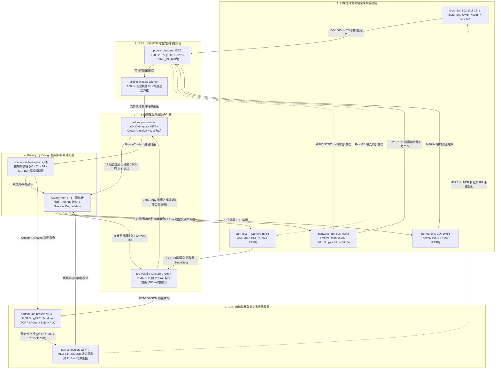
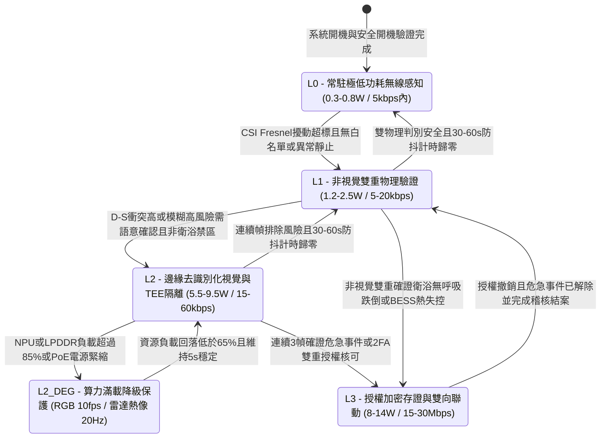
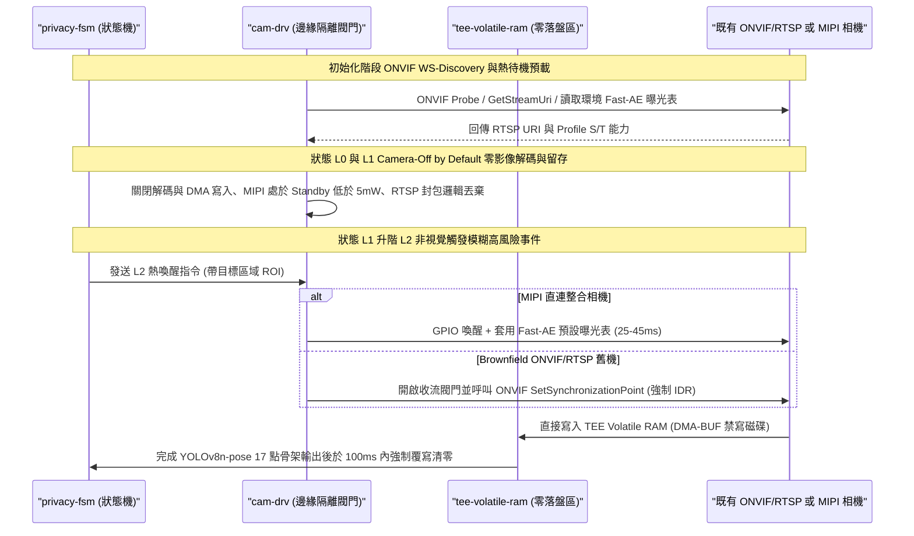

# 系統架構與融合核心工程設計規格書（System Architecture & Fusion Core Specification）

> **文件編號**：`DOC-ISF-ARCH-001`  
> **版本**：`v1.0.0-Baseline`  
> **基準對齊**：本規格書所有延遲、功耗、頻寬、晶片能力與合規紅線均嚴格對齊 [research_report.md](file:///d:/AI_sensor_fusion/research_report.md) 與 [prd_proposal_outline.md](file:///d:/AI_sensor_fusion/prd_proposal_outline.md)，並作為 C++20 嵌入式邊緣核心、Python FastAPI 原型及五大可插拔場景模組之共同系統設計契約。  
> **架構主軸**：無線網路設備 **ISAC（通感一體化）三重角色中樞** × **Privacy-by-Design 四階級聯喚醒（L0–L3）** × **100 ms 滑動視窗時空對齊與 Dempster-Shafer 證據融合引擎**。

---

## 1. 系統工程總覽與跨硬體配置基準

### 1.1 核心設計原則與三大硬性工程鐵律

本平台將 **無線網路設備（Wi-Fi 7 AP / IEEE 802.11bf CSI / BLE AoA / UWB）**、**60/77 GHz mmWave Radar**、**非製冷 $\text{VO}_x$ LWIR Thermal Sensor** 與 **IP Camera（Starlight RGB / IR-Cut）** 整合於單一邊緣感知匯流平台。為同時達成高可靠度物理閉環與極致隱私合規（GDPR Article 25、EU AI Act `2024/1689`、HIPAA），系統在核心架構層強制執行三大不可繞過之工程鐵律：

1. **預設不開鏡（Camera-Off by Default）**：系統於日常待機（`L0`）與日常安全活動（`L1`）階段，光學 CMOS 保持硬體待機或 Brownfield 邏輯串流閘控，100% 由無線射頻、毫米波點雲與低解析熱矩陣執行存在感測與異常前兆篩檢。
2. **記憶體揮發隔離（Volatile RAM Only, Zero Disk Persistence）**：`L2` 語意驗證期間擷取之原始 RGB 影格僅得駐留於受 **TEE（Trusted Execution Environment）** 或安全隔離區保護之揮發性記憶體環形緩衝區（`SecureRingBuffer`），嚴禁任何寫入 Flash / eMMC / SSD / SD 卡之系統呼叫；完成 17 點去識別化骨架推論與跨模態確認後，必須於 **`< 100 ms`** 內執行 `volatile` 逐位元組強制覆寫清零。
3. **加密雙重授權託管（Cryptographic Dual-Custody）**：唯有多幀連續確證高危事故（跌倒昏迷、起火熱失控、禁區確認入侵），或經 **RBAC + 雙因子（2FA）動態權杖** 雙重授權簽核，方可觸發 `L3` 加密存證並鎖定 Volatile RAM 中之觸發前 5–10 秒 Pre-roll 片段。

### 1.2 三階硬體部署藍本之軟體系統資源邊界

為統一支援軟體組態熱切換與跨平台編譯，系統將底層硬體抽象為三大標準配置檔案（Hardware Profiles）：

| 規格維度 | `phase1_distributed_mvp`（Phase 1 分散式利舊閘道） | `phase2_all_in_one_tier2`（Phase 2 Tier 2 All-in-One 智慧 AP） | `tier3_industrial`（Tier 3 工業級關鍵基礎設施） |
| :--- | :--- | :--- | :--- |
| **定位與典型場域** | 零開模首發試點：長照衛浴／臥室（A1）、BESS／配電室（C4/C2）、利舊既有 ONVIF 攝影機 | 量產商用主力：新建商辦（B2）、連鎖長照機構、智慧零售與智慧建築 | 關鍵基礎設施：半導體無塵室、高壓變電站、儲能場、園區周界（B1）、HRC（C1） |
| **主控／網通與 NPU 算力** | Edge Box：**RK3588**（6 TOPS, 非 NDAA）或 **QCS6490**（12–13 TOPS, NDAA）；搭配 OpenWrt CSI AP | **IPQ5424 / MT7988** Wi-Fi 7 + **QCS6490**（12–13 TOPS）/ **CV72** / **RK3588**（6 TOPS） | **Filogic 880 / IPQ9574** + **NVIDIA Jetson Orin NX 8/16GB**（70–157 Sparse TOPS）或 **Ambarella CV5** |
| **記憶體匯流排與餘裕目標** | LPDDR4x/5（34–51 GB/s），單路至雙路餘裕 $\ge 1.8\times$ | LPDDR5-3200（~51 GB/s），強制 Zero-Copy `DMA-BUF` | 128-bit LPDDR5（**102.4 GB/s** on Orin NX），支援 4–8 路併發融合 |
| **四模態感測配置** | Pod：ESP32-C6 + **TI IWRL6432 / IWR6843AOP** + **MLX90640 (32×24)** / **Lepton 3.5 (160×120)**；納管既有 ONVIF/RTSP | **IWR6843AOP / BGT60TR13C**（60 GHz）+ **Lepton 3.5 / Tiny1-C** + **Sony IMX415/IMX678** + 20°–35° 雲台 | **TI AWR2944**（77 GHz 僅限戶外/交通/桶槽）或雙 60 GHz 室內 + **Seek Mosaic 320 / InfiRay 384 / Boson 640** + **IMX678 WDR** |
| **供電上限與 PoE 預算** | 閘道 PoE+ **25.5 W PD**（或 12/24V DC）；無鏡頭 Pod 待機 `< 1.5 W` | PoE+（25.5 W PD 分級壓限模式）或 **PoE++ 802.3bt Type 3**（60 W PSE / 51 W PD） | 強制 **PoE++ 802.3bt Type 3/4**（60–90 W PSE / 51–71.3 W PD）+ 6 kV 防雷 + 寬溫 `-40°C ~ +85°C` IP67 |
| **關鍵端對端延遲目標** | 標準逐級喚醒 `< 450–500 ms` | 預熱平行路徑 **110–205 ms**；標準喚醒 **250–420 ms** | 預熱路徑 **110–205 ms**；工業工安 PLC 直連 **`< 50–150 ms`** |

> **法規頻段硬性軟體鎖（Regulatory Band Lock）**：系統開機初始化與場景載入時，強制驗證 `hardware_profile` 與 `region_code`／`indoor_flag`。凡部署於室內商用、長照與辦公場景（`A1`, `B2`, 室內 `C1`），**禁止啟用 77 GHz 雷達驅動**（遵守 FCC Part 95M、ETSI EN 301 091 與台灣 NCC LP0002 第 4.14/4.15 節），僅允許運行 **60 GHz（57–64/66 GHz）** 頻段；並禁止使用預定於 2027 年底 EOL 之 FLIR Lepton 2.5。

---

## 2. 系統微服務／邊緣進程拓撲架構

### 2.1 邊緣系統微服務與進程拓撲圖

為兼顧微秒級實時感測採集與容器化／TEE 安全隔離，邊緣節點（Edge AP / Edge Fusion Box）將系統劃分為五大邏輯域：**實體採集驅動層（Hardware Drivers）**、**時空同步與緩衝層（PTP & Alignment）**、**TEE 隔離與融合推論核心（TEE & Fusion Core）**、**狀態機與可插拔場景層（FSM & Scenario Engine）**，以及 **ISAC 網通排程與北向代理層（ISAC & Northbound Broker）**。



*圖 1-1：四模態感測融合邊緣微服務與進程拓撲架構圖*

### 2.2 進程隔離邊界、IPC 機制與 CPU/NPU 親和性

| 進程／服務名稱 | 執行權限與隔離域 | 實時排程策略 | 進程間通訊（IPC）機制 | 核心職責與安全約束 |
| :--- | :--- | :--- | :--- | :--- |
| `rf-csi-drv` | Linux User-Space (`CAP_NET_ADMIN`) | `SCHED_FIFO` (Prio 70) | Netlink Socket / Unix DGRAM + Shared Ring | 解析 Wi-Fi 7 晶片韌體之 802.11bf CSI 封包、BLE AoA IQ 採樣與 UWB TWR 測距封包。 |
| `mmwave-drv` | Linux User-Space (`rt-group`) | `SCHED_FIFO` (Prio 80) | POSIX Shared Memory (`shm_open`) + EventFD | 控制 TI IWRL6432/IWR6843AOP/AWR2944 UART (921,600 bps) 或 SPI，管理 LPDS 2 ms 喚醒與 TLV 點雲解封裝。 |
| `thermal-drv` | Linux User-Space | `SCHED_RR` (Prio 60) | POSIX Shared Memory + I2C/VoSPI ioctl | 擷取 MLX90640/Lepton 3.5/Mosaic/Boson+ 輻射溫度矩陣，執行 ATC 環境溫度補償與 FFC 快門控制。 |
| `cam-drv` | **隔離媒體沙盒**（無磁碟寫權） | `SCHED_FIFO` (Prio 75) | **`dma_heap` Zero-Copy `DMA-BUF`** + gRPC Control | 執行 MIPI-CSI2 或 ONVIF/RTSP 納管；於 `L0/L1` 維持硬體 Standby / 邏輯丟棄；`L2` 僅將 YUV 寫入鎖定之 TEE RAM。 |
| `ptp-sync-engine` | Privileged Sync Service (`CAP_SYS_TIME`) | `SCHED_FIFO` (Prio 90) | PHC (`/dev/ptp0`) + GPIO `gpiod` | 執行 `ptp4l` / `phc2sys` 維持 Sub-1 μs 同步，輸出 1PPS / `SYNC_IN` 觸發並為所有幀注入 `ptp_timestamp_ns`。 |
| `sliding-window-aligner` | Edge Core Process (`C++20` 零堆積執行緒) | `SCHED_FIFO` (Prio 85) | Lock-Free SPSC Ring Buffer | 維護 $\Delta W = 100\text{ ms}$ 時間視窗、CSI 特徵壓縮、雷達卡爾曼速度外推及跨模態投影座標轉換。 |
| `tee-volatile-ram` | **TEE Secure World（OP-TEE / Carve-out RAM）** | 鎖定記憶體（`mlockall`） | 受保護之 `DMA-BUF` Handle 與 Cryptoki PKCS#11 | 管理不可換頁（No-Swap）揮發性環形緩衝區、`< 100 ms` `volatile` 強制覆寫驗證與 L3 AES-256-GCM 密封。 |
| `edge-npu-runtime` | NPU Runtime Sandbox | CPU Affinity 綁定大核 + NPU IRQ | Shared Tensor Memory + Unix UDS gRPC | 運行 `YOLOv8n-pose` INT8、輕量 PointNet、Cross-Attention 與 D-S 證據合併；L2 僅輸出 17 點去識別化 JSON。 |
| `privacy-fsm` & `scenario-rule-engine` | Core Orchestrator Process | `SCHED_OTHER` / High Nice | In-Process / Unix UDS gRPC | 仲裁 L0–L3 狀態轉換、遲滯防抖計時、Graceful Degradation 降載與五大場景模組評估。 |
| `northbound-broker` | Network Egress Container | `SCHED_OTHER` | Local UDS gRPC → TLS 1.3 / Industrial Fieldbus | 對外發送 MQTT、Modbus TCP、BACnet/IP、PROFINET/PROFIsafe、ONVIF/VMS Webhook 與 SIP 語音信令。 |

### 2.3 ISAC 通感一體化資源隔離排程與記憶體牆防護

1. **Wi-Fi 7 MLO 通感共排（ISAC Co-Scheduling）**：
   - 在 `phase2_all_in_one_tier2` 與 `tier3_industrial` 之三頻 Wi-Fi 7 平台上，無線核心明確隔離射頻時間與頻譜資源：**2.4 GHz 或單一 5 GHz（20/80 MHz）通道** 專責執行 IEEE 802.11bf 五步感測交換（SMS → NDPA → NDP → CSI 估測 → TB SME / SBP），控制空口佔用率（Airtime Overhead）**`< 1%–3%`**；**6 GHz（160/320 MHz）高頻寬通道** 結合 MLO **STR（同步收發）** 與 **Preamble Puncturing（頻譜穿孔）**，保留給確定性告警、L3 加密存證與邊緣分散式 Pod 回傳，確保「感知採樣」與「高速傳輸」互不饑餓（Starvation-Free）。
   - 分散式輕量終端則透過 **EMLSR（Enhanced Multi-Link Single Radio）** 同時監聽多條鏈路並動態切換至低干擾頻段，抑制封包抖動。
2. **記憶體牆（Memory Wall）頻寬保護準則**：
   - 依系統延遲預算分析，4K YUV DMA 寫入（2.5–4.5 GB/s）、NPU 權重與 Attention KV 讀寫（8–18 GB/s）及 L3 H.265 編碼（2.0–4.0 GB/s）並發時，**峰值記憶體頻寬佔用達 13–28 GB/s**。
   - 系統強制實施 **Zero-Copy `DMA-BUF`** 管線（Camera ISP → TEE RAM → NPU → VPU 全程不經過 CPU `memcpy`），且硬體選型必須保證實測 LPDDR 頻寬具有 **$\ge 1.8\times$ 餘裕**（RK3588 / QCS6490 34–51 GB/s 單路滿足；Orin NX 102.4 GB/s 滿足 4–8 路多節點匯流）。當記憶體控制器使用率 $> 85\%$ 時，立即觸發狀態機降級策略。

---

## 3. L0–L3 Privacy-by-Design 狀態機完整規格

### 3.1 視覺化狀態機（`stateDiagram-v2`）



*圖 3-1：Privacy-by-Design L0–L3 分級喚醒與異常降級狀態機*

> **衛浴／隱私絕對禁區特別規則**：於 `A1`（衛浴／臥室無鏡頭模式）與 `B2`（商辦日間空調模式）中，狀態機透過策略旗標 `allow_optical_l2 = false` 在硬體與狀態守衛層鎖死 `L1 → L2` 路徑；若發生極高危生命徵象異常（如跌倒後呼吸停止 $> 30\text{ s}$），在無鏡頭感測 Pod 下可直接由 `L1` 發出最高級別非視覺緊急告警與 SIP 雙向語音通話（不產生影像），或於走廊/公共區節點依預授權升階 `L3`。

### 3.2 跨階級系統狀態與量化資源預算對照表

| 隱私階級 | 感測器啟閉與採樣規格 | 內部匯流排頻寬（Sensor-to-RAM） | 對外上行有效負載（Uplink） | 感測+AI 增量功耗 / 含 Wi-Fi 7 AP 總功耗 | 端對端處理與喚醒延遲預算 | 隱私與法規合規等級 |
| :--- | :--- | :--- | :--- | :--- | :--- | :--- |
| **L0：日常無人** | CSI 100 Hz + BLE/UWB 常駐；mmWave **LPDS (~0.48–0.67 mW, 2 ms 喚醒)**；Thermal **Shutdown (0–5 mW)**；RGB **Standby (<1–5 mW)** | CSI 內部擷取：~0.35–1.5 Mbps | **`< 2–5 kbps`**（僅心跳與無人狀態摘要） | 增量：~0.3–0.8 W<br>含 AP：~12.5–19 W | Stage 0 RF 觸發：**20–40 ms** | **Tier-0 最高隱私**（零影像、零熱斑、非 GDPR 個資） |
| **L1：日常安全活動 / 非視覺驗證** | CSI 100–200 Hz + BLE AoA；mmWave **10–20 Hz** 點雲與呼吸；Thermal **1–9/30 Hz**；RGB **保持關閉** | CSI + 雷達 TLV (~50–150 kbps) + 熱陣列 (~100 kbps–2.8 Mbps) | **`5–20 kbps`**（匿名人數、安全區間、呼吸心跳摘要） | 增量：~1.2–2.5 W<br>含 AP：~19–30 W | L0→L1 喚醒 + 物理計算：**20–40 ms**（含熱像 Shutdown 最長 110–180 ms） | **Tier-1 非視覺合規**（僅匿名向量與粗熱斑，合 HIPAA/GDPR 衛浴標準） |
| **L2：邊緣去識別化語意解析** | CSI 500 Hz；mmWave **20 Hz**；Thermal 160×120 @ **9–30 Hz**；RGB **Fast-AE 熱喚醒進 TEE RAM** 跑 `YOLOv8n-pose` | RGB YUV 進 RAM：~0.75–3.0 Gbps + 雷達 (~250 kbps) + 熱像 (~9.2 Mbps) | **`15–60 kbps`**（僅輸出 17 點骨架、匿名 BBox 與熱點 JSON） | 增量：~5.5–9.5 W<br>含 AP：~24–38 W | Fast-AE 喚醒 25–45 ms + 對齊 35–50 ms + NPU 20–45 ms；**預熱總延遲 110–205 ms**（標準 250–420 ms） | **Tier-2 邊緣不可逆去識別化**（Zero Disk Persistence；RAM **`< 100 ms`** 覆寫銷毀，合 GDPR Art. 25） |
| **L3：授權／危急加密存證** | 全模態全速：CSI 500–1000 Hz + mmWave 20–30 Hz + Thermal 30 Hz + RGB 4K @ 30fps H.265 + 雙向語音 | 內部全開：~1.5–3.2 Gbps（含 5–10s Pre-roll 環形讀出） | **`15–30 Mbps`**（DOL-HDR 40–60 Mbps）+ 雙向語音 64 kbps | 增量：~8–14 W<br>含 AP：~30–48+ W（須 PoE++） | Stage 4 加密打包 10–25 ms + Wi-Fi 7 STR 1–5 ms = **15–30 ms** | **Tier-3 受控合規存證**（Vital Interests / RBAC 2FA；AES-256-GCM + TLS 1.3 + 第三方自動遮罩） |

### 3.3 狀態轉換詳細規格表（Trigger / Guard / Action / Hysteresis / Degradation）

| 編號 | 轉換路徑 | 觸發事件（Trigger） | 守衛條件（Guard Condition） | 執行動作（Action） | 遲滯防抖與計時器（Hysteresis / Timer） | 異常降級與回退（Graceful Degradation / Fallback） |
| :---: | :--- | :--- | :--- | :--- | :--- | :--- |
| **T1** | `L0 → L1` | Wi-Fi CSI 子載波振幅方差或相位差（CSI Ratio）突破動態 Fresnel 基線 | `(csi_anomaly == true && !ble_uwb_whitelist_match) || prolonged_static_timeout` | 透過 `GPIO SYNC_IN` 於 **2 ms** 內喚醒 mmWave 脫離 LPDS；開啟 Thermal MOSFET/解除 Shutdown；啟動 PTP 對齊視窗 | 進入 `L1` 後立即鎖定最小駐留時間 **`T_dwell_L1 = 30 s`**（場景可設 30–60 s），防止邊界訊號反覆抖動 | 若 Thermal 尚處 Shutdown 冷熱穩定（<0.5 s），先以 mmWave 單獨運算並設 $m_{\text{thermal}}(\Theta)=1.0$ |
| **T2** | `L1 → L0` | mmWave 與 Thermal 判定區域無人或僅正常無害環境擾動 | `ds_belief_alert < th_l1_clear && occupancy_count == 0` | 關閉 Thermal 供電或切回 Shutdown（5 mW）；下發指令將 mmWave 切回 LPDS（0.5 mW）；發送 `L0` 摘要 | 必須連續滿足無人/安全條件滿 **遲滯防抖計時器 `30–60 s`**（如 B2 空房關機可設為 300–600 s 業務確認）方能降級 | 若下發休眠前最後一幀檢測到目標重入，立即重置計時器並維持 `L1` |
| **T3** | `L1 → L2` | D-S 融合判定存在「疑似危急事件」或高衝突需光學語意仲裁 | `(ds_belief_alert >= th_l2_wake || ds_conflict_K >= 0.99 || ds_uncertainty_Theta >= 0.45) && scenario.allow_optical_l2 == true && !hardware_privacy_lock` | 解除 `cam-drv` 邏輯閥門，以 **Fast-AE + Suspend-to-RAM** 在 **25–45 ms** 內寫入 TEE Volatile RAM；執行 `YOLOv8n-pose` 與 Cross-Attention；輸出 17 點骨架 JSON 後 **`< 100 ms`** 內執行 `secure_wipe()` | 設最小駐留觀察窗 **`T_dwell_L2 = 30 s`**；L2 期間每次推論皆獨立觸發 RAM 覆寫與計時稽核 | 若 `cam-drv` 斷線或鏡頭遭遮蔽，自動回退「純非視覺高靈敏度仲裁模式」（調升雷達與熱像權重 $\alpha$）並上報硬體告警 |
| **T4** | `L2 → L1` | L2 跨模態連續確認為無害事件（如掉落紙箱、動物、日光反光或人員已正常起身活動） | `ds_belief_alert < th_l2_clear && rgb_semantic_risk == false` 連續持續滿防抖時間 | 停止 RGB 擷取、確認 `tee-volatile-ram` 緩衝區 **100% 全零清零**並寫入 Audit Log；降回 `L1` 僅維持雷達+熱像追蹤 | 強制連續安全滿 **遲滯防抖 `30–60 s`** 方允許關閉光學感測 | 若防抖期間再次出現模糊高風險特徵，立即重置倒數計時維持 `L2` |
| **T5** | `L2 → L2_DEG` | 系統資源飽和：突發多區域喚醒導致 NPU 算力或 LPDDR 頻寬瀕臨記憶體牆，或 PoE+ 25.5W 電源緊縮 | `npu_util > 85% || mem_bw_headroom < 1.8x || poe_power_budget_near_limit == true` | **Graceful Degradation**：將 `L2` RGB CMOS 幀率由 **30 fps 動態降至 10 fps**（縮減 66% DMA 與視覺算力負載），**優先鎖定 20 Hz mmWave 3D 點雲與 Thermal 連續追蹤**；PoE+ 下動態調降非必要 Wi-Fi 空間流 | 降級保護立即生效（`< 1 幀週期 33 ms`）；回升須待負載連續低於 65% 滿 **`5 s`** | 若持續過載 $> 10\text{ s}$，暫停較低優先級區域之視覺推論，維持最高危區域追蹤與 PLC 保護迴路 |
| **T6** | `L2 / L1 → L3` | (a) 連續 $\ge 3$ 幀確證高危異常（無呼吸跌倒、明火熱失控擴散、確認入侵）；或 (b) 遠端值班員／醫護發出合法雙重授權請求 | `(critical_confirmed_frames >= 3) || (dual_custody_token.valid == true && mfa_verified == true)` | 若來自 L2，鎖定 TEE RAM 中 **觸發前 5–10 秒 Pre-roll 片段**，執行硬體 H.265 編碼＋**AES-256-GCM + TLS 1.3** 串流；自動啟動非相關第三者動態模糊遮罩；發送 `ActuatorDispatch`（PLC 跳脫／SIP 通話／VMS 告警） | 進入 `L3` 後維持加密事件鎖定至少 **`60 s`**，直至於控制台完成事件確認（ACK）且現場風險消除 | 若網路上行中斷（WAN Disconnected），將加密封裝片段暫存於本地受 TPM 加密保護之環形事件隔離區（限時 TTL 清除），斷網不影響本地 PLC/BMS 急停 |
| **T7** | `L3 → L1` | 危急事件已處置完畢或授權連線逾時自動到期 | `incident_acknowledged == true && emergency_resolved == true && cooldown_elapsed >= 60 s` | 終止 H.265 錄製與 TLS 存證通道，執行完整 `tee-volatile-ram` `secure_wipe()` 全零覆寫，記錄稽核雜湊後安全降回 `L1` | 須人工 ACK 或權杖 TTL 到期後再加 `30–60 s` 安全觀察窗 | 降回前若任一模態仍報警，拒絕降級並保持在 `L3`/`L2` |

---

## 4. Dempster-Shafer (D-S) 證據融合與 100ms 滑動視窗對齊數學規格

### 4.1 Dempster-Shafer 證據理論（D-S Theory）數學模型

為解決單純「加權平均」無法區分「低風險（確定安全）」與「感測器盲區（不知道是否安全，Epistemic Uncertainty）」之致命缺陷，系統採用 **Dempster-Shafer 證據合併理論** 作為 L1/L2 核心決策仲裁器。

#### (1) 辨識框架（Frame of Discernment）與基本機率分配（BPA / Mass Function）

定義基本安全狀態辨識框架為：
$$\Theta = \{N, A\}$$
其中 $N$ 代表 `Normal`（安全／日常正常活動），$A$ 代表 `Alert`（異常風險／觸發事件，具體子類由所掛載場景模組綁定）。冪集（Power Set）包含四個元素：$2^\Theta = \{\emptyset, \{N\}, \{A\}, \Theta\}$，其中集合 $\Theta = \{N, A\}$ 代表 **不確定性（Epistemic Uncertainty / Ignorance）**。

對每一模態 $i \in \{\text{CSI}, \text{mmWave}, \text{Thermal}, \text{RGB}\}$，於時刻 $t_{\text{ref}}$ 依其特徵風險分數 $s_i \in [0, 1]$ 與**環境可靠度折減因子（Shafer Discounting Factor）$\alpha_i \in [0, 1]$** 構造 Mass Function $m_i: 2^\Theta \to [0, 1]$：

1. **原始風險機率轉換（未折減前，$u_{0,i}$ 為模態固有雜訊保留不確定度，如 $u_{0,i} \in [0.05, 0.25]$）**：
   $$\tilde{m}_i(A) = (1 - u_{0,i}) \cdot s_i$$
   $$\tilde{m}_i(N) = (1 - u_{0,i}) \cdot (1 - s_i)$$
   $$\tilde{m}_i(\Theta) = u_{0,i}$$

2. **Shafer 環境可靠度折減（Sensor Reliability Discounting）**：
   依據即時物理品質指標（如：濃煙能見度低時 $\alpha_{\text{rgb}} \to 0.05$；Thermal 處於 FFC 快門凍結或資料過期 $|\Delta t| > 100\text{ ms}$ 時 $\alpha_{\text{thermal}} = 0$；L0/L1 鏡頭關閉時 $\alpha_{\text{rgb}} = 0$）：
   $$m_i(A) = \alpha_i \cdot \tilde{m}_i(A)$$
   $$m_i(N) = \alpha_i \cdot \tilde{m}_i(N)$$
   $$m_i(\Theta) = (1 - \alpha_i) + \alpha_i \cdot \tilde{m}_i(\Theta)$$
   必滿足正則化條件：$m_i(\emptyset) = 0$ 且 $m_i(N) + m_i(A) + m_i(\Theta) = 1$。當模態關閉或失效（$\alpha_i = 0$），自動退化為完全無知 $m_i(\Theta) = 1.0$，對融合結果保持完全中性不干擾。

#### (2) 衝突係數 $K$ 與 Dempster 正交合併公式

給定兩個獨立證據體 $m_1$ 與 $m_2$，其衝突係數（Conflict Coefficient）$K$ 定義為兩者支持互斥假設之機率乘積和：
$$K = \sum_{B \cap C = \emptyset} m_1(B) m_2(C) = m_1(N)m_2(A) + m_1(A)m_2(N)$$

當 $K < 1$ 時，Dempster 正交合併法則（$m_{12} = m_1 \oplus m_2$）計算如下：
$$m_{12}(A) = \frac{1}{1 - K} \Big( m_1(A)m_2(A) + m_1(A)m_2(\Theta) + m_1(\Theta)m_2(A) \Big)$$
$$m_{12}(N) = \frac{1}{1 - K} \Big( m_1(N)m_2(N) + m_1(N)m_2(\Theta) + m_1(\Theta)m_2(N) \Big)$$
$$m_{12}(\Theta) = \frac{1}{1 - K} \Big( m_1(\Theta)m_2(\Theta) \Big)$$

由於 Dempster 合併滿足結合律與交換律，對四個模態依序迭代計算：
$$m_{\text{fused}} = \left(\left(m_{\text{CSI}} \oplus m_{\text{mmWave}}\right) \oplus m_{\text{Thermal}}\right) \oplus m_{\text{RGB}}$$

並輸出最終決策區間：
* **信任函數（Belief）**：$\text{Bel}(A) = m_{\text{fused}}(A)$（代表證據「明確支持」異常之下界）
* **似然函數（Plausibility）**：$\text{Pl}(A) = m_{\text{fused}}(A) + m_{\text{fused}}(\Theta)$（代表證據「不反對」異常之上界；區間 $[\text{Bel}(A), \text{Pl}(A)]$ 寬度即系統剩餘不確定度）
* **Pignistic 轉換機率**：$\text{BetP}(A) = m_{\text{fused}}(A) + \frac{1}{2} m_{\text{fused}}(\Theta)$

#### (3) 極端衝突保護機制（High-Conflict Safeguard, $K \ge 0.99$）

實務中可能出現感測器極度矛盾（例如：濃煙遮蔽導致 RGB 強報 $m_{\text{rgb}}(N) = 0.99$，而 mmWave 與 Thermal 強報 $m_{\text{radar+thm}}(A) = 0.995$，致 $K \ge 0.99$）。若直接執行 $\frac{1}{1-K}$ 將造成數值暴衝或除零風險。系統強制實作雙重保護：
1. **數值安全防線**：當累計或單步衝突係數 **$K \ge 0.99$**（即 $1 - K \le 0.01$）時，禁止執行正交除法，切換為 **Murphy/Yager 保守平均回退**：將衝突品質 $K$ 全部歸入不確定項 $m_{\text{safe}}(\Theta) = m_{\text{base}}(\Theta) + K$，或將各模態 BPA 取算術平均後再行合併。
2. **狀態機仲裁旗標**：強制將 `high_conflict_escalate = true` 送入 `privacy-fsm`，若當前處於 `L1` 則觸發升階 `L2` 語意／情境審核，或於濃煙/環境失效場景中依據場景物理優先級（如 `C4` 濃煙模式下自動降權 $\alpha_{\text{rgb}} \to 0$）重新計算，徹底消除矛盾鎖死。

---

### 4.2 100 ms 滑動視窗時間對齊與卡爾曼速度外推演算規格

四模態原始取樣頻率跨越三個數量級：**Wi-Fi CSI（100–1000 Hz, 週期 1–10 ms）**、**mmWave Radar（10–20 Hz, 週期 50–100 ms）**、**Thermal（9–30 Hz, 週期 33.3–111.1 ms）** 及 **RGB Camera（30–60 fps, 週期 16.7–33.3 ms）**。系統於 Edge RAM 建立長度 **$\Delta W = 100\text{ ms}$（$100,000,000\text{ ns}$）** 之滑動對齊視窗，以主控頻率（$20\text{ Hz}$，步進 $50\text{ ms}$）或最新主幀時間戳 $t_{\text{ref}}$ 為對齊基準：

1. **高頻降維聚合（100–1000 Hz Wi-Fi CSI）**：
   - 從環形緩衝區萃取 $[t_{\text{ref}} - 25\text{ ms}, t_{\text{ref}} + 25\text{ ms}]$ 區間內全部 $M_{\text{csi}}$ 筆封包（典型 5–50 筆）。
   - 執行 Hampel 離群值濾波 $\to$ 計算雙天線/子載波 **CSI Ratio** 消除載波頻率偏移（CFO）與採樣頻偏（SFO） $\to$ 短時能量與都卜勒頻譜包絡壓縮，輸出單一對齊特徵向量 $\mathbf{f}_{\text{csi}}(t_{\text{ref}})$。
2. **低頻異步幀卡爾曼速度外推補償（10–20 Hz mmWave / 9–30 Hz Thermal）**：
   - 在時間窗 $[t_{\text{ref}} - 100\text{ ms}, t_{\text{ref}}]$（或雙向視窗 $\pm 50\text{ ms}$）內搜尋最接近 $t_{\text{ref}}$ 之幀時間戳 $t_s$。
   - **新鮮度門檻檢查**：若 $|t_{\text{ref}} - t_s| > 100\text{ ms}$，判定該模態資料過期（Stale），設定可靠度 $\alpha_i = 0$（BPA 轉為 $m_i(\Theta) = 1.0$）。
   - **一階運動學／卡爾曼狀態外推**：對每個追蹤目標 ID 維護定常速度卡爾曼濾波器（Constant-Velocity Kalman Filter），狀態向量 $\mathbf{x}_k = [x, y, z, v_x, v_y, v_z]^T$。利用最新濾波估測速度向量 $\hat{\mathbf{v}}$ 將空間位置外推至精確基準時刻 $t_{\text{ref}}$（目標殘餘時間對齊誤差 **$\epsilon_t \le 15\text{ ms}$**）：
     $$\Delta t = t_{\text{ref}} - t_s \quad (|\Delta t| \le 0.100\text{ s})$$
     $$\hat{\mathbf{p}}_{\text{radar}}(t_{\text{ref}}) = \mathbf{p}_{\text{radar}}(t_s) + \hat{\mathbf{v}}_{\text{radar}} \cdot \Delta t$$
     對 Thermal 熱斑質心 $(u_{\text{thm}}, v_{\text{thm}})$ 亦同步利用上一幀光流或投影自雷達之影像平面速度 $(\hat{v}_u, \hat{v}_v)$ 執行外推平移，消除如 9 Hz 熱像（111 ms 間隔）對 1.5–3.0 m/s 移動目標造成之 16–33 cm 錯位！
3. **L2 級跨模態特徵融合（BEV + Cross-Attention）**：
   - 當進入 `L2` 後，系統啟動 **Cross-Attention** 跨模態融合：以空間幾何精準之 **mmWave 3D 座標與 Thermal 熱塊作為 Query ($Q$)**，向 **RGB `YOLOv8n-pose` 特徵圖提取 Key/Value ($K, V$)** 進行雙向特徵聚合（或於鳥瞰圖 BEV 網格對齊），使系統在局部遮擋或微光下仍能穩定綁定目標語意與人體骨架。

```text
演算法流程：SlidingWindowAlign_100ms(t_ref_ns)
1. 檢查各模態 SPSC RingBuffer，丟棄 ptp_timestamp_ns < (t_ref_ns - 100_000_000) 之過期幀。
2. [CSI 聚合] 取出 [t_ref_ns - 25ms, t_ref_ns + 25ms] 內所有 CSI 幀；
   若樣本數 >= 2，計算子載波方差、Phase Ratio 與能量包絡 -> f_csi；否則標記 csi_stale。
3. [mmWave 外推] 搜尋 |t_ref_ns - t_rad| <= 100ms 之最近 RadarFrame：
   計算 dt = (t_ref_ns - t_rad) * 1e-9；
   對各追蹤點雲執行 Kalman 位置外推 p_hat = p + v_hat * dt；
   若未經硬體 SYNC_IN 同步，檢查殘餘補償誤差是否 <= 15ms。
4. [Thermal 外推與標定] 搜尋 |t_ref_ns - t_thm| <= 100ms 之最近 ThermalFrame：
   提取最高溫度、溫升斜率 dT/dt 與熱斑質心；
   以 dt_thm = (t_ref_ns - t_thm) * 1e-9 外推熱斑邊界框並投影至統一座標系。
5. [RGB L2 閘控與對齊] 若 PrivacyFSM >= L2 且 allow_optical_l2 == true：
   從 TEE SecureRingBuffer 取最接近 t_ref_ns 之 DMA-BUF 幀執行 YOLOv8n-pose 與 Cross-Attention；
   立即呼叫 secure_wipe() (< 100ms) 並記錄抹除耗時與驗證結果。
   若處於 L0/L1，直接設定 rgb_valid = false 且 alpha_rgb = 0.0。
6. 將對齊後之 AlignedWindow 送入 D-S 證據合併引擎與當前啟用之 ScenarioModule。
```

---

## 5. 完整通訊協定與 Data Schema

### 5.1 邊緣 MQTT Topics 階層樹規範

邊緣節點與區域/雲端管理平台（或地端 BMS / VMS / 護理站系統）之間統一採用 **MQTT v5.0 over TLS 1.3**（埠號 `8883`；純內網 OT 隔離可選 mTLS），Topics 採四層標準命名階層：

```text
isf/{site_id}/{zone_id}/{node_id}/
├── telemetry/
│   ├── l0/csi                # QoS 0: L0 Wi-Fi 802.11bf CSI / BLE 存在摘要 (< 5 kbps)
│   ├── l1/mmwave             # QoS 0: L1 匿名 3D 追蹤目標與呼吸/心率摘要 (不帶身分)
│   ├── l1/thermal            # QoS 0: L1 熱點統計、最高/平均溫度與 dT/dt 斜率
│   └── l2/skeleton           # QoS 1: L2 17點去識別化骨架 JSON 與 RAM 清零稽核資訊
├── events/
│   └── alert                 # QoS 1 (Retain=false): D-S 融合判定與場景觸發告警
├── forensics/
│   └── l3/custody            # QoS 2: L3 雙重授權 AES-256-GCM 加密 Pre-roll 存證封包索引
├── health/
│   └── diagnostics           # QoS 1 (Retain=true): 硬體狀態、PoE 瓦數、NPU 負載、LWT 遺囑離線通知
└── cmd/                      # 下行控制指令 (須驗證 JWT / ECDSA 簽章)
    ├── fsm                   # 狀態機策略與遲滯參數下發
    ├── l3_auth               # 雙因子 Dual-Custody 加密存證授權權杖
    └── scenario              # 熱切換場景模組 (A1 / C4 / B1 / C1 / B2) 與閾值更新
```

### 5.2 標準 JSON Payload 範例集

#### (1) L0 Wi-Fi CSI 特徵摘要 JSON（`telemetry/l0/csi`）

```json
{
  "schema_ver": "1.0",
  "ptp_timestamp_ns": 1795240182450123900,
  "node_id": "ap-edge-ward02-01",
  "privacy_level": "L0",
  "rf_sensing": {
    "standard": "IEEE_802_11bf_2025",
    "channel_mhz": 80,
    "band_ghz": 5.18,
    "sample_rate_hz": 100,
    "fresnel_variance_score": 0.78,
    "doppler_energy_norm": 0.42,
    "csi_motion_state": "DISTURBANCE_DETECTED",
    "whitelist_tags": [
      {
        "proto": "BLE_AOA",
        "token_hash": "sha256:9f84b2c1a0...",
        "distance_m": 2.4,
        "aoa_deg": -18.5,
        "auth_valid": false
      }
    ]
  }
}
```

#### (2) L1 mmWave 點雲與生命徵象摘要 JSON（`telemetry/l1/mmwave`）

```json
{
  "schema_ver": "1.0",
  "ptp_timestamp_ns": 1795240182500000400,
  "node_id": "pod-bath-204-01",
  "radar_chip": "TI_IWR6843AOP",
  "band_ghz": 60.5,
  "privacy_level": "L1",
  "point_cloud_summary": {
    "num_points": 38,
    "snr_avg_db": 17.4,
    "clutter_filtered_count": 6
  },
  "tracks": [
    {
      "track_id": 104,
      "centroid_xyz_m": [1.42, 2.18, 0.29],
      "velocity_xyz_mps": [0.02, -0.01, -1.12],
      "height_drop_delta_m": 0.94,
      "stillness_duration_s": 18.5,
      "vital_signs": {
        "respiration_bpm": 9.2,
        "heart_rate_bpm": 54.0,
        "micro_doppler_conf": 0.89
      }
    }
  ]
}
```

#### (3) L1 Thermal 熱點統計 JSON（`telemetry/l1/thermal`）

```json
{
  "schema_ver": "1.0",
  "ptp_timestamp_ns": 1795240182501200000,
  "node_id": "pod-bess-rack03",
  "sensor_model": "FLIR_LEPTON_3_5",
  "resolution": [160, 120],
  "privacy_level": "L1",
  "radiometric_stats": {
    "ambient_c": 26.8,
    "fpa_temp_c": 34.1,
    "ffc_active": false,
    "frame_max_c": 68.4,
    "frame_min_c": 24.5
  },
  "hotspots": [
    {
      "hotspot_id": 1,
      "bbox_norm": [0.41, 0.52, 0.14, 0.19],
      "peak_temp_c": 68.4,
      "mean_temp_c": 63.1,
      "temp_rise_rate_c_per_min": 3.85,
      "delta_above_baseline_c": 29.2,
      "estimated_area_m2": 0.18
    }
  ]
}
```

#### (4) L2 17 點骨架去識別化 JSON（`telemetry/l2/skeleton`）

> 規範要求：僅包含 COCO-17 標準關節相對座標、匿名軌跡 ID 與防洩漏稽核記錄，**嚴格禁止夾帶任何 Base64 像素或人臉 Embedding 向量**。

```json
{
  "schema_ver": "1.0",
  "ptp_timestamp_ns": 1795240182550000000,
  "node_id": "ap-corridor-01",
  "privacy_level": "L2",
  "zero_disk_audit": {
    "tee_ram_only": true,
    "raw_frame_wiped": true,
    "ram_wipe_latency_ms": 1.42,
    "wipe_verification_passed": true
  },
  "deidentified_targets": [
    {
      "anon_track_id": "trk_a8f19c",
      "bbox_norm": [0.34, 0.48, 0.28, 0.19],
      "semantic_class": "HUMAN_POSTURE_PRONE",
      "ppe_compliant": null,
      "keypoints_coco17": [
        [0.42, 0.54, 0.91], [0.43, 0.53, 0.88], [0.41, 0.53, 0.89],
        [0.44, 0.54, 0.82], [0.40, 0.54, 0.80], [0.47, 0.55, 0.94],
        [0.39, 0.56, 0.92], [0.51, 0.58, 0.85], [0.38, 0.59, 0.83],
        [0.54, 0.61, 0.79], [0.37, 0.62, 0.78], [0.52, 0.57, 0.93],
        [0.49, 0.58, 0.91], [0.57, 0.60, 0.88], [0.54, 0.61, 0.87],
        [0.61, 0.63, 0.84], [0.59, 0.64, 0.82]
      ]
    }
  ],
  "ds_fusion": {
    "belief_alert": 0.934,
    "plausibility_alert": 0.972,
    "uncertainty_theta": 0.038,
    "conflict_k": 0.041
  }
}
```

#### (5) L3 加密事件存證封裝 JSON（`forensics/l3/custody`）

```json
{
  "schema_ver": "1.0",
  "event_id": "evt-20261122-044938-9921",
  "ptp_timestamp_ns": 1795240188100000000,
  "node_id": "ap-corridor-01",
  "scenario_id": "A1",
  "privacy_level": "L3",
  "custody_authorization": {
    "trigger_basis": "CRITICAL_MULTI_FRAME_VITAL_INTERESTS",
    "dual_custody_required": true,
    "operator_a_key_id": "tpm-key-op-8812",
    "operator_b_key_id": "hsm-supervisor-204",
    "token_signature_alg": "ES256"
  },
  "encrypted_preroll": {
    "preroll_window_sec": 8.0,
    "codec": "H265_MAIN_PRIVACY_MASKED",
    "third_party_masked": true,
    "cipher": "AES-256-GCM",
    "key_wrap_alg": "RSA-OAEP-256-TPM2",
    "iv_nonce_b64": "q7kLm2pX9vR1tY8n",
    "aad_b64": "aXNmLXNpdGUtMDEtZXZ0LTk5MjE=",
    "auth_tag_b64": "x9Kp3mW8zQ1rL4vN2bT6yA==",
    "wrapped_dek_b64": "MEUCIQDx...encrypted_dek...",
    "media_uri": "https://vault.local/v1/clips/evt-20261122-044938-9921.enc",
    "payload_sha256": "e3b0c44298fc1c149afbf4c8996fb92427ae41e4649b934ca495991b7852b855"
  }
}
```

### 5.3 內部高速通訊 gRPC Protobuf (`.proto`) 介面定義

邊緣進程之間（如 `sliding-window-aligner`、`edge-npu-runtime`、`privacy-fsm` 與 `northbound-broker`）透過 Unix Domain Socket（UDS）或受 TLS 保護之本地 gRPC 進行高速強型別交換，確保與 C++20 結構體及 Python 模型無縫對應：

```protobuf
syntax = "proto3";

package isf.edge.v1;

option optimize_for = LITE_RUNTIME;

enum PrivacyLevel {
  PRIVACY_L0_AMBIENT_RF = 0;
  PRIVACY_L1_DUAL_PHYSICS = 1;
  PRIVACY_L2_DEIDENTIFIED_VISION = 2;
  PRIVACY_L3_ENCRYPTED_FORENSICS = 3;
  PRIVACY_L2_DEGRADED = 4;
}

enum HardwareProfile {
  PHASE1_DISTRIBUTED_MVP = 0;
  PHASE2_ALL_IN_ONE_TIER2 = 1;
  TIER3_INDUSTRIAL = 2;
}

enum ScenarioId {
  SCENARIO_UNSPECIFIED = 0;
  SCENARIO_A1_ELDERLY_CARE = 1;
  SCENARIO_C4_BESS_THERMAL = 2;
  SCENARIO_B1_PERIMETER = 3;
  SCENARIO_C1_HRC_SAFETY = 4;
  SCENARIO_B2_SMART_HVAC = 5;
}

message CsiFrame {
  uint64 ptp_timestamp_ns = 1;
  float fresnel_variance = 2;
  float doppler_energy = 3;
  float breathing_proxy_hz = 4;
  bool whitelist_tag_present = 5;
  repeated float subcarrier_amplitude = 6;
}

message RadarTarget {
  uint32 track_id = 1;
  float x_m = 2;
  float y_m = 3;
  float z_m = 4;
  float vx_mps = 5;
  float vy_mps = 6;
  float vz_mps = 7;
  float rcs_dbsm = 8;
  float respiration_bpm = 9;
  float heart_rate_bpm = 10;
  float micro_doppler_hz = 11;
}

message MmWaveFrame {
  uint64 ptp_timestamp_ns = 1;
  uint32 band_ghz = 2; // 60 or 77 (77 restricted to outdoor/TLPR)
  repeated RadarTarget targets = 3;
}

message ThermalHotspot {
  uint32 hotspot_id = 1;
  float cx_norm = 2;
  float cy_norm = 3;
  float width_norm = 4;
  float height_norm = 5;
  float peak_temp_c = 6;
  float mean_temp_c = 7;
  float rise_rate_c_per_min = 8;
}

message ThermalFrame {
  uint64 ptp_timestamp_ns = 1;
  float ambient_temp_c = 2;
  float max_temp_c = 3;
  bool ffc_active = 4;
  repeated ThermalHotspot hotspots = 5;
}

message Keypoint2D {
  float x_norm = 1;
  float y_norm = 2;
  float confidence = 3;
}

message SkeletonTarget {
  string anon_track_id = 1;
  string semantic_class = 2;
  repeated Keypoint2D keypoints_coco17 = 3;
  bool ppe_helmet_ok = 4;
  bool ppe_vest_ok = 5;
}

message RgbSkeletonFrame {
  uint64 ptp_timestamp_ns = 1;
  uint64 dma_buf_audit_id = 2;
  double ram_wipe_latency_ms = 3;
  bool wipe_verified_zero = 4;
  repeated SkeletonTarget targets = 5;
}

message SensorFrame {
  uint32 source_node_id = 1;
  oneof payload {
    CsiFrame csi = 2;
    MmWaveFrame mmwave = 3;
    ThermalFrame thermal = 4;
    RgbSkeletonFrame rgb_skeleton = 5;
  }
}

message DsMassVector {
  double mass_normal = 1;
  double mass_alert = 2;
  double mass_uncertainty = 3;
  double conflict_k = 4;
  double belief_alert = 5;
  double plausibility_alert = 6;
  bool high_conflict_escalate = 7;
}

message FusionResult {
  uint64 aligned_ptp_timestamp_ns = 1;
  uint64 window_span_ns = 2; // 100,000,000 ns
  DsMassVector fused_ds = 3;
  PrivacyLevel current_privacy_level = 4;
  ScenarioId active_scenario = 5;
  string risk_level = 6; // NORMAL, WARNING, CRITICAL
  repeated string suppression_reasons = 7;
  repeated string action_commands = 8;
  double e2e_latency_ms = 9;
}

message StateCommand {
  uint64 command_id = 1;
  PrivacyLevel target_level = 2;
  ScenarioId switch_scenario = 3;
  HardwareProfile hardware_profile = 4;
  bool force_graceful_degradation = 5;
  string reason = 6;
}

message L3AuthorizeRequest {
  string event_id = 1;
  string operator_a_jwt = 2;
  string operator_b_2fa_sig = 3;
  float requested_preroll_sec = 4; // 5.0 - 10.0s
}

message CommandAck {
  bool accepted = 1;
  PrivacyLevel resulting_level = 2;
  string audit_hash = 3;
  string error_message = 4;
}

service EdgeFusionBus {
  rpc StreamSensorFrames (stream SensorFrame) returns (stream FusionResult);
  rpc SetStateCommand (StateCommand) returns (CommandAck);
  rpc AuthorizeL3Forensics (L3AuthorizeRequest) returns (CommandAck);
}
```

### 5.4 Brownfield 既有 ONVIF/RTSP 攝影機納管與熱待機（Warm-Standby + Fast-AE）協定流程

在 Phase 1 利舊導入與混合部署中，客戶現場常已安裝既有 ONVIF/RTSP 攝影機；而在 All-in-One 節點則直連 MIPI-CSI2 感測器。兩者皆嚴禁採傳統「冷斷電重開機」（因 Linux/ISP/3A 收斂耗時 $> 400\text{–}1000\text{ ms}$）。系統採雙軌熱待機控制策略：

1. **MIPI-CSI2 直連攝影機（Warm-Standby + Fast-AE）**：
   - `L0/L1` 期間 CMOS 處於硬體 Standby（$< 1\text{–}5\text{ mW}$），ISP 時脈閘控但主控保留 **預載之環境預設曝光表（Fast-AE LUT）與預配置 `DMA-BUF`**。
   - `L2` 喚醒時透過 `GPIO SYNC_IN` + I2C 快速暫存器寫入（2–10 ms）直入指定 Gain/Exposure 擷取首幀可用 YUV（33 ms），達成 **25–45 ms** 送入 NPU，繞過傳統數百毫秒的 3A 自動曝光收斂等待。
2. **Brownfield ONVIF/RTSP 攝影機納管（邏輯閥門 + Fast-IDR 喚醒）**：
   - 初始化階段透過 **WS-Discovery（UDP 3702 Probe）** 自動探索內網 ONVIF Profile S/T 攝影機，呼叫 `GetStreamUri` 取得 RTSP 串流位址。
   - 為兼顧低延遲與零留存，於 `L0/L1` 階段 `cam-drv` 僅維持極低開銷之 TCP/RTSP Keep-Alive（或將攝影機本機設定為關閉錄影與 SD 卡、僅備援子串流），**於邊緣閘道網卡入口邏輯閥門（Socket Valve）直接丟棄非喚醒期封包，不解碼、不寫入記憶體亦不落盤**。
   - 一旦 `privacy-fsm` 進入 `L2`，閘道立即開啟 TEE RAM 接收並向攝影機發送 ONVIF `SetSynchronizationPoint`（強制攝影機於 1 幀內輸出 Keyframe IDR），立即送交硬體解碼器解出 YUV 進行去識別化推論，隨即清零。



*圖 5-1：Brownfield ONVIF/RTSP 納管與 Warm-Standby + Fast-AE 熱喚醒序列圖*

---

## 6. IEEE 1588 PTP 與異質外參標定工程 SOP

為避免人工踩點成本並滿足 $\epsilon_t \le 15\text{ ms}$ 時間對齊與亞公分／像素級空間關聯精度，工程現場與產線遵循四階段標準作業程序（SOP）。其中 **Phase 1 分散式現場安裝要求單室／單機櫃完整標定總工時 $< 2\text{ 小時}$**；**Phase 2 All-in-One 出廠前於 FATP 夾具完成剛體外參預標定（現場 Zero-Touch）**。

### 6.1 階段一：IEEE 1588 PTP / gPTP 時鐘與硬體觸發對齊 SOP

1. **網路硬體時間戳驗證**：於 PoE++ Switch 與 Edge AP / Edge Box 確認網卡支援 PTP Hardware Clock（`ethtool -T eth0` 須回報 `SOF_TIMESTAMPING_TX_HARDWARE` 與 `RX_HARDWARE`）。指定 Wi-Fi 7 AP / 邊緣融合閘道為 **PTP Grandmaster**，運行 `ptp4l -i eth0 -m -H`（或 IEEE 802.1AS gPTP 設定檔）及 `phc2sys -s eth0 -c CLOCK_REALTIME -O 0`。
2. **驗收指標**：透過 `pmc` 檢查從時鐘（Slave Pod）之 `master_offset` 連續 60 秒內穩定維持 **`< 1,000 ns`（典型 `< 100 ns`）**，徹底消滅 NTP（1–20+ ms）造成人員移動 3–6 cm 之錯位。
3. **節點內 `SYNC_IN` 硬體脈衝綁定**：以示波器量測 SoC 輸出至 mmWave 雷達 `SYNC_IN`（20 Hz 上升沿）與 Camera `FSIN` 腳位之脈衝抖動，確認硬體觸發偏斜 `< 50 μs`。

### 6.2 階段二：RGB–Thermal 加熱 ChArUco 標定與動態視差補償 SOP

1. **工具準備**：準備主動電阻加熱式 **ChArUco 複合標定板**（高發射率黑色消光塗層底板搭配低發射率鋁箔／發熱貼片棋盤格，恆溫設定 45°C–50°C，確保在可見光與 8–14 μm 長波紅外皆具高對比度角點）。
2. **聯合擷取與解算**：於距離節點 1.5 m 至 5.0 m 涵蓋邊角視場（FOV）擺放至少 15 個不同傾角姿態，同步擷取 RGB 與 Thermal 成對影像；執行 OpenCV ChArUco 角點偵測與張正友標定法求解雙目內參（$K_{\text{rgb}}, D_{\text{rgb}}$ 與 $K_{\text{thm}}, D_{\text{thm}}$），再以 **Levenberg-Marquardt 非線性最佳化**求解剛體外參 $[R_{t \to c} \mid \mathbf{t}_{t \to c}]$。
3. **動態深度視差補償**：由於近距（1.5–6 m）存在基線視差，單一 2D 單應性矩陣 $H$ 會隨目標距離漂移。系統在運行期讀取 mmWave 量測之真實目標深度 $Z_r$，透過 3D 反投影至 Thermal 視角再正投影至 RGB 平面完成視差修正。

### 6.3 階段三：mmWave 3D 點雲至光學平面投影矩陣 $H_{\text{cam} \leftarrow \text{radar}}$ 標定 SOP

由於 60/77 GHz 毫米波可穿透紙質標定板，必須採用**「視覺-熱感複合靶標＋高 RCS 金屬三面角反射器（Trihedral Corner Reflector）」剛性聯合標定工裝**（已知角反射器尖端相對靶標原點之機械偏移向量 $\Delta \mathbf{p}_{\text{offset}}$）：

1. **多點位採集**：於視場空間內（涵蓋近/中/遠距及左右上下邊界）放置標定工裝至少 8–12 個空間座標點；在每個位置靜止 2 秒，取 mmWave 點雲峰值訊噪比（RCS Peak）質心座標 $P_r^{(k)} = [X_r, Y_r, Z_r]^T$，並記錄光學與熱像偵測到靶標對應中心之像素座標 $(u^{(k)}, v^{(k)})$。
2. **外參投影矩陣求解**：依據針孔透視投影模型：
   $$s \begin{bmatrix} u \\ v \\ 1 \end{bmatrix} = K_{\text{rgb}} \begin{bmatrix} R_{r \to c} & \mathbf{t}_{r \to c} \end{bmatrix} \begin{bmatrix} X_r \\ Y_r \\ Z_r \\ 1 \end{bmatrix} = H_{\text{cam} \leftarrow \text{radar}} \begin{bmatrix} X_r \\ Y_r \\ Z_r \\ 1 \end{bmatrix}$$
   以 RANSAC 去除多路徑雜散點雲後，最小化 2D 重投影誤差 $\sum_k \| \mathbf{u}^{(k)} - \pi(K [R_{r \to c} \mid \mathbf{t}_{r \to c}] P_r^{(k)}) \|_2^2$（EPnP 初值 + LM 精修）。
3. **驗收指標**：平均 2D 重投影誤差在 1080p 影像平面上須 **$\le 8\text{ pixels}$**（對應 4 m 處空間誤差 $< 3\text{ cm}$），於熱像平面須 $\le 1.5\text{ pixels}$。

### 6.4 階段四：Wi-Fi CSI Fresnel Zone 建立與跨模態自監督線上校準

1. **初始幾何建立**：於系統設定介面輸入 AP 與子節點相對平面圖位置，自動生成收發鏈路三維 **Fresnel Zone 橢球空間模型**，並結合多天線陣列 MUSIC/ESPRIT 演算法估測初始 AoA 與 ToF 區域扇區。
2. **L1 跨模態自監督校準（消除 Site Survey 重踩點痛點）**：
   - 當系統處於 `L1` 單人正常走動情境（高信噪比且僅單一 mmWave 軌跡存在）時，自動觸發 **Self-Supervised CSI Calibration Daemon**。
   - 系統將同步對齊後之精準 **mmWave 3D 軌跡座標 $\mathbf{p}_{\text{radar}}(t)$ 作為自動偽標籤（Pseudo-Labels）**，持續更新輕量化 CSI 空間指紋網路／高斯混合基線（GMM）權重。
   - **價值**：即使室內部屬調整辦公桌、病床或隔板（改變多路徑反射結構），系統無需人工重新踩點即於 24 小時日常運行內完成自動重映射。

---

## 7. 資安與法規稽核架構（Security, Privacy & Compliance Architecture）

### 7.1 TEE / Volatile RAM `< 100 ms` 零落盤覆寫與防編譯器消除設計

為在作業系統與硬體層徹底證明「L2 原始影像不可復原且永不落盤（Zero Disk Persistence）」，系統實作以下四層防線：

1. **物理隔離與禁止換頁（No-Swap Memory Carve-out）**：
   - 於系統開機時由 Device Tree 保留專用 `dma_heap` 安全連續記憶體區（於 ARM TrustZone / OP-TEE 下設 TZASC 存取權限僅限 ISP DMA 與 NPU 安全執行緒存取），User-Space 進程強制執行 `mlockall(MCL_CURRENT | MCL_FUTURE)` 且作業系統禁用 Swap 分區。
   - 媒體管線強制禁止綁定任何寫入檔案描述符（`seccomp-bpf` 沙盒過濾 `cam-drv` 之 `openat(O_CREAT/O_WRONLY)` 系統呼叫）。
2. **強制覆寫與防 Dead-Store Elimination（DSE）機制**：
   - 傳統 C/C++ `memset()` 若後續不再讀取該記憶體，編譯器最佳化（`-O2`/`-O3`）會直接刪除清零指令，造成重大隱私漏洞！
   - 本系統於 `SecureRingBuffer::secure_wipe()` 強制採用 **`volatile std::uint8_t*`** 逐位元組覆寫全零（可選寫入隨機噪聲再寫零），並在迴圈前後插入 **`std::atomic_signal_fence(std::memory_order_seq_cst)`**（或 `explicit_bzero` / C23 `memset_explicit`），確保機器碼必執行真實 DRAM 匯流排覆寫。
3. **耗時量測與全零驗證稽核**：
   - 使用高解析度單調時鐘（`std::chrono::steady_clock`）包夾覆寫區間，實測 1080p/4K YUV 單幀至多幀緩衝區覆寫耗時僅約 **0.5–8 ms**，遠優於法規規格紅線 **`< 100 ms`**；覆寫後立即執行抽樣讀回驗證（Verify-All-Zero），並僅將 `{ptp_timestamp_ns, buffer_id, wipe_latency_ms, verified_zero: true}` 寫入防竄改雜湊鏈稽核日誌。

### 7.2 AES-256-GCM + TLS 1.3 雙重授權 L3 託管架構

- **傳輸與靜態雙層加密**：所有北向節點連線強制採用 **mTLS 1.3（ECDHE-ECDSA / X25519 + AES-256-GCM-SHA384）**，憑證私鑰存放於硬體 **TPM 2.0 / Secure Element**，不可匯出。
- **信封加密（Envelope Encryption）與 Dual-Custody**：觸發 `L3` 存證時，TEE 內部 CSPRNG 即時生成一次性 256-bit 資料加密金鑰（DEK）與 96-bit 嚴格遞增 Nonce（IV），對經第三方自動隱私遮罩之 5–10 秒 H.265 Pre-roll 進行 **AES-256-GCM** 加密與完整性標籤（AAD 綁定 `node_id + event_id + ptp_timestamp_ns`）；DEK 再以機構公鑰（KEK）與監管端雙人公鑰進行 Threshold/雙重密封包裝。調閱原始影片必須具備兩名不同角色授權者之 2FA 簽章（或緊急生命危急自動政策並於 24 小時內留存強制稽核軌跡）。

### 7.3 RED EN 18031、EU CRA、IEC 62443 與雙軌合規工程設計

| 法規／標準 | 關鍵強制條款與時程節點 | 本系統軟體與硬體對應工程實作 |
| :--- | :--- | :--- |
| **GDPR (Art. 5, 6, 9, 25) & EU AI Act (`2024/1689`)** | 禁止公共即時生物辨識（Art. 5）；提取唯一身分步態/人臉屬高風險/特殊個資；可逆馬賽克仍算個資，須「不可逆匿名」與預設保護（Art. 25） | `L0–L1` 零影像；`L2` 僅輸出不可逆 17 點骨架座標並 `< 100 ms` 物理清零 RAM，無任何臉部/步態識別碼（ID Embedding）；內建自動化 DPIA 合規報表匯出器。 |
| **EU RED EN 18031-1/2/3** | 2025 年 8 月 1 日起強制生效：連網無線設備網路資產安全、隱私保護與防詐欺驗證 | 出廠強制取消預設通用密碼（每台唯一隨機金鑰／憑證開通）；通訊介面預設最小開放原則；強制 TLS 1.3 與安全儲存驗證。 |
| **EU Cyber Resilience Act (`2024/2847`)** | **2026/09/11**：漏洞與重大資安事件主動通報 ENISA/CSIRT（具回溯效力）；**2027/12/11**：全面強制 SBOM、Secure Boot 與加密 OTA | CI/CD 每次建置自動產出 **CycloneDX / SPDX JSON SBOM** 並嵌入韌體 Manifest；ROM Root of Trust $\to$ 簽章 TF-A/U-Boot FIT $\to$ **`dm-verity` 唯讀根檔案系統**；A/B 雙分區 ECDSA 簽章 OTA 含硬體 Anti-Rollback 計數器；內建 CVE 遙測追蹤管線。 |
| **IEC 62443-4-1 / 4-2 & NDAA Section 889** | 工業元件安全開發生命週期、OT/IT 網路分段；美國聯邦與醫療禁止特定受限供應鏈晶片 | `tier3_industrial` 實作 OT 匯流排（Modbus/PROFINET）與 IT 上行網段硬體隔離；嚴格維護 **雙軌韌體建置矩陣**（NDAA 合規版鎖定 Qualcomm / Ambarella / TI / FLIR / Seek；非受限高性價比版支援 RK3588 / InfiRay），並禁止混用料號。 |
| **射頻法規（FCC 15.255 / 95M, ETSI EN 305 550 / 301 091, NCC LP0002）** | 77 GHz 嚴禁作一般室內安防；6 GHz Wi-Fi 7 須符合 LPI/VLP 與 LBT / AFC | 韌體於驅動載入期讀取不可竄改之 OTP/EEPROM 區域與設備類型碼，鎖定室內機型禁用 77 GHz、並隨國別碼自動載入 6 GHz LBT / AFC 功率表。 |
