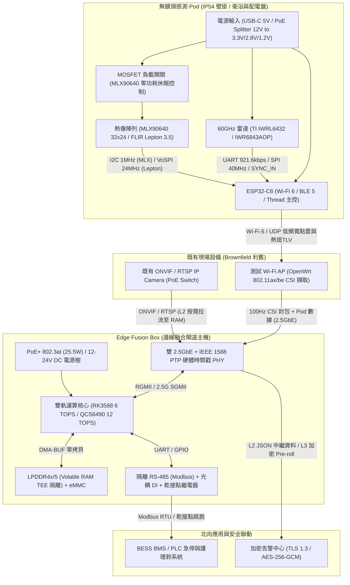
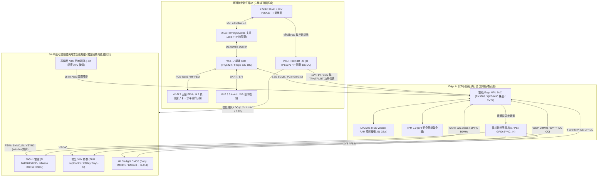
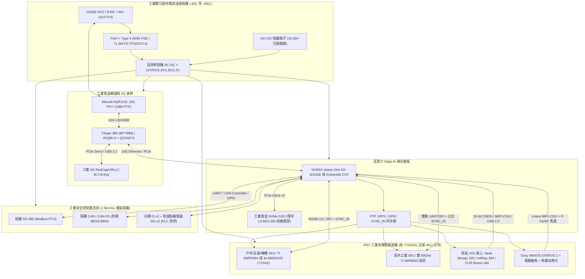
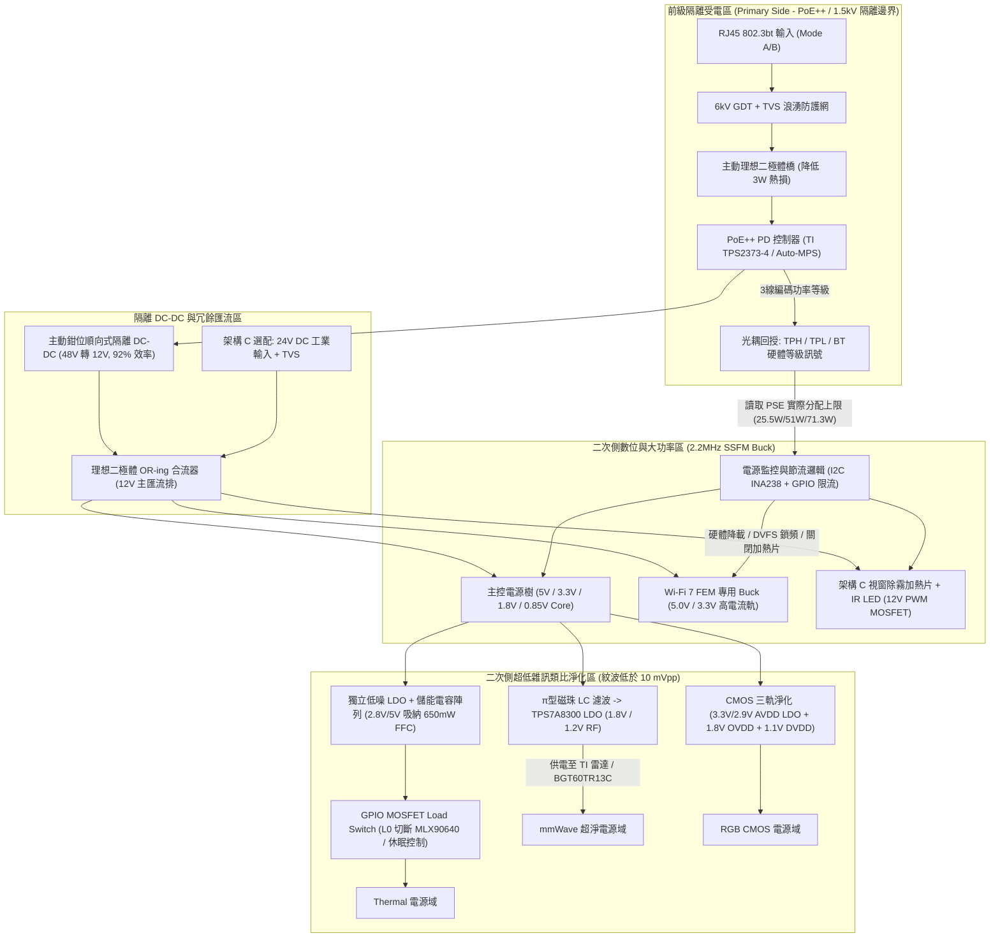

# 四模態 AI 感測融合平台：三大硬體形態完整工程設計包（EE / PCB Layout / ME 開案規格書）

> **文件編號**：`ASF-HW-PACK-V2.0`  
> **目標讀者**：硬體電路工程師（EE）、高速/射頻佈局工程師（PCB Layout）、機構與熱流工程師（ME/Thermal）、電源與安規工程師、製造與測試工程團隊（DFM/FATP）  
> **基準對齊文件**：[research_report.md](file:///d:/AI_sensor_fusion/research_report.md)（特別是第 6、8、10 章）、[02_technical_architecture.md](file:///d:/AI_sensor_fusion/sections/02_technical_architecture.md)、[03_market_bom_gtm.md](file:///d:/AI_sensor_fusion/sections/03_market_bom_gtm.md)  
> **設計鐵律與合規基線**：
> 1. 全系列硬體須在實體層支援 **Privacy-by-Design（L0–L3 分級供電與時脈閘控）**，使攝像頭於 L0/L1 處於硬體 Standby，L2 原始影像僅駐留受 TEE 保護之 Volatile RAM（Zero Disk Persistence）。
> 2. **77 GHz 頻段法規隔離紅線**：77 GHz 雷達（TI AWR2944 / AWR2243）嚴禁售作一般室內商用或辦公空間感測（違反 NCC LP0002 第 4.14/4.15 節、FCC Part 95M 與 ETSI EN 301 091）；室內場域一律強制採用 **60 GHz 頻段**。
> 3. **EOL 元件禁令**：**Teledyne FLIR Lepton 2.5（80×60）已排定於 2027 年底停售（EOL），全專案新開案嚴禁選用**，Tier 1 改用 Melexis MLX90640，Tier 2 改用 FLIR Lepton 3.5（160×120）或 InfiRay Tiny1-C。
> 4. **雙軌供應鏈原則**：所有三大架構均提供 **標準高性價比（非 NDAA）** 與 **美國 NDAA Section 889 合規** 雙軌晶片與 BOM 替代矩陣。

---

## 1. 三大硬體形態架構與子系統方塊圖

本設計包涵蓋從 Phase 1 快速場域驗證（Brownfield 利舊）到 Phase 2/Tier 3 量產開模之三大硬體藍本：

| 硬體藍本代號 | 產品定位與適用場景 | 部署形態 | 核心算力與網路骨幹 | 供電規格 | 萬片級工程 BOM 目標（非 NDAA / NDAA） |
| :--- | :--- | :--- | :--- | :--- | :--- |
| **架構 A** | **Phase 1 MVP 分散式利舊系統** （私立長照衛浴/臥室、BESS/高壓配電試點） | 分散式： Edge Fusion Box ＋ 無鏡頭 Pod ＋ 既有 ONVIF Camera ＋ 測試 AP | RK3588 (6 TOPS) 或 QCS6490 (12–13 TOPS) ＋ ESP32-C6 Pod ＋ OpenWrt CSI AP | Box：PoE+ (25.5W) / 12–24V DC Pod：USB-C 5V / PoE Splitter | Edge Box：\$95–\$215（試點級） Tier 1 Pod：\$40–\$48 Tier 2 Pod：\$135–\$165 |
| **架構 B** | **Phase 2 V2 All-in-One 智慧 AP** （Tier 2 商用建築、精裝長照病房、連鎖零售） | 單一整合機殼： 吸頂（含 20°–35° 雲台）或壁掛式企業 Wi-Fi 7 節點 | IPQ5424 / MT7986/88 ＋ RK3588 / QCS6490 / CV72 ＋ 60GHz + VOx + 4K CMOS | **PoE++ 802.3bt Type 3 (60W PSE / 51W PD)**；含 PoE+ 25.5W 降頻防呆模式 | Non-NDAA：**\$189.00 – \$260.00** NDAA 889：**\$257.00 – \$355.00** |
| **架構 C** | **Tier 3 工業級關鍵基礎設施系統** （半導體無塵室、變電站/BESS、港口/路口/桶槽） | IP67 工業強固一體機或「防爆融合閘道 ＋ 4 純感測前端」 | Filogic 880 / IPQ9574 ＋ Jetson Orin NX / CV5 ＋ 77GHz/雙 60GHz ＋ 測溫核心 | **PoE++ 802.3bt Type 3/4 (60–90W PSE / 51–71.3W PD)** ＋ 24V DC 雙冗餘 | 準工業：**\$649.00 – \$960.00** 旗艦基建：**\$2,314.00 – \$3,695.00** 分散單點攤提：**\$600 – \$720** |

---

### 1.1 架構 A：Phase 1 MVP 分散式利舊系統（Brownfield Retrofit）

**設計目標**：免除第一年高昂模具與全套射頻取證費用（M1–M12），透過 **Edge Fusion Box** 直接接管客戶現有 ONVIF/RTSP IP Camera，並以獨立「無鏡頭感測 Pod」切入衛浴、臥室與高壓配電盤試點。

* **子系統組成**：
  1. **Edge Fusion Box（邊緣融合主機）**：
     * **雙軌運算核心**：非 NDAA 線採用 **Rockchip RK3588**（8nm, 6 TOPS INT8, LPDDR4x/5 34–51 GB/s）；NDAA 預備線採用 **Qualcomm QCS6490**（6nm, 12–13 TOPS Hexagon DSP+HTA, LPDDR5 51 GB/s）。
     * **網通與對齊介面**：雙 **2.5GbE RJ45**（一埠支援 802.3at PoE+ PD 25.5W 受電，另配 12V/24V DC-Jack 工業端子備援），PHY 晶片強制選用支援 **IEEE 1588v2 PTP 硬體時間戳** 型號（如 MaxLinear GPY211 / Realtek RTL8221B-CG + SoC MAC PTP）；內建 USB 3.0 埠、M.2 E-Key（可選插 802.11ax/be 測試網卡）與隔離型 RS-485 / 乾接點繼電器。
  2. **無鏡頭感測 Pod（Sensor Pod）**：
     * **MCU 與無線**：**Espressif ESP32-C6**（160 MHz RISC-V, Wi-Fi 6 + BLE 5 + IEEE 802.15.4/Thread, 3.3V），負責聚合 Pod 內資料經 Wi-Fi 6 或有線 RS-485/PoE 回傳至 Edge Fusion Box，同時可發出 BLE Beacon 供鄰近節點識別。
     * **60 GHz 雷達模組（預認證 AoP）**：**TI IWRL6432**（Tier 1 存在與呼吸，LPDS 0.48–0.67 mW，2 ms 喚醒）或 **TI IWR6843AOP**（Tier 2 長照 3D 跌倒點雲，3T4R C674x DSP）。
     * **非製冷熱像子板**：**Melexis MLX90640**（32×24, I2C 1 MHz, 3.3V ~76 mW，外掛 P-MOSFET Load Switch 切斷 $V_{DD}$ 達成 0 mW 休眠）或 **Teledyne FLIR Lepton 3.5**（160×120, Molex 105028-1001 32-pin 插座, VoSPI + I2C, 高增益可測至 +400°C 供 BESS/配電盤使用）。
  3. **既有基礎設施納管**：透過 2.5GbE 區域網路接管 **既有 ONVIF/RTSP IP Camera**（平時邏輯閘控捨棄串流，L2 喚醒讀入記憶體）與 **支援 CSI 擷取之測試 Wi-Fi AP**（如 OpenWrt Wi-Fi 6/7 路由器，透過 UDP/Netlink 串流 100 Hz CSI 封包至 Edge Box）。

*圖 1-1：架構 A（Phase 1 MVP 分散式利舊系統）硬體子系統與匯流方塊圖*

---

### 1.2 架構 B：Phase 2 V2 All-in-One 吸頂／壁掛 Tier 2 智慧 AP

**設計目標**：將企業級 **Wi-Fi 7 2.5GbE AP**、**Edge AI 推論主控** 與 **三大物理感測模組** 高度整合於單一工業設計（ID）外殼內，出廠完成剛體外參預標定，支援單條網路線 **Zero-Touch Commissioning** 即插即用。

* **子系統組成**：
  1. **網通與 Wi-Fi 7 子系統**：
     * **主網通 SoC**：**Qualcomm IPQ5424**（Wi-Fi 7 Networking Pro A7 平台，支援三頻 MLO 與 3× USXGMII/SGMII+）或 **MediaTek Filogic 830 (MT7986) / Filogic 880 (MT7988)** 精簡射頻組。
     * **Wi-Fi 7 射頻與天線**：透過 PCIe Gen3 x1/x2 連接 Wi-Fi 7 RF/預認證 M.2 子卡或板載 FEM（2.4 GHz + 5 GHz + 6 GHz，LPI 23 dBm），並集成 **BLE 5.3 / UWB 擴充介面（支援 AoA 白名單識別）**。
     * **有線埠與時脈**：2.5GbE PHY（**Qualcomm QCA8081**）對接 RJ45 + 網路變壓器 + 6kV 浪湧防護，提供 **802.3bt PoE++ Type 3 (60W PSE / 51W PD)** 主供電及次級 2.5GbE 下行埠；內建高穩溫補晶振（TCXO ±0.5 ppm）與 **IEEE 1588 PTP 硬體時間戳引擎**。
  2. **Edge AI 融合計算子系統（雙軌主板 Footprint 衍生版）**：
     * **非 NDAA 商業版**：**Rockchip RK3588**（6 TOPS INT8, 4–8GB LPDDR4x/5）透過 2.5G SGMII/PCIe 與網通 SoC 互連（若採 MT7988 則可共用部分高速交換平面）。
     * **NDAA 889 合規版**：**Qualcomm QCS6490 裸晶直接焊載方案**（12–13 TOPS, 6nm, Spectra ISP, 8GB LPDDR5-3200 達 51 GB/s 避開 Memory Wall；較外購 SoM 模組大幅節省 \$180+ 成本）或 **Ambarella CV72**（CVflow AI 低功耗視覺＋雷達處理）。
     * **安全信任根**：獨立 **TPM 2.0（SPI）** 儲存裝置私鑰與 Secure Boot 憑證，配合 SoC 內建 TEE 區隔 **Volatile RAM Ring Buffer**。
  3. **20°–35° 可調萬向雲台感測艙（剛體共面隔離支架）**：
     * 為解決「Wi-Fi 天線需水平頂裝覆蓋」與「鏡頭／熱像／雷達需 20°–35° 下俯視角」之幾何矛盾，將三顆感測器共同鎖固於 **獨立可調萬向雲台內框**（內部採同一剛體鋁鎂骨架固定外參 $[R|t]$，轉動雲台角度不破壞工廠標定矩陣！）：
       * **60 GHz 3D 雷達**：**TI IWR6843AOP**（NDAA 與高階首選，3T4R AoP 封裝整合天線 + C674x DSP）或 **Infineon XENSIV BGT60TR13C**（非 DSP 精簡組，1T3R L 型 AiP 經 50 MHz SPI 送主控計算點雲）。
       * **微型 $\text{VO}_x$ 熱像**：**FLIR Lepton 3.5**（160×120, NDAA 合規，Molex 105028-1001）或 **InfiRay Tiny1-C**（256×192, 非 NDAA 高解析組，8-bit DVP/SPI）。
       * **4K Starlight CMOS**：**Sony IMX415**（1/2.8" Starvis）或 **Sony IMX678**（1/1.8" STARVIS 2, WDR），搭配低畸變廣角玻璃鏡頭、雙線圈 **IR-Cut 切換器** 與外環 **850/940 nm IR LED**，透過軟排線（FPC）與同軸微線連接主板。

*圖 1-2：架構 B（Phase 2 V2 All-in-One 吸頂／壁掛 Tier 2 智慧 AP）硬體系統方塊圖*

---

### 1.3 架構 C：Tier 3 工業級關鍵基礎設施系統

**設計目標**：滿足 **-40°C 至 +85°C 工業寬溫**、**IP67 防水防塵**、高壓變電站強 EMI 抗擾、高精準放射測溫（$\pm 2^\circ\text{C}$ 或 $\pm 2\%$）與 20–100+ TOPS 多模態重型融合（BEV Cross-Attention）。可組態為 **「IP67 工業一體機」** 或 **「防爆 Edge AI 閘道 ＋ 4 組 PoE++ 純感測前端」**。

* **子系統組成**：
  1. **工業寬溫網通與多介面背板**：
     * **工業網通平台**：**MediaTek Filogic 880 (MT7988)**（四核 A73, 雙 10G USXGMII, 硬體封包加速 TOPS）或 **Qualcomm IPQ9574 + QCN9274**（旗艦三頻 Wi-Fi 7 MLO），搭配 **Marvell AQR113C 10GBASE-T PHY**（支援 IEEE 1588v2 PTP）與選配工業級 5G RedCap/URLLC M.2 B-Key 數據機（雙 SIM 備援）。
     * **工業供電與保護**：**IEEE 802.3bt PoE++ Type 4（90 W PSE / 71.3 W PD）** 為主輸入，並支援 **18–36V DC（標稱 24V DC）隔離工業電源雙冗餘備援**；全外部埠配置 **IEC 61000-4-5 6 kV 浪湧保護**。
  2. **高算力 Edge AI 運算單元**：
     * **準工業目標價帶組**：**Ambarella CV5**（雙/四核 ARM + 8K 多路 CVflow AI，低功耗且自發熱低）或 **NVIDIA Jetson Orin NX 8GB**（70 Sparse TOPS, 102.4 GB/s LPDDR5）。
     * **關鍵基礎設施旗艦組**：**NVIDIA Jetson Orin NX 16GB**（100 Sparse TOPS / Super 模式達 157 Sparse TOPS, 260-pin SO-DIMM 工業寬溫版 -25°C~+85°C，載板配工業寬溫 M.2 NVMe SSD 供 L3 加密事後存證緩衝）。
  3. **60 / 77 GHz 4D 成像雷達（依場域法規硬體 SKU 分流）**：
     * **戶外／交通／港口／封閉桶槽專用（`SKU-IND-77G`）**：**TI AWR2944**（76–81 GHz, 4T4R, C66x DSP + HWA 2.0 + HSM 硬體安全模組，RGMII 乙太網直出 4D 點雲）或 **旗艦 4× TI AWR2243 級聯模組**（12T16R, 86 虛擬通道, >350 m 偵測距，透過外部 TDA2/AM273x DSP 板經高速乙太網接入 Orin NX）。
     * **室內工業專用（`SKU-IND-60G`，無塵室／變電室／BESS 機房）**：嚴禁使用 77 GHz，改採 **雙 TI IWR6843 / IWR6843AOP 60 GHz 協同配置**（以 15° 幾何張角斜置，共用 `SYNC_IN` 時分/頻分正交調頻防干擾，兼顧角解析度與法規 100% 合規）。
  4. **高解析測溫 $\text{VO}_x$ 熱像核心（含黑體廠校與放射率補償）**：
     * **準工業合規組**：**Seek Thermal Mosaic Core 320×240**（12µm, -40°C~330°C, 27–32 Hz, 透過 Sensor Flex 接協處理板轉 USB 2.0 / CMOS 介面接入）。
     * **非受限工業組**：**InfiRay 384×288 / 640×512 OEM 測溫機芯**（16-bit 輻射溫度輸出，CMOS/MIPI）。
     * **西方關鍵基建旗艦組**：**Teledyne FLIR Boson 320 / 640 / Boson+**（$\le 20\text{ mK}$ NETD, ITAR-free & NDAA 合規，16-bit CMOS 平行 / MIPI CSI-2 / USB-UVC 介面）。所有機芯於出廠前皆執行黑體多點校準，前端配備 **DLC 鍍膜單晶鍺（Ge）抗刮紅外視窗**。
  5. **工業 4K WDR 光學視覺**：**Sony IMX678 STARVIS 2**（1/1.8" 4K, Deep Trench Isolation 抗車燈/電弧強光眩光，MIPI CSI-2 4-lane）＋ 耐高溫全玻璃電動變焦鏡頭（P-Iris / 步進馬達 SPI 驅動）＋ 視窗除霧加熱片（12V PWM 溫控）。
  6. **工業現場匯流排**：2.5 kVrms 隔離 **RS-485（Modbus RTU）**、隔離 **CAN-FD（對接 BESS BMS）**、2 路光耦隔離數位輸入（DI）與 2 路常開/常閉乾接點繼電器（DO，直控 PLC 安全迴路或斷路器分勵脫扣）。

*圖 1-3：架構 C（Tier 3 工業級關鍵基礎設施系統）雙 SKU 隔離硬體方塊圖*

---

## 2. 詳細匯流排與介面腳位連接矩陣

為確保 EE 原理圖繪製（Schematic Capture）與嵌入式 BSP 驅動開發無縫銜接，以下定義主控平台與各類感測器、射頻與工業匯流排之間之實體介面規範、時脈頻率、電氣準位與同步引腳定義。

### 2.1 異質匯流排與連接器工程矩陣

| 子系統 / 目標晶片 | 實體介面與匯流排類型 | 傳輸速率 / 時脈頻率 | 工作電位準位（I/O） | 物理連接器 / 封裝規格 | 硬體同步與關鍵控制腳位 | 適用架構與備註 |
| :--- | :--- | :--- | :--- | :--- | :--- | :--- |
| **Sony IMX415 / IMX678** (4K Starlight / WDR CMOS) | **MIPI CSI-2 D-PHY** (4-lane 數據 + 1-lane 時脈) ＋ I2C 控制 | 數據率 **1.5–2.5 Gbps/lane** INCK 主時脈：**24 / 27 / 37.125 MHz** I2C：400 kHz | **1.8 V**（OVDD）；須另供 **3.3 V** (IMX678 AVDD) / **2.9 V** (IMX415 AVDD) 與 **1.1 V** (DVDD) | 30-pin 0.4mm 間距板對板 FPC 連接器（如 Hirose DF40C）或微型同軸線 | `MIPI_D[0..3]_P/N`、`MIPI_CLK_P/N`、`CSI_I2C_SDA/SCL`、`CAM_XVS`（對接 `SYNC_IN` 垂直曝光同步）、`CAM_XCLR_N`（複位）、`CAM_PWDN`（硬體 Standby） | 架構 B、C；L0/L1 由 SoC 拉低 `CAM_PWDN` 進入 <1–5 mW 待機；嚴禁完全斷電以免冷啟動 >400 ms |
| **FLIR Lepton 3.5** (160×120 LWIR VOx) | **VoSPI** (Video over SPI) ＋ **CCI (I2C-like)** | VoSPI `SCLK`：**20–24 MHz** 主時脈 `MASTER_CLK`：**25 MHz**（12–25 MHz CMOS Oscillator） CCI I2C：100–400 kHz（7-bit addr `0x2A`） | **VDDIO：2.8 V**（2.5–3.1 V，若對接 1.8V/3.3V 主控**必須加雙向電位轉換器**如 TI TXS0104E）＋ 1.2V Core ＋ 2.8V Analog | **Molex 105028-1001** 32-pin SMD 側壓式插座 | `VOSPI_CLK/MISO/MOSI/CS_N`、`GPIO3_VSYNC`（對齊 PTP 幀同步與 DMA 中斷觸發）、`PWR_DWN_L`（Shutdown ~5 mW）、`RESET_L` | 架構 A (Pod)、B (NDAA)；注意快門 FFC 時脈與瞬間 650 mW 電流尖峰緩衝 |
| **InfiRay Tiny1-C** (256×192 LWIR VOx) | **8-bit 平行 DVP** 或 **SPI** ＋ **I2C** | DVP PCLK：~12–27 MHz SPI：~20–30 MHz I2C：400 kHz | **3.3 V** 數位 I/O ＋ **5.0 V** 低雜訊類比供電 | 模組板對板或客製 FPC（13×13×8 mm 微型封裝） | `DVP_D[0..7]` / `VSYNC` / `HSYNC` / `PCLK`（若主控無 DVP 則經 Lattice CrossLink 或 TC358746 橋接轉 MIPI CSI-2） | 架構 B (非 NDAA 高性價比組)；快門 FFC 峰值約 600 mW |
| **Melexis MLX90640** (32×24 FIR 熱陣列) | **I2C Fast-Mode Plus** | **1 MHz**（Fast-Mode Plus）；上拉電阻強制 **$1.5\text{k}\Omega\text{–}2.2\text{k}\Omega$** | **3.3 V** 單電源（I2C 地址 `0x33`） | 4-pin TO-39 金屬罐封裝（直焊 PCB 或耐高溫插座） | **無硬體睡眠腳位**：須於 $V_{DD}$ 前端串接 P-MOSFET Load Switch（如 DMG2305UX）並以主控 GPIO `THERM_PWR_EN` 切斷達成 **0 mW** 休眠 | 架構 A (Tier 1 Pod)；I2C 走線長度須 $< 5\text{ cm}$ 降低電容負載 |
| **Seek Mosaic Core 320 / FLIR Boson 640** (工業測溫級 VOx) | **16-bit CMOS 平行** / **MIPI CSI-2** / **USB 2.0 (UVC)** | CMOS PCLK：27–54 MHz USB 2.0 HS：480 Mbps | **1.8 V / 3.3 V**（Boson 擴充板提供 LVCMOS 或 MIPI；Seek 透過 Sensor Flex 接協處理板） | 80-pin Hirose DF40（Boson 擴充）/ Sensor Flex | `CMOS_D[0..15]`、`EXT_SYNC`（接 1PPS/Frame Sync）、`UART_TX/RX`（SDK 命令與放射率參數下載） | 架構 C；採硬體 `EXT_SYNC` 與 IMX678 同步曝光以利 BEV 熱視覺融合 |
| **TI IWRL6432** (60 GHz ULP 2T3R 雷達) | **SPI** (高速數據/FFT) ＋ **UART** ＋ **GPIO** | SPI：**最高 40 MHz**（全週期）/ 20 MHz（半週期） UART：CLI 115,200 / Data **921,600 bps** 晶振：**40.0 MHz** | **1.8 V**（單電源 BOM 最佳化）或 **3.3 V** 可選 I/O | QFN / FCCSP / AOP 預認證模組（40-pin B2B） | `SOP[1:0]`（`00` Flashing, `01` Functional, `11` Debug）、`NRESET`、`SYNC_IN`（**LPDS 2 ms 硬體喚醒腳**）、`HOST_INTR` | 架構 A (Tier 1 Pod)；以 `SOP` + `NRESET` 實現主控線上自動韌體升級 |
| **TI IWR6843AOP** (60 GHz 3T4R AoP 雷達) | **雙 UART** ＋ **SPI** ＋ **GPIO**（保留 LVDS 測試點） | Data UART：**921,600 bps**（標準 TLV 點雲） CLI UART：115,200 bps 晶振：40.0 MHz | **3.3 V**（I/O）＋ **1.8 V / 1.2 V**（來自 PMIC LP87524） | FCBGA-161 AOP（整合封裝天線於頂部 Epoxy 封裝） | `SOP[2:0]`（`101` UART Flashing, `000`/`001` QSPI Functional）、`NRESET`、`SYNC_IN`（20 Hz 幀同步）、`WARM_RESET` | 架構 A (Tier 2 Pod)、B、C (室內雙顆協同 SKU) |
| **Infineon BGT60TR13C** (60 GHz 1T3R AiP 雷達) | **高速 SPI**（Raw FIFO 讀出）＋ **GPIO** | SPI：**最高 50 MHz**（需啟用寄存器 `SFCTL.MISO_HS_RD`） | **1.8 V**（I/O 與 RF/Digital）＋ **3.3 V**（PLL Loop Filter 專用） | VQFN-34（6.5×5.0 mm 封裝天線 AiP） | `SPI_CLK/MOSI/MISO/CSN`、`IRQ`（FIFO 閾值觸發主控 DMA 讀取）、`RST_N`；嚴格要求主控端提供 1.8V SPI 或加高速電位轉換器 | 架構 B (非 DSP 精簡組)；將 ADC FIFO 傳給 RK3588/CV72 執行 Range-Doppler FFT |
| **TI AWR2944** (77 GHz 4T4R 4D 雷達) | **RGMII (100M/1G)** ＋ **SPI** ＋ **UART** | RGMII：**125 MHz DDR**（AWR2944P 支援 1Gbps，輸出 25 MHz PHY RefClk） UART：921,600 bps | **3.3 V / 1.8 V** 雙電壓 LVCMOS（配 LP87745-Q1 PMIC） | FCBGA-204（需焊接於頂層 Rogers RO4350B 天線板） | `RGMII_TX/RX`、`SOP[2:0]`、`NRESET`、`SYNC_IN`（戶外多機防幹擾或級聯同步） | 架構 C (`SKU-IND-77G` 戶外交通/港口/桶槽專用) |
| **Wi-Fi 7 射頻與高速 PHY** (IPQ5424/9574/MT7988 ⇄ QCN9274/AQR113C) | **PCIe Gen3 (x1/x2)** ＋ **USXGMII** ＋ **RGMII** | PCIe Gen3：**8.0 GT/s/lane**（100 MHz HCSL 差分時脈） USXGMII：**10.3125 Gbps SerDes** | **1.8 V / 1.2 V / 0.85 V**（PCIe CML 交流耦合 $100\text{ nF}$） | 板載 BGA ＋ 預認證 M.2 E-Key / B-Key 介面 | `PCIE_CLKREQ_N`、`PERST_N`、`WAKE_N`；PHY 支援 **IEEE 1588v2 PTP 硬體 SOF 時間戳輸出（1PPS / PPS_OUT）** | 架構 B、C；PCIe 阻抗控制 $85\,\Omega$ 差分、USXGMII 控 $100\,\Omega$ 差分 |
| **工業現場隔離匯流排** (RS-485 / CAN-FD / DI / DO) | **隔離 UART→RS-485** ＋ **隔離 CAN-FD** ＋ **光耦/繼電器** | RS-485：9,600 – 115,200 bps（最高 2 Mbps） CAN-FD：5 Mbps | 邏輯端 **3.3 V**；隔離現場端 **12–24 V / 乾接點**（隔離耐壓 **2.5 kVrms**） | 5.08mm 可插拔工業接線端子（Phoenix Contact 型）或 M12 航插 | `RS485_DE/RE`（建議帶自動流向控制或精準 UART RTS）、`CAN_TX/RX`、`RLY_TRIP_EN`（高安全雙 GPIO 邏輯及閘防止單點故障誤觸發急停） | 架構 A（護理鈴/BMS）、架構 C（PLC/BMS/斷路器跳脫） |

---

### 2.2 節點內硬體脈衝同步（GPIO `SYNC_IN` / `1PPS`）與 PTP 對齊拓撲

為徹底消除軟體作業系統中斷與 USB/SPI/UART 佇列造成的不確定延遲，主控端必須設計專用的 **硬體同步時脈扇出網路（Hardware Trigger Fanout Network）**：

1. **時鐘源頭與 IEEE 1588 PTP 鎖相**：
   * 有線/無線網路 PHY（如 QCA8081 / AQR113C）或 SoC MAC 內建之 IEEE 1588v2 PTP 硬體時鐘單元作為本地 Slave（或 Grandmaster），透過硬體暫存器比對與補償封包延遲，直接自專用引腳輸出誤差 **$< 100\text{ ns}$** 之 `1PPS`（1 Hz）與可程式化脈衝輸出 `PTP_TRIG_OUT`（例如設定為 **20 Hz / 50 ms 週期** 或 **30 Hz / 33.33 ms 週期**）。
2. **零偏斜樹狀扇出緩衝器（Zero-Skew Fanout Buffer）**：
   * `PTP_TRIG_OUT` 進入低抖動緩衝器（如 **TI LMK1C1104**，通道間偏斜 Output-to-Output Skew $< 50\text{ ps}$），必要時經雙電源電位轉換後，以等長走線（Length Matching $\pm 10\text{ mm}$）同時送達三個感測器：
     * **mmWave 雷達 `SYNC_IN`**：於上升緣後固定偏移（如 $< 10\text{ \mu s}$）啟動 Frame Chirp 序列（對 TI IWRL6432 在 LPDS 狀態時，亦作為 **2 ms 硬體喚醒中斷**）。
     * **RGB CMOS `XVS / FSIN`**：觸發曝光窗口對齊，使「曝光時間中點（Mid-Exposure）」精準落於雷達幀中心時刻。
     * **Thermal Core `EXT_SYNC / GPIO_VSYNC`**：針對支援外部同步之 Boson / Tiny1-C 觸發採樣同步；針對僅自主自由運行（Free-Run ~8.6–9 Hz）之 FLIR Lepton 3.5 與 MLX90640，則將其 `VSYNC` 脈衝拉回 SoC 之 **PTP Hardware Timestamp Capture 引腳（Input Capture）**，在硬體中斷瞬間鎖定該幀精準的 `ptp_timestamp_ns` 送入 100 ms 滑動視窗引擎進行速度外推對齊。
3. **mmWave `SOP[2:0]` 免拆機產線／OTA 救援接線設計**：
   * 量產機殼封膠或鎖固後無法手動撥動 DIP Switch。EE 設計必須將 `SOP[2:0]`（或 `SOP[1:0]`）接至主控 SoC 或獨立電源管理 MCU 之 GPIO（透過 **$10\text{k}\Omega$ 預設下拉電阻** 確保斷電與預設開機落入 `Functional Mode`），當需在產線燒錄或現場救援雷達韌體時，由主控拉高對應 `SOP` 引腳並脈衝拉低 `NRESET` 10 ms，即可全自動進入 UART Flashing 模式。

---

## 3. 電源樹設計（Power Tree）與 PoE+ / PoE++ 功耗預算表

### 3.1 隔離式 PoE++ 與超低雜訊分離電源樹架構

本系統包含高功率射頻突波負載（Wi-Fi 7 PA 峰值、IR LED、機械快門 FFC 650 mW）與極端怕電源雜訊的類比前端（60/77 GHz mmWave PLL/VCO、STARVIS 2 CMOS、$\text{VO}_x$ Microbolometer ROIC）。電源樹設計嚴守 **「前後級隔離、數類分離、次級濾波、獨立突波儲能」** 四大原則：

* **前級（Primary Side）受電與整流**：
  * 支援 IEEE 802.3bt Type 3（60 W PSE / 51.0 W PD）與 Type 4（90 W PSE / 71.3 W PD）。
  * 傳統二極體橋式整流於 90 W 滿載下產生高達 3–4 W 導通熱損，**架構 B/C 強制採用主動式理想二極體橋（Active Bridge，如 TI LM74700-Q1 或整合型低 $R_{DS(on)}$ MOSFET 橋）**，將整流損耗壓低至 $< 0.5\text{ W}$。
  * PD 控制器選用 **TI TPS2373-4**（內建 $0.1\,\Omega$ 熱插拔 MOSFET，2.2 A 限流保護，支援 **Automatic MPS** 與 **`TPH / TPL / BT`** 三腳硬體分級解碼輸出）。
* **隔離級（Isolation Barrier, $\ge 1.5\text{ kVrms}$）**：
  * 採用 **有源鉗位順向式轉換器（Active-Clamp Forward Converter）** 或高效率反激拓撲，將 42–57 V PoE 直流匯流排轉換為隔離式 **12.0 V 主匯流排**（效率 $\ge 92\%$），並於架構 C 支援 **24V DC（18–36V）工業端子經 OR-ing 理想二極體合流**。
* **二次側（Secondary Side）Buck 轉換與 LDO 數類淨化**：
  * **開關頻率避讓鐵律**：所有二次側同步降壓 DC-DC（5V / 3.8V / 3.3V / 1.8V / 0.85V SoC Core）開關頻率統一設定為 **$2.1\text{–}2.4\text{ MHz}$**（並啟用展頻 SSFM），避開 AM 頻帶及 mmWave 雷達中頻接收頻帶（0.1–15 MHz）基波與低次諧波交叉耦合。
  * **mmWave 超低雜訊供電鏈（核心紅線：紋波 $< 10\text{ mVpp}$）**：
    * 不可直接由普通數位 Buck 供電給雷達 RF！採用「**主 Buck (3.3V/2.3V) → 鐵氧體磁珠 $\pi$ 型濾波（600 $\Omega$ @ 100 MHz + $10\,\mu\text{F} + 0.1\,\mu\text{F}$）→ 超低雜訊高 PSRR LDO（如 TI TPS7A8300 / TPS7A4700，PSRR $> 60\text{ dB}$ @ 1 MHz，雜訊 $< 4\,\mu\text{Vrms}$）**」或 TI 專用低紋波車規/工業 PMIC **LP87524-Q1 / LP87745-Q1 + 建議之 100 nH 輸出濾波電感與雙排 0402/0603 低 ESR MLCC**，確保 **1.2 V RF/VCO 與 1.8 V Synth 電源軌紋波嚴格壓在 $< 10\text{ mVpp}$**（一般數位邏輯放寬至 $< 30\text{ mVpp}$）。
  * **Thermal 快門 FFC 650 mW 突波保護軌**：
    * FLIR Lepton 3.5（2.8V Analog）與 InfiRay Tiny1-C（5.0V Analog）使用 **獨立 LDO 電源軌**（與雷達 RF 及 CMOS 隔離），並在靠近插座處佈設 **$47\,\mu\text{F} + 22\,\mu\text{F}$ 低 ESR 鉭電容/MLCC 儲能陣列**，吸收機械快門彈射時 600–650 mW（約 150–230 mA）持續 300 ms 的瞬間電流突波，防止系統壓降造成重啟或畫面條紋。

*圖 3-1：PoE++ 802.3bt 隔離電源樹與數類淨化拓撲圖*

---

### 3.2 跨架構、全狀態精確功耗預算表（L0 至 L3 與 FFC 突波）

下表嚴格對齊 [research_report.md](file:///d:/AI_sensor_fusion/research_report.md) 第 5.3 節與第 8 章口徑，拆解 **「感測器與推論增量功耗（Incremental）」** 與 **「含全速三頻 Wi-Fi 7 企業級 AP 骨幹之整機總功耗（Total System Power）」**：

| 運行狀態 / 情境 | 系統與感測器硬體狀態描述 | 架構 A：Edge Box ＋ 單 Pod（增量 / 含 Box 總功耗） | 架構 B：Tier 2 All-in-One 智慧 AP（增量 / 含 Wi-Fi 7 AP 總功耗） | 架構 C：Tier 3 工業寬溫系統（準工業 / 旗艦含加熱） | PoE 電源等級對應與供電餘裕分析 |
| :--- | :--- | :--- | :--- | :--- | :--- |
| **系統 Idle / 初始化** | OS 啟動、Wi-Fi AP Beacon 待命、所有感測器休眠/低負載 | Box 待機：~4.5–6.5 W Pod 待機：< 0.3 W | 增量：~0.2–0.5 W 含 AP 總功耗：**12.0 – 18.0 W** | 準工業：~18–25 W 旗艦 Orin NX：~24–32 W | Type 1 (12.95W) 僅能供單 Pod；Box/AP 須至少 PoE+ |
| **L0：常駐無線感知** | **Wi-Fi CSI 100 Hz** ＋ BLE AoA；mmWave **LPDS (~0.5 mW)**；Thermal **Shutdown (0–5 mW)**；RGB **Standby (<1–5 mW)** | 增量：~0.3–0.6 W 含 Box 總功耗：~5.0–7.5 W (Pod 本體 < 0.25 W) | 增量：**~0.3 – 0.8 W** 含 AP 總功耗：**12.5 – 19.0 W** | 增量：~0.8–1.5 W 含工業 AP 總功耗：**20.0 – 28.0 W** | 常態 95%+ 時間落於此低功耗區，完全相容 PoE+ 25.5W（須注意開機突波控管） |
| **L1：非視覺雙重驗證** | **mmWave 喚醒 (2 ms)** 至 10–20 Hz 3D 點雲（IWRL6432 <50 mW / IWR6843 1.0–1.8 W）＋ Thermal 1–9 Hz 掃描；**RGB 仍關閉** | 增量：~0.8–2.0 W 含 Box 總功耗：~6.0–9.0 W (Pod 均值 < 1.5 W) | 增量：**~1.2 – 2.5 W** 含 AP 總功耗：**19.0 – 30.0 W** | 增量：~3.0–5.5 W（AWR2944/雙 60G + Boson） 含 AP 總功耗：**26.0 – 36.0 W** | **關鍵門檻**：架構 B 進入 L1 高載時已觸及 PoE+ 25.5 W 邊緣，必須靠錯峰排程 |
| **Thermal FFC 突波** *(疊加於 L1/L2)* | $\text{VO}_x$ 機械快門致動執行 Flat Field Correction（持續 ~250–350 ms） | 單顆快門突波 **+0.60 – 0.65 W** (由 LDO 儲能電容優先緩衝) | 單顆快門突波 **+0.60 – 0.65 W** | Boson / 384 核心快門突波 **+0.80 – 1.20 W** | 電路級儲能電容吸收瞬態電流，不拉低主匯流排觸發 PD 保護 |
| **L2：邊緣去識別化推論** | **RGB 熱喚醒至 TEE RAM**（Fast-AE 25–45 ms）＋ NPU 執行 `YOLOv8n-pose` INT8 ＋ Cross-Attention ＋ `<100 ms` RAM 清零 | 增量：~4.5–8.0 W（Box NPU 滿載） 含 Box 總功耗：~10.5–15.5 W | 增量：**~5.5 – 9.5 W** 含 AP 總功耗：**24.0 – 38.0 W** | 增量：~10–18 W（Orin NX 推論） 含 AP 總功耗：**34.0 – 48.0 W** | 架構 B/C 全面進入 **PoE++ Type 3 (51W PD)** 安全運作區 |
| **L3：危急告警全載峰值** | 全模態全速（CSI 1kHz + 雷達 20–30Hz + 熱像 30Hz + 4K H.265 編碼 + AES-256-GCM + IR 補光 + **三頻 Wi-Fi 7 35–50W 峰值**） | 增量：~7.0–12.0 W 含 Box 總功耗：~14.0–19.5 W | 增量：**~8.0 – 14.0 W** 含 AP 總功耗：**30.0 – 48.0+ W** | 含 Orin NX 滿載＋加熱除霜＋三頻 Wi-Fi 7 峰值：**45.0 – 68.0 W**（極端峰值保留至 **71.3 W**） | **架構 B 強制 Type 3 (51W PD)；架構 C 強制 Type 4 (71.3W PD)** |

---

### 3.3 徹底規避「PoE+ 25.5W 降頻跳脫陷阱」的硬體工程機制

在既有大樓（Brownfield）若交換機僅支援 **IEEE 802.3at PoE+（PSE 30.0 W / PD 端扣除 100m Cat5e 線損僅剩 25.5 W）**，而一台全速三頻 Wi-Fi 7 AP 加上 NPU 與感測器在瞬間併發時容易衝破 **30–48+ W**，將觸發交換機 PSE 的 **Over-Current Protection（$I_{CUT}$ 斷電跳脫）** 或迫使 AP 盲目強制降頻死機。本架構於硬體端實施四重防呆設計：

1. **PD 層硬體功率真相表即時解碼（TI TPS2373-4 `TPH`、`TPL`、`BT` 引腳）**：
   依據 TI 應用筆記 SLUAA73，PD 控制器在完成實體層多指分類（Classification Fingers）後，即透過光耦將實際核配功率寫入開漏引腳，於主控 Boot 前（10 ms 內）送達電源監控 MCU / SoC GPIO：

   | PSE 實測供電等級 | 分配至 PD 端保證功率 | `TPH` | `TPL` | `BT` | 本系統硬體自動回應策略（Hardware Power Throttling Profile） |
   | :--- | :---: | :---: | :---: | :---: | :--- |
   | **802.3af (Type 1)** | 12.95 W | HIGH | HIGH | HIGH | **僅允許管理面與警示 LED 啟動**，禁止啟動 Wi-Fi 7 Radio 與 NPU，於螢幕/Web/Syslog 發出「供電不足告警」。 |
   | **802.3at (Type 2 / PoE+) 或 Type 3 降階** | **25.5 W** | **HIGH** | **LOW** | HIGH/LOW | **啟動「PoE+ 25.5W 防跳脫保護模式」**：硬體直接鎖定電源策略上限於 23.5 W（預留 2 W 緩衝）。 |
   | **802.3bt Type 3 (Class 5/6)** | **51.0 W** | **LOW** | **HIGH** | **LOW** | **架構 B 全功能解鎖**：允許三頻 Wi-Fi 7 全速 ＋ NPU 滿頻 ＋ 全感測 ＋ FFC 同時併發。 |
   | **802.3bt Type 4 (Class 7/8)** | **71.3 W** | **LOW** | **LOW** | **LOW** | **架構 C 工業全功能解鎖**：額外釋放 **12V 除霧加熱片**、長距高功率 IR 補光與 Orin NX Super/MaxN 滿載模式。 |

2. **「PoE+ 25.5W 防跳脫模式」的三級硬體限流手段**：
   * **射頻降階硬體綁定**：當偵測到 `TPH=HIGH, TPL=LOW`（僅 25.5 W 預算）時，射頻驅動強制停用 6 GHz 4×4 高功放鏈路或將三頻限制為「2.4 GHz (2×2) + 5 GHz (2×2)」及降低 TX Power 3 dB，將 AP 基礎功耗從 18–28 W 壓低至 **9.5–13.5 W**，為感測與推論騰出 **10–12 W 確定性淨空**。
   * **NPU DVFS 時脈鉗位與錯峰排程**：鎖定 RK3588 / QCS6490 NPU 最高電壓-頻率階（OPP），並以硬體互斥訊號確保 **「Thermal 650 mW 機械快門 FFC」、「850/940nm IR LED 補光（3–4 W）」與「Wi-Fi 7 大封包突發傳送」錯開至少 50 ms** 執行，消除三者同步湧流（Inrush Stacking）。
   * **5 ms 硬體高速電流環（INA238 + 類比比較器）**：於隔離 12 V 主匯流排串接 **$10\text{ m}\Omega$ 檢流電阻** 與高速數位電流監控器（TI INA238 / INA226），若瞬時總輸入功率超過 24.0 W，比較器於 **< 50 μs** 內硬體拉低 IR LED PWM 致能腳與觸發 SoC `PROCHOT_N` 降頻腳位，徹底杜絕 PSE 端在 50–75 ms 過流窗口內切斷電源！

3. **6kV 浪湧與 ESD 防護規範（架構 B 戶外／半戶外與架構 C 工業強制）**：
   * **PoE 乙太網路埠**：依據 **IEC 61000-4-5（1.2/50 μs 浪湧與 10/700 μs 電信波）**，於 RJ45 與網路變壓器（耐壓 $\ge 2.25\text{ kVrms}$）之間佈設 **90V 氣體放電管（GDT）＋ 高功率 TVS 陣列**（線對地共模 **6 kV**、線對線差模 **2 kV** 防護）；網路變壓器中心抽頭電容採 **2 kV Y1 安規電容** 接地。
   * **高速資料線 ESD**：乙太網 MDI 差動線、USB 3.0 與外露按鈕加裝超低寄生電容 TVS（$C_j < 0.3\text{ pF}$，符合 **IEC 61000-4-2 ±15 kV 空氣 / ±8 kV 接觸放電**）。

---

## 4. PCB 層疊、RF/EMI 隔離與機構熱學／天線罩（Radome）工程指南

### 4.1 10–12 層 HDI 混壓 PCB 疊構建議

由於架構 B 與架構 C 同時包含 **60/77 GHz 毫米波高頻路徑**、**5.9–7.1 GHz Wi-Fi 7 高功率射頻**、**10 Gbps USXGMII / 8 GT/s PCIe Gen3 / LPDDR5 高速數位匯流排** 以及 **高壓 54V PoE++ 電源層**，傳統 6 層 FR4 無法支撐信號完整性與熱散逸，必須採用 **HDI 疊構（架構 B 採 10 層 HDI / 架構 C 採 12 層 Rogers + Megtron-6 混壓板）**：

#### 表 4-1：12 層混壓 HDI PCB 建議疊構（架構 C 旗艦級與架構 B 高整合參考）

| 層序 | 介電材質建議 | 銅箔厚度 | 功能定義與佈線準則 |
| :---: | :--- | :---: | :--- |
| **L1 (Top)** | **Rogers RO4350B**（0.10–0.13 mm，推薦 Spread-Glass 1067/1078） | 0.5 oz + 鍍銅 | **60/77 GHz 天線饋線／GCPW、AoP 雷達焊接面**、Wi-Fi FEM 微帶線（此層禁止走低速數位訊號，免除 60GHz 玻纖效應相位偏斜） |
| **L2** | **Rogers RO4350B / 2929 相容黏合片** | 1 oz | **完整 RF 參考接地平面（Solid RF GND）**：L1 高頻走線正下方絕對禁止跨分割（No Split Plane） |
| **L3** | **Panasonic Megtron 6 (R-5775)**（$\text{Dk}\approx 3.3\text{–}3.4, \text{Df}\approx 0.002\text{–}0.004$） | 0.5 oz | **高速差動訊號層 1**：MIPI CSI-2（2.5 Gbps）、PCIe Gen3、USXGMII（10.3G）、LPDDR5 DQ/DQS |
| **L4** | Megtron 6 Prepreg | 1 oz | **高速數位參考地層（Digital GND）** ＋ **EBG 隔離帶內嵌結構** |
| **L5** | Megtron 6 Core | 0.5 oz | **高速訊號層 2**：RGMII 等長線（$\pm 5\text{ mil}$）、SDIO / SPI 40–50 MHz |
| **L6** | 高 Tg FR4 / Megtron 6 | 1–2 oz | **主電源平面層 1**：隔離 12V / 5V / 3.3V / PoE++ 主匯流排（與雷達區保留 $> 5\text{ mm}$ 淨空區） |
| **L7** | 高 Tg FR4 / Megtron 6 | 1–2 oz | **主電源平面層 2**：SoC Core (0.85V) 大電流銅箔與 LPDDR5 VDDQ；另設 **獨立 Analog LDO 電源島** |
| **L8** | Megtron 6 Core | 0.5 oz | **控制與低速介面層**：I2C（MLX90640 1MHz 短線）、UART 921.6kbps、`SYNC_IN` 樹狀等長線 |
| **L9** | Megtron 6 Prepreg | 1 oz | **完整系統接地平面（System GND）** |
| **L10** | Megtron 6 Core | 0.5 oz | **混合訊號與 PoE 前級過渡層**（嚴格劃分 **Primary PGND** 與 **Secondary GND** 之 2.25 kV 爬電距離 $\ge 2.5\text{ mm}$） |
| **L11** | Megtron 6 Prepreg | 1 oz | **次要參考地層 / 散熱內銅面** |
| **L12 (Bottom)** | 高 Tg FR4 / Megtron 6 | 0.5 oz + 鍍銅 | **高算力 SoC / PoE++ 變壓器 / 隔離端子 / 散熱貼合墊底面** |

> **混壓工藝警告**：Rogers RO4350B（烴類陶瓷熱固樹脂）與 Panasonic Megtron 6（改性環氧樹脂）熱膨脹係數（CTE）與固化溫度（$> 200^\circ\text{C}$）不同。發包 PCB 廠時必須指定 **相容無流膠粘結片（如 Rogers 2929 Bondply）** 與 **對稱銅箔平衡設計**，防止高溫無鉛回焊時板彎翹曲（Warpage 須控管在 $< 0.5\%$），導致 BGA 焊球（如 QCS6490 / IWR6843AOP）空焊。若架構 B 採用預整合天線之 **TI IWR6843AOP**（無須在 PCB 表面佈設 60 GHz 射頻線，僅有數位/中頻訊號於 PCB 內），可評估於該區降階改為 **全板 Megtron 6 或高速中損耗基材（如 Isola FR408HR）** 以進一步節省 15%–20% PCB 裸板成本。

---

### 4.2 2.4 / 5 / 6 GHz Wi-Fi 大功率 PA 與 60/77 GHz 雷達接收鏈隔離設計

All-in-One 機構空間極度受限（直徑約 180–220 mm 吸頂外殼），高功率 Wi-Fi 7 PA（瞬時發射總功率可達 +23 至 +28 dBm）與高靈敏度雷達接收機共存時，須透過三層物理結構達到 **$\ge 50\text{–}65\text{ dB}$ 寬頻隔離度**：

1. **雙排交錯接地過孔圍欄（Staggered Via Fence）**：
   * 圍繞 60/77 GHz 雷達子區與 2.4/5/6 GHz Wi-Fi RF 走線邊界佈設雙排交錯接地過孔（連接 L1 至 L2/L4/L9 完整地層）。
   * **間距設計公式**：過孔中心距 $p \le \frac{\lambda_g}{10}$。針對 60 GHz 訊號（RO4350B 中介質波長 $\lambda_g \approx 2.6\text{ mm}$），過孔間距須極密（**$0.25\text{–}0.35\text{ mm}$**，採 0.15 mm 雷射盲孔/通孔）；針對 Wi-Fi 6 GHz 頻段（$\lambda_g \approx 25\text{ mm}$），圍欄孔距設定為 **$1.5\text{–}2.0\text{ mm}$** 並圍合遮蔽罩焊盤。
2. **電磁帶隙結構（EBG, Electromagnetic Bandgap）抑制表面波與電源平面耦合**：
   * Wi-Fi 大功率 PA 切換瞬間產生的 2.4–7.1 GHz 雜訊容易沿著 PCB 電源/地平行板波導（Parallel-Plate Waveguide）傳遞至雷達類比中頻（IF）前端。
   * 在 Wi-Fi 射頻區與感測器區之間的內層電源平面（如 L6/L7 之間，隔離帶寬度 8–12 mm），佈設 **週期性蘑菇形 EBG 單元（Mushroom-type EBG，如方形金屬貼片陣列配中心連接 L4 接地層的接地通孔，典型貼片邊長針對 5–6 GHz 帶隙約 4.5–5.5 mm、間隙 0.3 mm）**，可於 2.4–6.5 GHz 區間額外形成 **$> 25\text{–}35\text{ dB}$ 帶阻衰減**，徹底切斷平行板雜訊串擾。
3. **分腔式沖壓金屬遮蔽罩（Multi-Cavity EMI Shielding Can）與諧波避讓**：
   * Wi-Fi 7 FEM/PA、Edge NPU/LPDDR5、與雷達電源/SPI 橋接區各自覆蓋 **0.2 mm 厚度鍍鎳銅（Nickel Silver）分腔遮蔽罩**，內貼高頻吸波材（Absorber Sheet，如 Laird Eccosorb）吸收 6 GHz 以上腔體諧振。
   * **高速匯流排諧波避讓**：MIPI CSI-2 4-lane、USB 3.0（2.5 GHz 基頻正好撞擊 2.4 GHz Wi-Fi/BLE！必須使用遮蔽罩與超短線長）與 PCIe Gen3 走線禁止穿越雷達區域下方，維持 **$\ge 5\text{ mm}$ 水平淨空**。

---

### 4.3 60 GHz（與 77 GHz）Radome 天線罩工程設計指南

在 60 GHz 頻段，自由空間波長 $\lambda_0 = \frac{c}{f} \approx \mathbf{4.96\text{ mm}}$（以中心頻率 $f = 60.5\text{ GHz}$ 計；77 GHz 則為 $3.89\text{ mm}$），一般塑膠外殼厚度已接近波長量級，若隨意決定肉厚，將導致高達 **3–6 dB 雙向回波損耗** 與嚴重波束畸變（鬼影雜訊）。

1. **半波長透波厚度公式與多材質設計表**：
   為了使電磁波穿透塑膠罩前後兩界面時的反射波達成破壞性干涉相互抵消（最小插入損耗），壁厚 $d$ 必須滿足半波長整數倍準則（垂直入射及一般斜入射修正通式）：
   $$d = \frac{n \cdot c}{2 f \sqrt{\epsilon_r}} \quad (\text{含入射角 }\theta\text{ 修正： } d = \frac{n \cdot c}{2 f \sqrt{\epsilon_r - \sin^2\theta}}), \quad n = 1, 2, 3\dots$$

   | Radome 建議工程塑膠 | 60 GHz 下典型介電常數 $\epsilon_r$ | 損耗角正切 $\tan\delta$ (Df) | 60.5 GHz 半波長最佳壁厚 $d$ ($n=1$) | 77.0 GHz 最佳壁厚 $d$ ($n=1$) | 工程適用建議與優缺點 |
   | :--- | :---: | :---: | :---: | :---: | :--- |
   | **PP（聚丙烯）** | 2.25 – 2.35 | **0.0005 – 0.002** | **1.62 – 1.66 mm** | 1.27 – 1.30 mm | **射頻損耗最低（< 0.3 dB）**、成本低；唯剛性與耐候較弱，適合作為內嵌透波窗口片 |
   | **PC（聚碳酸酯）** | 2.70 – 2.85 | 0.005 – 0.009 | **1.47 – 1.51 mm** | 1.15 – 1.18 mm | 耐衝擊強度極高、UL94 V-0 阻燃配方成熟，適合戶外及商用機殼（如 Tier 2/3） |
   | **PC / ABS 合金** | 2.75 – 3.00 | 0.006 – 0.012 | **1.43 – 1.49 mm** | 1.12 – 1.17 mm | 最易於射出成型與控制縮水公差，為 **架構 A/B 量產機殼首選基材**（可選用 $n=2$ 約 2.9 mm 增強剛性，但須實測插損） |
   | **PBT / ASA（工業耐候）** | 2.90 – 3.15 | 0.008 – 0.015 | **1.40 – 1.45 mm** | 1.10 – 1.14 mm | 抗紫外線（UV）與化學腐蝕（Tier 3 工廠環境適用），須針對具體料號進行 60/77 GHz 自由空間波導實測 $\epsilon_r$ |

2. **模具公差、距離氣隙與塗裝禁令**：
   * **模具厚度公差**：Radome 正對雷達天線 $140^\circ$ 視場角投影區域內，壁厚公差必須嚴格控制在 **$\pm 0.05\text{ mm}$** 以內，且禁止該區域背面設置加強筋（Ribs）、Boss 柱或頂針痕（Ejector Pin Marks）。
   * **天線面至 Radome 內壁最佳氣隙（Air Gap）**：保持 **$\lambda_0 / 2$ 的整數倍**（60 GHz 建議 **$2.5\text{ mm}$ 或 $5.0\text{ mm}$**；**絕對避開 $\lambda_0/4 \approx 1.25\text{ mm}$** 奇數倍以免產生強駐波反射退化天線匹配）。
   * **塗裝與填料絕對禁令**：外殼材料與表面漆層**嚴禁含有碳纖填料（Carbon Fiber）、過高密度玻璃纖維、金屬粉體烤漆（Metallic Paint）、導電 EMI 屏蔽漆或電鍍裝飾條**。只能採用無金屬色素塑膠本色射出或純介質型聚氨酯面漆（漆膜厚度 $< 30\text{ \mu m}$）。

---

### 4.4 $\text{VO}_x$ 熱隔離、ATC/FFC 補償與 Ge/Si DLC 紅外視窗機構

All-in-One 智慧 AP（架構 B/C）內部存在極端熱源衝突：**Wi-Fi 7 PA ＋ Edge NPU 總發熱達 18–45+ W**（密閉頂裝機殼內部空氣極易飆升至 **55–75°C**），而一旁的非製冷 $\text{VO}_x$ 微測輻射熱計不具主動 TEC 致冷，對環境溫度變化極為敏感（每度焦平面溫飄 $\Delta T_{\text{FPA}}$ 產生的固定圖案雜訊 FPN 與電阻變化足以淹沒人體或早期設備過熱訊號）。

1. **雙區隔熱腔與背板散熱分流設計**：
   * **後向／上向大面積散熱排（熱源疏導）**：將 IPQ5424/9574、QCN9274 FEM 與 RK3588/QCS6490/Orin NX 全數佈置於主機板背面（朝向天花板/牆面底座），透過高導熱矽膠墊片（Thermal Gap Pad，$\ge 5\text{–}8\text{ W/m}\cdot\text{K}$）緊密壓合於 **壓鑄鋁合金散熱背板與鋁擠鰭片**，藉由煙囪效應向機殼後方散熱，嚴禁高熱元件朝向感測面。
   * **獨立熱像隔熱內腔（Thermal Isolation Chamber）**：在雲台艙內，將 Lepton 3.5 / Tiny1-C / Boson 獨立包裹於低導熱 **PPS 塑膠或氣凝膠隔熱套杯** 中，電氣連接採用長條折彎 **軟性 FPC 排線**（截面積小、降低銅導熱路徑）而非直接插焊於主發熱主板；鎖固螺絲採尼龍/PEEK 絕熱襯套，確保熱像核心溫升速率小於 $0.1^\circ\text{C/min}$。
2. **高精度 NTC 配置與 ATC / FFC 系統連動**：
   * 緊貼熱像鏡頭金屬鏡座與 FPA 封裝背面各貼附一顆 **$\pm 0.1^\circ\text{C}$ 精密 NTC 熱敏電阻**（透過 $0.1\%$ 精密電阻分壓進 16-bit ADC）。韌體結合出廠多點溫箱校準曲線執行 **ATC（環境溫度補償，Ambient Temperature Compensation）** 修正偏移。
   * 當 NTC 監測到殼內溫度變化超過 **$\Delta T \ge 0.5^\circ\text{C}$** 或固定每 3–5 分鐘，主控觸發熱像機械快門執行 **FFC（Flat Field Correction）**，於 300 ms 內重新扣除背景 FPN（L1/L2 狀態機在 FFC 期間自動維持上幀熱斑鎖定並暫時提高雷達權重，避免畫面凍結觸發誤判）。
3. **Ge（鍺）／Si（矽）DLC 紅外視窗工程規範（為何不可用一般玻璃？）**：
   * **物理阻絕原理**：一般透明光學玻璃（二氧化矽 $\text{SiO}_2$ / 鈉鈣玻璃 / BK7）以及常見工程塑膠（PC / PMMA 壓克力）在可見光波段（0.4–0.7 µm）透明，但在 **遠紅外線 LWIR 8–14 µm 波段呈現 100% 不透明（穿透率 $\approx 0\%$）**——若將熱像儀封閉於一般玻璃罩或塑膠殼內，系統會變成只能看見塑膠內壁溫度的「全盲」。
   * **光學視窗選型與鍍膜規範**：必須為熱像鏡頭開設專用外部視窗，選用 **單晶鍺（Germanium, Ge，折射率 $n \approx 4.0$）**、**CVD 多晶矽（Si，較低成本選項但注意 9 µm 處有輕微吸收峰）** 或 **硫系模壓紅外玻璃（Chalcogenide）**。
   * **DLC（類鑽碳）＋ AR（抗反射）雙面鍍膜鐵律**：未鍍膜之鍺片因折射率高達 4.0，單面菲涅耳反射即造成 ~36% 光能損失（雙面損耗 >50%），且 Ge 材質脆軟易受砂塵刮傷與鹽霧腐蝕。設計規範強制規定：
     * **視窗外表面（朝外接觸環境）**：鍍覆 **DLC（Diamond-Like Carbon）類鑽碳保護硬膜**（莫氏硬度近 8–9，通過 MIL-C-48497A 耐磨耐鹽霧測試，抗工業油污與擦拭刮傷）。
     * **視窗內表面（朝向熱像鏡頭）**：鍍覆 **8–14 µm 高效增透抗反射膜（BBAR）**，確保視窗於 LWIR 波段總穿透率 **$\ge 90\%\text{–}95\%$**（若採用成本較低之矽視窗配 DLC/AR，亦可達 80%–88% 滿足非精密測溫需求）。
     * 視窗圓周採 **氟橡膠（FKM / Viton）O-ring 壓圈密封**，不可讓雙面膠老化滲水。

---

### 4.5 20°–35° 可調萬向雲台與 Tier 3 IP67 防護機構設計

1. **架構 B 吸頂版「20°–35° 可調剛體萬向雲台」解決幾何視角衝突**：
   * **工程矛盾**：Wi-Fi 7 AP 與 802.11bf CSI 要求主機板 **水平吸頂安裝（Z 軸正朝下）**，才能對稱覆蓋整個樓層或病房；但 IP Camera、Thermal 與 mmWave 若正朝下（0° 垂直俯視）僅能看到人頭頂，在 3 m 樓高無法辨識側身跌倒輪廓、人臉或機櫃正面，最佳俯仰視角為 **向下傾斜 20°–35°**（等效側視斜角）。
   * **機構解法**：主機底盤內嵌入一個「**球碗形／雙軸齒輪棘輪式可調內雲台模組（調節範圍：俯仰 Pitch $20^\circ\text{–}35^\circ$ 無段或 $5^\circ$ 棘輪鎖止，水平 Pan $0^\circ\text{–}360^\circ$ 手動旋轉預鎖）**」。
   * **共面剛體設計（Rigid Co-Planar Calibration）**：將 **IMX415/678 鏡頭＋熱像（含外置 Ge/Si DLC 視窗）＋ 60GHz 雷達模組（頂覆該區專用 1.45 mm PC/ABS 半波長透波面蓋）** 三者共同固定於同一塊 CNC 壓鑄鋁鎂剛體雲台基座上。施工人員於天花板安裝時旋轉或俯仰調整雲台對準病床／大門／配電盤後鎖緊螺絲，**三顆感測器彼此之間的物理相對位置 $[R|t]$ 零變動，工廠出廠預標定之外參矩陣 100% 維持有效！** 雲台外緣與吸頂底殼間以軟性矽膠波紋防塵套封閉，同時 Wi-Fi 7 天線群環繞外圈水平佈局，兩者完全互不遮擋。
2. **架構 C Tier 3 IP67 工業強固密封機構設計**：
   * **壓鑄鋁殼與防腐塗層**：ADC12/A380 壓鑄鋁合金上下蓋，結合面 CNC 二次精銑密封槽，表面施以鉻酸鹽鈍化＋戶外抗 UV 粉體烤漆。
   * **IP67 雙道 O-ring 與洩壓透氣閥**：主接縫處採用氟矽膠（Fluorosilicone）O-ring（溝槽壓縮率設計 **22%–28%**，防 -40°C 低溫硬化失效）；外殼側面強制鎖入一顆 **IP67/IP68 ePTFE（膨體聚四氟乙烯）防水透氣平衡閥（Gore Vent）**，平衡機殼內部冷熱交替（-40°C~+85°C）產生的負壓抽吸效應，防止長期熱脹冷縮將水氣吸入鏡頭內壁起霧。
   * **工業防水接頭**：乙太網路採用鎖牙式 **M12 X-coded 8-pin IP67 航插**（或防水尼龍 PG 葛蘭頭搭配現場壓接 RJ45），電源與 RS-485/CAN 採用高耐振 IP67 航插，確保室外暴雨與高壓水柱沖洗環境零滲漏。

---

## 5. 雙軌工程 BOM 料表彙整（標準非 NDAA vs. NDAA Section 889）

所有金額依據 [research_report.md](file:///d:/AI_sensor_fusion/research_report.md) 第 8 章及 [03_market_bom_gtm.md](file:///d:/AI_sensor_fusion/sections/03_market_bom_gtm.md) 統一估算口徑，嚴格區分 **「市場公開單顆/樣品報價（1–100 pcs）」** 與 **「萬片級（10k pcs）ODM 工程 BOM 估算（USD）」**。

> [!CAUTION]
> **雙重法規與元件生命週期強制警示（採購與 NPI 簽核紅線）**：
> 1. **【77 GHz 料號銷售隔離警示】**：架構 C 中採用 **77 GHz 雷達（TI AWR2944 / 4× AWR2243）** 之成品料號（`SKU-IND-77G`）**僅限銷售於戶外交通路口、港口周界與封閉式工業桶槽位面探測（TLPR）**，絕對禁止作為一般室內安防、辦公室或廠房室內人員監測販售（嚴格受 FCC Part 95M、ETSI EN 301 091 及台灣 NCC LP0002 第 4.14/4.15 節管制）。所有室內工業／商用方案一律開立 **60 GHz 料號（`SKU-60G` / 雙 IWR6843 協同）**。
> 2. **【FLIR Lepton 2.5 禁止選用警示】**：Teledyne FLIR 已正式排定 **FLIR Lepton 2.5（80×60）於 2027 年底進入生命週期終止（EOL）停售**。全專案所有新設計嚴禁將 Lepton 2.5 列入 BOM！架構 A/Tier 1 入門設計一律採用 **Melexis MLX90640（32×24）**，架構 B/Tier 2 採用 **FLIR Lepton 3.5（160×120）** 或 **InfiRay Tiny1-C（256×192）**。

---

### 5.1 架構 A BOM：Phase 1 MVP 分散式利舊系統（試點套件拆分）

架構 A 採分離式採購以快速驗證試點（無專用開模費，採用標準鋁擠盒體與現成防水盒）：

| 分離單元 | 子系統與核心料號（雙軌選型） | 市場公開報價區間（1–100 pcs） | 萬片級工程 BOM（非 NDAA 組） | 萬片級工程 BOM（NDAA 889 組） | 工程備註 |
| :--- | :--- | :--- | :---: | :---: | :--- |
| **Edge Fusion Box** *(利舊主機)* | **運算主控**：Rockchip RK3588（非 NDAA）/ Qualcomm QCS6490（合規） **記憶體/儲存**：8GB LPDDR4x/5 + 64GB eMMC **雙 2.5GbE + PTP**：2× RTL8221B/QCA8081 + TPS2373/PoE+ **工業 I/O 與機構**：隔離 RS-485/乾接點/鋁擠散熱盒 | \$45–\$60 (RK3588) \$250+ (QCS6490 SoM) | **\$95.00 – \$135.00** | **\$145.00 – \$205.00** *(裸晶降本版；若初期買現成 SoM 試產達 \$290+)* | 納管既有 ONVIF/RTSP 攝影機與測試 Wi-Fi AP；與 Tier 2 走廊閘道無攝影機版結構對齊 |
| **Tier 1 無鏡頭 Pod** *(衛浴/居家極簡版)* | **MCU/Wi-Fi 6**：ESP32-C6 模組 **60GHz 雷達**：TI IWRL6432 (2T3R) **低階熱陣列**：Melexis MLX90640 (32×24，禁選 Lepton 2.5) **電源與 IP54 外殼**：5V USB-C/LDO + PC/ABS 殼 | \$2–\$3 (ESP32-C6) \$6–\$9 (IWRL6432) \$35–\$50 (MLX90640) | **\$40.00 – \$48.00** | **\$40.00 – \$48.00** *(ESP32-C6 可替換為 Nordic nRF7002+nRF5340 確保全西方合規，增約 \$4–\$6)* | 100% 無光學鏡頭；平均單空間分攤極低（1 戶 3 房情境含主機單房 \$53–\$61） |
| **Tier 2 無鏡頭 Pod** *(長照跌倒/BESS 試點版)* | **無線/PoE 橋接**：Wi-Fi 6 / PoE 802.3af 介面 **60GHz 3D 雷達**：TI IWR6843AOP (3T4R + DSP) **測溫熱像**：FLIR Lepton 3.5（+400°C BESS 必選）/ InfiRay Tiny1-C **機構**：IP54 殼 + Ge/Si DLC 小視窗 | \$20–\$30+ (IWR6843AOP) \$200–\$250 (Lepton 3.5) | **\$110.00 – \$138.00** *(採 Tiny1-C)* | **\$135.00 – \$165.00** *(採 Lepton 3.5)* | 嚴格對齊第 8.3 節「Tier 2 長照無鏡頭 Pod \$135–\$165」數據；支援 BESS Stage 1 監控 |

*(註：Tier 1 若為單機含 1080p Starvis IMX307 + RV1106G3/Kneron KL630 之 All-in-One 入門節點，萬片工程 BOM 分別為非 NDAA **\$61.80 – \$88.00** 與 NDAA 合規 **\$81.80 – \$110.50**。)*

---

### 5.2 架構 B BOM：Phase 2 V2 All-in-One 吸頂／壁掛 Tier 2 智慧 AP（含 20°–35° 雲台）

本表嚴格對齊 [research_report.md](file:///d:/AI_sensor_fusion/research_report.md) 表 3.2 / 第 8.3 節萬片級工程 BOM 估算：

| 子系統 | 標準高性價比組（非 NDAA）選型 | NDAA Section 889 合規組選型 | 市場公開報價區間（1–100 pcs 參考） | 萬片級工程 BOM（非 NDAA 組） | 萬片級工程 BOM（NDAA 889 組） | 關鍵封裝與工程替代說明 |
| :--- | :--- | :--- | :--- | :---: | :---: | :--- |
| **Wi-Fi 7 + 2.5GbE 網通** | MediaTek Filogic 830/880 精簡射頻組 / Qualcomm IPQ5424 + 2.5G PHY | Qualcomm IPQ5424 + Wi-Fi 7 FEM + QCA8081 2.5G PHY (1588 PTP) + BLE AoA | \$15–\$25（IPQ5424 萬片估算） | \$22.00 – \$30.00 | \$26.00 – \$35.00 | 建議使用預認證 Wi-Fi 7 射頻子卡或整合 FEM 模組降低 FCC/CE/NCC 重測費 |
| **60GHz 3D 點雲雷達** | Infineon XENSIV BGT60TR13C (1T3R AiP，非 DSP) | TI IWR6843AOP (3T4R AoP + C674x DSP) | \$10–\$20 (BGT60) \$20–\$30+ (IWR6843AOP) | \$8.00 – \$14.00 | \$15.00 – \$22.00 | AoP 封裝免除 PCB 上佈設 60GHz 高頻天線風險；全室內 60GHz 合規 |
| **微型 $\text{VO}_x$ 熱像模組** | InfiRay Tiny1-C (256×192, 12µm, ≤25Hz) | Teledyne FLIR Lepton 3.5 (160×120, Molex 105028, <9Hz 出口合規) | \$200–\$300 (Tiny1-C) \$200–\$250 (Lepton 3.5) | \$78.00 – \$105.00 | \$110.00 – \$145.00 | 嚴禁選用即將 EOL 之 Lepton 2.5；Lepton 3.5 須搭獨立 2.8V LDO 吸收 650mW 突波 |
| **Edge AI NPU 主控** | Rockchip RK3588 (6 TOPS INT8, 8nm) | Qualcomm QCS6490 裸晶焊載 (12–13 TOPS, 6nm) 或 Ambarella CV72 | \$45–\$60 (RK3588) \$25–\$50 (CV72) \$250+ (QCS6490 SoM) | \$30.00 – \$40.00 | \$42.00 – \$65.00 | NDAA 路線必須採 **裸晶直接上板（Chip-down）** 方能壓進 \$42–\$65 預算帶 |
| **4K Starlight 視覺光學** | Sony IMX415 (1/2.8" Starvis) + 低畸變鏡頭 + IR-Cut + IR LED | Sony IMX678 (1/1.8" STARVIS 2) / IMX415 + 玻璃鏡頭 + IR-Cut + IR LED | \$15–\$35 (IMX415) \$30–\$70 (IMX678) | \$14.00 – \$20.00 | \$20.00 – \$28.00 | 4-lane MIPI CSI-2 介面；IR-Cut 與 IR LED 採錯峰開關控制 |
| **記憶體與安全儲存** | 4–8GB LPDDR4x/LPDDR5 + 32–64GB eMMC | 8GB LPDDR5-3200 (51 GB/s) + 64GB 工業 eMMC + SPI TPM 2.0 | — | \$11.00 – \$16.00 | \$13.00 – \$19.00 | 保障 $\ge 1.8\times$ 記憶體頻寬餘裕（防 Memory Wall）與 EU CRA 安全開機 |
| **PoE 電源樹與防護** | PoE+ (802.3at 30W PSE) PD + 隔離 DC-DC + 低雜訊 LDO + TVS | PoE+ / 升級 PoE++ Type 3 PD (TPS2373-4) + `TPH/TPL` 限流 + 6kV TVS | — | \$8.00 – \$11.00 | \$9.00 – \$12.00 | 若全機需支援不降頻三頻 Wi-Fi 7 L3 滿載，升級 802.3bt Type 3 電源料件約增 \$6–\$12 |
| **PCB、散熱與雲台機構** | 8–10 層 HDI PCB + 鋁背板 + PC/ABS Radome + **20°–35° 雲台** + 隔熱腔 + FATP | 10 層 HDI + EBG/Via Fence + 鋁鰭散熱 + **20°–35° 剛體雲台** + Ge/Si DLC 視窗 + 廠校 | — | \$18.00 – \$24.00 | \$22.00 – \$29.00 | 含產線「加熱 ChArUco＋角反射器」自動化預標定工裝攤提 |
| **合計 Tier 2 All-in-One** | **萬片級工程總 BOM (USD)** | — | — | **\$189.00 – \$260.00** | **\$257.00 – \$355.00** | **分散式換算**（1 走廊 AP \$165–\$210 ＋ 4 房無鏡頭 Pod \$135–\$165）：**單空間平均 \$141 – \$174 USD** |

---

### 5.3 架構 C BOM：Tier 3 工業級關鍵基礎設施系統（-40°C ~ +85°C / IP67）

本表嚴格對齊 [research_report.md](file:///d:/AI_sensor_fusion/research_report.md) 表 3.3 / 第 8.4 節數據，清楚區分 **「準工業目標價帶組（\$649–\$960）」** 與 **「西方關鍵基建旗艦組（\$2,314–\$3,695）」**：

| 子系統 | 準工業組選型（目標 \$550–\$1,200 帶內） | 關鍵基礎設施旗艦組選型（西方最高標竿） | 市場公開報價區間（1–100 pcs 參考） | 千／萬片級 BOM（準工業組） | 千／萬片級 BOM（旗艦基建組） | 工業認證與合規備註 |
| :--- | :--- | :--- | :--- | :---: | :---: | :--- |
| **工業寬溫 Wi-Fi 7 / 10G** | MediaTek Filogic 880 (MT7988, 雙 10G USXGMII) + 10G PHY (不含 5G 數據機) | Qualcomm IPQ9574 + QCN9274 三頻 Wi-Fi 7 + Marvell AQR113C 10G PHY (-40~85°C) | \$25–\$60+（主晶片組規模估） | \$38.00 – \$52.00 | \$55.00 – \$75.00 | 如須內建 5G RedCap/URLLC M.2 模組另加 \$45–\$85；皆為工業寬溫料號 |
| **60/77GHz 4D 成像雷達** | **戶外/桶槽**：單晶 TI AWR2944 (77GHz, 4T4R) **室內工業**：雙 60GHz TI IWR6843 協同 | **戶外/港口**：4× TI AWR2243 Cascade (12T16R, 86 虛擬通道) + DSP/Rogers 板 **室內**：雙 IWR6843AOP | \$30–\$55 (AWR2944) \$4,000+ (4-Chip Cascade EVM) | \$28.00 – \$42.00 | \$240.00 – \$350.00 | **強制法規隔離**：`SKU-IND-77G` 僅限戶外交通與 TLPR 桶槽，室內工業強制切回 60 GHz |
| **高解析測溫 $\text{VO}_x$ 核心** | Seek Thermal Mosaic Core 320×240（NDAA 合規）或 InfiRay 384×288（非受限區） | Teledyne FLIR Boson 640×512 / Boson+ 測溫版（$\le 20\text{ mK}$, ITAR-free, NDAA 合規） | \$450–\$600 (Seek 320) \$800–\$1,500 (384) \$3,500–\$6,000+ (Boson 640) | \$290.00 – \$420.00 | \$1,450.00 – \$2,400.00 | 含出廠黑體（Blackbody）多點校準、NUC 與目標放射率（$\varepsilon$）/反射溫度補償表 |
| **高算力 Edge AI 運算** | Ambarella CV5 + Carrier（準工業）或 NVIDIA Jetson Orin NX 8GB（70 Sparse TOPS） | NVIDIA Jetson Orin NX 16GB（100–157 Sparse TOPS, 102.4 GB/s LPDDR5, 寬溫版） | \$60–\$120 (CV5 晶片) \$399–\$599+ (Orin NX 模組) | \$145.00 – \$220.00 | \$340.00 – \$510.00 | Orin NX 搭載 260-pin SO-DIMM 載板與工業級 NVMe（僅存 L3 加密存證） |
| **工業 4K WDR 視覺** | Sony IMX678 (STARVIS 2) + 耐高溫全玻璃電動變焦鏡頭 + 除霧加熱片 | Sony IMX678 (STARVIS 2) + 工業 P-Iris 電動變焦長壽鏡頭 + 除霧加熱控溫片 | \$30–\$70+（感測板模組） | \$35.00 – \$55.00 | \$55.00 – \$85.00 | 抗電弧與夜間對向車燈強光眩光，4-lane MIPI CSI-2 直接進 Orin NX NVCSI |
| **PoE++ / 防雷與工業匯流排** | 60–90W PoE++ PD (TPS2373-4) + 24V DC 雙冗餘 + 6kV 浪湧 + 隔離 RS-485/CAN/繼電器 | 全隔離 IEC 62443/61000-4-5 6kV 防護 + 高規格工業寬溫固態電容 + 雙冗餘繼電器 | — | \$18.00 – \$26.00 | \$24.00 – \$35.00 | PoE++ 高功率變壓器與浪湧保護單獨帶來 \$6–\$12 增量 BOM |
| **IP67 壓鑄殼與紅外視窗** | 12 層混壓 PCB + IP67 壓鑄鋁殼 + **DLC 鍍膜 Ge/Si 紅外視窗** + ePTFE 透氣閥 + 廠校 | 12 層 Rogers/Megtron-6 混壓 + 大尺寸 **DLC+AR 單晶鍺視窗** + 高等防爆/防腐處理 + 廠校 | — | \$95.00 – \$145.00 | \$150.00 – \$240.00 | 大口徑 Ge/ZnSe 紅外視窗玻璃與黑體測試佔工業機構極高比重 |
| **合計 Tier 3 All-in-One** | **千／萬片級工程總 BOM (USD)** | — | — | **\$649.00 – \$960.00** | **\$2,314.00 – \$3,695.00** | **分散式工業分攤**：1 台防爆閘道（\$680）＋ 4 組純感測前端（\$430–\$550/組）→ **單點位均價 \$600 – \$720 USD** |

---

## 6. 硬體工程開案檢核表（EE / Layout / ME Sign-Off Checklist）

在原理圖凍結（Schematic Freeze）與 PCB 發包投板（Tape-out）前，設計團隊必須逐項完成以下強制檢核：

1. **EE 原理圖檢核**：
   * [ ] 確認未選用 FLIR Lepton 2.5；Tier 1 MLX90640 的 3.3V 電源前已加掛 GPIO 控制之 MOSFET Load Switch，且 1 MHz I2C 上拉電阻為 $1.5\text{k}\Omega\text{–}2.2\text{k}\Omega$。
   * [ ] 確認 Lepton 3.5（2.8V VDDIO）與 BGT60TR13C（1.8V SPI + 3.3V LF）邏輯電位完全匹配無倒灌電流（Back-powering）風險。
   * [ ] 確認 TI TPS2373-4 的 `TPH / TPL / BT` 三腳已透過光耦連接主控 / 電源 MCU，且驗證當 PSE 僅提供 25.5W PoE+ 時能於 10 ms 內硬體限流降載不跳脫。
   * [ ] 確認 mmWave 1.2V/1.8V 電源軌配置獨立低雜訊 LDO（$< 10\text{ mVpp}$）與磁珠 $\pi$ 型濾波，且熱像類比軌配置足額電容吸納 650 mW FFC 突波。
   * [ ] 確認所有感測器均具備 `SYNC_IN / XVS / VSYNC` 硬體同步或擷取迴路，且 `SOP` 引腳可由主控軟體控制進入 Flashing 模式。
2. **PCB Layout 檢核**：
   * [ ] 確認 10/12 層混壓疊構（Rogers RO4350B / Megtron 6）已與 PCB 廠確認無流膠粘結片與對稱銅分布。
   * [ ] 確認 60/77 GHz 天線周邊及 2.4/5/6 GHz RF 區域已完成雙排交錯 Via Fence（孔距 $\le \lambda_g/10$）與內層 EBG 隔離結構。
   * [ ] 確認 PoE Primary PGND 與 Secondary GND 之間滿足 $\ge 2.5\text{ mm}$ 隔離爬電距離與 2.25 kVrms 耐壓，RJ45 入口完成 6 kV GDT/TVS 佈局。
3. **ME 與熱流機構檢核**：
   * [ ] 確認 60 GHz Radome 正對天線區採用無碳纖、無金屬漆之 PC/ABS 或 PP，壁厚依半波長公式鎖定（PC/ABS 1.43–1.49 mm，公差 $\pm 0.05\text{ mm}$），且距天線面保留 2.5 mm 或 5.0 mm 氣隙。
   * [ ] 確認 All-in-One 結構具備獨立 $\text{VO}_x$ 隔熱腔體、後向鋁散熱背板分流 18–45 W 熱源，並於鏡座配置 $\pm 0.1^\circ\text{C}$ NTC。
   * [ ] 確認紅外視窗採用外表面 **DLC 抗刮鍍膜＋內表面 BBAR 增透鍍膜之 Ge/Si 鏡片**（嚴禁一般玻璃），且架構 B 吸頂版配 **20°–35° 剛體共面萬向雲台**、架構 C 具 IP67 雙道 FKM/氟矽膠 O-ring 與 ePTFE 透氣平衡閥。
4. **法規與 SKU 檢核**：
   * [ ] 確認 ERP / BOM 系統已將 `SKU-IND-77G`（77 GHz 戶外/桶槽）與 `SKU-60G`（60 GHz 室內全場景）強制切分料號防呆，避免誤出至室內專案。
