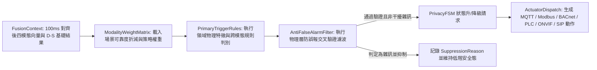
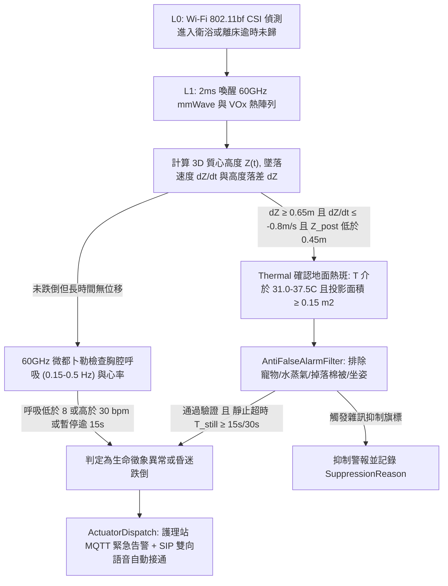
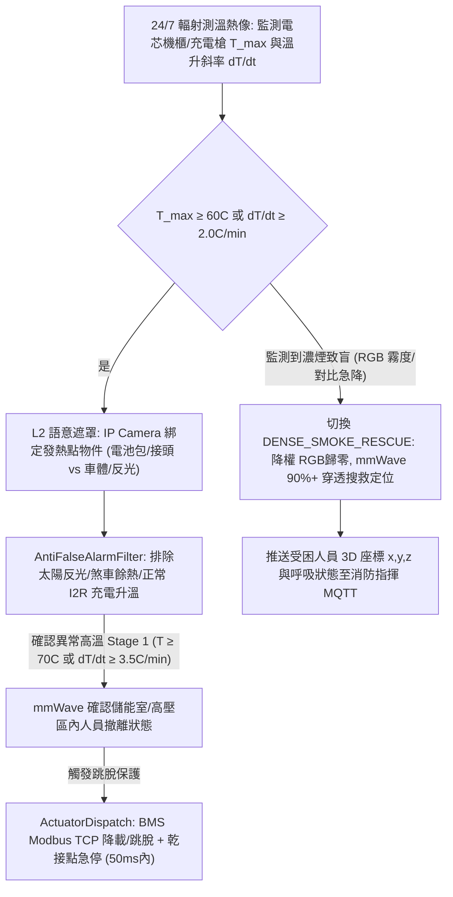
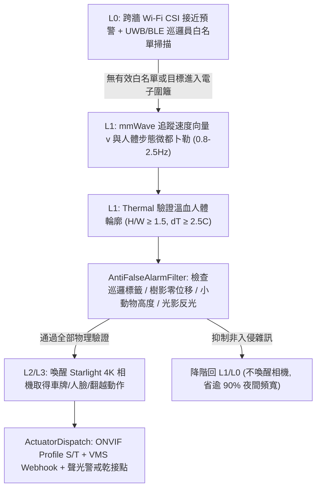
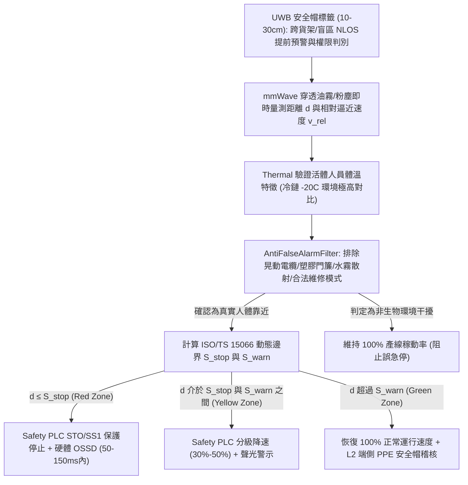
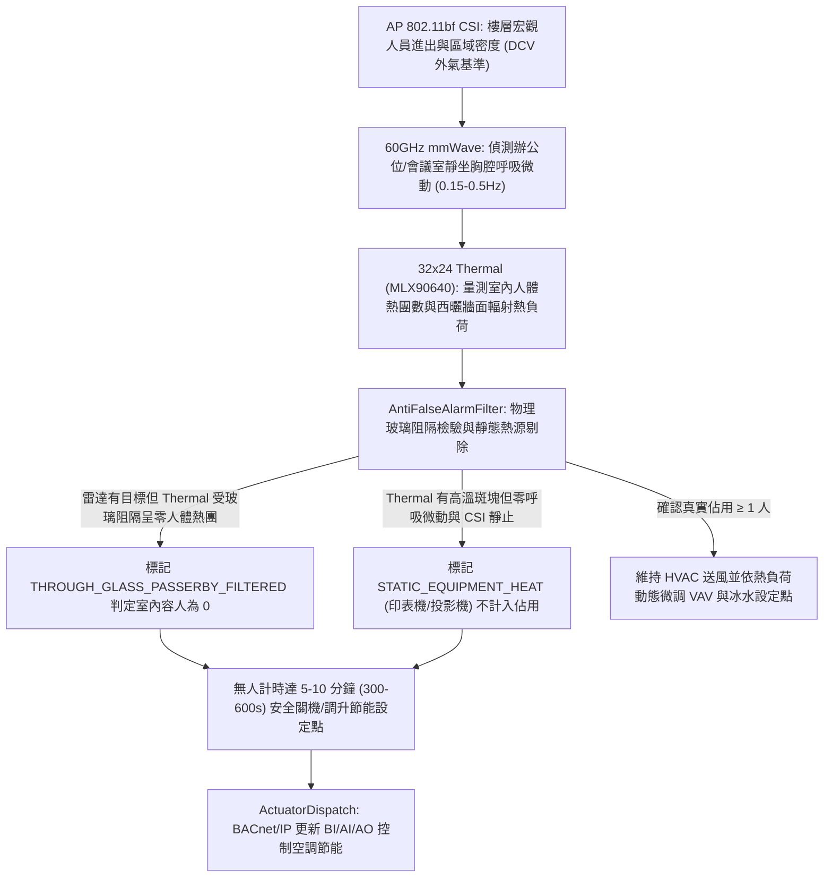

# 五大可插拔場景模組工程規格書（Pluggable Scenario Modules Specification）

> **文件編號**：`DOC-ISF-SCN-003`  
> **版本**：`v1.0.0-Baseline`  
> **關聯文件**：系統主架構、狀態機與 Dempster-Shafer 融合核心定義請參閱 [01_system_architecture_spec.md](file:///d:/AI_sensor_fusion/system_design/docs/01_system_architecture_spec.md)；領域評分與商業量化基準對齊 [research_report.md](file:///d:/AI_sensor_fusion/research_report.md) 第 3 章與 [prd_proposal_outline.md](file:///d:/AI_sensor_fusion/prd_proposal_outline.md)。  
> **架構定位**：本規格書定義可於運行期熱插拔切換（Hot-Swappable Plugin）的抽象場景引擎介面 `ScenarioModule`，並逐一給出 **Top 5 旗艦場景模組（A1、C4、B1、C1、B2）** 之具體數學閾值、四模態權重矩陣、防誤報物理濾波規則及北向工業／醫療／樓宇聯動介面。

---

## 1. 統一抽象介面 `ScenarioModule` 與執行管線規範

### 1.1 模組熱插拔執行管線架構

在四模態感測平台上，底層硬體驅動、PTP 同步、100 ms 滑動視窗對齊與 Dempster-Shafer 引擎均為場景無關（Scenario-Agnostic）之通用核心；所有垂直產業之物理判別閾值、隱私禁區政策、防誤報濾波鏈與北向控制協議皆封裝於實作 `ScenarioModule` 抽象介面的獨立外掛模組中。



*圖 1-1：可插拔場景模組 `ScenarioModule` 標準執行管線*

### 1.2 核心資料契約（`FusionContext` / `ModalityWeightMatrix` / `AntiFalseAlarmFilter` / `ActuatorDispatch`）

以下結構契約同時約束 Python 參考原型（`app/modules/base.py`）與 C++20 嵌入式策略核心（`include/scenario_profiles.hpp`）：

#### (1) 標準輸入向量：`FusionContext`

| 欄位名稱 | 資料型別 | 物理意義與工程來源 |
| :--- | :--- | :--- |
| `ptp_timestamp_ns` | `uint64` | IEEE 1588 PTP 基準時間戳（奈秒） |
| `hardware_profile` | `enum` | `phase1_distributed_mvp` / `phase2_all_in_one_tier2` / `tier3_industrial` |
| `privacy_level` | `enum` | 目前狀態機狀態 `L0` / `L1` / `L2` / `L2_DEG` / `L3` |
| `csi_features` | `CsiAlignedStats` | 100 ms 窗內聚合後之 Fresnel 方差、都卜勒能量、呼吸代理頻率、BLE/UWB 白名單標籤狀態 |
| `mmwave_tracks` | `List[RadarTrack]` | 卡爾曼外推至 `t_ref` 之 3D 位置 $(x, y, z)$、速度 $(v_x, v_y, v_z)$、$dZ/dt$、RCS、呼吸率與心率 |
| `thermal_stats` | `ThermalAlignedStats` | 環境基線溫度、全景峰值溫度、熱斑邊界框／質心、溫升斜率 $\Delta T / \Delta t$、熱斑投影面積 |
| `rgb_semantics` | `Optional[RgbDeidStats]` | **僅於 L2/L3 非空**：17 點 COCO 骨架、姿態分類、PPE 狀態、光學火煙/反光語意遮罩（L0/L1 必為 `null`） |
| `ds_result` | `DsFusionResult` | D-S 基礎合併結果：$\{m(N), m(A), m(\Theta), K, \text{Bel}(A), \text{Pl}(A)\}$ |
| `zone_metadata` | `ZoneGeometry` | 場域邊界參數（如衛浴標註、玻璃幕牆坐標邊界、機械臂工作半徑、BESS 機櫃座標） |

#### (2) 可調權重矩陣：`ModalityWeightMatrix`

```json
{
  "module_id": "A1",
  "allow_optical_l2": false,
  "require_77ghz_prohibition": true,
  "hysteresis_cooldown_sec": 45,
  "base_reliability_alpha": {
    "csi": 0.70,
    "mmwave": 0.95,
    "thermal": 0.85,
    "rgb": 0.00
  },
  "dynamic_degradation_policy": {
    "smoke_obscured_rgb_alpha": 0.00,
    "smoke_boost_radar_alpha": 0.98,
    "ffc_freeze_thermal_alpha": 0.00
  },
  "decision_thresholds": {
    "l1_wake_csi_var": 0.55,
    "l2_escalate_belief": 0.65,
    "l3_critical_belief": 0.85,
    "confirm_frames_required": 3
  }
}
```

#### (3) 防誤報濾波器介面：`AntiFalseAlarmFilter`

每個場景模組須實作有序濾波器鏈（Filter Chain），依序對初步警報候選進行物理一致性質詢，輸出標準結構 `FilterVerdict`：
* `suppressed` (`bool`)：是否判定為物理雜訊或合法安全事件而予以抑制。
* `reason_code` (`string`)：標準化抑制碼，供戰情室稽核與模型微調追蹤，包含：`PET_OR_ROBOT_VACUUM`、`BATHROOM_STEAM_DRIFT`、`NON_HUMAN_OBJECT_DROP`、`NORMAL_SITTING_RECOVERY`、`SOLAR_OR_VEHICLE_EXHAUST_HEAT`、`AUTHORIZED_PATROL_WHITELIST`、`FOLIAGE_RAIN_ZERO_NET_DISPLACEMENT`、`SMALL_ANIMAL_HEIGHT_LOW`、`OPTICAL_GLARE_RADAR_MISMATCH`、`SWINGING_CABLE_NO_THERMAL`、`WATER_MIST_CLUTTER`、`THROUGH_GLASS_PASSERBY_FILTERED`、`STATIC_EQUIPMENT_HEAT`。
* `adjusted_ds_mass` (`DsMassVector`)：當環境明確違反單模態假設時（如濃煙中光學失明、穿透玻璃誤觸），依濾波規則重設衝突模態 $\alpha_i$ 並重算真實信念。

#### (4) 北向外部聯動動作：`ActuatorDispatch`

```json
{
  "dispatch_id": "dsp-20261122-001",
  "ptp_timestamp_ns": 1795240188100000000,
  "module_id": "C4",
  "priority": "CRITICAL_IMMEDIATE",
  "protocol": "MODBUS_TCP",
  "target_endpoint": "10.10.20.15:502",
  "action_code": "EMERGENCY_CONTACTOR_TRIP",
  "payload": {
    "unit_id": 1,
    "coil_address": 40001,
    "value": 1,
    "interlock_human_clear_verified": true
  },
  "sla_max_latency_ms": 50,
  "fallback_protocol": "DRY_CONTACT_RELAY_CH1"
}
```

### 1.3 五大旗艦場景模組能力與架構對照總表

| 模組代號 | 旗艦排名／評分 | 核心痛點解決目標 | L2 攝影機政策 | 核心融合權重傾向（$\alpha$） | 主要防誤報過濾對象 | 北向對接協議 |
| :---: | :---: | :--- | :--- | :--- | :--- | :--- |
| **A1** | #1（93.3 分） | 長照衛浴／臥室零穿戴跌倒與呼吸驟停 | 衛浴 **100% 鎖死禁用**；走廊／客廳按需去識別化骨架 | mmWave (0.95) + Thermal (0.85) + CSI (0.75) | 寵物、掃地機、水蒸氣、掉落毛巾棉被、緩慢坐下 | MQTT 護理鈴、SIP/VoIP 自動通話、HL7 FHIR |
| **C4** | #2（90.9 分） | BESS 儲能／配電室 Stage 1 熱失控截斷＋濃煙搜救 | 火災/濃煙下 **自動歸零 $\alpha_{\text{rgb}}\to 0$**；日常防車輛餘熱誤報啟用 ROI | Thermal (0.95) + mmWave (0.95) + RGB (0.00–0.75) | 太陽直射車頂、高溫煞車碟盤/排氣管、正常充放電溫升 | BMS Modbus TCP、Fail-Safe 乾接點、消防搜救 MQTT |
| **B1** | #3（88.1 分） | 關鍵園區／倉儲全天候零誤報周界入侵 | 圍牆外零錄影；翻越禁區且非白名單始喚醒 L2/L3 | mmWave (0.92) + Thermal (0.88) + UWB/BLE 白名單 | 授權巡邏員、搖晃樹影、貓狗飛鳥、暴雨反光、熱閃爍 | ONVIF Profile S/T、VMS Webhook、聲光乾接點 |
| **C1** | #4（87.7 分） | 人機協作（HRC）／冷鏈倉儲盲區動態防撞 | 端側去識別化防窺（人臉即刻抹除），僅稽核 PPE | mmWave (0.95) + UWB (0.95) + Thermal (0.85) | 垂掛晃動電纜、塑膠門簾、冷鏈結霧水氣、掉落紙箱 | Safety PLC PROFINET/PROFIsafe、Modbus TCP、OSSD |
| **B2** | #5（87.3 分） | 商辦微氣候 HVAC 零 False-Off 節能與夜間安防 | **日間辦公 100% 關閉**；僅下班保全模式開啟 | mmWave (0.92) + Thermal (0.90) + CSI (0.85) | **玻璃隔間外走廊路人**、靜態設備發熱（印表機/投影機） | BACnet/IP（ASHRAE 135 `BI/AI/AO/BV`）、BMS MQTT |

---

## 2. 模組 A1：銀髮居家／長照衛浴零穿戴跌倒與生命徵象守護

### 2.1 場景痛點、法規紅線與四模態權重設計

* **核心痛點**：高達 **23%** 長者未依規配戴穿戴裝置（洗澡、如廁、就寢高風險時段幾乎全數取下）；傳統醫療警報 **80%–99% 為誤報**引發護理站警報疲勞；純攝影機違反 GDPR Article 5/9 及衛浴倫理（「Granny Cam」拒裝）。
* **硬體與法規約束**：強制鎖定 **60 GHz 雷達**（如 TI IWR6843AOP / IWRL6432）搭配無鏡頭熱陣列（MLX90640 32×24 或 Lepton 3.5 160×120）構成衛浴/臥室 IP54 感測 Pod；設定 `allow_optical_l2 = false`（衛浴與臥室硬體級無鏡頭，走廊端選配可依授權啟動 L2 骨架）。
* **四模態權重與可靠度配置**：`alpha_mmwave = 0.95`, `alpha_thermal = 0.85`, `alpha_csi = 0.75`, `alpha_rgb = 0.00`（衛浴模式）。

### 2.2 跌倒與生命徵象判別演算法及參數閾值



*圖 2-1：模組 A1 長照衛浴零穿戴跌倒與生命徵象判別流程圖*

| 評估子項 | 參數代號 | 具體工程閾值 | 物理判別邏輯說明 |
| :--- | :--- | :--- | :--- |
| **跌倒高度落差** | `delta_z_drop_m` | **$\ge 0.65\text{ m}$**（1.5 秒內） | 從站立／行走質心高度（$Z > 1.05\text{ m}$）急降至接近地面（$Z_{\text{post}} < 0.45\text{ m}$）。 |
| **墜落垂直速度** | `vz_fall_mps` | **$\le -0.80\text{ m/s}$** | 區分急墜跌倒與緩慢彎腰/蹲下（緩慢沿牆滑倒另採 $Z_{\text{post}} < 0.40\text{ m}$ 且持續靜止確認）。 |
| **倒地靜止超時** | `stillness_warn_s` / `crit_s` | 預警 **$15\text{ s}$** / 確認 **$30\text{–}60\text{ s}$** | 預留 15 s 短暫觀察窗允許長者自行爬起；若逾 30 s 無法起身或呼吸微弱立即升級危急警報。 |
| **胸腔呼吸異常** | `resp_rate_bpm` / `apnea_s` | 正常 $10\text{–}24\text{ bpm}$；過緩 **$< 8$** / 過促 **$> 30$**；暫停 **$> 15\text{–}20\text{ s}$** | 60 GHz 相位微都卜勒（0.15–0.5 Hz 帶通）持續量測亞毫米級胸腔起伏。 |
| **心率異常警戒** | `heart_rate_bpm` | **$< 45\text{ bpm}$ 或 $> 130\text{ bpm}$**（$\pm 5\text{ bpm}$） | 靜止躺臥時透過 0.8–2.2 Hz 諧波濾波提取輔助判定休克或心律失常。 |
| **人體熱斑驗證** | `human_temp_c` / `area_m2` | **$31.0^\circ\text{C} \text{–} 37.5^\circ\text{C}$**，面積 **$\ge 0.15\text{ m}^2$** | 確認倒地物具人類體表熱輻射；同步監測異常體表高熱（$>38.2^\circ\text{C}$ 發燒）或低溫失溫風險。 |

### 2.3 防誤報濾波器（`AntiFalseAlarmFilter`）詳細規則

1. **寵物與掃地機器人過濾（`PET_OR_ROBOT_VACUUM`）**：追蹤目標歷史軌跡，若目標進入房間以來最大質心高度始終 $Z_{\max} < 0.55\text{ m}$（從未呈現直立人體高度）且雷達散射截面 RCS 偏低或熱斑面積 $< 0.10\text{ m}^2$，直接判定為寵物／掃地機並抑制跌倒告警。
2. **衛浴熱水蒸氣與淋浴干擾過濾（`BATHROOM_STEAM_DRIFT`）**：60 GHz 毫米波波長（~5 mm）可直接穿透水蒸氣，不會因霧氣產生假位移；熱水蒸氣在 Thermal 呈擴散均勻緩升溫（空間梯度平緩）且無集中之地面墜落高速 $dZ/dt$ 軌跡與 0.15–0.5 Hz 胸腔呼吸特徵，當 `thermal_diffuse_drift == true && mmwave_fall_kinematics == false` 時抑制告警。
3. **掉落棉被／枕頭／大浴巾過濾（`NON_HUMAN_OBJECT_DROP`）**：床單或濕毛巾掉落雖瞬間觸發雷達墜落速度，但落點熱斑溫度趨近室溫（$|T_{\text{blob}} - T_{\text{floor}}| < 2.0^\circ\text{C}$）且零後續胸腔呼吸微都卜勒，雙物理交叉驗證即刻剔除。
4. **正常坐臥／如廁起身復位（`NORMAL_SITTING_RECOVERY`）**：在預置坐便器／床緣地理圍欄（$Z \in [0.40, 0.65]\text{ m}$）內坐下或於 $15\text{ s}$ 觀察窗內重心回升至 $Z > 0.80\text{ m}$，自動降階為正常日常作息。

### 2.4 北向護理聯動規格與量化 KPI

* **護理站 MQTT 聯動（`isf/{site}/{room}/{node}/events/alert`）**：QoS 1 發送 `{event_type: "FALL_CONFIRMED" | "APNEA_ALERT", posture_z_m, stillness_s, resp_bpm, heart_bpm, privacy_mode: "CAMERA_LOCKED_OFF"}`，同步對接醫院／機構護理資訊系統（HL7 FHIR `Observation` Webhook）。
* **SIP / VoIP 雙向語音緊急通話**：於 `CRITICAL` 確證後自動向護理站分機發起 `SIP INVITE`（G.711/Opus 64 kbps），自動開啟房間端麥克風與揚聲器進行無接觸語音關懷；併提供硬體乾接點輸出（NO/NC）直接並聯既有床頭拉繩護理鈴總機。
* **驗收 KPI**：衛浴/臥室跌倒靈敏度 **$\ge 95\%$**（MVP）至 **$\ge 97\%\text{–}99\%$**（量產）；實務環境誤報率較單模態下降 **75%–90%**；從觸地到發出確認告警總延遲 **1.5–3.0 s**（含自我起身觀察窗）；常態頻寬節省 **$> 95\%$**。

---

## 3. 模組 C4：BESS 儲能站／配電室熱失控 Stage 1 截斷與濃煙搜救

### 3.1 場景痛點、熱失控三階段與雙模動態切換

* **核心痛點**：鋰電池熱失控依序經歷 **Stage 1（微短路內部異常升溫，60–120°C，早於冒煙數分至數十分鐘）→ Stage 2（130–200°C+ 排氣閥開啟噴出有毒可燃氣體）→ Stage 3（$>1000^\circ\text{C}$ 射流火焰與極濃黑毒煙）**。傳統煙感在通風強的 BESS 貨櫃與開放 EV 超充場嚴重滯後；純熱像儀常被夏季烈日直射深色車頂與高溫煞車碟盤誤觸發；起火後濃煙又讓光學鏡頭瞬間致盲，無法定位受困維運員或車主。
* **雙運行子模式權重設計**：
  * **子模式 1 — 預防性溫控與防誤報（`PRE_IGNITION_PREVENTION`）**：`alpha_thermal = 0.95`, `alpha_rgb = 0.75`（語意區分充電座 vs. 車體煞車/排氣管）, `alpha_mmwave = 0.85`（跳脫前人員撤離確認）, `alpha_csi = 0.60`。
  * **子模式 2 — 濃煙致盲災時搜救（`DENSE_SMOKE_RESCUE`）**：當光學對比度／能見度指標驟降（Smoke Obscuration $> 70\%$），系統動態執行 **`alpha_rgb = 0.00`** 並將 **`alpha_mmwave = 0.98`**、**`alpha_thermal = 0.85`** 設為主導，穿透 0 m 能見度黑煙持續標定人員座標與生命徵象。

### 3.2 熱失控截斷與濃煙搜救判別規則及閾值表



*圖 3-1：模組 C4 BESS 熱失控 Stage 1 截斷與濃煙穿透搜救流程圖*

| 評估子項 | 參數代號 | 具體工程閾值 | 物理判別邏輯說明 |
| :--- | :--- | :--- | :--- |
| **Stage 1 預警溫度** | `temp_warn_c` | **$T_{\max} \ge 60.0^\circ\text{C}$** 且 $\Delta T_{\text{excess}} \ge 15^\circ\text{C}$ | 相對於同排相鄰正常電池櫃／充電槍基線溫度高出 $15^\circ\text{C}$ 以上。 |
| **關鍵斷電截斷溫度** | `temp_trip_c` | **$T_{\max} \ge 70.0^\circ\text{C}$**（或接點 **$> 85^\circ\text{C}$**） | 觸發 Stage 1 高優先級警報並連動 BMS 限制電流或跳脫主接觸器（Lepton 3.5 高增益支援至 **+400°C**）。 |
| **異常溫升斜率** | `rise_rate_c_min` | 預警 **$\ge 2.0^\circ\text{C/min}$**；急停 **$\ge 3.5\text{–}5.0^\circ\text{C/min}$** | 連續滑動回歸 30–60 秒溫度趨勢，在表面溫度尚未達 70°C 前搶先偵測內部微短路劇烈放熱。 |
| **濃煙能見度切換** | `smoke_obscure_idx` | `rgb_contrast_score < 0.15` 且 `thermal_smoke_haze == true` | 判定進入濃煙全盲環境，無條件切換至 `DENSE_SMOKE_RESCUE`，依賴 60/77 GHz 雷達鎖定人體。 |
| **災時搜救人員確認** | `rescue_vital_conf` | 3D 點雲軌跡 + 微都卜勒呼吸 **$\ge 0.65$** | 穿透極濃黑煙與明火煙霧維持 **$\ge 90\%$** 人員定位率，區分倒地消防員／作業員與靜止金屬櫃。 |

### 3.3 防誤報濾波器（`AntiFalseAlarmFilter`）與工業聯動規格

* **防誤報規則**：
  1. **太陽反光與車輛高溫部件遮罩（`SOLAR_OR_VEHICLE_EXHAUST_HEAT`）**：於戶外 EV 超充場，L2 攝影機進行語意區域分割，將「汽車前蓋引擎區、煞車碟盤輪拱、排氣管尾段」劃為合法高溫 ROI 遮罩區；同時針對低放射率光滑金屬（$\varepsilon < 0.2$）隨日照角度移動的鏡面高溫假點，結合攝影機紋理辨識予以剔除，**消除 85%–95% 陽光熱反射與車體餘熱誤報**。
  2. **正常快充 $I^2 R$ 溫升容許曲線**：透過 Modbus 讀取 BMS 即時充電電流 $I_{\text{chg}}$，當溫升斜率符合預期焦耳熱模型且峰值 $< 55^\circ\text{C}$ 時標記為安全。
* **BMS / EMS Modbus TCP 暫存器映射規格（Unit ID = `1`, Port `502`）**：

| Modbus 位址 | 暫存器類型 | 欄位名稱 | 數值定義與縮放比例 | 觸發延遲 SLA |
| :--- | :--- | :--- | :--- | :--- |
| `0x0001` (Coil) | Read/Write Coil | `BESS_EMERGENCY_TRIP` | `1` = 請求 BMS 立即切斷直流接觸器（跳脫前先檢查 `ZONE_OCCUPIED == 0` 或發廣播警告） | **`< 50 ms`**（同步硬線乾接點繼電器） |
| `0x0002` (Coil) | Read/Write Coil | `CHARGER_POWER_DERATE` | `1` = Stage 1 預警請求充電電流降載 50% | `< 150 ms` |
| `40001` (HR) | Holding Register (`uint16`) | `ZONE_MAX_TEMP_DECI_C` | 最高監測溫度 $\times 10$（例如 `684` = `68.4°C`） | 週期 1 Hz 更新 |
| `40002` (HR) | Holding Register (`int16`) | `TEMP_SLOPE_CENTI_MIN` | 最大溫升斜率 $\times 100$（例如 `385` = `3.85°C/min`） | 週期 1 Hz 更新 |
| `40003` (HR) | Holding Register (`uint16`) | `TRAPPED_PERSONNEL_CNT` | 濃煙搜救模式偵測到之人員數量（0–65535） | 週期 10 Hz 更新 |

* **驗收 KPI**：較傳統光電煙感提前 **$\ge 3\text{ 分鐘}$ 至數十分鐘**（配電接頭漸進劣化可提前 **3–18 個月**）；濃煙 0 m 能見度下雷達人員定位率 **$\ge 90\%$**；協助關鍵電力設施減少高達 **73%** 非計畫停機風險。

---

## 4. 模組 B1：關鍵園區／倉儲全天候零誤報周界入侵偵測

### 4.1 場景痛點、法規合規與四模態分工

* **核心痛點**：傳統周界紅外 PIR 每日產生 **20–50 次誤報**（風吹樹枝、昆蟲、光影劇變）；純熱像無法排除中大型溫血野生動物、夏季路面熱氣閃爍（Thermal Shimmer）且高階雙光 PTZ 單台高達 `$10,000–$35,000+ USD`；緊鄰公共道路之圍牆外側面臨嚴格路人隱私錄影禁止條款。
* **四模態權重設計**：`alpha_mmwave = 0.92`（戶外 77 GHz TI AWR2944 廣域追蹤；室內近牆限用 60 GHz）, `alpha_thermal = 0.88`, `alpha_csi = 0.70`（含 UWB/BLE 白名單核銷）, `alpha_rgb = 0.85`（僅翻越圍籬進入內部禁區於 L2/L3 喚醒）。

### 4.2 周界入侵判別規則與防誤報濾波鏈



*圖 4-1：模組 B1 關鍵園區零誤報周界入侵偵測流程圖*

| 評估子項 | 參數代號 | 具體工程閾值 | 物理判別邏輯說明 |
| :--- | :--- | :--- | :--- |
| **巡邏白名單比對** | `whitelist_match_dist_m` | UWB（`10–30 cm`）或 BLE AoA（`0.3–1.0 m`）配對半徑 **$\le 1.5\text{ m}$** | 驗證加密 UWB **STS（抗中繼）** 標籤或 BLE 簽章信標之時間位置吻合度，自動解防合法巡邏員。 |
| **入侵速度與步態** | `human_vel_mps` / `gait_hz` | 速度 **$\lvert v \rvert \in [0.4, 8.0]\text{ m/s}$**；微都卜勒步頻 **$0.8\text{–}2.5\text{ Hz}$** | 結合跨越多普勒頻譜之擺臂與雙腿週期微調特徵，明確區別人類步行／奔跑與無規律雜訊。 |
| **溫血人體輪廓驗證** | `aspect_ratio` / `delta_t_c` | 垂直長寬比 **$H/W \ge 1.5$**（直立）且 **$\Delta T_{\text{body-bg}} \ge 2.5^\circ\text{C}$** | 於夜間或濃霧（MOR ~13 m 仍達 $\ge 90\%$ 偵測）鎖定溫血直立人形；爬行模式則輔以熱面積與連續軌跡判定。 |

### 4.3 防誤報濾波器（`AntiFalseAlarmFilter`）與 VMS 聯動規格

* **四重誤報過濾邏輯**：
  1. **授權巡檢員白名單（`AUTHORIZED_PATROL_WHITELIST`）**：當 UWB/BLE 挑戰應答驗證合法且定位座標與雷達目標距離 $\le 1.5\text{ m}$ 時，自動標註為 `AUTHORIZED_GUARD` 並保持 Camera 關閉（免錄員工行蹤）。
  2. **搖晃樹枝／雨霧零位移振盪（`FOLIAGE_RAIN_ZERO_NET_DISPLACEMENT`）**：風吹樹影雖具高瞬時都卜勒速度，但 3 秒內淨空間位移向量 $\|\mathbf{p}(t) - \mathbf{p}(t-3\text{s})\| < 0.30\text{ m}$ 且 Thermal 無獨立溫血輪廓 $\to$ 立即過濾。
  3. **流浪貓狗／狐狸／鳥類（`SMALL_ANIMAL_HEIGHT_LOW`）**：雷達量測目標質心離地高度 $Z < 0.65\text{ m}$ 且 Thermal 輪廓寬高比呈現水平四足特徵（$W > H$）$\to$ 直接過濾。
  4. **車燈眩光與夏季熱氣閃爍（`OPTICAL_GLARE_RADAR_MISMATCH`）**：攝影機受對向車燈 Bloom 眩光或熱像路面 Thermal Shimmer 產生虛假框時，77/60 GHz 雷達無對應固體 RCS 軌跡（D-S 衝突高），由雷達物理存在事實否決虛假警報。
* **ONVIF / VMS 聯動規格（`ActuatorDispatch`）**：
  * 發送 **ONVIF Profile S/T** `tns1:RuleEngine/FieldDetector/ObjectsInside` 標準 XML 告警並呼叫 `SetSynchronizationPoint` 強制攝影機輸出加密關鍵幀，同時推送 JSON Webhook 至 Milestone / Genetec VMS 觸發電子圍籬地圖彈窗與 PTZ 預置點聯動、開啟高音警示器乾接點。
* **驗收 KPI**：綜合誤報率壓低至 **$< 1\text{–}2\text{ 次/百公尺/月}$**（相較傳統 PIR 降低 **$> 98\%$**）；夜間頻寬與儲存節省 **$> 90\%$**；部署 TCO 較全面雙光 PTZ 降低 **40%–60%**。

---

## 5. 模組 C1：智慧工廠人機協作（HRC）／倉儲粉塵冷鏈盲區防撞

### 5.1 場景痛點、ISO/TS 15066 法規與勞資隱私合規

* **核心痛點**：工業現場垂掛電纜晃動、塑膠門簾、水霧、焊煙與冷鏈結霧造成安全光柵與純視覺圍籬頻繁誤急停（False Stops），單次非計畫產線停機損失高達 **`$50,000–$260,000+ USD/小時`**；同時倉儲貨架轉角遮蔽（與 C3 共構）導致堆高機盲區碰撞；工會強烈反對 24/7 高清人臉監控職場表現。
* **法規與權重設計**：室內強制使用 **60 GHz 雷達** 搭配 **UWB（IEEE 802.15.4z, 10–30 cm）** 與工業 Thermal；`alpha_mmwave = 0.95`, `alpha_uwb_csi = 0.95`, `alpha_thermal = 0.85`, `alpha_rgb = 0.70`（端側 PPE 合規檢查後 `< 100 ms` 抹除人臉，僅留存匿名稽核事件）。

### 5.2 ISO/TS 15066 動態安全距離分級與防撞判別邏輯

依據 **ISO/TS 15066 Speed and Separation Monitoring（SSM）** 規範，系統在每一個 100 ms 對齊週期即時計算動態保護分離距離 $S_p(t_0)$：
$$S_p(t_0) = S_h + S_r + S_s + C + Z_d + Z_r$$
其中：
* $S_h = v_h \cdot (T_r + T_s)$：人員朝機械臂逼近之反應與煞停期間移動距離（由 mmWave 量測真實逼近速度 $v_{\text{rel}}$，系統反應時間 $T_r \le 0.05\text{ s}$，機械臂制動時間 $T_s$）；
* $S_r$：系統觸發期間機械臂移動距離；$S_s$：機械臂煞車滑行距離；
* $C$：身體部位（如手部伸入）預留侵入距離；$Z_d, Z_r$：感測器（mmWave 公分級 / UWB 10–30 cm）與機器人位置不確定裕度。



*圖 5-1：模組 C1 人機協作與倉儲盲區動態防撞決策流程圖*

| 分級安全區域 | 距離與物理觸發條件 | 對應機械臂 / AGV 控制策略 | 目標端對端延遲 |
| :--- | :--- | :--- | :--- |
| **Zone Green（安全作業）** | $d > S_{\text{warn}}$（典型 $> 2.5\text{ m}$）且無跨貨架 UWB 交會風險 | 維持 **100%** 額定速度；L2 端側隨機抽檢安全帽與反光背心（不存人臉） | 常態監控（20 Hz） |
| **Zone Yellow（分級減速預警）** | $S_{\text{stop}} < d \le S_{\text{warn}}$（典型 $1.2\text{–}2.5\text{ m}$）或 **UWB 偵測貨架轉角盲區人員逼近** | 下發限速指令將速度線性調降至 **30%–50%**，啟動堆高機／機械臂黃燈與方向警報 | **`< 100 ms`** |
| **Zone Red（保護性停止）** | $d \le S_{\text{stop}}(v_{\text{rel}})$（依逼近速度動態計算，典型 $\le 0.6\text{–}1.2\text{ m}$） | 立即觸發 Safety PLC **`STO` / `SS1` 安全停機** 與雙通道 OSSD 繼電器斷開 | **`< 50–150 ms`** |

### 5.3 防誤報濾波器（`AntiFalseAlarmFilter`）與 Safety PLC 聯動規格

* **三大誤停機防禦規則**：
  1. **垂掛晃動電纜／塑膠門簾／掉落紙箱過濾（`SWINGING_CABLE_NO_THERMAL`）**：當 mmWave 偵測進入圍籬之物體時，檢查對應投影區域之 Thermal 溫差：若目標表面溫度與環境設備一致（$\Delta T_{\text{target-env}} < 2.0^\circ\text{C}$，非裸手/人體散熱特徵）且無配戴人員 UWB 標籤，則判定為無生命機械晃動或門簾擺動，**自動抑制 E-Stop 誤停機**（維持安全減速監看或放行）。
  2. **水霧／焊煙／冷鏈結霧雜訊過濾（`WATER_MIST_CLUTTER`）**：水霧與懸浮微粒對 60 GHz 雷達散射截面積（RCS）極低且點雲分布離散不具連續軌跡（$\ge 3$ 幀卡爾曼軌跡關聯失敗），搭配 Thermal 無局部高溫生物輪廓，予以直接濾除。
  3. **授權維修人員協作模式**：若 UWB 讀取到具備 `SUPERVISOR_MAINT` 加密憑證之安全帽標籤，且機械臂處於低速示教模式（$< 250\text{ mm/s}$），依授權策略動態縮小安全半徑。
* **Safety PLC 北向聯動規格（PROFINET / PROFIsafe & Modbus TCP + OSSD）**：
  * **硬體安全看門狗（Heartbeat Watchdog）**：邊緣閘道與 Safety PLC 之間每 **20 ms** 交換一次遞增序號心跳封包；若逾 **`50 ms`** 未收到有效心跳，Safety PLC 依 Fail-Safe 原則自動進入 `Zone Yellow/Red` 保護態。
  * **資料介面**：PROFINET IO Cyclic Data（16-bit `Safe_Speed_Limit_Pct` `0–1000` 千分比、`Protective_Stop_Req` Boolean、`Active_Human_Count`、`Fault_Code`），並與硬體隔離雙通道乾接點安全繼電器並聯輸出。
* **驗收 KPI**：相較傳統 2D 安全光柵與純視覺圍籬，**減少 70%–85% 不必要誤急停停機**；端對端邊緣至 PLC 反應延遲 **`< 50–150 ms`**。

---

## 6. 模組 B2：智慧商辦微氣候 HVAC 零 False-Off 節能與夜間安防

### 6.1 場景痛點、日夜雙模式切換與四模態分工

* **核心痛點**：傳統紅外 PIR 無法感知靜坐打字或安靜開會人員，頻繁「False-Off」誤關冷氣照明引發客訴，迫使大樓物業設定長達 **30–60 分鐘「無人延遲關機」** 造成巨額空房能耗；若單用 60 GHz 雷達，電波會**穿透玻璃隔間偵測走廊經過路人**導致會議室冷氣徹夜空轉；上班時段裝攝影機點算人頭則觸犯職場隱私反彈。
* **雙運行模式設計**：
  * **日間辦公節能模式（`DAY_HVAC_MODE`, e.g. `07:30–20:30`）**：**IP Camera 100% 硬體待機關閉（$\alpha_{\text{rgb}} = 0.00$）**，完全依賴吸頂 AP 既有的 **802.11bf CSI（$\alpha_{\text{csi}} = 0.85$）+ 60 GHz mmWave 靜坐呼吸微動（$\alpha_{\text{mmwave}} = 0.92$）+ 32×24 Thermal MLX90640（$\alpha_{\text{thermal}} = 0.90$）**。
  * **夜間保全安防模式（`NIGHT_SECURITY_MODE`, e.g. `20:30–07:30`）**：HVAC 轉為離峰節能/關機，若 CSI + 雷達 + 熱像跨模態確認異常人員闖入（非合法加班/清潔白名單），始喚醒 L2 去識別化骨架或 L3 加密存證通報大樓中控。

### 6.2 零 False-Off 判別、玻璃穿透阻斷與靜態熱源濾波



*圖 6-1：模組 B2 智慧商辦零 False-Off 與玻璃外行人過濾流程圖*

| 評估子項 | 參數代號 | 具體工程閾值 | 物理判別邏輯說明 |
| :--- | :--- | :--- | :--- |
| **靜坐微動存在確認** | `micro_resp_conf` | 胸腔呼吸頻帶 $0.15\text{–}0.5\text{ Hz}$ 能量 **$> \text{SNR } 8\text{ dB}$** | 即使人員完全靜止打字或冥想，mmWave 仍精準鎖定「有人」，徹底終結 PIR False-Off。 |
| **無人確認關機延遲** | `vacant_turnoff_s` | **5–10 分鐘（`300–600 s`）** 遲滯確認 | 相較傳統 PIR 需留 30–60 分鐘緩衝，確認全室零 CSI 波動＋零呼吸＋零人體熱團即可安全關機。 |
| **玻璃隔間外行人過濾** | `glass_bleed_filter` | `mmwave_target == true` 但 `thermal_human_blob == false` 且座標鄰近玻璃邊界 | **利用 LWIR 8–14 µm 物理上無法穿透玻璃**之特性，一旦雷達穿過玻璃看到走廊路人而熱像看不見室內體溫，立即判定 `THROUGH_GLASS_PASSERBY_FILTERED`，防止整夜誤開冷氣。 |
| **靜態設備熱源過濾** | `static_heat_filter` | `hotspot_temp > 38°C` 但 `csi_var < 0.1` 且 `radar_breathing == false` 逾 60 s | 排除忘記關機之投影機、雷射印表機、伺服器或日光斜射地板發熱塊（`STATIC_EQUIPMENT_HEAT`）。 |
| **微氣候熱負荷微調** | `radiant_load_offset_c` | 室內平均輻射溫度與人數補償 $\Delta T_{\text{set}} \in [-1.5, +2.0]^\circ\text{C}$ | 依 32×24 熱像感測實際人體密度與西曬玻璃輻射熱，動態補償 VAV 風閥開度與設定點。 |

### 6.3 北向樓宇自控 BACnet/IP（ASHRAE 135）物件規格與量化 KPI

Edge AP / 閘道內建標準 **BACnet/IP Server（UDP Port `47808`）**，直接暴露標準 BACnet 物件供既有樓宇自動化系統（BAS / BMS）訂閱（COV, Change of Value）或輪詢：

| BACnet Object ID | Object Type | Object Name | 單位 / 狀態定義 | 更新策略與節能控制意義 |
| :--- | :--- | :--- | :--- | :--- |
| `BI:1` | Binary Input | `Zone_True_Occupancy` | `ACTIVE (1)` = 有人 / `INACTIVE (0)` = 確認無人 | 結合防玻璃誤觸與靜態呼吸，作為空調與照明啟閉總開關（延遲壓縮至 5–10 分鐘）。 |
| `AI:1` | Analog Input | `Zone_Estimated_Headcount` | `0.0 – 50.0` 人（CSI + Thermal 熱團綜合估算） | 提供 Demand-Controlled Ventilation（DCV）精準調整外氣引入比例。 |
| `AI:2` | Analog Input | `Zone_Radiant_Temp_C` | `°C`（32×24 Thermal 排除人體後之牆窗輻射均溫） | 提前偵測西曬玻璃輻射熱負荷，消除傳統壁掛溫控器反應遲鈍問題。 |
| `AO:1` | Analog Output | `VAV_Damper_Trim_Pct` | `0.0 – 100.0 %`（建議 VAV 風閥開度補償值） | 依即時人數與熱負荷平滑輸出建議控制量至 VAV 控制器。 |
| `BV:1` | Binary Value | `Night_Security_Intrusion` | `ACTIVE (1)` = 夜間非授權異常入侵告警 | 僅於 `NIGHT_SECURITY_MODE` 啟動，連動保全中心與大樓門禁。 |

* **驗收 KPI**：空房關機延遲由 **30–60 分鐘** 縮短至 **5–10 分鐘**；辦公時段 **100% 零攝影機錄影**；較傳統 PIR／定時系統額外節省 **15%–25% HVAC 與照明電費**；複用天花板 Wi-Fi AP 改造成本極低，高電價商辦約 **1.5–2.5 年回本**。

---

## 7. 五大場景跨模組整合驗證與測試注入矩陣（Verification Matrix）

為確保文件規格與 Python POC 模擬器及 C++20 嵌入式單元測試 100% 一致，下表規範系統出廠與試點驗收必測之 **11 項標準注入情境（真陽性觸發 vs. 蓄意誤報雜訊對照）**：

| 測試情境 ID | 啟用模組 | 輸入特徵設計（四模態組合） | 預期 D-S 融合與防誤報行為 | 預期狀態機目標與北向 `ActuatorDispatch` |
| :--- | :---: | :--- | :--- | :--- |
| `normal_empty` | 全模組 | CSI 方差 `< 0.1`、雷達無目標、Thermal 環境均溫、RGB 關閉 | `Bel(Alert) < 0.05`；維持極低功耗靜默 | 停留 **`L0`**；對外頻寬 `< 2–5 kbps` |
| `normal_activity` | 全模組 | CSI 有擾動或有合法白名單、人員正常走動坐臥、體溫正常 | `Bel(Alert) < 0.30`；無異常告警 | 處於 **`L1`**（或白名單減低介入），RGB 保持關閉 |
| `a1_bathroom_fall` | `A1` | $dZ = -0.95\text{ m}$、$dZ/dt = -1.1\text{ m/s}$、靜止 $>30\text{ s}$、呼吸 9 bpm、地面熱斑 35.5°C | **真陽性確認**：非視覺雙重物理確證跌倒 | 衛浴禁開鏡頭鎖定 **`L1 → L3（非視覺通報）`**；觸發護理站 MQTT + SIP 通話 |
| `a1_pet_false_alarm` | `A1` | 歷史最高高度 $Z_{\max} = 0.38\text{ m}$ 快速竄動、衛浴蒸氣緩慢升溫 | 觸發 **`PET_OR_ROBOT_VACUUM` / `BATHROOM_STEAM_DRIFT`** 抑制 | 維持安全觀察或防抖後回 **`L0`**；**零誤報發送** |
| `c4_thermal_runaway_smoke` | `C4` | $T_{\max} = 69.5^\circ\text{C}$、$\Delta T/\Delta t = 4.2^\circ\text{C/min}$、濃煙致盲 `rgb_contrast = 0.05`、雷達測得受困者 | 動態降權 $\alpha_{\text{rgb}} \to 0$，升權雷達濃煙追蹤與熱失控確認 | 升至 **`L3`**；Modbus `0x0001` 跳脫 + 推送消防 3D 搜救座標 |
| `b1_perimeter_intrusion` | `B1` | 無白名單標籤、$|v| = 1.6\text{ m/s}$ 人體步態、熱斑 $H/W = 1.8, \Delta T = 4.5^\circ\text{C}$ | 通過 UWB/BLE 白名單核對無符合 $\to$ 確認非授權入侵 | **`L1 → L2（去識別化）→ L3`** 喚醒 Starlight 取證並送 ONVIF/VMS Webhook |
| `b1_sunlight_animal_noise` | `B1` | 光學強烈反光 + 低矮目標 $Z = 0.42\text{ m}$ 或零淨位移樹影振盪 | 觸發 **`SMALL_ANIMAL_HEIGHT_LOW` / `OPTICAL_GLARE_RADAR_MISMATCH`** | 抑制入侵警報、禁止不必要 L3 錄影，防抖後降回 `L0` |
| `c1_hrc_collision_risk` | `C1` | UWB 盲區逼近 + mmWave $d = 0.75\text{ m} \le S_{\text{stop}}$ + 熱斑確認人體 36.2°C | 計算 ISO/TS 15066 動態邊界成立；L2 檢查安全帽同時抹除人臉 | **`L1 → L2/L3`**；`< 50–150 ms` 下發 Safety PLC `STO` 停機與 OSSD |
| `c1_cable_water_mist_noise` | `C1` | 機械臂旁電纜晃動 $v = 0.9\text{ m/s}$ + 水霧散射點雲，Thermal $\Delta T = 0.4^\circ\text{C}$、無 UWB | 觸發 **`SWINGING_CABLE_NO_THERMAL` / `WATER_MIST_CLUTTER`** | **阻止產線誤急停（No False Stop）**；維持正常生產與 OEE |
| `b2_hvac_glass_passerby` | `B2` | 會議室內無人、走廊路人穿過玻璃使 mmWave 測得動靜、Thermal 室內無熱斑 | 觸發 **`THROUGH_GLASS_PASSERBY_FILTERED`** | 維持無人計時，滿 5–10 分鐘後 BACnet `BI:1 = 0` 關閉空調 |
| `b2_office_occupied` | `B2` | 人員靜坐打字（宏觀 $v \approx 0$）、60 GHz 測得呼吸 16 bpm、Thermal 3 人熱團 | 確認真實佔用，**消除 PIR False-Off**；日間 Camera 保持關閉 | 維持 **`L1`**；BACnet `BI:1 = 1, AI:1 = 3.0` 維持舒適送風 |
